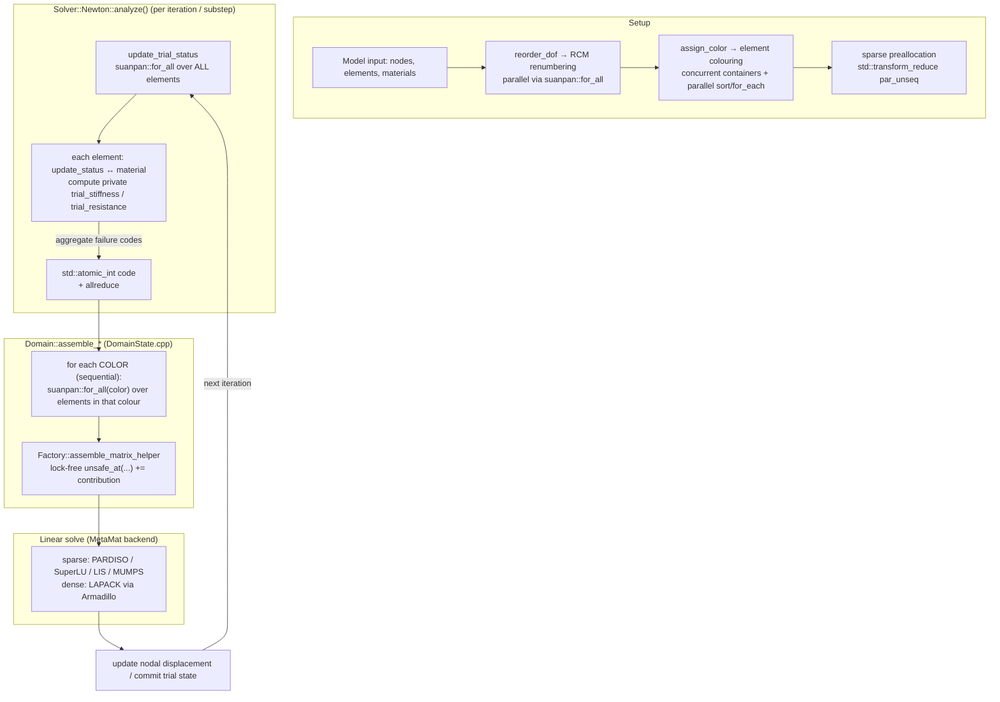
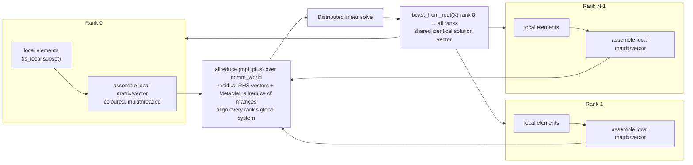
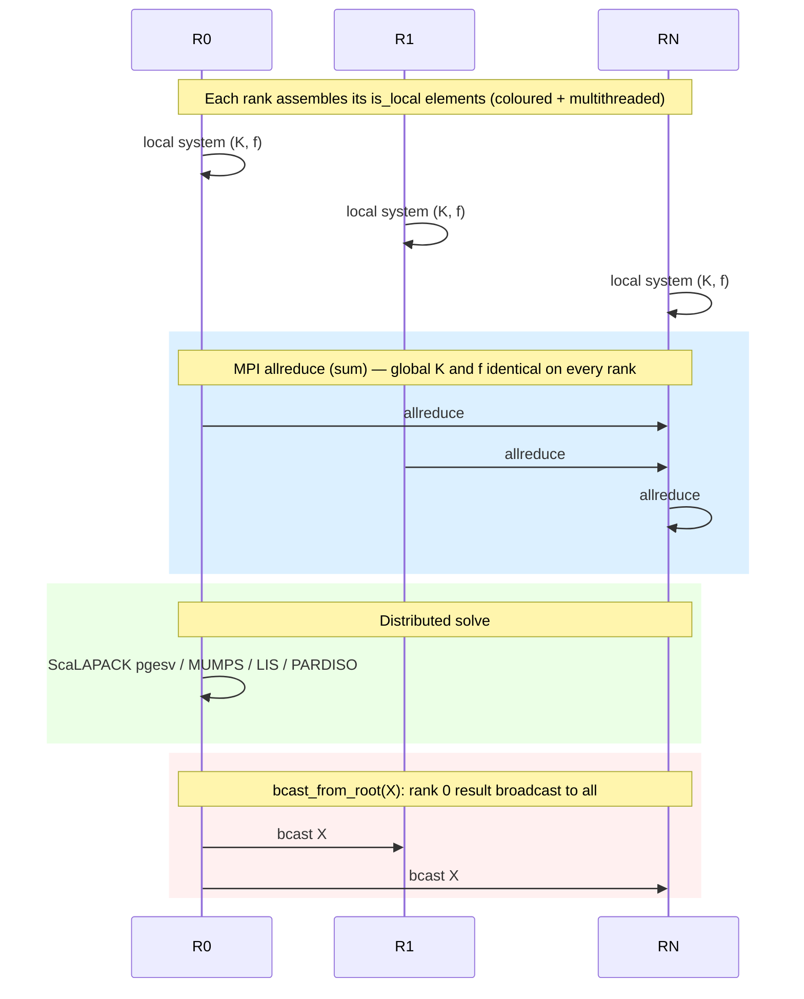
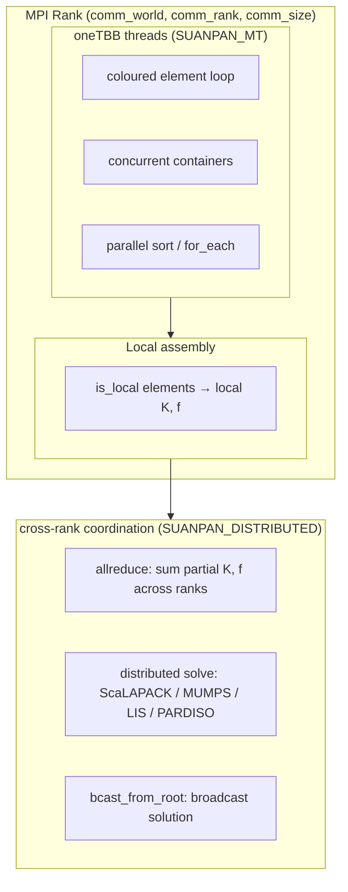

# Parallelism Mechanisms in suanPan

**An analysis of shared-memory (thread-based) and distributed-memory (cluster/MPI) parallelism in the suanPan finite element framework.**

---

## 1. Overview

suanPan is an open-source finite element framework whose performance-critical compute path (element stiffness computation, global system assembly, and linear solving) is parallelised at **two distinct levels**:

| Parallelism | Layer / Abstraction | Backend | Build switch | Compile definition |
|---|---|---|---|---|
| **Shared memory** (node-level threads) | Element & assembly loops | oneTBB (Threading Building Blocks) | `SP_BUILD_PARALLEL` | `SUANPAN_MT` |
| Shared memory (BLAS) | Linear algebra kernels | Intel MKL / OpenMP | `SP_ENABLE_MKL` | `SUANPAN_MKL` |
| **Distributed memory** (cluster) | Cross-rank assembly & solving | MPI via the **MPL** library | `SP_ENABLE_MPI` | `SUANPAN_DISTRIBUTED` |
| Heterogeneous (offload) | GPU solvers | CUDA / MAGMA | `SP_ENABLE_CUDA` | `SUANPAN_CUDA` |

Both shared and distributed parallelism funnel through the **`Domain`** object, which owns the element/node/constraint ponds and the global stiffness container. This report focuses on the shared-memory (`SUANPAN_MT`) and distributed-memory (`SUANPAN_DISTRIBUTED`) mechanisms and the data flows through them.

The two mechanisms are *orthogonal*: the same problem can be run single-node multithreaded, or across a cluster of MPI ranks, or both simultaneously (MPI ranks that are themselves multithreaded).

---

## 2. Compile-time selection & configuration

The parallelism backend is selected entirely at build time via CMake options (`CMakeLists.txt`), which map onto compile-time macros in `suanPan.h`.

```
CMake option                       Compile definition            Activates
─────────────────────────────────  ──────────────────────────   ──────────────────────────────
SP_BUILD_PARALLEL    (line 63)  →  SUANPAN_MT            (275)   oneTBB loops & concurrent containers
SP_ENABLE_MKL        (line 71)  →  SUANPAN_MKL           (202)   MKL PARDISO / FGMRES / ScaLAPACK
SP_ENABLE_MPI        (line 86)  →  SUANPAN_DISTRIBUTED   (182)   MPI collectives + distributed solvers
SP_ENABLE_CUDA       (line 121) →  SUANPAN_CUDA          (224)   GPU solvers
SP_ENABLE_SYSLIB     (line 81)  →  (none)                        use system TBB/HDF5 instead of bundled
```

### 2.1 The `SUANPAN_MT` switch (`suanPan.h:184-192`)

The single most important macro for shared-memory parallelism. When defined, the generic `suanpan_sort` / `suanpan_for_each` primitives map to their oneTBB equivalents; otherwise they degrade to the standard library serial versions:

```cpp
// suanPan.h
#ifdef SUANPAN_MT
#include <oneapi/tbb/parallel_for_each.h>
#include <oneapi/tbb/parallel_sort.h>
#define suanpan_sort      tbb::parallel_sort
#define suanpan_for_each  tbb::parallel_for_each
#else
#define suanpan_sort      std::sort
#define suanpan_for_each  std::for_each
#endif
```

Because every parallel call site goes through these two abstractions, the **entire program compiles to either a parallel or a serial build** by toggling one flag.

### 2.2 The `SUANPAN_DISTRIBUTED` switch (`suanPan.h:209-253`)

When defined, the MPI **MPL** library is pulled in and three global objects/concepts are made available:

```cpp
// suanPan.h
#ifdef SUANPAN_DISTRIBUTED
#include <mpl/mpl.hpp>
inline auto& comm_world{mpl::environment::comm_world()};   // the world communicator
inline const auto comm_rank{comm_world.rank()};
inline const auto comm_size{comm_world.size()};
// ... mpl_data_t concept ...
#else
inline constexpr auto comm_rank{0};
inline constexpr auto comm_size{1};
#endif
```

Crucially, three **reduction/broadcast helpers** are defined with an identical name signature in both branches:

| Helper | Distributed behaviour | Serial fallback |
|---|---|---|
| `bcast_from_root(x)` | `comm_world.bcast(0, x)` — rank 0 → all | identity (`std::forward`) |
| `allreduce(x)` | `comm_world.allreduce(mpl::plus, x)` — sum over all ranks | identity |
| `reduce(x)` | sum to rank 0 only | identity |

This lets ordinary analysis code call `allreduce(...)` / `bcast_from_root(...)` **unconditionally** — on a serial build these are no-ops. MPI init is owned by `mpl::environment` (invoked in `suanPan.cpp:48`), and the ezp/BLACS layer is told *not* to manage its own MPI (`ezp::blacs_env<>::do_not_manage_mpi()`), so a single world communicator is shared everywhere.

> The rank is surfaced in logging via the `[P{n}]` prefix (`suanPan.h:267`) and in recorder filenames (`Recorder/Recorder.cpp:99`) whenever `comm_size > 1`.

---

## 3. Shared-memory parallelism (oneTBB)

### 3.1 The analytic model: element colouring

The principal challenge in parallel global assembly is avoiding concurrent writes to the same global matrix/vector entry. suanPan solves this **without locks or atomics** on the hot path by partitioning elements into **"colours"** such that:

> **Two elements in the same colour never share a node, and therefore never share a global degree-of-freedom (DOF) index.**

Within a colour, element DOF encodings are pairwise disjoint, so their `+=` contributions to the global stiffness/resistance cannot collide. Colours are processed **sequentially**; elements *within* a colour are processed **concurrently** via oneTBB.

This is formalised in `Toolbox/sort_color.hpp` (`sort_color_wp` weighted-priority and `sort_color_mis` maximal-independent-set variants) and driven by `Domain::assign_color()` (`Domain/Domain.cpp:919-945`):

```cpp
int Domain::assign_color() {
    if(ColorMethod::OFF != color_model) {
        const auto color_algorithm = ColorMethod::WP == color_model ? sort_color_wp<unsigned> : sort_color_mis<unsigned>;
        const auto [element_map, element_register] = get_element_connectivity(false);
        color_map = color_algorithm(element_register);
        suanpan::for_all(color_map, [&](std::vector<unsigned>& color) { /* map back to tags */ });
    }
    // ...sparse preallocation via std::transform_reduce(par_unseq)...
}
```

`get_element_connectivity` (`Domain.cpp:822-848`) builds the element↔node incidence graph using the **concurrent containers** defined in `Toolbox/container.h`, which swap in oneTBB types when `SUANPAN_MT` is set:

```cpp
// Toolbox/container.h  (SUANPAN_MT branch)
template<typename T> using vector       = tbb::concurrent_vector<T>;
template<typename T> using set          = tbb::concurrent_set<T>;
template<typename T> using unordered_set= tbb::concurrent_unordered_set<T, std::hash<T>>;
template<typename T, typename D> using map         = tbb::concurrent_map<T, D, std::hash<T>>;
template<typename T, typename D> using unordered_map = tbb::concurrent_unordered_map<T, D, std::hash<T>>;
```

### 3.2 Visualising the shared-memory data flow

The following diagram shows the end-to-end pipeline for a single Newton-Raphson iteration. Parallel (oneTBB) sections are highlighted.



**Step-by-step narrative:**

1. **`update_trial_status`** (`DomainState.cpp:497-511`) fans out **the entire element pool** via `suanpan::for_all`. This step only *reads* the shared nodal trial-displacement vector and *writes private* per-element state, so no colouring is needed. Each element's `update_status()` runs at its integration points **serially** (e.g. `C3D8::update_status`, `Element/Cube/C3D8.cpp:112`) but **in parallel across elements**. Per-element failure codes are summed into a shared `std::atomic_int code`, then reduced across MPI ranks with `allreduce`.

2. **`assemble_resistance` / `assemble_matrix`** (`DomainState.cpp`) zero the target global vector/matrix, then iterate colours sequentially; within each colour `suanpan::for_all` runs the elements concurrently. Each element scatters its private stiffness/resistance using `Factory::assemble_matrix_helper` (`Factory.hpp:1466`), which does a **lock-free** `GM->unsafe_at(g_row, g_col) += EM(...)`. `unsafe_at` is deliberately named — its safety is guaranteed *by the colouring invariant*, not by synchronization.

3. The resulting sparse matrix undergoes `csc_condense()` (merging duplicate `(row,col)` triplets) upon solve, and the linear system is handed to a solver backend.

### 3.3 Thread-safety summary

| Concern | Mechanism |
|---|---|
| Element ↔ element race during assembly | Colour invariant (disjoint DOFs per colour) |
| Element status update race | Per-element private state; only reads shared inputs |
| Failure-code aggregation | `std::atomic_int` (`DomainState.cpp:501, 509`) |
| Element connectivity building | oneTBB concurrent containers (`Toolbox/container.h`) |
| Out-of-band cross-thread edits (constraints, loads, recorders) | `std::vector<std::mutex> global_mutex{20}` (`Factory.hpp:171`) — *separate* from the colour-safe hot path |
| Logging | `suanpan::print_mutex` (`suanPan.h:259`) |

---

## 4. Distributed-memory parallelism (MPI)

### 4.1 The analytic model: divide the element pond over ranks

SuanPan's distributed model is a classic **element-by-row (data) decomposition**:

> Each element is tagged `is_local` on exactly one rank. Each rank assembles its **local** element contributions into its own local global matrix/vector. The partial systems are then **sum-reduced** across all ranks with `allreduce` so every rank ends up with the identical global system, which is solved by a distributed solver (or by a rank-0 solver whose result is **broadcast** back via `bcast_from_root`).

Free functions in `suanPan.h` provide rank-agnostic collective operations (see §2.2) that serial builds turn into no-ops.

### 4.2 The distributed data flow



**Where the collectives are applied** (all in `Domain/DomainState.cpp`):

- **Residual / RHS vectors** — each element adds only its local DOFs, then the partial vectors are summed:
  - `allreduce(trial_resistance)` — `assemble_resistance` (line 142), `update_current_resistance` (line 41)
  - `allreduce(trial_damping_force)` (62) · `allreduce(trial_nonviscous_force)` (83) · `allreduce(trial_inertial_force)` (104)
  - generic `assemble_vector` returns `allreduce(result)` (125)

- **Stiffness/mass/damping/geometry matrices** — each rank calls `<matrix>->allreduce()` after its local colour-scatter. The virtual `MetaMat::allreduce()` (declared `MetaMat.hpp:220`) is where the matrix is assembled across ranks:
  - Dense: element-wise in-place sum of the whole buffer via `comm_world.allreduce(mpl::plus<T>, ...)` (`DenseMat.hpp:125-129`)
  - Sparse: collect COO entry counts with `allgather`, then non-blocking `ibcast` each rank's row/col/val triplets into the concatenated pool, then `csc_condense()` to merge duplicates (`SparseMat.hpp:92-118`)

- **Status agreement** — `allreduce(code)` at `DomainState.cpp:510, 526, 565` so every rank agrees on element success/failure.
- **Post-solve distribution** — the distributed solver's result (valid on a distributed set or only on root) is synchronized with `bcast_from_root(X)` (see §4.3).



### 4.3 Distributed linear solver backends

Solver backends are selected in `Domain/Factory.hpp::get_basic_container()` (`Factory.hpp:1495-1517`). Under `SUANPAN_DISTRIBUTED` it constructs the `*Cluster` (distributed) variants:

| Storage scheme | Distributed backend | Underlying parallel routine |
|---|---|---|
| Dense `FULL` | `FullMatCluster` (`FullMatCluster.hpp:123`) | ScaLAPACK `pgesv` → `pdgetrf`/`pdgetrs` (`ezp/pgesv.hpp:111,150`) |
| Dense `SYMMPACK` | `FullSymmMatCluster` (`:124`) | ScaLAPACK `pposv` |
| Dense `BAND` | `BandMatCluster` | ScaLAPACK `pgbsv` |
| Dense `BANDSYMM` | `BandSymmMatCluster` | ScaLAPACK `ppbsv` |
| Sparse `SPARSE`/`SPARSESYMM` | `SparseMatClusterPARDISO` (MKL) / `SparseMatClusterLIS` / `SparseMatClusterMUMPS` (`Factory.hpp:1507-1517`) | MKL PARDISO / LIS / **MUMPS** parallel sparse direct |

Each distributed solver wrapper follows the same three-phase contract (e.g. `SparseMatClusterMUMPS.hpp:65-77`, `FullMatCluster.hpp:105-117`):

```cpp
const auto INFO = bcast_from_root(solver.solve({n_rows, n_cols, memptr()}, {B..., X...}));  // distributed solve
if(0 == INFO) bcast_from_root(X = std::move(B));                                            // broadcast result
```

The MUMPS wrapper (`Include/ezp/ezp/mumps.hpp:98-113`) attaches the shared MPL world to the Fortran MUMPS instance and reduces error codes across ranks:

```cpp
const mpl::communicator& comm_world{mpl::environment::comm_world()};
...
id.comm_fortran = MPI_Comm_c2f(comm_world.native_handle());   // share the world communicator
comm_world.allreduce(mpl::min<IT>(), error);                  // cross-rank error agreement
```

For eigenproblems under `SUANPAN_DISTRIBUTED`, `Solver/Arnoldi.cpp:66-70` dispatches to the **parallel ARPACK** (`eig_psolve`, `Toolbox/arpack.cpp:229`), which uses the ScaLAPACK-style `pdsaupd_`/`pdseupd_` routines over the shared `comm_world`.

Not every feature is distributed: `ArcLength.cpp:30-33` explicitly rejects distributed execution, while `Buckle.cpp:31-33` and `Frequency.cpp:31-33` warn that some backends may run independently per rank.

### 4.4 MPI init & coordination

- `suanPan.cpp:48-52` — `ezp::blacs_env<>::do_not_manage_mpi()`; warns if `comm_size == 1`.
- Rank-gated I/O — only rank 0 handles interactive input / help / history (`Toolbox/command.cpp:1246`, `Toolbox/argument.cpp:107`).
- Per-rank recorder output files get a `P{rank}-` prefix when `comm_size > 1`.

---

## 5. Combined (hybrid) view

Shared-memory and distributed parallelism compose: **each MPI rank runs its local element/assembly work with oneTBB threads**, and the cross-rank system is reconciled with MPI collectives.



---

## 6. Key files, symbols & line references

### Shared memory (oneTBB)
| Concern | File | Symbol / line |
|---|---|---|
| MT switch & primitives | `suanPan.h:184-192` | `SUANPAN_MT`, `suanpan_sort`, `suanpan_for_each` |
| `for_all` wrapper | `suanPan.h:373-375` | `suanpan::for_all` |
| Indexed parallel-for | `Toolbox/utility.h:41-50` | `suanpan::for_each` (affinity partitioner) |
| Concurrent containers | `Toolbox/container.h:32-46` | `suanpan::vector/set/map/...` |
| Colouring algorithms | `Toolbox/sort_color.hpp:37,84` | `sort_color_wp`, `sort_color_mis` |
| Colouring driver | `Domain/Domain.cpp:919-945` | `Domain::assign_color` |
| Global assembly | `Domain/DomainState.cpp` | `assemble_resistance` (128), `assemble_matrix` family, `update_trial_status` (497) |
| Lock-free scatter | `Domain/Factory.hpp:1466-1489` | `assemble_matrix_helper` → `unsafe_at` |
| Sparse storage | `Domain/MetaMat/triplet_form.hpp`, `csr_form.hpp`, `csc_form.hpp` | COO → CSC, `suanpan_sort` |
| Parallel STL | `Toolbox/utility.h:52-93`, `Domain.cpp:936` | `std::execution::par` / `par_unseq` |

### Distributed memory (MPI)
| Concern | File | Symbol / line |
|---|---|---|
| DISTRIBUTED switch & helpers | `suanPan.h:209-253` | `comm_world/rank/size`, `bcast_from_root`, `allreduce`, `reduce` |
| MPI init | `suanPan.cpp:48-52` | `do_not_manage_mpi` |
| Rank prefix | `suanPan.h:267` | `[P{n}]` pattern |
| Vector reduction | `Domain/DomainState.cpp:41,62,83,104,125,142` | `allreduce(trial_*)` |
| Sparse matrix reduction | `Domain/MetaMat/SparseMat.hpp:92-118` | `~MetaMat::allreduce` (allgather + ibcast) |
| Dense matrix reduction | `Domain/MetaMat/Dense.Cluster/DenseMat.hpp:125-129` | dense `allreduce` |
| Distributed solver dispatch | `Domain/Factory.hpp:1495-1517` | `*Cluster` selection |
| Dense distributed solve | `Domain/MetaMat/Dense.Cluster/FullMatCluster.hpp:105-124` | `pgesv`/`pposv` + `bcast_from_root` |
| Sparse distributed solve | `Domain/MetaMat/Sparse.Cluster/SparseMatClusterMUMPS.hpp` (and LIS/PARDISO) | MUMPS/LIS/PARDISO + `bcast_from_root` |
| MUMPS integration | `Include/ezp/ezp/mumps.hpp:98-113` | shared `comm_world`, `comm_fortran` |
| Parallel eigensolver | `Solver/Arnoldi.cpp:66-70`, `Toolbox/arpack.cpp:229` | `eig_psolve` (P-ARPACK) |

### Problem-specific distributed guards
| File | Behaviour |
|---|---|
| `Step/ArcLength.cpp:30-33` | rejects distributed execution |
| `Step/Buckle.cpp:31-33`, `Step/Frequency.cpp:31-33` | warns; may run per-rank |

---

## 7. Summary

1. **Shared-memory parallelism** (`SUANPAN_MT`, oneTBB) parallelises the element computation and global assembly **coarse-grained over elements**, with correctness guaranteed by a **graph-colouring invariant** that makes cross-element writes to shared global storage collision-free by construction — no locks or atomics on the hot path. Concurrent containers, `parallel_for`/`parallel_for_each`/`parallel_sort`, and a static `affinity_partitioner` provide the threading substrate; parallel STL (`par`/`par_unseq`) backs a few reduction/preallocation helpers.

2. **Distributed-memory parallelism** (`SUANPAN_DISTRIBUTED`, MPI via MPL) partitions elements over ranks and reconciles the partial systems with **`allreduce`** (exact-sum of local vectors/matrices) so every rank holds the identical global system. The system is solved by **distributed backends** — ScaLAPACK/ezp (`pgesv`/`pposv`/`pgbsv`/`ppbsv`) for dense, MKL PARDISO / MUMPS / LIS for sparse, P-ARPACK for eigenproblems — and the result is **broadcast back** via `bcast_from_root`. Cross-rank communication reuses one shared MPL world communicator.

3. **The two layers compose**: within each MPI rank, oneTBB threads accelerate local element/assembly work, while MPI coordinates across ranks — giving a natural **hybrid (MPI + threads)** execution model.
