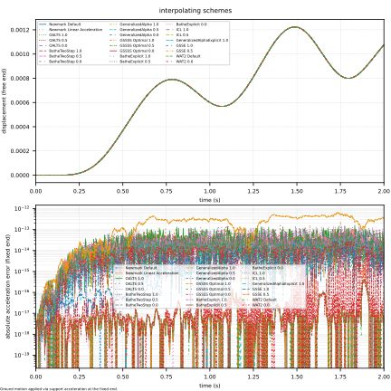
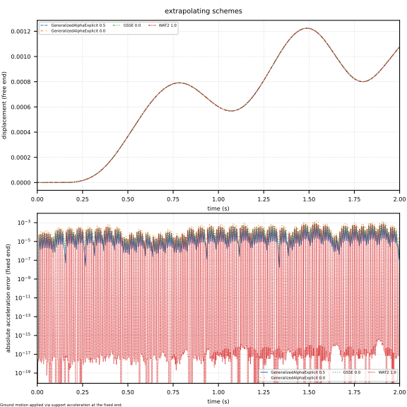

# load

The `load` command creates loads applied to nodes.

Currently, concentrated node-based loads can be applied in terms of force, displacement and acceleration.
All external forces are eventually converted to concentrated nodal forces.
Commands for distributed load patterns may therefore not be available in the foreseeable future.

All loads are initialised and processed in **parallel** via global mutexes.

## Syntax

All loads share a similar syntax:

```text title="load"
load <load_type> <unique_tag> <arguments that define the specific load...>
```

### Nodal Load

To apply loads to nodes,

```text title="nodalload"
# to apply nodal concentrated force
cload (1) (2) (3) (4) (5...)
load cload (1) (2) (3) (4) (5...)
# to apply nodal displacement
displacement (1) (2) (3) (4) (5...)
load displacement (1) (2) (3) (4) (5...)
# (1) int, unique tag
# (2) int, amplitude tag, 0 to use a default `Ramp` amplitude
# (3) double, nominal magnitude
# (4) string, dof identifier
# (5...) int, node tags

# to apply nodal acceleration
acceleration (1) (2) (3) (4) [5...]
load acceleration (1) (2) (3) (4) [5...]
# (1) int, unique tag
# (2) int, amplitude tag, 0 to use a default `Ramp` amplitude
# (3) double, nominal magnitude
# (4) string, dof identifier
# [5...] int, node tags
```

The keyword `cload` is the abbreviation for **c**oncentrated **load**.

### Body Force

Some elements support body force.
The corresponding element pages indicate which elements support it.

```text title="bodyforce"
bodyforce (1) (2) (3) (4) (5...)
load bodyforce (1) (2) (3) (4) (5...)
# (1) int, unique tag
# (2) int, amplitude tag, 0 to use a default `Ramp` amplitude
# (3) double, nominal magnitude
# (4) string, dof identifier
# (5...) int, element tags
```

### Load Applied to Node/Element Groups

To apply loads to groups,

```text title="groupload"
# on node groups
groupcload (1) (2) (3) (4) (5...)
groupdisplacement (1) (2) (3) (4) (5...)
load groupcload (1) (2) (3) (4) (5...)
load groupdisplacement (1) (2) (3) (4) (5...)

# on element groups
groupbodyforce (1) (2) (3) (4) (5...)
load groupbodyforce (1) (2) (3) (4) (5...)

# (1) int, unique tag
# (2) int, amplitude tag, 0 to use a default `Ramp` amplitude
# (3) double, nominal magnitude
# (4) string, dof identifier
# (5...) int, group tags
```

### Support Excitation

For response history analysis, it is sometimes necessary to apply excitations to supports.
Multi-support excitation is automatically supported when different excitations are assigned to different supports.

```text title="support"
supportdisplacement (1) (2) (3) (4) (5...)
supportvelocity (1) (2) (3) (4) (5...)
supportacceleration (1) (2) (3) (4) (5...)
load supportdisplacement (1) (2) (3) (4) (5...)
load supportvelocity (1) (2) (3) (4) (5...)
load supportacceleration (1) (2) (3) (4) (5...)
# (1) int, unique tag
# (2) int, amplitude tag, 0 to use a default `Ramp` amplitude
# (3) double, nominal magnitude
# (4) string, dof identifier
# (5...) int, node tags
```

Essentially, `supportdisplacement`, `supportvelocity` and `supportacceleration` are all implemented as displacement loads.
A displacement-controlled scheme is therefore enabled automatically.

Although designed for response history analysis, these commands can also apply acceleration or velocity to any nodes, not only supports.

!!! warning "difference in explicit and implicit dynamic analysis"
    Implicit time integration schemes use displacement as the primary variable.
    Thus, `supportdisplacement`, `supportvelocity` and `supportacceleration` all convert to the corresponding nodal displacement.
    Explicit time integration schemes use acceleration as the primary variable.
    Because they are explicit methods, there is no way to obtain the corresponding nodal displacement or velocity from the acceleration.
    Thus, in explicit dynamic analysis, `supportdisplacement` is identical to `supportacceleration`, as both apply acceleration to the nodes.
    `supportvelocity` is not available in explicit dynamic analysis.

#### Validation

The algorithms implemented are **not** a naive integration.
**All support excitations are guaranteed to be consistent with the time integration scheme used.**
For all interpolating methods, the exact same input can be observed in the output.
Extrapolating methods do not guarantee the exact same input in the output.

The following validation can be obtained via the [script](support-motion-validation.py).
It defines a simple column and applies a support motion at the base (fixed) end of the column.
It measures both the top (free) end displacement and the base (fixed) end acceleration.

Interpolating schemes produce the same acceleration history at the base as the input.
Extrapolating schemes yield some difference because they extrapolate.
Such an error may cause spurious responses in the structure.
This problem is discussed in [this](https://doi.org/10.1080/13632469.2024.2372814) paper.




### Uniformly Distributed Load (UDL)

```text title="lineudl"
lineudl2d (1) (2) (3) (4) (5...)
lineudl3d (1) (2) (3) (4) (5...)
load lineudl2d (1) (2) (3) (4) (5...)
load lineudl3d (1) (2) (3) (4) (5...)
# (1) int, unique tag
# (2) int, amplitude tag, 0 to use a default `Ramp` amplitude
# (3) double, nominal magnitude
# (4) string, dof identifier
# (5...) int, node tags
```

The magnitude can be either positive or negative, which applies the load in different directions of the assigned DoF.
Only translational DoFs are supported, so use `1`, `2`, `3`, `U1`, `U2` or `U3` only.

### Reference Load

For arc-length analysis, a reference load can be defined with the `RefForce` command.

```text title="refload"
refforce (1) (2) (3) (4) (5...)
refload (1) (2) (3) (4) (5...)
load refforce (1) (2) (3) (4) (5...)
load refload (1) (2) (3) (4) (5...)
# (1) int, unique tag
# (2) int, amplitude tag, has no effect in arc-length analysis, just a placeholder, can be set to 0
# (3) double, reference magnitude
# (4) string, dof identifier
# (5...) int, node tags
```

## Short Forms

The leading `load` keyword can be replaced by a dedicated first-level command with the same arguments.

`disp` and `dispload` are equivalent to `displacement`.

`groupdisp` and `groupdispload` are equivalent to `groupdisplacement`.

`refforce`, `refload` and `refereceload` are equivalent to the `ReferenceLoad` type.

`grouprefforce`, `grouprefload` and `grouprefereceload` are equivalent to the `GroupReferenceLoad` type.

The misspelling `refereceload` is intentional in the implementation.

## Remarks

1. The leading `load` keyword can often be omitted for simplicity.
2. By default, `acceleration` is applied to all active nodes in the model if `[5...]` is not assigned.
3. The true load magnitude is the product of the nominal magnitude and the amplitude.
   This is similar to ABAQUS.
4. The multipoint displacement control algorithm [`MPDC`](../../Library/Solver/MPDC.md) is automatically enabled if a `displacement` or `groupdisplacement` is used.
5. Optionally, the displacement can be applied with an [`MPC`](../../Library/Constraint/MPC.md) constraint.
6. The multipoint displacement control algorithm [`MPDC`](../../Library/Solver/MPDC.md) is automatically enabled if `supportdisplacement`, `supportvelocity` and/or `supportacceleration` are used.

**It must be noted that nodal displacement loads are only valid for a single step.**
If a displacement load is defined within a step, it is activated for that step only.

All other load types stay active once activated.

The DoF identifier can take the following values.
Accepted inputs vary with the selected element type(s) and the problem type.

| identifier       | implies                                                             | of type                          |
|------------------|---------------------------------------------------------------------|----------------------------------|
| `PINNED`, `P`    | `DOF::U1`, `DOF::U2`, `DOF::U3`                                     | displacement                     |
| `ENCASTRE`, `E`  | `DOF::U1`, `DOF::U2`, `DOF::U3`, `DOF::UR1`, `DOF::UR2`, `DOF::UR3` |                                  |
| `XSYMM`, `X`     | `DOF::U1`, `DOF::UR2`, `DOF::UR3`                                   |                                  |
| `YSYMM`, `Y`     | `DOF::UR1`, `DOF::U2`, `DOF::UR3`                                   |                                  |
| `ZSYMM`, `Z`     | `DOF::UR1`, `DOF::UR2`, `DOF::U3`                                   |                                  |
| `1`, `U1`        | `DOF::U1`                                                           |                                  |
| `2`, `U2`        | `DOF::U2`                                                           |                                  |
| `3`, `U3`        | `DOF::U3`                                                           |                                  |
| `4`, `U4`, `UR1` | `DOF::UR1`                                                          |                                  |
| `5`, `U5`, `UR2` | `DOF::UR2`                                                          |                                  |
| `6`, `U6`, `UR3` | `DOF::UR3`                                                          |                                  |
| `FU1`            | `DOF::FU1`                                                          | fluid                            |
| `FU2`            | `DOF::FU2`                                                          |                                  |
| `FU3`            | `DOF::FU3`                                                          |                                  |
| `FUR1`           | `DOF::FUR1`                                                         |                                  |
| `FUR2`           | `DOF::FUR2`                                                         |                                  |
| `FUR3`           | `DOF::FUR3`                                                         |                                  |
| `RADIAL`         | `DOF::RADIAL`                                                       | axisymmetric                     |
| `AXIAL`          | `DOF::AXIAL`                                                        | axisymmetric, rod/beam like      |
| `RS`             | `DOF::RS`                                                           | beam                             |
| `RW`             | `DOF::RW`                                                           | 3D beam                          |
| `DAMAGE`         | `DOF::DAMAGE`                                                       | special damage DoF               |
| `PRESSURE`       | `DOF::PRESSURE`                                                     | special pressure DoF             |
| `TEMPERATURE`    | `DOF::TEMPERATURE`                                                  | thermal DOF                      |
| `WARP`           | `DOF::WARP`                                                         | special warp DoF (in some beams) |
