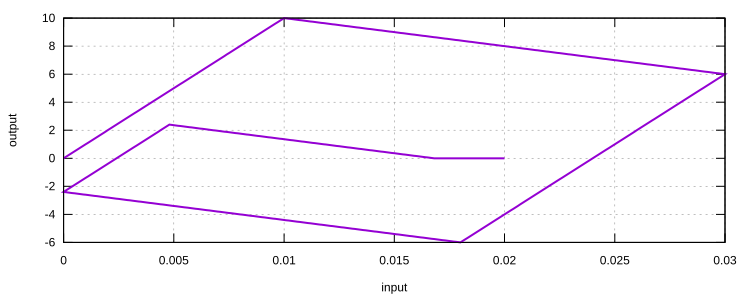

# materialtest

This command category tests most material models **that depend on strain input only** without establishing an FE model.
Some wrappers and material models that rely on other material models cannot be tested in this way.

## Syntax

```text title="materialtest"
materialTest1D (1) (2) (3) [4...]
# (1) int, unique tag of the material model to use
# (2) double, size of per strain increment
# (3) int, number of steps along increment direction
# [4...] int, optional numbers of steps for strain history

materialTest2D (1) (2...4) (5) [6...]
# (1) int, unique tag of the material model to use
# (2...4) double, size of per strain increment
# (5) int, number of steps along increment direction
# [6...] int, optional numbers of steps for strain history

materialTest3D (1) (2...7) (8) [9...]
# (1) int, unique tag of the material model to use
# (2...7) double, size of per strain increment
# (8) int, number of steps along increment direction
# [9...] int, optional numbers of steps for strain history
```

## Remarks

1. The increment size can be either positive or negative.
2. The loading direction reverses after the given number of steps.
3. The strain-stress history is saved to `RESULT.txt`.
   If HDF5 support is enabled, the result is additionally saved to `RESULT.h5`.
   A `gnuplot` file named `RESULT.plt` is also generated.

## Usage

To use the tester, define a material beforehand.
Here, a `Bilinear1D` model is defined with elastic modulus $$E=1000.0$$, yield stress $$\sigma_y=10.0$$ and a negative hardening ratio $$h=-0.2$$.

```
material Bilinear1D 1 1000.0 10.0 -0.2
```

The following command loads in the positive strain direction for 300 increments of size $$0.0001$$.
It then loads in the negative direction for another 300 increments and finally in the positive direction for 200 increments.
The ending strain is $$\varepsilon=0.02$$.

```
materialTest1D 1 0.0001 300 300 200
```

The output is shown below.


