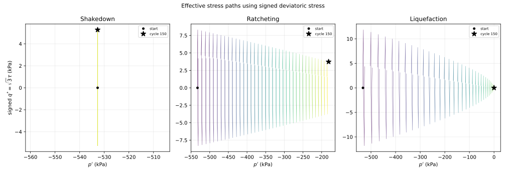
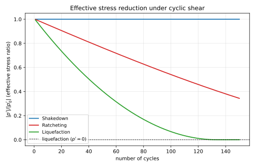
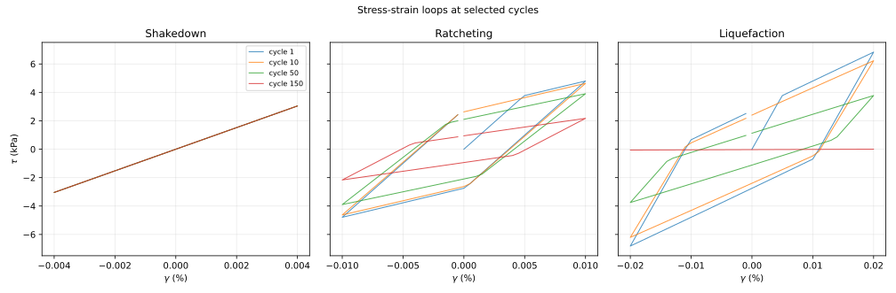

# [★★★☆☆] Shakedown, Ratcheting and Liquefaction of Sand Under Cyclic Shear

Sands respond to repeated shearing in three fundamentally different ways.
Recognising which regime applies is central to the design of foundations, slopes and earth structures under traffic, machinery or seismic loading.

* **Shakedown** — the stress–strain loops close after a few cycles, the mean effective stress stays constant, and no further deformation accumulates.
* **Ratcheting** — each cycle leaves a net plastic strain, so deformation grows steadily while the mean effective stress decreases gradually.
* **Liquefaction** — contractive plastic straining drives the mean effective stress to zero, the shear strength collapses, and the stress path curves towards the origin.

Which regime occurs is governed primarily by the cyclic strain amplitude, the initial state and the confinement.
This example uses a single calibrated parameter set for Toyoura sand and varies only the strain amplitude.
The [`DafaliasManzari`](../../Library/Material/Material3D/Sand/DafaliasManzari.md) model reproduces all three regimes because its state-dependent dilatancy links plastic volumetric straining to the evolution of effective stress.
The [model files](cyclic-regimes-of-sand.zip) are runnable with the standard `suanPan` executable.

## Engineering Context

A cyclic assessment normally asks a sequence of questions:

1. what effective stress and void ratio exist before the cyclic load arrives?
2. what amplitude of cyclic shear does the structure impose?
3. does the mean effective stress stay constant, fall gradually, or collapse?
4. is the accumulated deformation within the serviceability limit, and is the residual strength adequate?

The three cases below answer these questions for a deeply deposited sand whose initial mean effective stress is about $$533$$ kPa.
The small amplitude represents a vibration well within the elastic range, the intermediate amplitude a repeated working load, and the large amplitude a strong seismic excursion.

## Model and Parameter Selection

The Dafalias–Manzari model is a bounding-surface plasticity formulation with pressure- and void-ratio-dependent hyperelasticity.
The relevant ingredients are:

* the yield function $$F=\left|\mathbf s+p'\boldsymbol\alpha\right|+mp'$$ and the bounding surface $$\alpha^b=\alpha^c\exp(-n^b\psi)$$;
* the dilatancy $$D=A_0\left(1+\left\langle\mathbf z:\mathbf n\right\rangle\right)\left(\alpha^d-m-\boldsymbol\alpha:\mathbf n\right)$$, which under constant volume controls the change of mean effective stress;
* the kinematic hardening of $$\boldsymbol\alpha$$ and its reversal memory $$\boldsymbol\alpha_{in}$$, which control loop closure;
* the fabric tensor $$\mathbf z$$, which modifies dilatancy after load reversal.

With $$G_r=0.002$$ the lower bound on the shear modulus is only $$32.5$$ kPa, negligible compared with the modulus at the working stress.
The pressure-dependent law $$G\propto\sqrt{|p'|}$$ therefore governs the response all the way towards liquefaction, giving the strongly nonlinear paths shown below.
A larger floor would clamp the stiffness and hide the collapse.

```
material DafaliasManzari 1 125 .05 1.25 .02 .9 .7 .01 7 .1 .9 1.1 -.3 3.5 4 600 -130 .002
```

| # | Symbol | Value | Role in the cyclic response |
|---|--------|-------|------------------------------|
| 2 | $$G_0$$ | 125 | Small-strain stiffness scale. |
| 3 | $$\nu$$ | 0.05 | Elastic Poisson's ratio. |
| 4 | $$\alpha^c$$ | 1.25 | Critical stress ratio $$M$$; sets bounding and dilatancy surfaces. |
| 5 | $$\lambda_c$$ | 0.02 | Slope of the critical state line. |
| 6 | $$e_0$$ | 0.9 | Initial void ratio and CSL intercept. |
| 7 | $$\xi$$ | 0.7 | Curvature of the critical state line. |
| 8 | $$m$$ | 0.01 | Small yield surface; elastic nucleus. |
| 9 | $$h_0$$ | 7 | Hardening scale. |
| 10 | $$h_1$$ | 0.1 | Reversal-memory decay. |
| 11 | $$c_h$$ | 0.9 | Void-ratio dependence of hardening. |
| 12 | $$n^b$$ | 1.1 | Bounding-surface exponent. |
| 13 | $$A_0$$ | $$-0.3$$ | Contractive dilatancy; drives pore-pressure buildup. |
| 14 | $$n^d$$ | 3.5 | Dilatancy-surface exponent. |
| 15 | $$z_{max}$$ | 4 | Limiting fabric magnitude. |
| 16 | $$c_z$$ | 600 | Fabric evolution rate. |
| 17 | $$p_{at}$$ | $$-130$$ | Reference pressure, negative in this convention. |
| 18 | $$G_r$$ | 0.002 | Negligible modulus floor, so the nonlinear law governs. |

## Model Setup

A single element is consolidated isotropically to $$p'_0\approx533$$ kPa with a base strain of $$-3\times10^{-3}$$ in each direction.
It is then subjected to 150 symmetric cycles of constant-volume simple shear, i.e. undrained by construction.
The three amplitudes are $$\gamma_a=0.004\%$$, $$0.01\%$$ and $$0.02\%$$, obtained with shear strain increments of $$2\times10^{-6}$$, $$5\times10^{-6}$$ and $$1\times10^{-5}$$ applied over 40 substeps per half cycle.

```
material DafaliasManzari 1 125 .05 1.25 .02 .9 .7 .01 7 .1 .9 1.1 -.3 3.5 4 600 -130 .002
materialTestWithBase3D 1 -3E-3 -3E-3 -3E-3 0 0 0 0 0 0 0 0 2E-6 20 40 40 ...
```

All parameters are identical in the three runs; only the strain amplitude changes.
This isolates the amplitude as the control variable.

## Results

### Effective Stress Paths



The $$p'$$–$$q$$ paths reveal the three regimes directly.

* **Shakedown** ($$\gamma_a=0.004\%$$): the path is a single vertical line at $$p'=533$$ kPa. The imposed strain lies within the elastic nucleus of the yield surface, so no plastic volumetric strain develops and the effective stress never changes.
* **Ratcheting** ($$\gamma_a=0.01\%$$): the path migrates steadily leftwards. Each cycle generates a small contractive plastic volumetric strain, which under constant volume reduces $$p'$$. The deviatoric stress also falls gradually as the soil softens.
* **Liquefaction** ($$\gamma_a=0.02\%$$): the migration accelerates and the envelope of the path is strongly curved. As $$p'\to0$$ the shear modulus collapses with $$\sqrt{|p'|}$$ and the path turns towards the origin; the final cycles lie essentially at $$q=0$$.

The curvature of the liquefaction envelope is the hallmark of the nonlinear response: the tangent stiffness changes continuously with the effective stress rather than being set by a constant floor.

### Effective Stress Reduction



| Cycle | shakedown $$\|p'\|/\|p'_0\|$$ | ratcheting | liquefaction |
|------:|----------------------------:|-----------:|-------------:|
| 1 | 1.00 | 1.00 | 1.00 |
| 50 | 1.00 | 0.76 | 0.40 |
| 100 | 1.00 | 0.54 | 0.07 |
| 150 | 1.00 | 0.34 | 0.00 |

In the shakedown case the ratio stays exactly at unity.
Ratcheting reduces it roughly linearly with cycle number, while liquefaction shows an accelerating reduction that reaches zero within 150 cycles.
The pore pressure ratio $$r_u=1-|p'|/|p'_0|$$ is simply one minus these values, so the liquefaction case reaches $$r_u=1$$.

### Stress–Strain Loops



The loops complete the picture.
Under shakedown all cycles retrace the same straight line — the response is elastic.
Under ratcheting the loops widen and progressively lose stiffness; the peak stress falls from about $$4.8$$ kPa in cycle 1 to $$2.2$$ kPa in cycle 150.
Under liquefaction the loops expand dramatically, the peak stress falls from $$6.8$$ kPa to nearly zero, and the response at cycle 150 is essentially flat: the sand has lost its strength.

## Engineering Discussion

### Reading the regimes from a test

The three diagnostics should be used together:

* the **effective stress path** distinguishes a constant $$p'$$ from gradual migration and from collapse;
* the **stress–strain loops** show whether the response is elastic, hysteretic but stable, or degrading to zero;
* the **evolution of $$p'$$ with cycle number** gives the rate of pore-pressure generation and the number of cycles to liquefaction.

A single loop at one cycle cannot identify the regime; the trend over cycles is essential.

### Why amplitude controls the outcome

At small strain the stress state remains inside the yield surface $$F<0$$, so the response is elastic and non-linear only through the hyperelastic law.
Once the amplitude exceeds the elastic nucleus of size $$m$$, plastic straining begins.
For a contractive sand ($$A_0<0$$) the plastic volumetric increment is negative; under undrained conditions the elastic volumetric strain must compensate, lowering $$p'$$.
The rate of reduction scales with amplitude, so a modest increase from $$0.01\%$$ to $$0.02\%$$ changes a gradual ratcheting response into liquefaction within 150 cycles.
This is why a factor-of-two error in the estimated cyclic strain can change a design conclusion.

### The role of the modulus floor

Because $$G\propto\sqrt{|p'|}$$, the shear modulus falls by a factor of about 23 as $$p'$$ drops from $$533$$ kPa to $$1$$ kPa.
The nonlinear curvature of the $$p'$$–$$q$$ paths is a direct consequence.
A large modulus floor ($$G_r=0.2$$) would impose $$G_{\min}=3250$$ kPa, which is reached already at $$p'\approx5$$ kPa; the final part of the path would then be artificially stiff and the collapse hidden.
With $$G_r=0.002$$ the floor is $$32.5$$ kPa, reached only at $$p'\approx0.0005$$ kPa, so the physical degradation is visible over the full range.

### Implications for design

* **Shakedown** — acceptable for serviceability; only the elastic modulus is needed for the analysis.
* **Ratcheting** — deformation accumulates; the design must check the strain after the design number of cycles, and the cyclic stress ratio $$\tau_a/p'$$ is the governing quantity.
* **Liquefaction** — the strength is lost; the check must be made against the number of cycles imposed by the design earthquake, and mitigation (densification, drainage, reinforcement) is required.

A practical assessment runs a suite of amplitudes at the actual initial density and confinement, plots the $$p'$$-reduction curves, and interpolates the amplitude that reaches the adopted limit state.
The initial void ratio $$e_0$$ and the dilatancy parameters $$A_0$$ and $$n^d$$ must be calibrated from undrained cyclic tests, because they set the rate of effective stress reduction.

## Remarks

* The three regimes are not material properties but responses to a particular load amplitude; the same sand exhibits all three.
* All results use $$G_r=0.002$$; the pressure-dependent elasticity then governs the response, including the large-strain behaviour near liquefaction.
* The void ratio follows the trace of the total strain, so the accumulation of volumetric plastic strain shifts the state parameter $$\psi$$ and changes the dilatancy and bounding surfaces as cycling proceeds.
* The hardening parameters $$h_0$$, $$h_1$$ and $$c_h$$ control how quickly the back stress adapts and therefore the shape of the loops; they should be calibrated against cyclic tests.
* For a simpler sand model without fabric and reversal memory, see [`SimpleSand`](../../Library/Material/Material3D/Sand/SimpleSand.md); it does not reproduce the effective-stress migration that leads to liquefaction.

## References

1. [DafaliasManzari material documentation](../../Library/Material/Material3D/Sand/DafaliasManzari.md)
2. Dafalias, Y. F. and Manzari, M. T., *A simple plasticity model for flow and liquefaction of sands*, Journal of Geotechnical and Geoenvironmental Engineering, 130(6), 622–636, 2004. [doi:10.1061/(ASCE)0733-9399(2004)130:6(622)](https://doi.org/10.1061/(ASCE)0733-9399(2004)130:6(622))
3. Liu, H., et al., *Modelling the cyclic ratcheting of sands through memory-enhanced bounding surface plasticity*, Géotechnique, 69(9), 783–800, 2019. [doi:10.1680/jgeot.17.p.307](https://doi.org/10.1680/jgeot.17.p.307)
4. The [Constitutive Modelling Cookbook](https://github.com/TLCFEM/constitutive-modelling-cookbook/releases/download/latest/COOKBOOK.pdf) — chapter on the Dafalias–Manzari model.
