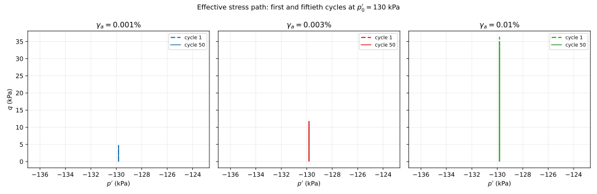

# [★★★☆☆] Cyclic Shear and Shakedown of Sand

Many geotechnical structures are subjected to repeated rather than static loading: railway track beds, machine foundations, offshore wind turbine anchors, pavements and retaining structures under traffic.
The governing design question is rarely the first cycle — it is whether deformation keeps accumulating over thousands or millions of cycles.
Two regimes are distinguished.

* **Shakedown** — after an initial transient the stress–strain loops close, and each subsequent cycle retraces the same path with no additional plastic strain.
  The soil has *adapted* to the load; the response is stable and serviceability is preserved.
* **Ratcheting** — every cycle leaves a net plastic strain increment. Deformation grows with cycle count even though the load amplitude is constant, eventually leading to excessive settlement or tilt.

Whether a given load causes shakedown or ratcheting depends on the cyclic amplitude, the mean stress, the initial density and the effective confinement.
The [`DafaliasManzari`](../../Library/Material/Material3D/Sand/DafaliasManzari.md) model is well suited to this problem: its bounding surface and kinematic hardening with reversal memory reproduce the gradual adaptation of the fabric that produces stable loops.

This example presents a complete element-level assessment: calibrate a cyclic sand model, run repeated simple shear at a realistic confinement, read the shakedown signature from the stress–strain loops and the effective stress path, and interpret the result in terms of design decisions.
The [model files](cyclic-shear-and-shakedown-of-sand.zip) are runnable with the standard `suanPan` executable.

## Engineering Context

A typical design workflow for a cyclically loaded sand layer is:

1. establish the in-situ effective stress state and relative density;
2. determine the cyclic stress or strain amplitude imposed by the structure;
3. test or model the soil under that amplitude for a representative number of cycles;
4. decide whether the response shakes down (acceptable) or ratchets (unacceptable), and at what amplitude the transition occurs.

Steps 3 and 4 are the purpose of this example.
We model a sand element at $p'_0=130$ kPa — representative of a depth of roughly 7–10 m in a dry deposit — and apply three strain amplitudes spanning small-strain machinery vibration to a stronger earthquake-level excursion.
The results show how to recognise shakedown and how the mobilised stress and dissipated energy scale with amplitude.

## The Material Model

The Dafalias–Manzari model is a bounding-surface plasticity formulation.
The key ingredients for cyclic response are:

* a small yield surface $F=|\mathbf s+p'\boldsymbol\alpha|+mp'$ whose centre $\boldsymbol\alpha$ (the back stress) translates with plastic shear;
* a bounding surface $\alpha^b=\alpha^c\exp(-n^b\psi)$ that the back stress approaches, setting the mobilised stress;
* an exponential hardening modulus that decays after load reversal, storing the memory of previous cycles in $\boldsymbol\alpha_{in}$;
* a fabric tensor $\mathbf z$ that modifies dilatancy after reversal and shapes the loops.

Here the dilatancy constant is set to $A_0=0$.
This gives a *neutral* volumetric response: no excess pore pressure is generated, and the mean effective stress stays at its initial value while the deviatoric stress cycles.
This corresponds to a sand at, or very close to, the critical state — a useful reference case that isolates the kinematic-hardening mechanism of shakedown from pore-pressure effects.
The role of non-zero dilatancy in real dense and loose sands is discussed at the end.

### Parameter Selection

All 17 material arguments are required; the trailing density is optional.

```
material DafaliasManzari 1 125 .05 1.25 .02 .9 .7 .01 7 .1 .9 1.1 0 3.5 4 600 -130 .01
```

| # | Symbol | Value | Why this value |
|---|--------|-------|----------------|
| 2 | $G_0$ | 125 | Small-strain stiffness scale; at $p'=130$ kPa it gives $G\approx36$ MPa, typical for a medium-dense Toyoura sand. |
| 3 | $\nu$ | 0.05 | Poisson's ratio of the hyperelastic law. |
| 4 | $\alpha^c$ | 1.25 | Critical stress ratio, $M$; sets the bounding surface and the ultimate strength $\tau_f\approx M p'/\sqrt3\approx75$ kPa. |
| 5 | $\lambda_c$ | 0.02 | Slope of the critical state line. |
| 6 | $e_0$ | 0.9 | Initial void ratio and CSL intercept; representative of Toyoura sand. |
| 7 | $\xi$ | 0.7 | Curvature of the critical state line. |
| 8 | $m$ | 0.01 | Small yield surface; controls the elastic nucleus and the smoothness of the loops. |
| 9 | $h_0$ | 7 | Hardening scale; together with $G_0$ it controls how fast $\boldsymbol\alpha$ approaches the bounding surface, i.e. how many cycles are needed to adapt. |
| 10 | $h_1$ | 0.1 | Reversal-memory decay; governs the Bauschinger-type softening that closes the loops. |
| 11 | $c_h$ | 0.9 | Void-ratio dependence of hardening. |
| 12 | $n^b$ | 1.1 | Distance to the bounding surface. |
| 13 | $A_0$ | 0 | Neutral dilatancy: constant $p'$ during shear, isolating the cyclic hardening response. |
| 14 | $n^d$ | 3.5 | State dependence of the dilatancy surface (inactive here because $A_0=0$). |
| 15 | $z_{max}$ | 4 | Limiting fabric magnitude; shapes the post-reversal response. |
| 16 | $c_z$ | 600 | Fabric evolution rate. |
| 17 | $p_{at}$ | $-130$ | Reference pressure, entered negative in this convention. |
| 18 | $G_r$ | 0.01 | Lower bound on $G$ as a fraction of $G_0|p_{at}|$. |

!!! info "why $G_r=0.01$ rather than a larger value"
    The floor shear modulus is $G_{\min}=G_rG_0|p_{at}|$.
    With $G_r=0.01$ it is $162.5$ kPa, while the actual modulus at $p'=130$ kPa is about $36\,000$ kPa — over 200 times larger.
    The floor therefore has no influence anywhere near the working stress range; it only becomes relevant when $p'$ falls below about $G_r^2|p_{at}|\approx0.013$ kPa.
    A value such as $G_r=0.2$ would raise the floor to $3\,250$ kPa and make it active below $p'\approx5$ kPa — a range reached by loose sand during strong cyclic loading — so the model would overpredict stiffness there.
    $G_r=0.01$ keeps the floor outside the engineering stress range.

## Model Setup

A single element is consolidated isotropically to $p'_0\approx130$ kPa by imposing $\varepsilon_{11}=\varepsilon_{22}=\varepsilon_{33}=-1.5\times10^{-3}$, then subjected to 50 symmetric cycles of constant-volume simple shear:

```
material DafaliasManzari 1 125 .05 1.25 .02 .9 .7 .01 7 .1 .9 1.1 0 3.5 4 600 -130 .01
materialTestWithBase3D 1 -1.5E-3 -1.5E-3 -1.5E-3 0 0 0 0 0 0 0 0 1E-5 20 40 40 ...
```

The twelve numbers after the tag are the six base strains and the six strain increments.
The shear increment $\Delta\gamma_{13}$ is applied in 40 substeps per half cycle; the first block is 20 substeps, giving 50 complete cycles.
Three amplitudes are compared:

| Model | $\Delta\gamma_{13}$ per substep | Strain amplitude $\gamma_a$ | Peak $\tau$ after adaptation |
|:------|--------------------------------:|----------------------------:|-----------------------------:|
| `cyclic-shear-1e-5` | $1\times10^{-5}$ | 0.001% | $\approx2.7$ kPa |
| `cyclic-shear-3e-5` | $3\times10^{-5}$ | 0.003% | $\approx6.7$ kPa |
| `cyclic-shear-1e-4` | $1\times10^{-4}$ | 0.01% | $\approx20$ kPa |

Each run writes the strain–stress history to `RESULT.txt`.

## Results

### Stress–Strain Loops


The first cycle is asymmetric: loading from the virgin state mobilises a different curve than the subsequent unloading.
By cycle 2 the loops are already nearly closed, and by cycle 50 the curves for each amplitude are stable and symmetric about the origin.
This is the defining signature of shakedown.
The loop widens with amplitude — from a peak stress of 2.7 kPa at $\gamma_a=0.001\%$ to 20 kPa at $\gamma_a=0.01\%$ — reflecting the larger plastic work dissipated each cycle.

### Effective Stress Path



The $p'$–$q$ path is a vertical segment at $p'=130$ kPa, traversed repeatedly from $q=0$ to $q=\sqrt3\,\tau$ and back.
Two engineering conclusions follow directly.

1. **The sand remains confined throughout the loading.** Because $A_0=0$, shearing produces no volumetric plastic strain; there is no pore-pressure migration and no loss of effective stress. The classic dangerous mechanism — strength loss through pore-pressure buildup — is absent in this reference case.
2. **The path is identical in the first and fiftieth cycles.** The material has not drifted in stress space. Combined with the closed loops in the $\gamma$–$\tau$ plot, this confirms that the response is stable rather than ratcheting.

A real loose sand with $A_0<0$ would instead generate positive pore pressure, and the path would migrate leftwards towards $p'=0$ as the number of cycles increased — the appropriate check for liquefaction, which is a different design question from shakedown.

### Mobilised Stress and Energy Dissipation


| $\gamma_a$ | $\tau_{\max}$ cycle 1 | cycle 50 | loop area cycle 1 | cycle 50 |
|-----------:|----------------------:|---------:|------------------:|---------:|
| 0.001% | 2.665 kPa | 2.673 kPa | $4.6\times10^{-4}$ | $4.7\times10^{-4}$ |
| 0.003% | 6.564 kPa | 6.654 kPa | $1.69\times10^{-3}$ | $1.70\times10^{-3}$ |
| 0.01% | 19.284 kPa | 20.208 kPa | $1.20\times10^{-2}$ | $1.24\times10^{-2}$ |

The peak stress rises slightly between the first and later cycles — the back stress is still approaching the bounding surface — and then levels off.
The hysteresis area, which is the energy dissipated per unit volume per cycle, stabilises at a value that scales strongly with amplitude: a tenfold increase of $\gamma_a$ raises the dissipated energy by a factor of about 26.
This quantity is directly relevant to heating, degradation and the damping used in dynamic analysis: a model that predicts the correct peak stress but the wrong loop area will underpredict cumulative effects.

## Engineering Discussion

### Reading a shakedown test

Three diagnostics should be used together rather than relying on a single curve:

* **loop closure** in the $\gamma$–$\tau$ plane — the qualitative signature;
* **peak stress or strain versus cycle number** — should become horizontal;
* **dissipated energy per cycle** — should stabilise, not grow or collapse to zero unexpectedly.

If the loops keep shifting in the direction of accumulated strain, the soil is ratcheting even if the peak stress appears stable.
In design this calls either for reducing the applied amplitude or for increasing the confinement — for example by drainage, reinforcement or a surcharge.

### The role of confinement

The size of the yield surface scales with $p'$: $F=|\mathbf s+p'\boldsymbol\alpha|+mp'$.
Doubling the mean effective stress roughly doubles the stress range that can be sustained without accumulating strain.
This is why the shakedown limit of a sand is not a fixed stress amplitude but a *ratio* $\tau_a/p'$, often expressed in practice as a cyclic stress ratio.
The comparison should therefore always be made at the in-situ effective stress, not at an arbitrary laboratory pressure.

### The role of initial state and dilatancy

Setting $A_0=0$ isolates the kinematic hardening mechanism, but real sands are rarely neutral:

* **Dense sand** ($A_0>0$) dilates during shear. Under undrained conditions this generates *negative* excess pore pressure, raising $p'$ and making the soil stiffer; the $p'$–$q$ path moves rightwards and the shakedown limit increases with cycling.
* **Loose sand** ($A_0<0$) contracts. Positive pore pressure reduces $p'$; the path migrates leftwards, the strength falls, and the response may progress from shakedown to ratcheting and ultimately to flow. Here $A_0$, $n^d$ and the state parameter $\psi$ are as important as the hardening parameters.

A practical assessment should therefore run the same amplitude sweep at the *actual* relative density, and inspect both the loops and the $p'$–$q$ path.
The neutral case presented here is the reference against which those deviations can be measured.

### From element response to a design decision

The three amplitudes used here illustrate the workflow:

* at $\gamma_a=0.001\%$ the loops close almost immediately and the dissipated energy is negligible — the soil responds essentially elastically and any structure founded on it would experience negligible cyclic settlement;
* at $\gamma_a=0.003\%$ the loops are stable but with measurable hysteresis — acceptable for serviceability provided the accumulated strain during the first few cycles is tolerated;
* at $\gamma_a=0.01\%$ the mobilised stress approaches 20 kPa and the dissipated energy is an order of magnitude larger — this is close to the range where transient pore pressure and strain accumulation must be checked before accepting the design.

The transition from acceptable to unacceptable is found by repeating the analysis over a range of amplitudes and plotting the stabilised peak strain or loop width against amplitude.
That curve is the element-level shakedown limit; it can be compared with the stress or strain imposed by the structure to decide whether mitigation is required.

## Remarks

* Shakedown is a property of the *load path*, not of the sand alone: the same material can shake down under one amplitude and ratchet under another. Design must consider the whole expected loading spectrum.
* A non-zero mean shear stress promotes ratcheting even when the amplitude is small; symmetric cycles are the most favourable case.
* The number of cycles needed to reach a stable loop is governed by $h_0$, $h_1$ and $c_h$. Higher hardening rates give faster adaptation but also higher mobilised stresses.
* The void ratio follows the trace of the total strain, so any volumetric straining shifts the state parameter $\psi$ and gradually changes the dilatancy and bounding surfaces — this is how monotonic and cyclic response are linked in the model.
* For a simplified sand model without fabric and reversal memory, see [`SimpleSand`](../../Library/Material/Material3D/Sand/SimpleSand.md); it cannot reproduce the loop closure that underpins shakedown.

## References

1. [DafaliasManzari material documentation](../../Library/Material/Material3D/Sand/DafaliasManzari.md)
2. Dafalias, Y. F. and Manzari, M. T., *A simple plasticity model for flow and liquefaction of sands*, Journal of Geotechnical and Geoenvironmental Engineering, 130(6), 622–636, 2004. [doi:10.1061/(ASCE)0733-9399(2004)130:6(622)](https://doi.org/10.1061/(ASCE)0733-9399(2004)130:6(622))
3. Liu, H., et al., *Modelling the cyclic ratcheting of sands through memory-enhanced bounding surface plasticity*, Géotechnique, 69(9), 783–800, 2019. [doi:10.1680/jgeot.17.p.307](https://doi.org/10.1680/jgeot.17.p.307)
4. Werkmeister, S., *The permanent deformation behaviour of unbound granular materials under repeated loads*, PhD thesis, University of Kassel, 2003.
5. The [Constitutive Modelling Cookbook](https://github.com/TLCFEM/constitutive-modelling-cookbook/releases/download/latest/COOKBOOK.pdf) — chapter on the Dafalias–Manzari model.
