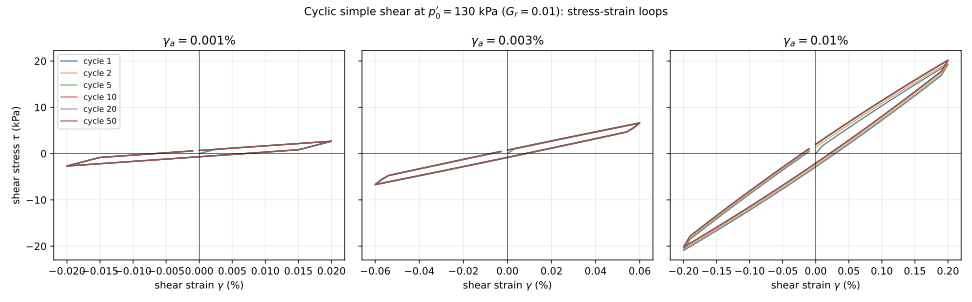
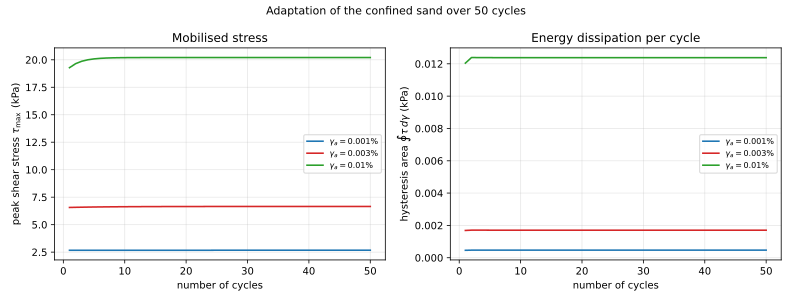

# [★★★☆☆] Cyclic Shear and Shakedown of Sand

When a sand deposit is subjected to repeated shearing — from machinery, waves or earthquakes — its response evolves during the first few cycles and then often settles into a stable pattern.
Two limiting behaviours are distinguished.

* **Shakedown:** after an initial transient, the stress–strain loops close and no further plastic strain accumulates.
  The material has adapted to the cyclic load and responds either essentially elastically (elastic shakedown) or with a stable, closed hysteresis loop (plastic shakedown).
* **Ratcheting:** each cycle adds a net plastic strain, so deformation accumulates progressively.
  This occurs when a non-zero mean stress is superimposed on the cyclic component.

The boundary between the two depends on the cyclic stress amplitude, the mean stress and the initial confinement.
The [`DafaliasManzari`](../../Library/Material/Material3D/Sand/DafaliasManzari.md) bounding-surface model reproduces both regimes through its kinematic hardening, reversal memory and state-dependent dilatancy.

This example uses a single confined sand element under drained cyclic simple shear to demonstrate shakedown.
The [model files](cyclic-shear-and-shakedown-of-sand.zip) are runnable with the standard `suanPan` executable.

## Confined Cyclic Simple Shear

A sand element is first consolidated to a mean effective stress of $p'_0=130$ kPa.
While that confinement is held constant, a symmetric shear stress

$$
\tau(t)=\tau_a\sin(\omega t)
$$

is applied with zero mean, cycling between $-\tau_a$ and $+\tau_a$.
Because the normal stresses are kept constant, the volume is free to change — the test is drained, as in a long-term foundation or offshore problem.

The response is characterised by two quantities measured at the end of each cycle: the peak shear strain $\gamma_{\max}$ and the hysteresis area $\oint\tau\,d\gamma$ (the energy dissipated per cycle).
Under shakedown both quantities become constant.

The built-in [`materialTestByLoadWithBase3D`](../../Collection/Process/materialtestbyload.md) command applies exactly this load history to a material point: it first establishes the base stress state and then cycles the prescribed stress increment, solving for the corresponding strain at every step.

## Parameter Selection

All 17 material arguments are required for `DafaliasManzari`; the trailing density is optional.
The values below are the Toyoura sand set distributed with the source and used in the library unit tests.

```
material DafaliasManzari 1 125 .05 1.25 .02 .9 .7 .01 7 .1 .9 1.1 -.3 3.5 4 600 -130 .2
```

| # | Symbol | Value | Role in cyclic shear |
|---|--------|-------|----------------------|
| 2 | $G_0$ | 125 | Sets the small-strain stiffness scale; $G\propto\sqrt{|p'|}$. |
| 3 | $\nu$ | 0.05 | Controls $K/G$ and thus the volumetric response. |
| 4 | $\alpha^c$ | 1.25 | Critical stress ratio $M$; fixes the bounding and dilatancy surfaces. |
| 5 | $\lambda_c$ | 0.02 | Slope of the critical state line, controlling state dependence. |
| 6 | $e_0$ | 0.9 | Initial void ratio and CSL intercept. |
| 7 | $\xi$ | 0.7 | Curvature of the critical state line. |
| 8 | $m$ | 0.01 | Size of the yield surface in stress-ratio space; a small value gives smooth loops. |
| 9 | $h_0$ | 7 | Hardening constant; larger values give stiffer cyclic response and faster adaptation. |
| 10 | $h_1$ | 0.1 | Decay of the hardening modulus on load reversal — controls the Bauschinger effect and loop shape. |
| 11 | $c_h$ | 0.9 | Void-ratio dependence of the hardening rate. |
| 12 | $n^b$ | 1.1 | Distance from the bounding surface. |
| 13 | $A_0$ | $-0.3$ | Dilatancy constant; its sign decides contractive or dilative volumetric response. |
| 14 | $n^d$ | 3.5 | State dependence of the dilatancy surface. |
| 15 | $z_{max}$ | 4 | Limiting fabric magnitude; affects the loop shape after reversal. |
| 16 | $c_z$ | 600 | Fabric evolution rate. |
| 17 | $p_{at}$ | $-130$ | Atmospheric pressure used for normalisation, entered negative (kPa). |
| 18 | $G_r$ | 0.2 | Lower bound on $G$ at low effective stress. |

!!! info "parameters that govern shakedown"
    The adaptation rate is controlled mainly by the hardening constants $h_0$, $h_1$ and $c_h$: they set how quickly the back stress $\boldsymbol\alpha$ approaches the bounding surface and how much memory of load reversal is retained.
    The cyclic amplitude that can be sustained without accumulating strain is set by $\alpha^c$ (strength) and $m$ (elastic nucleus), with $A_0$, $n^d$ and the fabric parameters modifying it through the evolving state.

## Model Setup

Three analyses differ only in the amplitude of the applied shear stress.
For $\tau_a=1$ kPa the command is

```
material DafaliasManzari 1 125 .05 1.25 .02 .9 .7 .01 7 .1 .9 1.1 -.3 3.5 4 600 -130 .2
materialTestByLoadWithBase3D 1 -130 -130 -130 0 0 -1 0 0 0 0 0 .02 100 100 100 ...
```

The first six numbers after the tag are the base stress,
$\boldsymbol\sigma_0=(-130,-130,-130,0,0,-1)$ kPa, which establishes both the confinement and the starting point $\tau=-\tau_a$.
The next six define the shear-stress increment;
with 100 substeps per half cycle, an increment of $0.02$ kPa takes $\tau$ from $-1$ kPa to $+1$ kPa and back, giving $\tau_a=1$ kPa.
The remaining numbers are the reversal counts: 100 substeps for the first half cycle followed by 100-substep blocks, giving 50 complete cycles in total.

The other two models use increments of $0.06$ kPa and $0.16$ kPa with base shear stresses of $-3$ kPa and $-8$ kPa, corresponding to $\tau_a=3$ kPa and $\tau_a=8$ kPa.
Each run writes its strain–stress history to `RESULT.txt`.

## Results

### Stress–Strain Loops



At $\tau_a=1$ kPa the loop is very narrow and essentially unchanged from the second cycle onward — the response is practically elastic after the first excursion.
At $\tau_a=3$ kPa and $\tau_a=8$ kPa the first cycle is noticeably wider than the subsequent ones; from cycle 2 the loops of every amplitude overlap, showing that the back stress has adapted and the material has shaken down into a stable cyclic state.
The loop width grows with amplitude, reflecting the larger amount of plastic work dissipated per cycle.

### Peak Strain and Dissipation



The peak shear strain and the hysteresis area stabilise within the first few cycles at all three amplitudes.

| $\tau_a$ | $\gamma_{\max}$ at cycle 1 | at cycle 50 | loop area at cycle 1 | at cycle 50 |
|---------:|---------------------------:|------------:|---------------------:|------------:|
| 1 kPa | 0.0033% | 0.0033% | $2\times10^{-5}$ | $2\times10^{-5}$ |
| 3 kPa | 0.0229% | 0.0216% | $5.5\times10^{-4}$ | $5.0\times10^{-4}$ |
| 8 kPa | 0.0699% | 0.0581% | $2.1\times10^{-3}$ | $1.7\times10^{-3}$ |

The small decrease of $\gamma_{\max}$ from cycle 1 to cycle 50 is the adaptation of the kinematic hardening: after the virgin loading the back stress reduces the stress increment available for further plastic flow.
The stabilised hysteresis area scales strongly with amplitude, from $2\times10^{-5}$ kPa at 1 kPa to $1.7\times10^{-3}$ kPa at 8 kPa.
This is the energy dissipated in each cycle and, in a real deposit, is the quantity that controls heating and degradation.

!!! note "what would cause ratcheting"
    Under symmetric stress cycles ($-\tau_a$ to $+\tau_a$ with zero mean) the model shakes down at all three amplitudes.
    Ratcheting appears when a non-zero mean shear stress is superimposed, because the hysteresis loop is then traversed asymmetrically and a net plastic strain is accumulated each cycle.
    The same model reproduces that behaviour; a shakedown assessment of a real structure should therefore consider the mean stress as well as the amplitude.

## Remarks

* Shakedown is a property of the *load path*: the same sand shakes down under symmetric cycles and ratchets when a mean stress is present.
* Higher confinement increases the stress range that can be sustained without accumulating strain, because the size of the yield surface in stress-ratio space scales with $p'$.
* The kinematic hardening rule in [`DafaliasManzari`](../../Library/Material/Material3D/Sand/DafaliasManzari.md) stores the back stress $\boldsymbol\alpha$ and the reversal memory $\boldsymbol\alpha_{in}$, which is what allows the model to reproduce loop closure after the first few cycles.
* The void ratio follows the trace of the total strain, so the drained volumetric strain accumulated during cycling shifts the state parameter $\psi$ and gradually changes the dilatancy and bounding surfaces.
* For a simpler bounding-surface sand model, use [`SimpleSand`](../../Library/Material/Material3D/Sand/SimpleSand.md); it does not include the fabric and reversal-memory effects that govern cyclic adaptation.

## References

1. [DafaliasManzari material documentation](../../Library/Material/Material3D/Sand/DafaliasManzari.md)
2. Dafalias, Y. F. and Manzari, M. T., *A simple plasticity model for flow and liquefaction of sands*, Journal of Geotechnical and Geoenvironmental Engineering, 130(6), 622–636, 2004. [doi:10.1061/(ASCE)0733-9399(2004)130:6(622)](https://doi.org/10.1061/(ASCE)0733-9399(2004)130:6(622))
3. Liu, H., et al., *Modelling the cyclic ratcheting of sands through memory-enhanced bounding surface plasticity*, Géotechnique, 69(9), 783–800, 2019. [doi:10.1680/jgeot.17.p.307](https://doi.org/10.1680/jgeot.17.p.307)
4. The [Constitutive Modelling Cookbook](https://github.com/TLCFEM/constitutive-modelling-cookbook/releases/download/latest/COOKBOOK.pdf) — chapter on the Dafalias–Manzari model.
