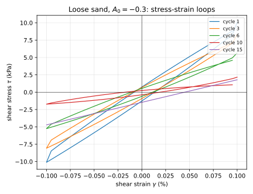
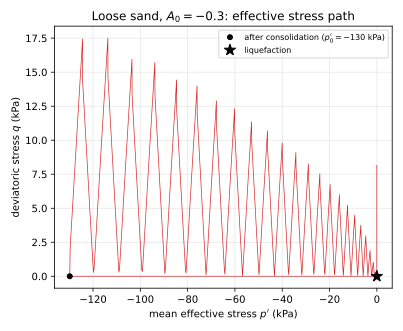
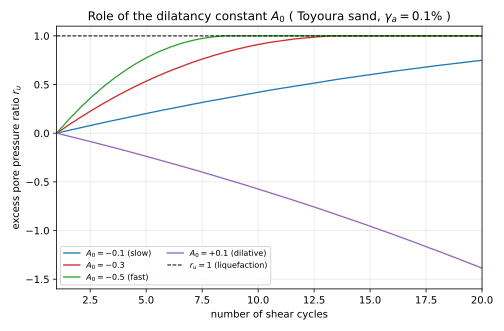

# [★★★☆☆] Liquefaction of Sand Under Cyclic Simple Shear

Liquefaction of saturated loose sand is one of the classic failure mechanisms in geotechnical earthquake engineering.
Under undrained cyclic loading the sand tends to compact; because the volume cannot change, the excess pore water pressure rises until the mean effective stress vanishes and the soil loses its strength.
The [`DafaliasManzari`](../../Library/Material/Material3D/Sand/DafaliasManzari.md) model was developed precisely to reproduce this behaviour: its state-dependent dilatancy and fabric memory reproduce pore-pressure generation, cyclic mobility and the large post-liquefaction strains of Toyoura sand.

This example does the following.

1. It reviews the seventeen model parameters and explains which ones control liquefaction, how they enter the constitutive equations, and how they are chosen.
2. It uses the built-in `materialTestWithBase3D` command to consolidate a material point and then drive **constant-volume cyclic simple shear** — the canonical element test for liquefaction — entirely with the standard `suanPan` executable.
3. It compares four values of the dilatancy constant $A_0$ and shows how the rate of pore-pressure build-up changes from decades of cycles to a handful of cycles, and how a dilative calibration suppresses liquefaction altogether.

The four runnable model files can be [downloaded](liquefaction-of-sand.zip).
Each produces its own `RESULT.txt`; no external scripts or data files are needed.

## Why an element test, and why simple shear?

An element test isolates the constitutive response from boundary effects.
Simple shear is a particularly convenient kinematic path because the deformation

$$
u_x=\gamma z,\qquad u_y=u_z=0
$$

has **exactly zero volumetric strain**:
$\varepsilon_v=\partial u_x/\partial x+\partial u_y/\partial y+\partial u_z/\partial z=0$.
The condition is therefore *undrained by construction*: no pore-pressure DoF and no permeability are needed, and the pore pressure can be recovered directly from the change of mean effective stress,

$$
\Delta u=-\Delta p',\qquad r_u=\dfrac{\Delta u}{|p'_0|}=1-\dfrac{p'}{p'_0},
$$

where $p'_0$ is the mean effective stress after consolidation and $p'$ is compressive (negative) in the tension-positive convention used by `suanPan`.
Liquefaction corresponds to $p'\to0$, i.e. $r_u\to1$.

The built-in [`materialTestWithBase3D`](../../Collection/Process/materialtest.md) command applies exactly this strain history to a material point without an FE model: first a *base* strain increment to establish confinement, then a sequence of strain increments whose direction reverses after a specified number of steps.
This is the same interface used by the library's unit tests and simply calls `update_incre_status()`/`commit_status()` in a loop.

## The Model in Brief

The model is a bounding-surface plasticity formulation with pressure- and void-ratio-dependent hyperelasticity.
Only the ingredients that matter for liquefaction are summarised here; the full equations are given on the [material page](../../Library/Material/Material3D/Sand/DafaliasManzari.md).

The state parameter measures how far the current void ratio $e$ is from the critical state line,

$$
\psi=e-e_0+\lambda_c\left(\dfrac{p'}{p_{at}}\right)^\xi,
$$

and the dilatancy and bounding surfaces are

$$
\alpha^d=\alpha^c\exp\left(n^d\psi\right),\qquad
\alpha^b=\alpha^c\exp\left(-n^b\psi\right).
$$

The plastic flow direction is non-associated:

$$
\Delta\boldsymbol{\varepsilon}^p=\gamma\left(\mathbf n+\dfrac13 D\,\mathbf I\right),\qquad
D=A_0\left(1+\left\langle\mathbf z:\mathbf n\right\rangle\right)\left(\alpha^d-m-\boldsymbol\alpha:\mathbf n\right).
$$

In this sign convention **a negative $D$ is contractive**, so $A_0$ must be negative for a liquefiable sand.
Under constant volume the contractive plastic volumetric increment $\Delta\varepsilon_v^p=\gamma D<0$ forces an elastic *increase* of volume and hence a reduction of $|p'|$: this is the pore-pressure generation mechanism.

Two further features are essential for the post-liquefaction response.
The fabric tensor $\mathbf z$ evolves only when the dilatancy is positive and amplifies it by $1+\mathbf z:\mathbf n$, producing the sharp re-mobilisation of strength known as cyclic mobility.
The shear modulus $G=G_0(2.97-e)^2/(1+e)\sqrt{|p'p_{at}|}$ degrades with $\sqrt{|p'|}$ as the effective stress falls, so the specimen becomes very soft at liquefaction; the floor $G\ge G_rG_0|p_{at}|$ limits that degradation.

## Parameter Selection

All 17 material arguments are required for `DafaliasManzari`; the trailing density is optional.
The values below are the Toyoura sand set distributed with the source and used in the library unit tests.

```
material DafaliasManzari 1 125 .05 1.25 .02 .9 .7 .01 7 .1 .9 1.1 -.3 3.5 4 600 -130 .2
```

| # | Symbol | Value | Role in liquefaction |
|---|--------|-------|----------------------|
| 2 | $G_0$ | 125 | Small-strain stiffness scale; $G\propto\sqrt{|p'|}$, so it sets how rapidly the specimen softens as $p'\to0$. |
| 3 | $\nu$ | 0.05 | Poisson's ratio; controls $K/G=2(1+\nu)/[3(1-2\nu)]$ and therefore how strongly a plastic volumetric increment changes $p'$. |
| 4 | $\alpha^c$ | 1.25 | Critical stress ratio $M$; $\phi_{cs}=\arcsin\left(3M/(6+M)\right)\approx31^\circ$. It defines the bounding and dilatancy surfaces. |
| 5 | $\lambda_c$ | 0.02 | Slope of the critical state line in $e$–$(p'/p_{at})^\xi$ space. It fixes how $\psi$ changes with confinement. |
| 6 | $e_0$ | 0.9 | Void-ratio intercept of the CSL **and** the void ratio at zero strain. Together with $\lambda_c$, $\xi$ and the consolidation strain it sets the initial state parameter $\psi$. |
| 7 | $\xi$ | 0.7 | Curvature of the CSL; 0.5–0.8 for sands. |
| 8 | $m$ | 0.01 | Yield-surface size in stress-ratio space. A small value gives a small elastic nucleus and smooth cyclic loops. |
| 9 | $h_0$ | 7 | Hardening constant; $b_0=G_0h_0(1-c_he)\sqrt{p_{at}/p'}$. Larger $h_0$ delays strain accumulation. |
| 10 | $h_1$ | 0.1 | Exponential decay of the hardening modulus after load reversal; governs the Bauschinger-type softening on unloading. |
| 11 | $c_h$ | 0.9 | Void-ratio dependence of the hardening rate; looser sand hardens more slowly. |
| 12 | $n^b$ | 1.1 | Bounding-surface exponent; $\alpha^b=\alpha^c\exp(-n^b\psi)$. |
| 13 | $A_0$ | $-0.3$ | **Dilatancy constant.** Its sign decides contractive ($A_0<0$, liquefiable) versus dilative ($A_0>0$) response; its magnitude sets the rate of pore-pressure build-up. |
| 14 | $n^d$ | 3.5 | Dilatancy-surface exponent; $\alpha^d=\alpha^c\exp(n^d\psi)$. |
| 15 | $z_{max}$ | 4 | Limiting fabric magnitude; controls the magnitude of post-liquefaction strain bursts. |
| 16 | $c_z$ | 600 | Fabric evolution rate; larger values make fabric build up faster during dilative phases. |
| 17 | $p_{at}$ | $-130$ | Atmospheric pressure used for normalisation. Entered **negative** in this convention (kPa here, 14.7 in psi). |
| 18 | $G_r$ | 0.2 | Lower bound on $G$ as a fraction of $G_0|p_{at}|$; limits stiffness degradation at low $p'$. |

!!! info "suggested calibration sequence"
    1. Fit $G_0$ and $\nu$ to the small-strain stiffness of drained triaxial tests.
    2. Fit $\alpha^c$, $\lambda_c$ and $\xi$ from the critical state line measured in loose and dense tests; $e_0$ follows from the CSL intercept.
    3. Fit $m$, $h_0$, $h_1$ and $c_h$ to the monotonic stress–strain curve and the size of the unloading hysteresis loops.
    4. Fit $A_0$ and $n^d$ to the pore-pressure history of a single undrained cyclic test — this is the decisive step for liquefaction.
    5. Fit $z_{max}$ and $c_z$ to the large-strain cyclic mobility response; they are the least constrained parameters.

## Model Setup

A single `materialTestWithBase3D` command establishes the initial confinement and applies the cyclic shear:

```
material DafaliasManzari 1 125 .05 1.25 .02 .9 .7 .01 7 .1 .9 1.1 -.3 3.5 4 600 -130 .2
materialTestWithBase3D 1 -1.5E-3 -1.5E-3 -1.5E-3 0 0 0 0 0 0 0 0 5E-5 40 40 ... 40
```

The first seven numbers are the base strain,
$\Delta\varepsilon_{11}=\Delta\varepsilon_{22}=\Delta\varepsilon_{33}=-1.5\times10^{-3}$, which gives a mean effective stress

$$
p'_0\approx-130~\mathrm{kPa}.
$$

The next six numbers define the increment applied during cycling,
$\Delta\gamma_{13}=5\times10^{-5}$ per substep.
Twenty reversal blocks of 40 substeps each give a strain amplitude $\gamma_a=0.1\%$ and 20 full cycles.
The command writes the strain–stress history to `RESULT.txt`.
The four cases in the download differ **only** in $A_0$; all other parameters are identical.
This isolates the effect of the dilatancy constant, which is the single most influential parameter for the rate of liquefaction.

## Results

### Stress–Strain Response



The loops for the liquefiable case ($A_0=-0.3$) shrink rapidly.
The peak shear stress falls from about $18$ kPa in the first cycle to a few kPa by cycle 15.
This is stiffness and strength degradation caused by the rising pore pressure: with $G\propto\sqrt{|p'|}$, a tenfold reduction of $|p'|$ cuts the small-strain shear modulus by more than a factor of three.

### Effective Stress Path



The effective stress path migrates steadily towards the origin as $p'\to0$ and $q\to0$ — the classic signature of flow liquefaction.
At that state the yield surface contracts to the origin and the sand carries essentially no shear stress; the remaining response is governed by the low-pressure elastic modulus floor.

### Rate of Pore-Pressure Generation



The figure compares four calibrations at the same state and cyclic amplitude.
The corresponding pore-pressure ratios at selected cycles are

| $A_0$ | $r_u$ at 1 | 5 | 10 | 15 | 20 | liquefies |
|------:|-----------:|--:|---:|---:|---:|:---------:|
| $-0.1$ | 0.07 | 0.28 | 0.50 | 0.68 | 0.82 | no (in 20 cycles) |
| $-0.3$ | 0.20 | 0.69 | 0.98 | 1.00 | 1.00 | cycle 12 |
| $-0.5$ | 0.32 | 0.93 | 1.00 | 1.00 | 1.00 | cycle 7 |
| $+0.1$ | $-0.02$ | $-0.27$ | $-0.64$ | $-1.06$ | $-1.54$ | never (dilative) |

A more negative $A_0$ makes every cycle more contractive, so $r_u$ climbs faster and liquefaction occurs in fewer cycles.
With $A_0>0$ the response is dilative: the excess pore pressure is *negative* ($r_u<0$), the mean effective stress grows, and the specimen becomes stiffer with cycling — the behaviour of dense sand or of a heavily overconsolidated deposit.

!!! warning "parameter interaction"
    $A_0$ is not independent of the state parameter. The dilatancy surface $\alpha^d=\alpha^c\exp(n^d\psi)$ enters the same bracket as $A_0$; a denser initial state (smaller $\psi$) reduces the driving term and can offset a more negative $A_0$.
    Calibration must therefore fit $A_0$ *and* $\lambda_c$, $e_0$ and $n^d$ against the same set of undrained tests, rather than adjusting $A_0$ in isolation.

## Remarks

* The void ratio follows the **trace of the total strain**, $e=e_0+(1+e_0)\,\mathrm{tr}\,\boldsymbol\varepsilon$, so volumetric straining shifts $\psi$ and thereby the dilatancy and bounding surfaces.
* The yield surface is circular in the deviatoric plane, corresponding to $c=1$ in the published formulation.
* The hardening modulus uses an exponential form, giving a smooth response across the load reversals of cyclic loading.
* $p_{at}$ is entered as a negative number and $A_0$ retains its sign; the remaining parameters are entered as magnitudes.
* For a simpler bounding-surface sand model without fabric effects, use [`SimpleSand`](../../Library/Material/Material3D/Sand/SimpleSand.md); it has no state-parameter-driven dilatancy and cannot reproduce the acceleration of pore-pressure build-up shown here.

## References

1. [DafaliasManzari material documentation](../../Library/Material/Material3D/Sand/DafaliasManzari.md)
2. Dafalias, Y. F. and Manzari, M. T., *A simple plasticity model for flow and liquefaction of sands*, Journal of Geotechnical and Geoenvironmental Engineering, 130(6), 622–636, 2004. [doi:10.1061/(ASCE)0733-9399(2004)130:6(622)](https://doi.org/10.1061/(ASCE)0733-9399(2004)130:6(622))
3. Dafalias, Y. F., *The SANICLAY family of elastoplastic models*, in Constitutive Modelling of Soils, Springer, 2022.
4. The [Constitutive Modelling Cookbook](https://github.com/TLCFEM/constitutive-modelling-cookbook/releases/download/latest/COOKBOOK.pdf) — chapter on the Dafalias–Manzari model.
