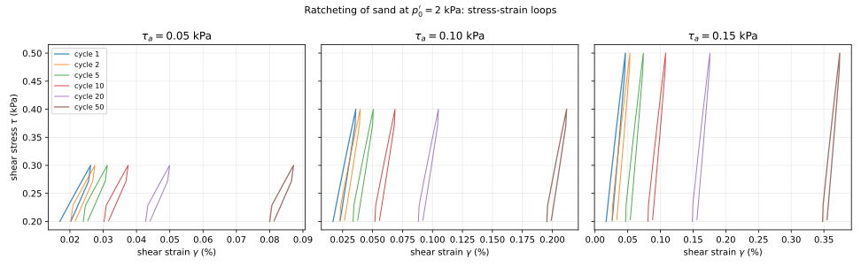
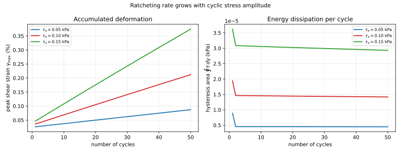
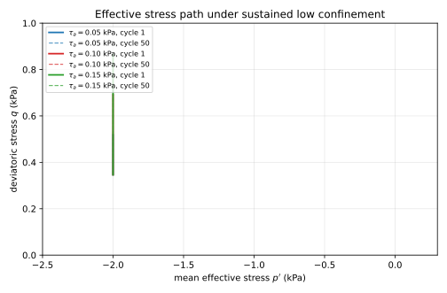

# [★★★☆☆] Ratcheting of Sand Under Low Confinement

Repeated loading of a soil does not always lead to a stable state.
When a cyclic load has a non-zero mean component, each cycle can leave a net plastic strain, so deformation accumulates progressively — a phenomenon known as **ratcheting** (or cyclic creep).
It is a common serviceability problem for railway track beds, machine foundations, pavements and anchor systems, where accumulated deformation is often more critical than ultimate strength.

This example demonstrates typical ratcheting with the [`DafaliasManzari`](../../Library/Material/Material3D/Sand/DafaliasManzari.md) model.
A sand element is subjected to a low sustained confinement and a shear stress that cycles around a non-zero mean.
Three stress amplitudes are compared to show how the ratcheting rate grows with the amplitude of the cyclic load.
The [model files](ratcheting-of-sand.zip) are runnable with the standard `suanPan` executable.

## Engineering Context

A typical assessment of cyclic serviceability proceeds as follows:

1. establish the in-situ effective stress and the mean and amplitude of the applied cyclic stress;
2. model the element response over a representative number of cycles;
3. plot the accumulated strain against cycle count and identify whether it stabilises (shakedown) or keeps growing (ratcheting);
4. compare the predicted accumulation with the serviceability limit, and check whether a different amplitude, confinement or drainage condition would bring it within limits.

Low confinement is the critical case: the yield surface of sand scales with the mean effective stress, so a given cyclic stress represents a much larger fraction of the strength when $$p'$$ is small.
The example uses $$p'_0=2$$ kPa, representative of a very shallow or poorly confined layer, with a contractive dilatancy $$A_0=-0.3$$ and a reduced modulus floor $$G_r=0.002$$.

## The Material Model

The Dafalias–Manzari model is a bounding-surface plasticity formulation with pressure-dependent hyperelasticity.
The relevant features here are:

* the yield surface $$F=\left|\mathbf{s}+p'\boldsymbol\alpha\right|+mp'$$, whose size scales with $$p'$$;
* the dilatancy $$D=A_0\left(1+\left\langle\mathbf z:\mathbf n\right\rangle\right)\left(\alpha^d-m-\boldsymbol\alpha:\mathbf n\right)$$, which drives volumetric plastic strain and hence changes of state;
* the kinematic hardening of the back stress $$\boldsymbol\alpha$$ and the reversal memory $$\boldsymbol\alpha_{in}$$, which control the shape of the loops;
* the fabric tensor $$\mathbf z$$, which amplifies dilatancy after reversal.

With $$A_0<0$$ the sand is contractive.
Under the drained, load-controlled conditions used here the mean effective stress is held constant by the test, so the contractive tendency is expressed as accumulating shear strain rather than pore pressure — the ratcheting response.

### Parameter Selection

All 17 material arguments are required; the trailing density is optional.

```
material DafaliasManzari 1 125 .05 1.25 .02 .9 .7 .01 7 .1 .9 1.1 -.3 3.5 4 600 -130 .002
```

| # | Symbol | Value | Why this value |
|---|--------|-------|----------------|
| 2 | $$G_0$$ | 125 | Small-strain stiffness scale. |
| 3 | $$\nu$$ | 0.05 | Poisson's ratio of the hyperelastic law. |
| 4 | $$\alpha^c$$ | 1.25 | Critical stress ratio $$M$$; sets the bounding surface. |
| 5 | $$\lambda_c$$ | 0.02 | Slope of the critical state line. |
| 6 | $$e_0$$ | 0.9 | Initial void ratio and CSL intercept. |
| 7 | $$\xi$$ | 0.7 | Curvature of the critical state line. |
| 8 | $$m$$ | 0.01 | Size of the yield surface in stress-ratio space. |
| 9 | $$h_0$$ | 7 | Hardening scale; controls the rate of plastic accumulation. |
| 10 | $$h_1$$ | 0.1 | Reversal-memory decay; shapes the loops. |
| 11 | $$c_h$$ | 0.9 | Void-ratio dependence of hardening. |
| 12 | $$n^b$$ | 1.1 | Distance to the bounding surface. |
| 13 | $$A_0$$ | $$-0.3$$ | Contractive dilatancy; provides the volumetric driving term. |
| 14 | $$n^d$$ | 3.5 | State dependence of the dilatancy surface. |
| 15 | $$z_{max}$$ | 4 | Limiting fabric magnitude. |
| 16 | $$c_z$$ | 600 | Fabric evolution rate. |
| 17 | $$p_{at}$$ | $$-130$$ | Reference pressure, negative in this convention. |
| 18 | $$G_r$$ | 0.002 | Lower bound on $$G$$ as a fraction of $$G_0|p_{at}|$$. |

!!! info "why such a small $$G_r$$"
    The floor shear modulus is $$G_{\min}=G_rG_0|p_{at}|$$.
    With $$G_r=0.002$$ it is only $$32.5$$ kPa, compared with about $$4.5$$ MPa at the working pressure $$p'=2$$ kPa — more than a hundred times smaller.
    The floor therefore does not impose the response; it only becomes relevant as the effective stress approaches zero.
    Lowering $$G_r$$ from the value used in other examples keeps the model's response genuinely nonlinear: the stiffness follows the pressure-dependent law $$G\propto\sqrt{|p'|}$$ over the whole working range rather than being dominated by a constant floor.
    This is important when studying ratcheting, because the accumulating strain is governed by the evolving tangent stiffness.

## Model Setup

The material-point test applies a constant confining stress and a shear stress that oscillates about a non-zero mean:

$$
\tau(t)=\tau_m+\tau_a\sin(\omega t),\qquad \tau_m=0.2~\mathrm{kPa}.
$$

The command for the intermediate amplitude is

```
material DafaliasManzari 1 125 .05 1.25 .02 .9 .7 .01 7 .1 .9 1.1 -.3 3.5 4 600 -130 .002
materialTestByLoadWithBase3D 1 -2 -2 -2 0 0 .2 0 0 0 0 0 .002 100 100 100 ...
```

The first six numbers after the tag are the base stress,
$$\boldsymbol\sigma_0=(-2,-2,-2,0,0,0.2)$$ kPa, which establishes the low confinement and the mean shear stress.
The next six are the stress increment per substep; with 100 substeps per half cycle, $$0.002$$ kPa gives $$\tau_a=0.1$$ kPa.
The remaining numbers are the reversal counts, giving 50 complete cycles.
The two other models use increments of $$0.001$$ and $$0.003$$ kPa, corresponding to $$\tau_a=0.05$$ and $$0.15$$ kPa.
Each run writes its strain–stress history to `RESULT.txt`.

## Results

### Stress–Strain Loops



The loops do not close: each cycle is shifted further towards larger shear strain.
This is the defining signature of ratcheting.
The effect is modest at $$\tau_a=0.05$$ kPa and becomes pronounced at $$\tau_a=0.15$$ kPa, where the peak strain grows from about $$0.05\%$$ in the first cycle to $$0.37\%$$ in the fiftieth.
The loops also become steeper with cycling, reflecting the pressure-dependent stiffness and the hardening of the back stress as the strain grows.

### Accumulated Strain and Energy



| $$\tau_a$$ | $$\gamma_{\max}$$ cycle 1 | cycle 50 | growth factor |
|-----------:|--------------------------:|---------:|--------------:|
| 0.05 kPa | 0.026% | 0.087% | 3.3 |
| 0.10 kPa | 0.036% | 0.212% | 5.9 |
| 0.15 kPa | 0.046% | 0.374% | 8.1 |

The peak strain grows steadily in all three cases, with no sign of levelling off within 50 cycles.
Doubling the stress amplitude from 0.05 to 0.10 kPa roughly doubles the accumulated strain after 50 cycles; increasing it further to 0.15 kPa gives a factor of more than four.
The hysteretic energy per cycle remains small because the stresses are low, but it decreases as the loops stiffen — the deformation accumulates at an almost constant rate rather than accelerating.

### Effective Stress Path



The $$p'$$–$$q$$ path is a vertical segment at $$p'=2$$ kPa: the normal stresses are held constant by the test, so no pore pressure is generated and the confinement is maintained.
The path is the same in the first and fiftieth cycles, confirming that the ratcheting is a deviatoric phenomenon driven by the mean shear stress, not a loss of confinement.
This distinction matters:ratcheting under sustained confinement is a deformation-life problem, whereas migration of the path towards $$p'=0$$ would indicate pore-pressure build-up and a strength problem.

## Engineering Discussion

### What drives ratcheting

A symmetric cycle ($$\tau_m=0$$) generally leads to shakedown: after a few cycles the loops close and no further strain accumulates.
Introducing a mean shear stress breaks the symmetry: the loop is traversed over different parts of the yield surface in loading and unloading, and a net plastic increment remains each cycle.
The larger the ratio $$\tau_m/\tau_a$$, the stronger the ratcheting.
In practice this means that the mean stress is just as important as the amplitude — a design check that considers only $$\tau_a$$ can miss the governing mechanism.

### Why confinement matters

The yield surface scales with $$p'$$: $$F=\left|\mathbf{s}+p'\boldsymbol\alpha\right|+mp'$$.
At low confinement the yield surface is small, so a stress amplitude of 0.1 kPa represents a large fraction of the available strength.
The same amplitude applied at $$p'=100$$ kPa would produce a far smaller accumulation.
This is why ratcheting is observed first in shallow, lightly confined layers, around pile tips, beneath sleepers and in unloaded corners of foundations.
The relevant design parameter is the cyclic stress ratio $$\tau_a/p'$$, not the stress amplitude alone.

### The role of dilatancy and state

With $$A_0=-0.3$$ the sand is contractive.
In a drained element the contraction appears as a volumetric strain; because the normal stresses are fixed in this test, the effect is channelled into continued shear straining.
A dilative sand ($$A_0>0$$) would tend to densify and harden, and would typically show much less accumulation.
The state parameter $$\psi$$, set by $$e_0$$, $$\lambda_c$$ and the current $$p'$$, determines the sign and magnitude of the dilatancy through $$\alpha^d=\alpha^c\exp(n^d\psi)$$.
A realistic assessment should therefore be run at the actual relative density, not with a generic parameter set.

### Nonlinear response and the modulus floor

The accumulated strain is governed by the tangent stiffness, which in this model varies with both pressure and void ratio: $$G\propto\sqrt{|p'|}\,(2.97-e)^2/(1+e)$$.
As ratcheting proceeds, the void ratio changes and the specimen moves along a nonlinear path — the response cannot be represented by a constant elastic modulus.
Using a small $$G_r$$ ensures that this pressure- and state-dependent stiffness controls the calculation throughout; a large floor would clamp the stiffness and underpredict the accumulated strain.
The amplitude sweep above is a practical way to expose this nonlinearity: the growth factor rises from 3.3 to 8.1 as the amplitude is tripled.

### From element results to a design decision

The workflow illustrated here can be applied directly:

* run a set of amplitudes covering the expected load spectrum;
* plot $$\gamma_{\max}$$ or the permanent strain against cycle number;
* identify whether the curves flatten (shakedown) or continue to rise (ratcheting);
* if they rise, compare the strain at the design number of cycles with the serviceability limit;
* repeat at the relevant confinement and density, and express the result as an allowable cyclic stress ratio.

If the accumulated strain exceeds the limit, the remedies follow from the mechanics: increase confinement (surcharge, reinforcement), reduce the mean stress (better load distribution), improve drainage, or replace the loose layer.

## Remarks

* Ratcheting is a property of the *load path*: the same sand shakes down under symmetric cycles and ratchets when a mean stress is present. Both must be considered in a design.
* The number of cycles over which accumulation is computed must reflect the design life; 50 cycles here illustrate the mechanism, but machine foundations may require $$10^6$$ cycles.
* The hardening parameters $$h_0$$, $$h_1$$ and $$c_h$$ control how quickly the back stress adapts and therefore the ratcheting rate; they should be calibrated against cyclic tests, not only monotonic ones.
* The void ratio follows the trace of the total strain, so any volumetric straining shifts the state parameter $$\psi$$ and changes the dilatancy and bounding surfaces as cycling proceeds.
* For a simpler sand model without fabric and reversal memory, see [`SimpleSand`](../../Library/Material/Material3D/Sand/SimpleSand.md); it cannot reproduce the progressive loop migration shown here.

## References

1. [DafaliasManzari material documentation](../../Library/Material/Material3D/Sand/DafaliasManzari.md)
2. Dafalias, Y. F. and Manzari, M. T., *A simple plasticity model for flow and liquefaction of sands*, Journal of Geotechnical and Geoenvironmental Engineering, 130(6), 622–636, 2004. [doi:10.1061/(ASCE)0733-9399(2004)130:6(622)](https://doi.org/10.1061/(ASCE)0733-9399(2004)130:6(622))
3. Liu, H., et al., *Modelling the cyclic ratcheting of sands through memory-enhanced bounding surface plasticity*, Géotechnique, 69(9), 783–800, 2019. [doi:10.1680/jgeot.17.p.307](https://doi.org/10.1680/jgeot.17.p.307)
4. Werkmeister, S., *The permanent deformation behaviour of unbound granular materials under repeated loads*, PhD thesis, University of Kassel, 2003.
5. The [Constitutive Modelling Cookbook](https://github.com/TLCFEM/constitutive-modelling-cookbook/releases/download/latest/COOKBOOK.pdf) — chapter on the Dafalias–Manzari model.
