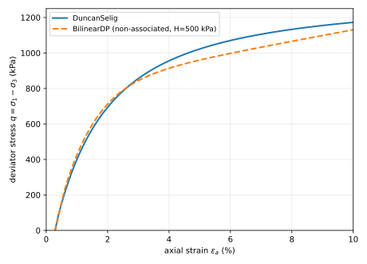
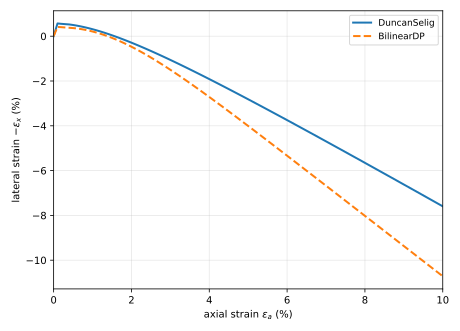
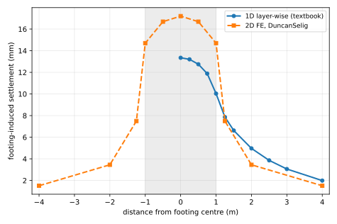

# [★★★☆☆] Triaxial Compression and Strip Footing Settlement of Sand

The [`DuncanSelig`](../../Library/Material/Material2D/DuncanSelig.md) model combines the hyperbolic Young's modulus of Duncan and Chang with the stress-dependent bulk modulus of Selig.
It is a *nonlinear elastic* plane-strain model: the tangent stiffness changes with the current stress level, but no plastic strain is accumulated and unloading/reloading follows the initial (undegraded) modulus.
This example has three parts.

1. A one-element drained compression test is used to show how the nine parameters are selected and what the model response looks like.
2. The same test is repeated with [`BilinearDP`](../../Library/Material/Material3D/DruckerPrager/BilinearDP.md) wrapped by [`PlaneStrain`](../../Library/Material/Wrapper/PlaneStrain.md), and the two curves are compared.
3. A 2 m wide strip footing is analysed and its settlement is checked against a conventional 1D layer-wise (textbook) computation based on the Boussinesq stress distribution.

The model scripts can be [downloaded](triaxial-compression-and-strip-footing-settlement.zip).

## The Model in Brief

With $p_a$ the reference pressure, $\sigma_3$ the compressive minor principal stress and $\sigma_d=\sigma_1-\sigma_3$, the source implements

$$
E_i=E_r\left(\dfrac{\sigma_3}{p_a}\right)^n,\qquad
B=B_r\left(\dfrac{\sigma_3}{p_a}\right)^m,\qquad
\phi=\phi_i-\Delta\phi\log_{10}\left(\dfrac{\sigma_3}{p_a}\right),
$$

$$
\sigma_{d,\max}=\dfrac{2}{r_f}\dfrac{c\cos\phi+\sigma_3\sin\phi}{1-\sin\phi},
\qquad
E=E_i\left(1-\dfrac{\sigma_d}{\sigma_{d,\max}}\right)^2.
$$

The bulk modulus is floored at $E/3$ and the degradation factor at $0.1$; both moduli are frozen for $\sigma_3/p_a\le0.1$.
The stiffness is assembled from $E$ and $B$ using $\nu=(3B-E)/(6B)$ and $G=3BE/(9B-E)$.
The tangent is **not symmetric** because $E$ and $B$ depend on the individual principal stresses, so `set symm_mat 0` is mandatory in every analysis below.
The model is natively plane strain (`PlaneType::E`); use `CP4`/`CP8` type elements and do **not** add a `PlaneStrain` wrapper.

## Part 1 — Drained Compression of a Soil Element

### Model

A unit square is meshed with one [`CP4`](../../Library/Element/Membrane/Plane/CP4.md) element.
The left and bottom edges are rollers, a constant cell pressure $\sigma_3=300~\mathrm{kPa}$ is applied as two nodal forces of $-150$ on the right edge, and the top edge is compressed by a displacement of $-0.1$ (10% axial strain) in 100 fixed substeps.

```
node 1 0 0
node 2 1 0
node 3 1 1
node 4 0 1

material DuncanSelig 1 100 40000 .6 27000 .2 .7 .1 .7 3

element CP4 1 1 2 3 4 1

fix 1 1 1 4
fix 2 2 1 2

amplitude Constant 1
cload 1 1 -150 1 2 3
displacement 2 0 -0.1 2 3 4

step static 1
set fixed_step_size true
set ini_step_size 1E-2
set symm_mat 0
```

The deviator stress is recovered from the vertical reactions, $q=\sigma_1-\sigma_3=-R_{y,3}-R_{y,4}-300$ (the width and thickness are both one).

### Parameter Selection

All stresses and moduli are entered in the **same units** (kPa here); friction angles are in **radians**, not degrees.
All nine numbers are required; the trailing density is the only optional argument.

| # | Symbol | Value | How it is obtained |
|---|--------|-------|--------------------|
| 1 | $p_a$ | 100 kPa | Reference atmospheric pressure; only normalises stresses. Use 14.7 for psi. |
| 2 | $E_r$ | 40 000 kPa | Initial modulus at $\sigma_3=p_a$, i.e. $K=E_r/p_a=400$. From the intercept of $E_i$ versus $\sigma_3/p_a$ measured in triaxial tests. |
| 3 | $n$ | 0.6 | Slope of $\log E_i$ versus $\log(\sigma_3/p_a)$; 0.5–0.8 for sands. |
| 4 | $B_r$ | 27 000 kPa | Bulk modulus at $p_a$, i.e. $K_b=B_r/p_a=270$. From the slope of the hydrostatic compression curve. |
| 5 | $m$ | 0.2 | Exponent of the bulk modulus; usually smaller than $n$. |
| 6 | $\phi_i$ | 0.7 rad (40.1°) | Peak friction angle at $\sigma_3=p_a$, from triaxial compression. |
| 7 | $\Delta\phi$ | 0.1 rad (5.7°) | Loss of friction angle per tenfold increase of $\sigma_3$ (curvature of the strength envelope). |
| 8 | $r_f$ | 0.7 | Failure ratio $q_f/q_u$; 0.7–0.95. The hyperbola reaches its asymptote $q_u=\sigma_{d,\max}$ at infinite strain. |
| 9 | $c$ | 3 kPa | Small apparent cohesion; keeps $\sigma_{d,\max}$ finite at very low confinement. Use 0 for a purely cohesionless sand. |

At $\sigma_3=300~\mathrm{kPa}$ the power laws give $E_i=77.3~\mathrm{MPa}$, $B=33.6~\mathrm{MPa}$ ($\nu=0.117$), $\phi=37.4°$, $\sigma_{d,\max}=1341~\mathrm{kPa}$ and $q_f=r_f\sigma_{d,\max}=939~\mathrm{kPa}$.
The values are the SI conversion of the canonical parameter set shipped with the source (`material DuncanSelig 1 14.7 6000 .6 4000 .2 .7 .1 .7 .5`, in psi), which is also used in the unit tests and iso-error maps of the library page.

!!! warning "units and angles"
    $\phi_i$ and $\Delta\phi$ are radians: 40° is entered as `0.698`, a 6° drop per decade as `0.105`.
    Cohesion, both reference moduli and $p_a$ must use one consistent stress unit.

## Part 2 — Comparison with Bilinear Drucker–Prager

The `BilinearDP` model is a 3D elastoplastic cone with linear cohesion hardening,
$c=c_0+H\bar\varepsilon_p$.
It is wrapped by `material PlaneStrain 2 1` because `DuncanSelig` is native plane strain while `BilinearDP` is 3D.
The input line used for the comparison is

```
material BilinearDP 1 77327 0.1168 0.571 0.173 0.752 3 500
material PlaneStrain 2 1
element CP4 1 1 2 3 4 2
```

The constants are calibrated as follows.

* $E=77\,327~\mathrm{kPa}$ and $\nu=0.1168$ reproduce the small-strain stiffness $E_i$ and $B$ of `DuncanSelig` at $\sigma_3=300~\mathrm{kPa}$. This is a *point* match: `BilinearDP` keeps them constant thereafter, whereas `DuncanSelig` restiffens with confinement.
* $\eta_y=0.571$ and $\xi=0.752$ come from the **plane-strain** Mohr–Coulomb fit with $\phi=37.4°$ given on the [`NonlinearDruckerPrager`](../../Library/Material/Material3D/DruckerPrager/NonlinearDruckerPrager.md) page. They define the yield surface, not a separate failure surface.
* $\eta_f=0.173$ is the potential (dilatancy) parameter fitted with a dilation angle $\psi=10°$. Associative flow ($\eta_f=\eta_y$) would produce about 32% lateral strain at 10% axial strain — roughly three times the measured dilation of dense sand. Non-associated flow also makes the tangent nonsymmetric, another reason for `set symm_mat 0`.
* $c_0=3~\mathrm{kPa}$ is the same cohesion as in the hyperbolic model, and $H=500~\mathrm{kPa}$ is chosen so that the two curves nearly match again at 10% axial strain (1131 versus 1173 kPa). This is a calibration to the curve, not a strength parameter.



The two curves are close, but for different reasons.
`DuncanSelig` is smoothly nonlinear from the first increment: the tangent modulus decays as the stress level $q/\sigma_{d,\max}$ rises, and there is no distinct yield event.
`BilinearDP` is linear until the yield surface is reached at about 2% strain (visible as the kink), then hardens with a constant plastic slope.
The agreement at 10% strain is a consequence of choosing $H$; it does not imply that either model predicts the same response for a different confinement or load path.



The lateral strains differ more than the deviatoric stresses: the elastoplastic cone dilates about 1.4 times as much as the hyperbolic model at 10% axial strain.
Use `recorder 3 hdf5 Element PE 1` to see the accumulated plastic strain in the DP case — the corresponding history entry of `DuncanSelig` only stores the maximum deviatoric stress ever reached and is **not** a yield indicator.

## Part 3 — Strip Footing Settlement and Textbook Reference

### Finite Element Model

A 2 m wide flexible strip footing carries a uniform pressure $q=100~\mathrm{kPa}$ on a dry sand layer with $\gamma=18~\mathrm{kN/m^3}$.
Only half of the symmetric domain is strictly needed, but the full $8~\mathrm{m}\times8~\mathrm{m}$ mesh of 60 `CP4` elements is used for a direct comparison with the analytical profile.
The analysis has two static steps:

1. gravity is applied with `groupbodyforce 1 0 -18 2 1` to establish the geostatic stress;
2. the footing pressure (a total of 225 kN/m over an effective width of 2.25 m, i.e. 100 kPa) is ramped with a tabular amplitude from $t=1$ to $t=2$.

The surface settlement caused by the footing alone is $u_y(t=3)-u_y(t=1)$.
At the footing centre it is

$$
s_{\mathrm{FE}}=17.2~\mathrm{mm}.
$$

!!! note "practical reminder"
    `set symm_mat 0` is again essential; with symmetric matrix storage the system becomes singular and the analysis stops with error code 206.
    The local Newton iteration with backtracking in `DuncanSelig` makes 2D models relatively slow, so the mesh and the number of substeps are deliberately modest.

### Conventional Computation

The standard 1D settlement calculation assumes zero lateral strain in each sublayer and a vertical stress increment from elastic half-space theory.
For a strip of half width $a=1~\mathrm{m}$ loaded by $q$, the Boussinesq stress at offset $x$ and depth $z$ is

$$
\Delta\sigma_z=\dfrac{q}{\pi}\left[z\left(\dfrac{u_2}{u_2^2+z^2}-\dfrac{u_1}{u_1^2+z^2}\right)+\arctan\dfrac{u_2}{z}-\arctan\dfrac{u_1}{z}\right],
\qquad u_1=-a-x,\quad u_2=a-x,
$$

which reduces to $\Delta\sigma_z=(q/\pi)(2\alpha+\sin 2\alpha)$ with $\alpha=\arctan(a/z)$ below the centre.
Take $K_0=1-\sin\phi_i=0.356$ and, in each of 32 layers of thickness $0.25~\mathrm{m}$,

$$
\sigma_v=\gamma z+\Delta\sigma_z,\quad
\sigma_3=K_0\sigma_v,\quad
\sigma_d=(1-K_0)\sigma_v,\quad
M=\dfrac{3B(3B+E)}{9B-E},
$$

where $E$ and $B$ are evaluated from the three power laws above at the current $\sigma_3$ and $E$ includes the hyperbolic degradation.
The layer settlement is obtained by integrating $d\varepsilon_z=d\sigma_v/M$ along the stress path from $\gamma z$ to $\gamma z+\Delta\sigma_z$.
The script `reference/settlement.py` in the download performs this calculation with numpy only.

| $z$ (m) | $\Delta\sigma_z$ (kPa) | $\sigma_3$ (kPa) | $E$ (MPa) | $M$ (MPa) | $\Delta s$ (mm) |
|--------:|-----------------------:|-----------------:|----------:|----------:|----------------:|
| 0.125 | 99.9 | 36.3 | 11.4 | 27.4 | 1.16 |
| 0.625 | 93.1 | 37.1 | 11.5 | 27.6 | 1.02 |
| 1.125 | 77.9 | 34.9 | 11.2 | 27.1 | 0.83 |
| 2.125 | 52.5 | 32.3 | 10.8 | 26.6 | 0.54 |
| 4.125 | 29.7 | 37.0 | 11.5 | 27.5 | 0.28 |
| 7.125 | 17.6 | 51.9 | 13.3 | 30.0 | 0.15 |

Summing all layers gives

$$
s_{\mathrm{1D}}=13.3~\mathrm{mm},
$$

or only $11.6~\mathrm{mm}$ if the initial tangent modulus is used everywhere without stress-level degradation — a useful lower bound.
The 2D finite element result is 1.29 times the 1D value.
This is the expected order of magnitude: layer-wise summation suppresses lateral spreading and shear under a finite strip, so it is well known to underestimate footing settlement; correction factors of about 1.2–1.5 are common in practice.
The remaining difference also reflects the coarse mesh and the artificial lateral boundaries at $x=\pm4~\mathrm{m}$.



The surface profile shapes agree well: both methods give a broad dish with a maximum under the footing and a rapid decay outside it.
The steeper FE profile near the edges comes from the shear distortions that the 1D method cannot represent.

## Remarks

* `DuncanSelig` is intended for monotonic, quasi-static loading. It accumulates no plastic strain, cannot generate pore pressure, and returns to the undeformed configuration on unloading; it is not a cyclic soil model.
* The Mohr–Coulomb expression in the source only limits the tangent modulus — it is a strength cap, not a yield surface. For critical-state elastoplasticity use [`ExpCC`](../../Library/Material/Material3D/Clay/CamClay/ExpCC.md) with a `PlaneStrain` wrapper.
* The friction angle is entered in radians; the source evaluates $\phi$ from $\sigma_3$ and clamps it at zero for very high confinement.
* The stress exponent $n$ and $m$ should be fitted from tests covering the confinement range of the actual structure; extrapolating beyond the tested range is unsafe because the moduli are power laws.
* With $\eta_f=\eta_y$ and $H=0$ the DP comparison becomes an associated perfectly plastic cone; with $\eta_y=\eta_f=0$ it reduces to von Mises plasticity.
* The textbook settlement calculation is only a *check*, not a substitute for the FE analysis: it assumes one-dimensional compression and uses a homogeneous, weightless half-space to obtain $\Delta\sigma_z$.

## References

1. [DuncanSelig material documentation](../../Library/Material/Material2D/DuncanSelig.md)
2. [BilinearDP material documentation](../../Library/Material/Material3D/DruckerPrager/BilinearDP.md)
3. [NonlinearDruckerPrager documentation and fitting formulas](../../Library/Material/Material3D/DruckerPrager/NonlinearDruckerPrager.md)
4. Duncan, J. M. and Chang, C. Y., *Nonlinear Analysis of Stress and Strain in Soils*, Journal of the Soil Mechanics and Foundations Division, ASCE, 1970. [doi:10.1061/JSFEAQ.0001458](https://doi.org/10.1061/JSFEAQ.0001458)
5. Selig, E. T., *Soil Parameters for Geotechnical Engineering*, 1988.
