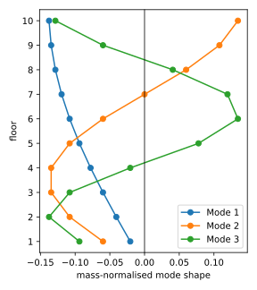
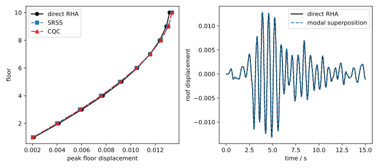

# [★★★☆☆] Modal Analysis of a Ten-Storey Shear Building

Minimum version: v4.4

The model files and the post-processing script can be downloaded as a [zip archive](modal-analysis-of-a-shear-building.zip).

## Introduction

This example demonstrates a complete modal analysis workflow for a small but realistic structural model:

1. define a ten-storey shear building with ten lateral DoFs,
2. run a [`Frequency`](../../../Library/Step/Frequency.md) step,
3. write the modal properties with the [Modal recorder](../../../Library/Recorder/ModalRecorder.md),
4. read and validate the modal data with Python,
5. use the mode shapes, participation factors and effective masses in a modal combination,
6. validate the modal superposition against a direct response history analysis.

The model is deliberately simple so that the stiffness and mass matrices can be assembled explicitly in Python and used as an independent reference.

## Model

The building is idealised as a ten-storey shear frame.
Each floor is a lumped mass of $$m=10$$ and the storeys are connected by linear shear springs of stiffness $$k=4.0\times10^4$$.
The base is fixed and all vertical displacements are restrained, leaving ten horizontal DoFs.

| parameter             | value        |
|-----------------------|--------------|
| number of floors      | 10           |
| floor mass            | 10           |
| storey stiffness      | $$4.0\times10^4$$ |
| damping ratio target  | 5% at modes 1 and 3 |

With the nodes numbered from the base to the roof, the lateral displacement vector is $$\mathbf{u}=[u_1,\ldots,u_{10}]^T$$.
The mass and stiffness matrices are

$$
\mathbf{M}=m\mathbf{I},
$$

$$
\mathbf{K}=k
\begin{bmatrix}
 2 & -1 &    &        &    \\
-1 &  2 & -1 &        &    \\
   & -1 &  2 & \ddots &    \\
   &    & \ddots & \ddots & -1 \\
   &    &    & -1 & 1
\end{bmatrix}.
$$

The model file is shown below.

```text title="shear-building.supan"
# modal analysis of a ten-storey shear building
# units: mass in t, length in m, force in kN
node 1 0 0
node 2 1 0
node 3 2 0
node 4 3 0
node 5 4 0
node 6 5 0
node 7 6 0
node 8 7 0
node 9 8 0
node 10 9 0
node 11 10 0

material Elastic1D 1 4.0E4

element Spring01 1 1 2 1
element Spring01 2 2 3 1
element Spring01 3 3 4 1
element Spring01 4 4 5 1
element Spring01 5 5 6 1
element Spring01 6 6 7 1
element Spring01 7 7 8 1
element Spring01 8 8 9 1
element Spring01 9 9 10 1
element Spring01 10 10 11 1

mass 11 2 10 1
mass 12 3 10 1
mass 13 4 10 1
mass 14 5 10 1
mass 15 6 10 1
mass 16 7 10 1
mass 17 8 10 1
mass 18 9 10 1
mass 19 10 10 1
mass 20 11 10 1

fix 1 E 1
fix 2 U2 1 2 3 4 5 6 7 8 9 10 11

recorder 1 hdf5 Modal U1

step frequency 1 10
analyze

peek eigenvalue
peek recorder 1
save recorder 1

exit
```

The [`Spring01`](../../../Library/Element/Special/Spring01.md) elements provide the storey shear stiffness.
Their orientation is along the global $$x$$ axis.
The [`Mass`](../../../Library/Element/Special/Mass.md) elements add a lumped translational mass in `U1` at nodes 2 to 11.
The base node 1 is fully fixed and `U2` is restrained at all nodes so that the only free DoFs are the ten `U1` DoFs.

The `Modal` recorder requires the influence direction.
Here `U1` is used, which corresponds to a uniform horizontal acceleration at all floors.

## Modal Analysis

Run the model with

```bash
suanPan -np -f shear-building.supan
```

The `Frequency` step computes all ten eigenpairs.
The eigenvalue output is

```text
Eigenvalues:
   8.9353e+01
   7.9225e+02
   2.1356e+03
   4.0000e+03
   6.2198e+03
   8.5978e+03
   1.0923e+04
   1.2988e+04
   1.4610e+04
   1.5645e+04
```

The `Modal` recorder writes `R1-Modal.h5`.
Its structure follows the layout described in the [Modal recorder documentation](../../../Library/Recorder/ModalRecorder.md):

```text
R1-Modal.h5
├── Frequency
├── U1
│   ├── ParticipationFactor
│   └── EffectiveMass
├── Mode 1
│   ├── N1 ... N11
│   └── F1 ... F11
├── Mode 2
│   └── ...
└── ...
```

For this two-dimensional model each node stores two local DoF components, `[U1, U2]`.
The lateral mode-shape component of a floor is therefore the first entry of its `N` dataset.
The second entry is the restrained `U2` component and is zero.
The `F` datasets contain the nodal modal elastic forces assembled from the element stiffness matrices.
In particular, `F1` contains the base reaction, while the `F` entries for nodes 2 to 11 are the storey forces.

## Post-Processing the Modal Data

The complete post-processing script is [modal-analysis-of-a-shear-building.py](modal-analysis-of-a-shear-building.py).
It performs the validation and produces the figures shown below.

### Reading the Modal Data

The modal data are read as follows.

```python
import h5py
import numpy as np

N_FLOOR = 10

with h5py.File('R1-Modal.h5', 'r') as file:
    frequency = file['Frequency'][()].ravel()
    participation = file['U1/ParticipationFactor'][()].ravel()
    effective_mass = file['U1/EffectiveMass'][()].ravel()

    shape = np.zeros((N_FLOOR, frequency.size))
    for mode in range(frequency.size):
        for floor, node in enumerate(range(2, 2 + N_FLOOR)):
            shape[floor, mode] = file[f'Mode {mode + 1}/N{node}'][()].ravel()[0]
```

The first floor is node 2 and the roof is node 11, so the loop over `range(2, 12)` maps the nodal datasets to the ten floors.
The `N` dataset is stored in the node-local DoF order `[U1, U2]`; index `0` extracts `U1`.

The modal properties are summarised in the following table.
The sign of the participation factor depends on the arbitrary sign of the mode shape.
The effective mass is always positive.

| mode | frequency / Hz | $$\Gamma_{n,U1}$$ | $$m_{n,U1}$$ | mass ratio / % |
|-----:|---------------:|------------------:|-------------:|---------------:|
| 1    | 1.5044         | -9.2083           | 84.7925      | 84.79          |
| 2    | 4.4797         | -3.0234           | 9.1408       | 9.14           |
| 3    | 7.3549         | -1.7583           | 3.0915       | 3.09           |
| 4    | 10.0658        | 1.1952            | 1.4286       | 1.43           |
| 5    | 12.5519        | 0.8653            | 0.7488       | 0.75           |
| 6    | 14.7576        | -0.6403           | 0.4100       | 0.41           |
| 7    | 16.6336        | -0.4705           | 0.2214       | 0.22           |
| 8    | 18.1380        | 0.3323            | 0.1104       | 0.11           |
| 9    | 19.2373        | -0.2129           | 0.0453       | 0.05           |
| 10   | 19.9068        | 0.1040            | 0.0108       | 0.01           |

The first three modes mobilise more than 97% of the total mass in the `U1` direction.
The sum of all effective masses is equal to the total mass, 100.

The first three mode shapes are shown below.



### Validation of the Modal Properties

The script independently assembles

$$
\mathbf{M}=m\mathbf{I},\qquad
\mathbf{K}=k\begin{bmatrix}
 2 & -1 &    &        &    \\
-1 &  2 & -1 &        &    \\
   & -1 &  2 & \ddots &    \\
   &    & \ddots & \ddots & -1 \\
   &    &    & -1 & 1
\end{bmatrix}
$$

and solves the generalised eigenproblem with `scipy.linalg.eigh`.
For the force check it also assembles the full stiffness matrix, including the restrained base node, so that the base reaction is validated together with the storey forces.
It then checks the following quantities.

| quantity                                        | maximum error |
|-------------------------------------------------|--------------:|
| relative frequency error                        | $$4.74\times10^{-10}$$ |
| $$\lVert\boldsymbol{\Phi}^T\mathbf{M}\boldsymbol{\Phi}-\mathbf{I}\rVert_\infty$$ | $$1.84\times10^{-12}$$ |
| mode-shape difference (sign-adjusted)           | $$5.51\times10^{-10}$$ |
| participation-factor error                      | $$4.44\times10^{-16}$$ |
| effective-mass error                            | $$1.78\times10^{-15}$$ |
| relative modal elastic-force error (including base reaction) | $$1.28\times10^{-9}$$ |
| $$\sum_n m_{n,U1}/\sum_i m_i$$                  | $$1.000000000$$ |

The mode-shape comparison is sign-adjusted because eigenvectors are only defined up to an arbitrary sign.
The remaining errors are at the level of floating-point round-off.
In particular, the identity

$$
\sum_n m_{n,U1}=\mathbf{1}^T\mathbf{M}\mathbf{1}=100
$$

is reproduced by the recorder data.

## Modal Combination

### Modal Response

For a base excitation with ground acceleration $$\ddot{u}_g(t)$$, the equations of motion are

$$
\mathbf{M}\ddot{\mathbf{u}}+\mathbf{C}\dot{\mathbf{u}}+\mathbf{K}\mathbf{u}
=-\mathbf{M}\mathbf{1}\ddot{u}_g.
$$

Using the mass-normalised mode shapes and the modal coordinate

$$
\mathbf{u}(t)=\sum_n\boldsymbol{\phi}_n q_n(t),
$$

the modal equation is

$$
\ddot{q}_n+2\zeta_n\omega_n\dot{q}_n+\omega_n^2q_n
=-\Gamma_n\ddot{u}_g.
$$

For a response spectrum analysis, let $$S_d(T_n,\zeta_n)$$ be the peak displacement of a unit-mass SDOF oscillator with period $$T_n$$ and damping ratio $$\zeta_n$$.
The peak modal contribution to the displacement of floor $$i$$ is

$$
u_{n,i}=\Gamma_n\phi_{n,i}S_d(T_n,\zeta_n).
$$

The corresponding peak modal base shear is

$$
V_n=\Gamma_n^2S_a(T_n,\zeta_n)=m_{n,U1}S_a(T_n,\zeta_n),
$$

where $$S_a=\omega_n^2S_d$$ is the pseudo-acceleration.

### Combination Rules

The SRSS estimate is

$$
r\approx\sqrt{\sum_n r_n^2}.
$$

The CQC estimate is

$$
r\approx\sqrt{\sum_j\sum_k\rho_{jk}r_jr_k},
$$

with the correlation coefficient

$$
\rho_{jk}=
\frac{
8\sqrt{\zeta_j\zeta_k}(\omega_j\omega_k)^{3/2}
\left(\zeta_j\omega_j+\zeta_k\omega_k\right)
}{
\left(\omega_j^2-\omega_k^2\right)^2
+4\zeta_j\zeta_k\omega_j\omega_k\left(\omega_j^2+\omega_k^2\right)
+4\left(\zeta_j^2+\zeta_k^2\right)\omega_j^2\omega_k^2
}.
$$

The diagonal terms are $$\rho_{jj}=1$$.
The CQC rule accounts for the correlation between close modes, while SRSS is adequate when the modes are well separated.

The script computes the response spectrum of the supplied record for each mode and applies these rules.

```python
modal_peak = shape * (participation * spectral_displacement)

srss = np.sqrt(np.sum(modal_peak**2, axis=1))
cqc = np.sqrt(np.einsum('fm,mn,fn->f', modal_peak, rho, modal_peak))
```

Here `modal_peak` has one row per floor and one column per mode.
`rho` is the CQC correlation matrix.

### Response History Validation

To provide an independent check, the same model is analysed with a direct response history analysis.
The record `ground_motion.txt` contains 501 samples at a time step of 0.03 s.
Its values are in gal; the load is scaled so that it represents the inertial force from a base acceleration in m/s$$^2$$.

The model uses a 5% damping ratio at the first and third modes.
The Rayleigh coefficients are

$$
a_1=\frac{2\zeta}{\omega_1+\omega_3},\qquad a_0=a_1\omega_1\omega_3,
$$

with $$\zeta=0.05$$, giving

```text
a0 = 7.847496E-1
a1 = 1.796458E-3
```

The response history model differs from the modal model only in the damping, load and analysis settings.
The full file is included in the download; the additional commands are

```text
# 5% damping at modes 1 and 3
modifier Rayleigh 1 7.847496E-1 1.796458E-3 0. 0.

amplitude Tabular 1 ground_motion.txt

# equivalent lateral force -m * a_g, with m = 10 and the record in gal
cload 1 1 -0.1 U1 2 3 4 5 6 7 8 9 10 11

hdf5recorder 2 Node U1 2 3 4 5 6 7 8 9 10 11

step dynamic 1 20
set ini_step_size 0.01
set fixed_step_size 1

integrator Newmark 1
converger AbsIncreDisp 1 1E-10 10 1

analyze
save recorder 2
exit
```

The factor `-0.1` is the product of the floor mass and the gal-to-m/s$$^2$$ conversion: $$-0.1=-10\times0.01$$.
With equal floor masses, a single `cload` therefore represents $$-m\mathbf{1}\ddot{u}_g$$.
For unequal masses, one `cload` per floor with magnitude $$-m_i\times0.01$$ should be used.

The script reconstructs the response history from the modal data,

$$
\mathbf{u}(t)=\sum_n\boldsymbol{\phi}_n q_n(t),
$$

where each modal coordinate is obtained from the same Newmark scheme as the direct analysis.
It also computes the SRSS and CQC estimates from the response spectrum.

The results are summarised below.

| quantity                                   | direct RHA | SRSS     | CQC      |
|--------------------------------------------|-----------:|---------:|---------:|
| peak roof displacement                     | 0.01316773 | 0.01336153 | 0.01335738 |
| peak base shear                            | 84.3252    | 81.2951  | 81.4502  |

The modal time-history superposition differs from the direct response history by at most $$1.48\times10^{-5}$$ in relative terms.
This confirms that the participation factors and mode shapes stored by the recorder are consistent with the equations of motion.

The SRSS and CQC estimates are within about 3.6% and 3.4% of the direct peak floor displacements, respectively.
The differences arise because the peak modal responses do not occur at the same time.
The combination rules are estimates of the peak response, not an exact time-history reconstruction.

The left panel below compares the peak floor displacements; the right panel compares the roof displacement history.



## Files

The example directory contains:

| file | description |
|------|-------------|
| `shear-building.supan` | modal analysis and `Modal` recorder |
| `shear-building-rha.supan` | direct response history analysis |
| `ground_motion.txt` | ground acceleration record used for the validation |
| `modal-analysis-of-a-shear-building.py` | post-processing and validation script |

## Remarks

1. The `Modal` recorder writes frequencies in hertz.
   The eigenvalues printed by `peek eigenvalue` are $$\omega_n^2=(2\pi f_n)^2$$.
2. The mode-shape sign is arbitrary.
   When comparing results, either align the signs or compare the absolute values.
3. The effective mass is the most convenient quantity for deciding how many modes to include.
   For this model, three modes capture more than 97% of the mass in the `U1` direction.
4. The recorder stores nodal data in the node-local DoF order, including restrained components.
   See the [Modal recorder documentation](../../../Library/Recorder/ModalRecorder.md) for the exact layout.
