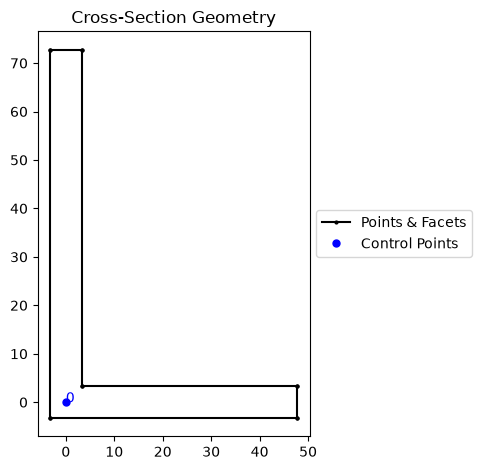

## Benchmarks

We present some benchmark problems for the B31OS element.

For further references, please see [this](https://doi.org/10.1016/j.engstruct.2021.112239) paper and the references therein.

### Angle Section


The cantilever beam with the angle section is under an axial load applied at the shear centre.

#### Remarks

1. The section is not rotated.
2. The axial load is applied at the shear centre. The section is defined in the local coordinate system in which the shear centre is the origin.


```python
import os
import shutil
from subprocess import run

from sectionproperties.post.fibre import to_fibre_section
from sectionproperties.pre import Geometry

temp_dir = "b31os_temp"

os.mkdir(temp_dir)
os.chdir(temp_dir)

b = 51
t = 6.5
a = 76
points = [(0, 0), (b, 0), (b, t), (t, t), (t, a), (0, a)]

facets = [(0, 1), (1, 2), (2, 3), (3, 4), (4, 5), (5, 0)]

geom = Geometry.from_points(
    points=points, facets=facets, control_points=[(t / 2, t / 2)]
).shift_section(-t / 2, -t / 2)
geom.create_mesh(mesh_sizes=2)
geom.plot_geometry()

to_fibre_section(geom, save_to="angle.sp", material_mapping={"default": 1})
```





    '# This is generated by sectionproperties library.\n# Please note the following:\n#   1. The warping function and its derivatives (if present) are computed in the\n#      local coordinate system (about origin).\n#   2. Beware of the potential different orientations of beam section.\n#   3. It may be necessary to manually adjust the material tags.\n#   4. If uncertain, please validate the behaviour first.\nsection Fibre3DOS 1 2 3 4 5 6 7 8 9 10 11 12 13 14 15 16 17 18 19 20 21 22 23 24 25 26 27 28 29 30 31 32 33 34 35 36 37 38 39 40 41 42 43 44 45 46 47 48 49 50 51 \\\n52 53 54 55 56 57 58 59 60 61 62 63 64 65 66 67 68 69 70 71 72 73 74 75 76 77 78 79 80 81 82 83 84 85 86 87 88 89 90 91 92 93 94 95 96 97 98 99 100 101 102 103 104 \\\n105 106 107 108 109 110 111 112 113 114 115 116 117 118 119 120 121 122 123 124 125 126 127 128 129 130 131 132 133 134 135 136 137 138 139 140 141 142 143 144 145 \\\n146 147 148 149 150 151 152 153 154 155 156 157 158 159 160 161 162 163 164 165 166 167 168 169 170 171 172 173 174 175 176 177 178 179 180 181 182 183 184 185 186 \\\n187 188 189 190 191 192 193 194 195 196 197 198 199 200 201 202 203 204 205 206 207 208 209 210 211 212 213 214 215 216 217 218 219 220 221 222 223 224 225 226 227 \\\n228 229 230 231 232 233 234 235 236 237 238 239 240 241 242 243 244 245 246 247 248 249 250 251 252 253 254 255 256 257 258 259 260 261 262 263 264 265 266 267 268 \\\n269 270 271 272 273 274 275 276 277 278 279 280 281 282 283 284 285 286 287 288 289 290 291 292 293 294 295 296 297 298 299 300 301 302 303 304 305 306 307 308 309 \\\n310 311 312 313 314 315 316 317 318 319 320 321 322 323 324 325 326 327 328 329 330 331 332 333 334 335 336 337 338 339 340 341 342 343 344 345 346 347 348 349 350 \\\n351 352 353 354 355 356 357 358 359 360 361 362 363 364 365 366 367 368 369 370 371 372 373 374 375 376 377 378 379 380 381 382 383 384 385 386 387 388 389 390 391 \\\n392 393 394 395 396 397 398 399 400 401 402 403 404 405 406 407 408 409 410 411 412 413 414 415 416 417 418 419 420 421 422 423 424 425 426 427 428 429 430 431 432 \\\n433 434 435 436 437 438 439 440 441 442 443 444 445 446 447 448 449 450 451 452 453 454 455 456 457 458 459 460 461 462 463 464 465 466 467 468 469 470 471 472 473 \\\n474 475 476 477 478 479 480 481 482 483 484 485 486 487 488 489 490 491 492 493 494 495 496 497 498 499 500 501 502 503 504 505 506 507 508 509 510 511 512 513 514 \\\n515 516 517 518 519 520 521 522 523 524 525 526 527 528 529 530 531 532 533 534 535 536 537 538 539 540 541 542 543 544 545 546 547 548 549 550 551 552 553 554 555 \\\n556 557 558 559 560 561 562 563 564 565 566 567 568 569 570 571 572 573 574 575 576 577 578 579 580 581 582 583 584 585 586 587 588 589 590 591 592 593 594 595 596 \\\n597 598 599 600 601 602 603 604 605 606 607 608 609 610 611 612 613 614 615 \n\nsection Cell3DOS 2 8.53678889e-01 3.53540038e+00 2.10126847e+00 -6.34917468e-01 1 7.19882276e-02 -2.23131563e+00\nsection Cell3DOS 3 1.77365452e+00 7.57394537e+01 2.50774099e+00 -2.79904102e+01 1 2.79905468e+01 -2.50807915e+00\nsection Cell3DOS 4 1.07299078e+00 -5.95096925e+01 4.48443248e+01 -1.24597531e+00 1 -1.24597950e+00 4.48443308e+01\nsection Cell3DOS 5 9.06384914e-01 -1.60171868e+02 6.28079401e+01 -2.45268590e+00 1 -2.49305565e+00 6.28232209e+01\nsection Cell3DOS 6 1.13478144e+00 5.43971735e+01 2.21283954e+00 -2.20807933e+01 1 2.20808560e+01 -2.21276399e+00\nsection Cell3DOS 7 1.82287493e+00 1.73683811e+01 1.27975870e+00 -9.46284665e+00 1 9.50000000e+00 -1.25113424e+00\nsection Cell3DOS 8 1.59014994e+00 -5.11186545e+01 1.69372219e+01 -2.80493444e+00 1 -2.80364212e+00 1.69375000e+01\nsection Cell3DOS 9 8.74237717e-01 -4.35803368e+01 2.48512655e+01 -1.60741342e+00 1 -1.60739344e+00 2.48512856e+01\nsection Cell3DOS 10 1.00149990e+00 -9.22424517e+00 5.10928636e+00 -1.35468345e+00 1 -1.13793320e+00 5.29171403e+00\nsection Cell3DOS 11 1.11449822e+00 1.06768355e+01 1.44519937e-01 -3.53482952e+01 1 3.53612994e+01 -1.45382004e-01\nsection Cell3DOS 12 1.21948001e+00 4.67594199e+01 1.14578357e+00 -3.57169872e+01 1 3.57302293e+01 -1.15418021e+00\nsection Cell3DOS 13 1.80518628e+00 2.55322834e+01 6.20510435e-01 -3.21766796e+01 1 3.21793449e+01 -6.21402511e-01\nsection Cell3DOS 14 1.77639124e+00 8.01495380e+00 5.35561489e+01 2.17468366e-01 1 2.17520133e-01 5.35566319e+01\nsection Cell3DOS 15 1.13963669e+00 -9.27830084e+01 3.73229166e+01 -2.38857058e+00 1 -2.38857069e+00 3.73229167e+01\nsection Cell3DOS 16 1.06489353e+00 -8.20922058e+01 -2.73701197e+00 -3.19889468e+01 1 3.19895833e+01 2.73948925e+00\nsection Cell3DOS 17 1.58474501e+00 -8.10318548e+01 -2.48127298e+00 -3.47672309e+01 1 3.47708333e+01 2.49027206e+00\nsection Cell3DOS 18 1.09776082e+00 8.47126744e+01 2.44025656e+00 -3.24085289e+01 1 3.24097148e+01 -2.44312429e+00\nsection Cell3DOS 19 8.70227236e-01 1.70487183e+01 4.00445108e-01 -2.87380368e+01 1 2.87385690e+01 -4.00550393e-01\nsection Cell3DOS 20 1.20513617e+00 6.25627646e+01 2.24170327e+00 -2.54374398e+01 1 2.54375000e+01 -2.24178151e+00\nsection Cell3DOS 21 1.32359735e+00 -1.84094852e+01 -6.56809759e-01 -3.61172214e+01 1 3.61354291e+01 6.63041149e-01\nsection Cell3DOS 22 1.38480803e+00 4.48232823e+01 9.84678537e-01 -3.86400252e+01 1 3.86985298e+01 -1.01687579e+00\nsection Cell3DOS 23 1.64811433e+00 -5.72375405e+01 -1.88031740e+00 -3.33181227e+01 1 3.33210223e+01 1.88419881e+00\nsection Cell3DOS 24 1.12818561e+00 7.28414097e+01 2.13802825e+00 -3.14548157e+01 1 3.14558463e+01 -2.13973935e+00\nsection Cell3DOS 25 1.97401599e+00 -4.17470295e+01 -1.53848845e+00 -3.07162693e+01 1 3.07172629e+01 1.53941913e+00\nsection Cell3DOS 26 1.21649227e+00 -2.78756392e+01 -1.02735139e+00 -3.24748121e+01 1 3.24777656e+01 1.02890838e+00\nsection Cell3DOS 27 1.33766150e+00 -5.98458875e+01 -2.33501522e+00 -2.79974482e+01 1 2.79976117e+01 2.33535282e+00\nsection Cell3DOS 28 1.06489353e+00 -8.46291082e+01 -2.73560094e+00 -3.29157492e+01 1 3.29166667e+01 2.73948925e+00\nsection Cell3DOS 29 1.24627253e+00 -2.86642990e+01 -1.29894428e+00 -2.63287819e+01 1 2.63289314e+01 1.29903523e+00\nsection Cell3DOS 30 9.81672639e-01 -2.28009866e+00 -2.58635286e-01 -3.02083156e+01 1 3.02094135e+01 2.58795156e-01\nsection Cell3DOS 31 1.98642629e+00 -5.04459203e+01 -1.62972510e+00 -3.42426659e+01 1 3.42481056e+01 1.63498162e+00\nsection Cell3DOS 32 7.49331548e-01 4.42826867e+01 1.29975253e+00 -2.97977788e+01 1 2.97985126e+01 -1.30026908e+00\nsection Cell3DOS 33 1.60581202e+00 8.22957462e+01 2.22427826e+00 -3.44002896e+01 1 3.44043303e+01 -2.23150565e+00\nsection Cell3DOS 34 1.59150757e+00 -5.40181057e+01 -1.88251186e+00 -3.16085574e+01 1 3.16098683e+01 1.88419881e+00\nsection Cell3DOS 35 1.05383232e+00 7.11801104e+01 2.18543969e+00 -3.00246124e+01 1 3.00251121e+01 -2.18631177e+00\nsection Cell3DOS 36 1.36951533e+00 1.89395827e+01 4.39682864e-01 -3.04646590e+01 1 3.04658587e+01 -4.39917339e-01\nsection Cell3DOS 37 1.47873923e+00 1.03765693e+02 2.93527736e+00 -3.34054508e+01 1 3.34062500e+01 -2.94072121e+00\nsection Cell3DOS 38 1.29952790e+00 -4.31171331e+01 -8.59209691e-01 -4.25886115e+01 1 4.30434447e+01 1.14417577e+00\nsection Cell3DOS 39 1.57993795e+00 -5.97951517e-01 -1.76771562e-01 -3.45602820e+01 1 3.45691026e+01 1.77530515e-01\nsection Cell3DOS 40 1.24627253e+00 -9.72755291e+00 -5.87968476e-01 -2.59612269e+01 1 2.59613788e+01 5.88001529e-01\nsection Cell3DOS 41 9.11423319e-01 4.30662086e+00 -4.48389163e-02 -2.74503032e+01 1 2.74506005e+01 4.48470104e-02\nsection Cell3DOS 42 1.25004570e+00 1.94250262e+01 4.08443228e-01 -3.38891980e+01 1 3.38955310e+01 -4.09783865e-01\nsection Cell3DOS 43 1.01415088e+00 5.89072956e+01 1.62068473e+00 -3.28739471e+01 1 3.28767682e+01 -1.62349995e+00\nsection Cell3DOS 44 1.66899424e+00 3.14554564e+01 8.27670276e-01 -3.12880092e+01 1 3.12896729e+01 -8.28363117e-01\nsection Cell3DOS 45 1.18763694e+00 5.32636705e+01 1.40794326e+00 -3.38039761e+01 1 3.38088837e+01 -1.41188131e+00\nsection Cell3DOS 46 1.73505694e+00 -7.58417580e-01 -1.92083010e-01 -3.27275266e+01 1 3.27312774e+01 1.92376810e-01\nsection Cell3DOS 47 8.70227236e-01 6.01511466e-01 -1.68857519e-01 -2.92245265e+01 1 2.92252086e+01 1.68904993e-01\nsection Cell3DOS 48 1.25084721e+00 4.12126069e+01 9.63575411e-01 -3.66083246e+01 1 3.66299000e+01 -9.74560255e-01\nsection Cell3DOS 49 7.49331548e-01 3.95612342e+01 1.17068327e+00 -2.90548919e+01 1 2.90554279e+01 -1.17101197e+00\nsection Cell3DOS 50 9.73946946e-01 6.46786628e+01 2.05660779e+00 -2.87504876e+01 1 2.87507774e+01 -2.05705466e+00\nsection Cell3DOS 51 1.46464925e+00 8.69193061e+01 2.63587921e+00 -3.08581890e+01 1 3.08586315e+01 -2.63733626e+00\nsection Cell3DOS 52 1.95195600e+00 -7.62223162e+01 -2.78137507e+00 -2.93880817e+01 1 2.93882367e+01 2.78211542e+00\nsection Cell3DOS 53 1.07823043e+00 8.77847349e+01 2.79825868e+00 -2.93850728e+01 1 2.93852306e+01 -2.79897551e+00\nsection Cell3DOS 54 9.50334914e-01 -2.29155540e+01 -9.81371993e-01 -2.89853298e+01 1 2.89858781e+01 9.81644386e-01\nsection Cell3DOS 55 1.97236597e+00 -5.20463197e+01 -1.92605611e+00 -2.98857321e+01 1 2.98862564e+01 1.92682498e+00\nsection Cell3DOS 56 1.48805580e+00 -5.15665531e+01 -2.20992383e+00 -2.58387944e+01 1 2.58388673e+01 2.21002384e+00\nsection Cell3DOS 57 1.86383771e+00 -6.98426517e+01 -2.80302505e+00 -2.68905747e+01 1 2.68906250e+01 2.80323740e+00\nsection Cell3DOS 58 1.85740901e+00 5.46126180e+01 2.47332787e+00 -1.98440722e+01 1 1.98441860e+01 -2.47304460e+00\nsection Cell3DOS 59 1.39657329e+00 -3.34204418e+01 -1.38993963e+00 -2.80240077e+01 1 2.80243168e+01 1.39017222e+00\nsection Cell3DOS 60 9.05339489e-01 2.26987144e+01 8.32958722e-01 -2.06044884e+01 1 2.06047024e+01 -8.32878317e-01\nsection Cell3DOS 61 1.11465629e+00 7.85669760e+01 2.78359751e+00 -2.62343372e+01 1 2.62343750e+01 -2.78373855e+00\nsection Cell3DOS 62 1.36745513e+00 1.50029336e+01 8.40943386e-01 -1.13596870e+01 1 1.13770904e+01 -8.33352757e-01\nsection Cell3DOS 63 1.43997866e+00 5.88519304e+01 2.24521755e+00 -2.37457267e+01 1 2.37457720e+01 -2.24521742e+00\nsection Cell3DOS 64 1.63734714e+00 -4.40661277e+01 -2.20595464e+00 -2.24869225e+01 1 2.24869792e+01 2.20589989e+00\nsection Cell3DOS 65 1.12949937e+00 -6.31475442e+00 -4.72736860e-01 -2.50711955e+01 1 2.50713094e+01 4.72751498e-01\nsection Cell3DOS 66 1.42048296e+00 -4.60673305e+01 -2.13097721e+00 -2.42164201e+01 1 2.42164714e+01 2.13099566e+00\nsection Cell3DOS 67 1.09676670e+00 -5.82469215e+01 -2.72422401e+00 -2.34140384e+01 1 2.34140625e+01 2.72420922e+00\nsection Cell3DOS 68 1.23740642e+00 -6.06473786e+01 -2.65673187e+00 -2.49117516e+01 1 2.49117839e+01 2.65678644e+00\nsection Cell3DOS 69 1.08116088e+00 -5.14574883e+01 -2.73186770e+00 -2.08645345e+01 1 2.08645833e+01 2.73169066e+00\nsection Cell3DOS 70 1.15472711e+00 -1.54260500e+01 -8.97482072e-01 -2.33586274e+01 1 2.33587175e+01 8.97473263e-01\nsection Cell3DOS 71 1.19548878e+00 -2.12857179e+01 -1.10474456e+00 -2.42799217e+01 1 2.42800078e+01 1.10475702e+00\nsection Cell3DOS 72 1.37628359e+00 3.57864496e+01 1.29159626e+00 -2.34198323e+01 1 2.34199128e+01 -1.29158806e+00\nsection Cell3DOS 73 1.10644231e+00 6.95000573e+01 2.78721153e+00 -2.29488738e+01 1 2.29488970e+01 -2.78717446e+00\nsection Cell3DOS 74 1.29561604e+00 7.22653475e+01 2.70800158e+00 -2.46405978e+01 1 2.46406250e+01 -2.70804296e+00\nsection Cell3DOS 75 8.13533751e-01 -6.57365514e+00 -7.52865157e-01 -1.61019818e+01 1 1.61037944e+01 7.52170450e-01\nsection Cell3DOS 76 1.02849558e+00 6.65475056e-01 -2.10230001e-01 -2.31759861e+01 1 2.31760874e+01 2.10226733e-01\nsection Cell3DOS 77 1.40574809e+00 4.45920008e+01 1.89880137e+00 -2.05697509e+01 1 2.05698950e+01 -1.89863413e+00\nsection Cell3DOS 78 1.26855111e+00 1.94556861e+01 5.58729587e-01 -2.49094173e+01 1 2.49095255e+01 -5.58744568e-01\nsection Cell3DOS 79 1.21812565e+00 2.55600782e+00 -1.35561100e-01 -2.19961815e+01 1 2.19963168e+01 1.35554514e-01\nsection Cell3DOS 80 1.44403703e+00 8.14406234e+00 1.35462416e-01 -1.92442434e+01 1 1.92446667e+01 -1.35435810e-01\nsection Cell3DOS 81 1.38258905e+00 2.02337379e+01 6.13981647e-01 -2.39355009e+01 1 2.39355939e+01 -6.13985573e-01\nsection Cell3DOS 82 1.47123628e+00 1.97261410e+01 6.56240931e-01 -2.16220101e+01 1 2.16221572e+01 -6.56204361e-01\nsection Cell3DOS 83 1.13306277e+00 3.35989298e+01 1.25917868e+00 -2.22861462e+01 1 2.22862468e+01 -1.25913463e+00\nsection Cell3DOS 84 1.78494496e+00 6.10617440e+01 2.04161526e+00 -2.71935201e+01 1 2.71936718e+01 -2.04181770e+00\nsection Cell3DOS 85 7.72021829e-01 3.88216154e+01 1.22400033e+00 -2.71897804e+01 1 2.71900031e+01 -1.22413482e+00\nsection Cell3DOS 86 1.24648778e+00 3.70437393e+01 1.23285730e+00 -2.55542096e+01 1 2.55543224e+01 -1.23291114e+00\nsection Cell3DOS 87 9.55889133e-01 1.25013828e+02 2.50108775e+00 -4.21040153e+01 1 4.21718750e+01 -2.85015095e+00\nsection Cell3DOS 88 1.32359735e+00 1.94999547e-01 -1.42997218e-01 -3.68651432e+01 1 3.68925551e+01 1.44937940e-01\nsection Cell3DOS 89 8.74945119e-01 3.07569841e+01 9.57116730e-01 -2.63473640e+01 1 2.63475287e+01 -9.57185301e-01\nsection Cell3DOS 90 9.64646913e-01 -2.04187153e+01 -9.46951203e-01 -2.74071297e+01 1 2.74073942e+01 9.47068201e-01\nsection Cell3DOS 91 8.71336259e-01 -2.58983408e+01 -1.40544709e+00 -2.23680042e+01 1 2.23680977e+01 1.40540256e+00\nsection Cell3DOS 92 1.08116088e+00 -5.39901169e+01 -2.73179173e+00 -2.17916306e+01 1 2.17916667e+01 2.73169066e+00\nsection Cell3DOS 93 1.14379054e+00 -1.22996652e+01 -8.30331205e-01 -2.14834865e+01 1 2.14836343e+01 8.30282484e-01\nsection Cell3DOS 94 1.74223105e+00 -3.69468185e+01 -2.10158589e+00 -2.02176445e+01 1 2.02177897e+01 2.10136703e+00\nsection Cell3DOS 95 1.60035896e+00 -1.49636131e+01 -1.00055953e+00 -2.04919655e+01 1 2.04921805e+01 1.00045617e+00\nsection Cell3DOS 96 1.67426365e+00 -1.49396338e+01 -1.21694912e+00 -1.68375173e+01 1 1.68386589e+01 1.21618084e+00\nsection Cell3DOS 97 1.54445173e+00 -3.25352583e+01 -2.25088171e+00 -1.69238534e+01 1 1.69244792e+01 2.24972115e+00\nsection Cell3DOS 98 1.26351956e+00 -3.42392768e+01 -2.13963270e+00 -1.85951007e+01 1 1.85953939e+01 2.13913259e+00\nsection Cell3DOS 99 1.00238428e+00 -4.38997467e+01 -2.77026152e+00 -1.78513736e+01 1 1.78515625e+01 2.76945623e+00\nsection Cell3DOS 100 1.51804730e+00 3.96116811e+01 1.93349368e+00 -1.76300997e+01 1 1.76306302e+01 -1.93274728e+00\nsection Cell3DOS 101 1.08413490e+00 -3.62353484e+01 -2.73304650e+00 -1.53014001e+01 1 1.53020833e+01 2.73026492e+00\nsection Cell3DOS 102 1.31481571e+00 -4.49968890e+01 -2.62006523e+00 -1.92905818e+01 1 1.92907064e+01 2.61967636e+00\nsection Cell3DOS 103 1.88597768e+00 -8.84600415e+00 -7.73939000e-01 -1.85900539e+01 1 1.85905848e+01 7.73731679e-01\nsection Cell3DOS 104 9.12216442e-01 -6.98969242e-01 -4.20798007e-01 -1.48464275e+01 1 1.48499062e+01 4.20078231e-01\nsection Cell3DOS 105 1.82939313e+00 -1.04266566e+00 -3.70671732e-01 -1.77600892e+01 1 1.77609332e+01 3.70515015e-01\nsection Cell3DOS 106 1.26312661e+00 2.95826989e+00 -1.29078243e-01 -1.99871115e+01 1 1.99874082e+01 1.29054242e-01\nsection Cell3DOS 107 1.52073650e+00 3.75285747e+01 1.67209412e+00 -1.91359452e+01 1 1.91362519e+01 -1.67177884e+00\nsection Cell3DOS 108 1.37320003e+00 6.27467007e+01 2.67571883e+00 -2.13819146e+01 1 2.13819590e+01 -2.67558953e+00\nsection Cell3DOS 109 1.54217857e+00 8.13266799e+01 2.13147408e+00 -3.53759407e+01 1 3.53826351e+01 -2.14264392e+00\nsection Cell3DOS 110 1.11009479e+00 -1.08436285e+01 -4.26547904e-01 -3.76549246e+01 1 3.76947161e+01 4.35034540e-01\nsection Cell3DOS 111 1.90360935e+00 1.09611375e+02 2.82802773e+00 -3.65052426e+01 1 3.65095548e+01 -2.85185948e+00\nsection Cell3DOS 112 9.21279209e-01 9.59513694e+01 2.38543787e+00 -3.74020419e+01 1 3.74160399e+01 -2.41827970e+00\nsection Cell3DOS 113 1.03035489e+00 1.15437393e+02 2.74229692e+00 -3.90253279e+01 1 3.90415066e+01 -2.81900188e+00\nsection Cell3DOS 114 1.92833400e+00 -6.13194620e+01 -1.82493680e+00 -3.63165383e+01 1 3.63295016e+01 1.84124410e+00\nsection Cell3DOS 115 1.18966165e+00 1.16893613e+02 2.59291703e+00 -4.05391685e+01 1 4.05781250e+01 -2.75236375e+00\nsection Cell3DOS 116 9.52572296e-01 6.23714079e+01 1.50798271e+00 -3.71650709e+01 1 3.71887909e+01 -1.52944419e+00\nsection Cell3DOS 117 1.10018980e+00 -2.73562362e+01 -7.23069608e-01 -4.09114778e+01 1 4.11072074e+01 8.04143989e-01\nsection Cell3DOS 118 1.67003619e+00 -7.76589760e+01 -2.52295912e-01 -4.46032104e+01 1 4.58500338e+01 1.89035450e+00\nsection Cell3DOS 119 9.32322995e-01 9.69223997e+01 2.33429982e+00 -3.83316688e+01 1 3.83542417e+01 -2.38542210e+00\nsection Cell3DOS 120 9.88919982e-01 -4.49368883e+01 -1.30131440e+00 -3.79607585e+01 1 3.79986882e+01 1.32988463e+00\nsection Cell3DOS 121 1.45563041e+00 -7.73314132e+01 -2.18727429e+00 -3.73737521e+01 1 3.73905997e+01 2.21799099e+00\nsection Cell3DOS 122 9.80008171e-01 6.25297582e+01 1.46264556e+00 -3.80894314e+01 1 3.81269927e+01 -1.49658658e+00\nsection Cell3DOS 123 1.47637938e+00 -1.35191470e+01 -4.60455949e-01 -3.93465680e+01 1 3.94385509e+01 4.84325420e-01\nsection Cell3DOS 124 1.51504489e+00 -8.26976466e+01 -2.16043167e+00 -3.93737467e+01 1 3.94187466e+01 2.24282681e+00\nsection Cell3DOS 125 1.09265700e+00 1.20411340e+01 1.64326529e-01 -3.84034604e+01 1 3.84630284e+01 -1.69313602e-01\nsection Cell3DOS 126 1.51504489e+00 -4.73313865e+01 -1.30494990e+00 -3.90347736e+01 1 3.90997518e+01 1.35472046e+00\nsection Cell3DOS 127 1.57424815e+00 -8.46215509e+01 -1.76233018e+00 -4.23908056e+01 1 4.26127158e+01 2.13379362e+00\nsection Cell3DOS 128 1.59774911e+00 -1.03734668e+02 -2.81558167e+00 -3.81396259e+01 1 3.81496397e+01 2.86701894e+00\nsection Cell3DOS 129 1.05849829e+00 -5.65015265e+00 -2.59526832e-01 -4.00889807e+01 1 4.02253353e+01 2.79145072e-01\nsection Cell3DOS 130 1.30202577e+00 -9.97784724e+01 -2.49660502e+00 -4.01717408e+01 1 4.02118152e+01 2.62580787e+00\nsection Cell3DOS 131 9.36885472e-01 1.86196445e+01 4.68832799e-01 -2.78986432e+01 1 2.78989998e+01 -4.68910203e-01\nsection Cell3DOS 132 7.95243098e-01 9.99909354e+00 1.67755270e-01 -2.65925984e+01 1 2.65928012e+01 -1.67768694e-01\nsection Cell3DOS 133 1.78164425e+00 2.56917347e+01 2.23829401e+00 -9.20975276e+00 1 9.23437500e+00 -2.19289394e+00\nsection Cell3DOS 134 1.08413490e+00 -3.87685453e+01 -2.73201842e+00 -1.62286972e+01 1 1.62291667e+01 2.73026492e+00\nsection Cell3DOS 135 1.54930359e+00 3.76889764e+01 2.08904075e+00 -1.54077331e+01 1 1.54091458e+01 -2.08680968e+00\nsection Cell3DOS 136 1.50388929e+00 -2.46988541e+01 -2.04518943e+00 -1.48072504e+01 1 1.48092290e+01 2.04216537e+00\nsection Cell3DOS 137 8.03035020e-01 7.35712682e+00 1.12968796e-01 -1.61211715e+01 1 1.61230916e+01 -1.12861191e-01\nsection Cell3DOS 138 1.11477076e+00 2.25612695e+01 1.20605432e+00 -1.41479938e+01 1 1.41520938e+01 -1.20330127e+00\nsection Cell3DOS 139 1.23110254e+00 3.71517616e+01 1.95358025e+00 -1.61953248e+01 1 1.61964031e+01 -1.95211310e+00\nsection Cell3DOS 140 1.91552595e+00 5.04818896e+01 2.44932658e+00 -1.83543293e+01 1 1.83545659e+01 -2.44873424e+00\nsection Cell3DOS 141 1.51632286e+00 1.94827856e+01 7.99999200e-01 -1.74396916e+01 1 1.74406433e+01 -7.99620918e-01\nsection Cell3DOS 142 9.12216442e-01 -1.11794050e+01 -1.09910644e+00 -1.52306553e+01 1 1.52332187e+01 1.09761120e+00\nsection Cell3DOS 143 7.47898668e-01 9.78590484e+00 2.76969814e-01 -1.53593094e+01 1 1.53620577e+01 -2.76588939e-01\nsection Cell3DOS 144 8.63093206e-01 -8.52719397e+00 -1.52146245e+00 -9.44304627e+00 1 9.48190239e+00 1.49013950e+00\nsection Cell3DOS 145 1.51729054e+00 -1.97250388e+01 -2.25662467e+00 -1.12893668e+01 1 1.12992337e+01 2.23899922e+00\nsection Cell3DOS 146 1.08990429e+00 2.22833952e+01 1.11913517e+00 -1.49865619e+01 1 1.49893749e+01 -1.11741107e+00\nsection Cell3DOS 147 9.91124268e-01 1.90805728e+01 8.19585965e-01 -1.65362297e+01 1 1.65376662e+01 -8.18986732e-01\nsection Cell3DOS 148 9.32406534e-01 5.01895365e-01 -3.59213976e-01 -1.40529626e+01 1 1.40581177e+01 3.58344340e-01\nsection Cell3DOS 149 1.21198549e+00 2.08224852e+01 1.43051099e+00 -1.08079881e+01 1 1.08266979e+01 -1.41479935e+00\nsection Cell3DOS 150 1.82304459e+00 4.67342319e+01 2.87333607e+00 -1.43630116e+01 1 1.43638069e+01 -2.86870963e+00\nsection Cell3DOS 151 9.34114938e-01 -2.71156587e+00 -7.12827518e-01 -1.16580652e+01 1 1.16737106e+01 7.07597721e-01\nsection Cell3DOS 152 1.23353133e+00 5.13153788e+01 2.73540164e+00 -1.67444520e+01 1 1.67448143e+01 -2.73401304e+00\nsection Cell3DOS 153 1.56548344e+00 3.48771336e+01 2.17857500e+00 -1.35060958e+01 1 1.35093647e+01 -2.17269988e+00\nsection Cell3DOS 154 1.03614432e+00 3.44759809e+01 2.84681225e+00 -1.02907252e+01 1 1.02968750e+01 -2.81658015e+00\nsection Cell3DOS 155 1.26711806e+00 3.19631925e+01 2.10263278e+00 -1.26232667e+01 1 1.26285057e+01 -2.09396915e+00\nsection Cell3DOS 156 1.46345034e+00 -7.86498851e-01 -9.62782135e-01 -6.83597515e+00 1 6.99991317e+00 9.20323160e-01\nsection Cell3DOS 157 1.06515779e+00 3.16366014e+01 2.37603530e+00 -1.10836926e+01 1 1.10923229e+01 -2.35655905e+00\nsection Cell3DOS 158 1.09973795e+00 3.86785866e+01 2.80426844e+00 -1.18860461e+01 1 1.18891979e+01 -2.78997889e+00\nsection Cell3DOS 159 1.16441228e+00 1.88868422e+01 1.08503521e+00 -1.23720355e+01 1 1.23820231e+01 -1.07910271e+00\nsection Cell3DOS 160 9.30669819e-01 1.03985188e+01 3.80544101e-01 -1.28345513e+01 1 1.28437763e+01 -3.78745202e-01\nsection Cell3DOS 161 1.29639972e+00 1.07493589e+01 2.43001027e+00 -3.17256357e+00 1 3.22130487e+00 -2.00209886e+00\nsection Cell3DOS 162 8.64211947e-01 -3.28828944e+01 -2.84226050e+00 -1.35523282e+01 1 1.35537033e+01 2.83569615e+00\nsection Cell3DOS 163 7.89431538e-01 -1.39455713e-01 -9.76712642e-01 -6.01068664e+00 1 6.25321984e+00 9.32562468e-01\nsection Cell3DOS 164 8.48166707e-01 -1.64079953e+01 -2.41900406e+00 -9.28174089e+00 1 9.30465126e+00 2.36946100e+00\nsection Cell3DOS 165 9.24747351e-01 1.13607378e+01 4.25527252e-01 -1.37270121e+01 1 1.37329880e+01 -4.24213028e-01\nsection Cell3DOS 166 1.17776983e+00 -2.72691509e+01 -2.69766087e+00 -1.22227188e+01 1 1.22263170e+01 2.68537626e+00\nsection Cell3DOS 167 8.87321994e-01 -1.00000791e+01 -1.14461001e+00 -1.36146321e+01 1 1.36201335e+01 1.14130854e+00\nsection Cell3DOS 168 1.13239145e+00 -1.01595743e+00 -5.30026099e-01 -1.24291099e+01 1 1.24401606e+01 5.27287983e-01\nsection Cell3DOS 169 1.86222924e+00 -2.29988388e+01 -2.83893882e+00 -1.01953352e+01 1 1.02031250e+01 2.80362295e+00\nsection Cell3DOS 170 1.49099986e+00 2.75462577e+01 2.69525178e+00 -8.41694863e+00 1 8.43750000e+00 -2.62631379e+00\nsection Cell3DOS 171 1.69375343e+00 9.16089300e+00 4.12445830e-01 -9.13051926e+00 1 9.18245946e+00 -3.97208918e-01\nsection Cell3DOS 172 8.17869945e-01 -2.35042804e+01 -2.27961742e+00 -1.27910690e+01 1 1.27956453e+01 2.27107241e+00\nsection Cell3DOS 173 9.88527908e-01 -5.60029274e+00 -1.11487635e+00 -1.01422757e+01 1 1.01732106e+01 1.09832314e+00\nsection Cell3DOS 174 1.05958449e+00 -1.07564199e+01 -1.27001259e+00 -1.28838346e+01 1 1.28913882e+01 1.26478435e+00\nsection Cell3DOS 175 1.05312034e+00 -2.44931701e+01 -2.15221433e+00 -1.39851663e+01 1 1.39879323e+01 2.14759659e+00\nsection Cell3DOS 176 9.89928083e-01 -6.99894777e+00 -1.68558995e+00 -7.78292603e+00 1 7.87259946e+00 1.61123139e+00\nsection Cell3DOS 177 1.99429336e+00 6.72223905e+00 1.95080563e-01 -7.26893577e+00 1 7.39314233e+00 -1.65625282e-01\nsection Cell3DOS 178 9.13990879e-01 5.01445994e+00 -4.70962311e-02 -1.10502048e+01 1 1.10723936e+01 4.73144870e-02\nsection Cell3DOS 179 9.44134324e-01 -1.01073855e+01 -1.42698700e+00 -1.10744181e+01 1 1.10920682e+01 1.41302090e+00\nsection Cell3DOS 180 9.53340210e-01 -1.28482539e+01 -3.00632312e+00 -6.66786931e+00 1 6.72656250e+00 2.79296799e+00\nsection Cell3DOS 181 8.14223283e-01 -4.78495307e+00 -1.22331401e+00 -8.68260697e+00 1 8.74516308e+00 1.18894191e+00\nsection Cell3DOS 182 1.62942822e+00 4.85984833e+00 -7.46193335e-02 -8.33646431e+00 1 8.41447015e+00 8.01234126e-02\nsection Cell3DOS 183 1.46499732e+00 -1.23557180e+01 -2.47535743e+00 -7.62191570e+00 1 7.68225543e+00 2.35880603e+00\nsection Cell3DOS 184 9.20143508e-01 2.28318657e+00 -3.23572166e-01 -1.01705179e+01 1 1.02044606e+01 3.19793216e-01\nsection Cell3DOS 185 1.08960203e+00 -4.07643916e+00 -4.46648809e+00 -3.15126414e+00 1 4.17708333e+00 2.72764397e+00\nsection Cell3DOS 186 9.05634708e-01 -1.78816849e+01 -2.90360406e+00 -8.35852851e+00 1 8.37756793e+00 2.81583804e+00\nsection Cell3DOS 187 1.49814123e+00 -7.03348875e+00 -2.56876298e+00 -5.54450742e+00 1 5.79947917e+00 2.27061196e+00\nsection Cell3DOS 188 1.17461571e+00 -6.35734234e+00 3.04163225e+00 -1.76492146e+00 1 -1.25053250e+00 3.15993710e+00\nsection Cell3DOS 189 1.74034998e+00 1.62910843e+01 2.54422025e+00 -4.92823206e+00 1 5.00437990e+00 -2.27844446e+00\nsection Cell3DOS 190 1.27181363e+00 4.44731991e+00 -7.98890309e-02 -5.10032954e+00 1 5.41399625e+00 1.87572872e-01\nsection Cell3DOS 191 1.24565902e+00 2.39573233e+01 2.86591646e+00 -6.83402014e+00 1 6.86375490e+00 -2.72894002e+00\nsection Cell3DOS 192 1.22122461e+00 3.82756762e+01 7.18360600e-01 -4.09735753e+01 1 4.11778718e+01 -7.99175604e-01\nsection Cell3DOS 193 9.82069798e-01 9.78019224e+01 2.21830903e+00 -3.97880784e+01 1 3.98383816e+01 -2.32136563e+00\nsection Cell3DOS 194 1.00116893e+00 6.13301409e+01 1.33931860e+00 -3.96387216e+01 1 3.97226538e+01 -1.40807506e+00\nsection Cell3DOS 195 1.13235877e+00 3.62667842e+01 7.14318754e-01 -4.01425089e+01 1 4.02739368e+01 -7.65693218e-01\nsection Cell3DOS 196 1.10018980e+00 -3.17703348e-01 -1.21199984e-01 -4.14003666e+01 1 4.16783910e+01 1.41477636e-01\nsection Cell3DOS 197 1.14687714e+00 -4.79354305e+00 -1.92206390e-01 -4.21414685e+01 1 4.25684136e+01 2.45146484e-01\nsection Cell3DOS 198 1.51934927e+00 -9.90368945e+01 -2.26452130e+00 -4.15872698e+01 1 4.16880193e+01 2.52162282e+00\nsection Cell3DOS 199 1.14282158e+00 6.51198654e+01 1.11893705e+00 -4.23331037e+01 1 4.26894283e+01 -1.40947325e+00\nsection Cell3DOS 200 1.39062500e+00 -1.08298022e+02 1.41275557e+00 -4.56029308e+01 1 4.72864583e+01 2.58333333e+00\nsection Cell3DOS 201 1.35356617e+00 3.24539205e+01 4.60737213e-01 -4.25905627e+01 1 4.31253655e+01 -6.32273485e-01\nsection Cell3DOS 202 1.29947781e+00 -5.44547829e+01 -8.38135151e-01 -4.33413858e+01 1 4.40155013e+01 1.38790745e+00\nsection Cell3DOS 203 8.35621749e-01 1.04834398e+02 1.33689784e+00 -4.39630362e+01 1 4.44250659e+01 -2.27910553e+00\nsection Cell3DOS 204 1.10657279e+00 9.32105908e+00 -3.87076756e-02 -4.36067209e+01 1 4.67862236e+01 -8.70379138e-02\nsection Cell3DOS 205 1.01094023e+00 -1.16686960e+02 -1.08633687e+00 -4.50566914e+01 1 4.54413258e+01 2.76535450e+00\nsection Cell3DOS 206 1.61797494e+00 -1.17763748e+02 -2.15211547e+00 -4.34443373e+01 1 4.35757382e+01 2.86217080e+00\nsection Cell3DOS 207 1.14358809e+00 6.64783417e+01 1.29497447e+00 -4.14223620e+01 1 4.16319572e+01 -1.47270652e+00\nsection Cell3DOS 208 1.05696364e+00 1.58943335e+01 1.02198634e-02 -4.38013544e+01 1 4.58533267e+01 -2.36151239e-01\nsection Cell3DOS 209 9.71953784e-01 -2.15777036e+01 4.47004998e-01 -4.34374121e+01 1 4.72316246e+01 6.25000000e-01\nsection Cell3DOS 210 1.03191227e+00 -9.81904511e+01 -1.37343268e+00 -4.40787266e+01 1 4.45118557e+01 2.37752530e+00\nsection Cell3DOS 211 1.66694635e+00 -1.80316224e+01 -2.57492723e-01 -4.34467915e+01 1 4.44756162e+01 5.43289986e-01\nsection Cell3DOS 212 1.98969637e+00 -6.94215353e+01 5.37057365e-01 -4.44977212e+01 1 4.67680830e+01 1.70833333e+00\nsection Cell3DOS 213 1.26151924e+00 3.04908915e+01 3.33079541e-01 -4.32131189e+01 1 4.40605115e+01 -5.77861661e-01\nsection Cell3DOS 214 1.56974829e+00 9.59354613e+01 3.25760530e-01 -4.46897316e+01 1 4.58440687e+01 -2.05201297e+00\nsection Cell3DOS 215 1.14756272e+00 5.45111699e+01 2.68285157e-01 -4.39498747e+01 1 4.54424218e+01 -1.11779296e+00\nsection Cell3DOS 216 1.07277539e+00 1.02418624e+02 2.13277468e+00 -4.12745937e+01 1 4.13750000e+01 -2.35251470e+00\nsection Cell3DOS 217 1.34082869e+00 1.21691822e+02 1.95550845e+00 -4.35593192e+01 1 4.37605962e+01 -2.68913048e+00\nsection Cell3DOS 218 1.13931041e+00 1.02922662e+02 1.82522206e+00 -4.27268075e+01 1 4.29637212e+01 -2.28928143e+00\nsection Cell3DOS 219 9.50233454e-01 6.40484846e+01 6.72557504e-01 -4.36546808e+01 1 4.45546690e+01 -1.34488553e+00\nsection Cell3DOS 220 1.37102585e+00 -2.32466691e+01 -1.61151482e-01 -4.38155834e+01 1 4.53806786e+01 6.57907839e-01\nsection Cell3DOS 221 9.80215893e-01 1.30846416e+02 1.31009709e+00 -4.49282608e+01 1 4.52269697e+01 -2.83997505e+00\nsection Cell3DOS 222 1.67446510e+00 8.99930425e+01 -5.76003120e-01 -4.46930073e+01 1 4.67733489e+01 -1.92037125e+00\nsection Cell3DOS 223 9.97563404e-01 1.99557868e+00 1.96238637e+00 3.63526914e-01 1 -7.24886772e-01 -2.83271858e+00\nsection Cell3DOS 224 1.29492188e+00 1.25150138e+02 -1.33436971e+00 -4.58178459e+01 1 4.72187500e+01 -2.70833333e+00\nsection Cell3DOS 225 1.59937755e+00 -7.21018686e+01 -1.73363612e+00 -4.09714268e+01 1 4.11029595e+01 1.89743069e+00\nsection Cell3DOS 226 1.08960203e+00 -7.37330547e+00 -3.31704074e+00 -4.83469613e+00 1 5.10416667e+00 2.72764397e+00\nsection Cell3DOS 227 1.93264447e+00 6.57778372e+00 2.30089399e+00 -1.83144316e+00 1 1.62755487e+00 -1.85119147e+00\nsection Cell3DOS 228 7.75372536e-01 -2.84744022e+00 -1.68541824e+00 -5.36467677e+00 1 5.70667154e+00 1.53527663e+00\nsection Cell3DOS 229 1.27181363e+00 1.78950885e+00 -7.27084513e-01 -4.38647432e+00 1 4.86744795e+00 7.90287030e-01\nsection Cell3DOS 230 1.39189478e+00 4.86989305e+00 7.19372870e-01 -2.84974722e+00 1 3.24584175e+00 -7.66733220e-02\nsection Cell3DOS 231 1.24565902e+00 2.08799459e+01 2.93317693e+00 -5.76525524e+00 1 5.80125490e+00 -2.72894002e+00\nsection Cell3DOS 232 1.21174791e+00 1.26366415e+01 1.15999770e+00 -6.73274503e+00 1 6.85301153e+00 -1.06365733e+00\nsection Cell3DOS 233 1.62798947e+00 9.31798436e+00 8.91676588e-01 -5.40934147e+00 1 5.62055877e+00 -7.22698483e-01\nsection Cell3DOS 234 1.15567417e+00 8.27943491e+00 1.50800510e+00 -3.39747301e+00 1 3.58260211e+00 -1.03745380e+00\nsection Cell3DOS 235 1.85961301e+00 1.13038531e+01 1.59287047e+00 -4.66075097e+00 1 4.83442714e+00 -1.31379940e+00\nsection Cell3DOS 236 1.07696594e+00 1.55011454e+01 3.14792120e+00 -3.89246749e+00 1 3.92187500e+00 -2.79950444e+00\nsection Cell3DOS 237 1.61183116e+00 2.49684716e+00 -4.35113801e-01 -3.19799787e+00 1 3.92037021e+00 7.70231728e-01\nsection Cell3DOS 238 1.62164514e+00 6.50290802e-01 -2.43809301e-01 9.31117582e-01 1 -2.22337800e+00 -2.57166478e+00\nsection Cell3DOS 239 1.84085033e+00 -6.11692251e-01 -2.10429674e+00 -1.74013589e+00 1 3.60073964e+00 1.97225333e+00\nsection Cell3DOS 240 1.47117605e+00 -1.76525598e+01 5.13548306e+00 -3.08930212e+00 1 -2.83703830e+00 5.16630872e+00\nsection Cell3DOS 241 1.65762675e+00 1.70657712e-01 1.36709224e+00 -1.04111802e+00 1 7.64295697e-01 1.39504300e+00\nsection Cell3DOS 242 1.47213840e+00 3.54404191e+00 9.16833510e-01 -2.00202148e+00 1 2.24516166e+00 1.49063176e-01\nsection Cell3DOS 243 1.90629773e+00 9.89230194e+00 2.85933757e+00 -2.45227740e+00 1 2.42442987e+00 -2.45259441e+00\nsection Cell3DOS 244 1.22376175e+00 -5.25009392e-01 2.26894265e-01 -1.73702064e+00 1 -2.30963310e+00 -5.41162164e-01\nsection Cell3DOS 245 1.43772892e+00 5.45297847e+00 2.71872131e+00 -9.65366868e-01 1 7.34375000e-01 -2.64859705e+00\nsection Cell3DOS 246 1.76476275e+00 1.33240561e+00 -1.02642571e+00 -5.11818410e-01 1 -2.75462800e+00 -1.77999811e+00\nsection Cell3DOS 247 9.50643628e-01 2.48683339e+00 1.58205326e+00 -1.05705932e+00 1 -6.40726143e-02 -1.28387347e+00\nsection Cell3DOS 248 1.03436992e+00 1.24431179e+00 1.11972780e+00 -9.14180433e-01 1 -8.96825613e-01 -1.20694120e+00\nsection Cell3DOS 249 1.52436383e+00 4.17307705e+00 1.54265243e+00 -1.80011621e+00 1 1.51942202e+00 -6.60809908e-01\nsection Cell3DOS 250 1.30987273e+00 2.35418330e+00 1.48872548e+00 -1.39801968e+00 1 4.90181309e-01 -5.10773336e-01\nsection Cell3DOS 251 1.14826626e+00 -1.61451303e-01 9.15158063e-01 -1.45271396e+00 1 -1.38319394e+00 -3.85386673e-01\nsection Cell3DOS 252 1.28871953e+00 1.38471529e+00 9.81565656e-01 2.37413908e-02 1 -1.29201477e+00 -2.15438335e+00\nsection Cell3DOS 253 1.68430860e+00 1.50352498e+00 6.86841310e-01 -1.17364313e+00 1 1.83678830e+00 1.22469529e+00\nsection Cell3DOS 254 1.95631615e+00 8.66651017e-01 -4.23116331e-01 -8.85663028e-02 1 2.51783782e+00 2.20098040e+00\nsection Cell3DOS 255 1.53573763e+00 5.13895238e-01 1.41389836e+00 -1.38721768e+00 1 1.43428348e-01 4.69447464e-01\nsection Cell3DOS 256 1.58529434e+00 -2.67537688e+00 5.79691621e-01 -2.65636089e+00 1 -2.80500510e+00 3.63835946e-01\nsection Cell3DOS 257 1.46206690e+00 -5.19150509e+00 1.69162185e+00 -2.63354100e+00 1 -2.31370825e+00 1.50528926e+00\nsection Cell3DOS 258 1.44598583e+00 -1.05576900e+00 1.35582369e+00 -1.60916016e+00 1 -8.97193902e-01 5.17901851e-01\nsection Cell3DOS 259 1.22412412e+00 -1.26421026e+00 1.94637523e+00 -7.63847768e-01 1 3.47381424e-01 2.31192380e+00\nsection Cell3DOS 260 1.29734506e+00 -3.66761069e+00 2.33135749e+00 -1.45638992e+00 1 -7.08628233e-01 2.37200609e+00\nsection Cell3DOS 261 1.43894437e+00 -3.07858711e+00 6.51315366e+00 4.74456695e-02 1 7.92098149e-02 6.69050330e+00\nsection Cell3DOS 262 1.29846600e+00 -3.36908095e+00 3.81060806e+00 -3.62714996e-01 1 -2.85244724e-02 4.22483462e+00\nsection Cell3DOS 263 9.45635484e-01 -1.02867314e+01 6.66267696e+00 -1.10540474e+00 1 -1.00795268e+00 6.78660836e+00\nsection Cell3DOS 264 9.98213638e-01 -1.32678323e+01 4.30696377e+00 -2.71451555e+00 1 -2.39757053e+00 4.36919681e+00\nsection Cell3DOS 265 1.75818080e+00 -1.81241406e+01 1.14631074e+01 -1.27507770e+00 1 -1.26429699e+00 1.14774416e+01\nsection Cell3DOS 266 1.31121374e+00 -7.24117212e-01 5.63201566e+00 4.74532149e-01 1 5.00042902e-01 5.90648440e+00\nsection Cell3DOS 267 1.05346922e+00 -6.27812665e+00 3.57927534e+00 -1.35770205e+00 1 -9.17061139e-01 3.80780778e+00\nsection Cell3DOS 268 1.60436852e+00 -3.44309256e+00 1.80114989e+00 -1.92644268e+00 1 -1.33233621e+00 1.50357967e+00\nsection Cell3DOS 269 9.00966111e-01 -1.01323582e+01 4.42740659e+00 -1.88132245e+00 1 -1.57280232e+00 4.57518747e+00\nsection Cell3DOS 270 1.75024503e+00 -9.43335335e+00 2.65986092e+00 -3.13055305e+00 1 -2.75870315e+00 2.64145331e+00\nsection Cell3DOS 271 8.61825592e-01 -1.04103472e+01 3.39174326e+00 -2.71350139e+00 1 -2.31923538e+00 3.42767474e+00\nsection Cell3DOS 272 7.62342472e-01 8.94689811e+00 4.94524798e+00 3.02342877e+00 1 2.54339827e+00 5.29187451e+00\nsection Cell3DOS 273 7.88308864e-01 -3.27887987e+01 1.04003218e+01 -2.83612131e+00 1 -2.80744064e+00 1.04062500e+01\nsection Cell3DOS 274 1.00379699e+00 -1.24442952e+01 5.96992360e+00 -1.66275117e+00 1 -1.50216233e+00 6.09064991e+00\nsection Cell3DOS 275 1.21136488e+00 1.20419011e+01 7.34880839e+00 2.25793055e+00 1 2.14077129e+00 7.43590855e+00\nsection Cell3DOS 276 1.81979215e+00 -2.14427837e+01 8.14302265e+00 -2.26978739e+00 1 -2.19618005e+00 8.17956905e+00\nsection Cell3DOS 277 1.66261656e+00 2.44790794e+00 9.62725025e-01 2.27587419e+00 1 2.24343602e+00 3.36933929e+00\nsection Cell3DOS 278 1.00150610e+00 -1.78983418e+01 6.11366591e+00 -2.55153101e+00 1 -2.37649921e+00 6.17123526e+00\nsection Cell3DOS 279 1.00823610e+00 1.41614423e+01 6.82611570e+00 2.81588590e+00 1 2.63103491e+00 6.90100898e+00\nsection Cell3DOS 280 1.07019229e+00 -1.57257116e+01 9.83661832e+00 -1.25286507e+00 1 -1.22999433e+00 9.86759991e+00\nsection Cell3DOS 281 1.31587216e+00 -1.35434484e+01 7.71647350e+00 -1.35666622e+00 1 -1.28900870e+00 7.79183622e+00\nsection Cell3DOS 282 1.64067050e+00 -2.36089043e+01 7.23158597e+00 -2.90782614e+00 1 -2.78946091e+00 7.25492654e+00\nsection Cell3DOS 283 1.14935655e+00 1.51258490e+01 1.75579765e+01 1.06894898e+00 1 1.06848891e+00 1.75588188e+01\nsection Cell3DOS 284 1.50414426e+00 -6.83373722e-01 7.44710537e+00 4.00719167e-01 1 3.93217428e-01 7.57097525e+00\nsection Cell3DOS 285 1.09795071e+00 -4.55668387e+00 4.91362206e+00 -3.92613491e-01 1 -2.22890466e-01 5.20365358e+00\nsection Cell3DOS 286 1.21812797e+00 -8.28591981e+00 8.30442743e+00 -5.89069355e-01 1 -5.61203286e-01 8.37846295e+00\nsection Cell3DOS 287 5.20269259e-01 1.32108856e+01 5.87814646e+00 3.30042867e+00 1 2.93060209e+00 5.96484375e+00\nsection Cell3DOS 288 1.30362220e+00 6.92804656e+00 8.86410180e+00 1.22341474e+00 1 1.19145622e+00 8.92169837e+00\nsection Cell3DOS 289 1.05678154e+00 -2.78456938e+01 9.13998696e+00 -2.70673462e+00 1 -2.65671913e+00 9.15380918e+00\nsection Cell3DOS 290 9.88889610e-01 -2.02823725e+01 1.66692317e+01 -9.99413585e-01 1 -9.98721084e-01 1.66705258e+01\nsection Cell3DOS 291 1.57660262e+00 -3.78244211e+01 1.21848060e+01 -2.82014212e+00 1 -2.80744488e+00 1.21875000e+01\nsection Cell3DOS 292 1.24476286e+00 -8.10004862e+00 9.23267673e+00 -4.99014405e-01 1 -4.84209194e-01 9.28206985e+00\nsection Cell3DOS 293 1.05187597e+00 -2.51417722e+01 9.72883681e+00 -2.24960420e+00 1 -2.21415977e+00 9.74755918e+00\nsection Cell3DOS 294 1.42177856e+00 3.91125249e+01 1.51946666e+01 2.81658797e+00 1 2.81357876e+00 1.51953125e+01\nsection Cell3DOS 295 1.63741021e+00 1.64355395e+01 9.26381704e+00 2.21671653e+00 1 2.16977839e+00 9.29368676e+00\nsection Cell3DOS 296 1.39423467e+00 -1.14247704e+01 1.07830261e+01 -7.32093428e-01 1 -7.22686665e-01 1.08058157e+01\nsection Cell3DOS 297 1.03119790e+00 -4.09462040e+01 1.39712827e+01 -2.67624012e+00 1 -2.67108188e+00 1.39727710e+01\nsection Cell3DOS 298 1.18245952e+00 -3.00771667e+01 1.11897753e+01 -2.38358255e+00 1 -2.36488552e+00 1.11979167e+01\nsection Cell3DOS 299 1.59718695e+00 1.96344030e+01 8.46768011e+00 2.84231115e+00 1 2.75973638e+00 8.49062874e+00\nsection Cell3DOS 300 1.44863099e+00 1.85920914e+01 1.04455886e+01 2.15610186e+00 1 2.12980890e+00 1.04614792e+01\nsection Cell3DOS 301 8.54330484e-01 -3.68803912e+01 1.45646702e+01 -2.28646197e+00 1 -2.28286454e+00 1.45665210e+01\nsection Cell3DOS 302 6.91512149e-01 -4.70022450e+01 1.51556936e+01 -2.86478185e+00 1 -2.86178265e+00 1.51562500e+01\nsection Cell3DOS 303 1.84146041e+00 -1.79131723e+01 1.26601988e+01 -1.13314234e+00 1 -1.12793823e+00 1.26689626e+01\nsection Cell3DOS 304 1.57623119e+00 8.03540760e+00 1.23577553e+01 9.49444720e-01 1 9.44380836e-01 1.23686085e+01\nsection Cell3DOS 305 1.43335630e+00 -3.29945368e+01 1.31773703e+01 -2.23552262e+00 1 -2.22852676e+00 1.31811043e+01\nsection Cell3DOS 306 1.46584093e+00 9.22246121e-01 1.32390938e+01 3.45418264e-01 1 3.44199411e-01 1.32469021e+01\nsection Cell3DOS 307 1.27992941e+00 -2.60722792e+01 1.74667924e+01 -1.28516972e+00 1 -1.28460069e+00 1.74676074e+01\nsection Cell3DOS 308 1.30165838e+00 1.14185718e+00 9.56380250e+00 5.07625842e-01 1 4.99218613e-01 9.60840204e+00\nsection Cell3DOS 309 1.28197732e+00 -1.66861153e+01 1.47236203e+01 -8.88042489e-01 1 -8.86449435e-01 1.47270648e+01\nsection Cell3DOS 310 1.80331457e+00 -1.21244228e+01 2.17474771e+01 -3.90406763e-01 1 -3.90382655e-01 2.17476057e+01\nsection Cell3DOS 311 1.45599464e+00 1.61748982e+01 1.59429066e+01 1.24372974e+00 1 1.24254366e+00 1.59446552e+01\nsection Cell3DOS 312 1.08304320e+00 -4.06392111e+01 2.07727535e+01 -1.78156109e+00 1 -1.78140562e+00 2.07728899e+01\nsection Cell3DOS 313 1.08904964e+00 -4.21515707e+01 1.59471083e+01 -2.41736270e+00 1 -2.41542477e+00 1.59479167e+01\nsection Cell3DOS 314 1.08566512e+00 4.18379216e+01 -6.10706562e-01 -4.35062289e+01 1 4.73045989e+01 -8.37037914e-01\nsection Cell3DOS 315 1.76650533e+00 1.01951121e-01 2.31194382e+00 5.68360875e-01 1 1.14547223e+00 3.30993498e+00\nsection Cell3DOS 316 1.72740005e+00 2.65283234e+01 1.11008865e+01 2.74178390e+00 1 2.71976689e+00 1.11063379e+01\nsection Cell3DOS 317 1.20991666e+00 5.30716862e+00 7.68107411e+00 1.21448515e+00 1 1.16244912e+00 7.78787849e+00\nsection Cell3DOS 318 1.51035866e+00 7.45913867e-01 1.06446706e+01 4.16371211e-01 1 4.11462646e-01 1.06713737e+01\nsection Cell3DOS 319 8.80100968e-01 4.70894997e+00 5.59129231e+00 1.59740743e+00 1 1.47297477e+00 5.89201766e+00\nsection Cell3DOS 320 5.48986398e-01 1.06246863e+01 6.20619257e+00 2.54190499e+00 1 2.31163700e+00 6.35804023e+00\nsection Cell3DOS 321 1.06263252e+00 4.68540800e+00 4.71361413e+00 1.89909650e+00 1 1.70473604e+00 5.18783111e+00\nsection Cell3DOS 322 1.62155691e+00 1.69955727e-01 3.59231025e+00 7.59806715e-01 1 9.26170163e-01 4.22347889e+00\nsection Cell3DOS 323 1.26143744e+00 7.36669001e+00 3.70246353e+00 4.46287536e+00 1 2.86279618e+00 4.38692659e+00\nsection Cell3DOS 324 9.55100041e-01 3.48557097e+01 1.30221956e+01 2.96561212e+00 1 2.95682781e+00 1.30234375e+01\nsection Cell3DOS 325 1.31639842e+00 8.20769544e+00 1.11334802e+01 1.07436793e+00 1 1.06373076e+00 1.11524625e+01\nsection Cell3DOS 326 1.00513129e+00 2.59260797e+01 1.21870861e+01 2.43862707e+00 1 2.42659470e+00 1.21922754e+01\nsection Cell3DOS 327 9.68909838e-01 2.47699971e+00 1.44907236e+01 4.22639641e-01 1 4.21753852e-01 1.44949474e+01\nsection Cell3DOS 328 1.22076778e+00 2.16336321e+01 1.39530954e+01 1.81541166e+00 1 1.81109865e+00 1.39567040e+01\nsection Cell3DOS 329 1.45599464e+00 3.24550858e+01 1.61766157e+01 2.23273167e+00 1 2.23106736e+00 1.61775016e+01\nsection Cell3DOS 330 1.43720212e+00 1.28855813e+01 1.48066344e+01 1.11764487e+00 1 1.11574715e+00 1.48097952e+01\nsection Cell3DOS 331 1.57161729e+00 4.17747119e+01 1.99290926e+01 2.27882922e+00 1 2.27855430e+00 1.99292407e+01\nsection Cell3DOS 332 1.73652280e+00 3.62494491e+00 1.80992294e+01 4.01227577e-01 1 4.01096929e-01 1.80999491e+01\nsection Cell3DOS 333 1.20767892e+00 5.80028308e+00 1.65862147e+01 5.69243554e-01 1 5.68838954e-01 1.65877061e+01\nsection Cell3DOS 334 1.17481795e+00 9.63517875e+00 1.89255176e+01 7.01321882e-01 1 7.01158190e-01 1.89259780e+01\nsection Cell3DOS 335 9.89258854e-01 -2.50345855e+00 2.04720435e+01 5.52615507e-02 1 5.52520102e-02 2.04722778e+01\nsection Cell3DOS 336 1.01165058e+00 -4.80839011e+01 1.87476094e+01 -2.37145428e+00 1 -2.37095940e+00 1.87478321e+01\nsection Cell3DOS 337 1.68301078e+00 -8.35281511e+00 1.97114647e+01 -2.39400120e-01 1 -2.39364341e-01 1.97118051e+01\nsection Cell3DOS 338 8.93120667e-01 -3.03283732e+01 1.60130384e+01 -1.66852447e+00 1 -1.66704446e+00 1.60144541e+01\nsection Cell3DOS 339 1.52505952e+00 -4.12920048e+00 2.43217934e+01 -2.03367823e-02 1 -2.03363096e-02 2.43218298e+01\nsection Cell3DOS 340 1.08304320e+00 -5.56575326e+01 2.06549686e+01 -2.51887949e+00 1 -2.51867602e+00 2.06550464e+01\nsection Cell3DOS 341 8.61965581e-01 -2.66916077e+01 1.50264785e+01 -1.53672789e+00 1 -1.53448422e+00 1.50288917e+01\nsection Cell3DOS 342 1.13044466e+00 -1.83287413e+01 1.80475140e+01 -8.14474884e-01 1 -8.14195294e-01 1.80482184e+01\nsection Cell3DOS 343 1.89771294e+00 4.24132323e+01 1.72631198e+01 2.66856071e+00 1 2.66748859e+00 1.72634391e+01\nsection Cell3DOS 344 9.26958395e-01 -7.96348285e+00 1.62170944e+01 -2.67178953e-01 1 -2.66935992e-01 1.62189294e+01\nsection Cell3DOS 345 1.33566926e+00 -2.69516662e+01 1.97698865e+01 -1.17960370e+00 1 -1.17942643e+00 1.97701676e+01\nsection Cell3DOS 346 9.68353653e-01 -4.53079200e+01 1.78007520e+01 -2.34191050e+00 1 -2.34114141e+00 1.78011190e+01\nsection Cell3DOS 347 9.36718165e-01 -8.01708079e+00 1.52581262e+01 -2.87630513e-01 1 -2.87224581e-01 1.52610309e+01\nsection Cell3DOS 348 1.68081980e+00 -1.07661746e+01 1.33494041e+01 -5.36044534e-01 1 -5.34241219e-01 1.33567190e+01\nsection Cell3DOS 349 1.18843930e+00 3.19168397e+01 1.41076050e+01 2.52531219e+00 1 2.52040657e+00 1.41093750e+01\nsection Cell3DOS 350 1.10188159e+00 1.82691510e+01 1.27567556e+01 1.72464441e+00 1 1.71728678e+00 1.27635627e+01\nsection Cell3DOS 351 1.06691968e+00 -1.77386106e+01 3.27819202e+01 -4.30238081e-01 1 -4.30237957e-01 3.27819208e+01\nsection Cell3DOS 352 1.91703771e+00 -4.12273259e+01 2.30594644e+01 -1.63030218e+00 1 -1.63025301e+00 2.30595118e+01\nsection Cell3DOS 353 1.06207469e+00 3.55827984e+01 1.80013098e+01 2.17927895e+00 1 2.17861486e+00 1.80017054e+01\nsection Cell3DOS 354 1.69573211e+00 4.39072933e+01 2.19784307e+01 2.16321648e+00 1 2.16311854e+00 2.19784900e+01\nsection Cell3DOS 355 1.59265896e+00 4.93543809e+01 1.91912791e+01 2.76155637e+00 1 2.76112627e+00 1.91913914e+01\nsection Cell3DOS 356 1.48392336e+00 -5.87943288e+01 1.94674731e+01 -2.83384530e+00 1 -2.83346011e+00 1.94675464e+01\nsection Cell3DOS 357 1.00234946e+00 -3.11656533e+01 1.89322313e+01 -1.45451350e+00 1 -1.45419613e+00 1.89326098e+01\nsection Cell3DOS 358 8.99002147e-01 1.68175513e+01 2.04097766e+01 1.00218949e+00 1 1.00207632e+00 2.04099920e+01\nsection Cell3DOS 359 1.14514580e+00 -3.07055096e+01 2.41672548e+01 -1.12016968e+00 1 -1.12014917e+00 2.41672887e+01\nsection Cell3DOS 360 1.05623653e+00 2.51303337e+01 1.95881476e+01 1.46872960e+00 1 1.46848962e+00 1.95884246e+01\nsection Cell3DOS 361 8.90137828e-01 6.74589206e+01 2.38828066e+01 2.97681400e+00 1 2.97676824e+00 2.38828125e+01\nsection Cell3DOS 362 1.40360928e+00 -7.23571065e+01 2.40624919e+01 -2.85604623e+00 1 -2.85600441e+00 2.40625000e+01\nsection Cell3DOS 363 1.22635208e+00 2.21723116e+01 2.13663185e+01 1.20791612e+00 1 1.20783150e+00 2.13664488e+01\nsection Cell3DOS 364 1.57212897e+00 5.54852521e+01 2.13628112e+01 2.76757854e+00 1 2.76742804e+00 2.13628494e+01\nsection Cell3DOS 365 8.77772899e-01 1.18905963e+01 2.91022901e+01 5.33470270e-01 1 5.33469377e-01 2.91022936e+01\nsection Cell3DOS 366 1.98016666e+00 6.05365268e+00 2.22869734e+01 4.34726081e-01 1 4.34704115e-01 2.22870696e+01\nsection Cell3DOS 367 1.84914351e+00 -3.19349086e+01 2.19897637e+01 -1.28704641e+00 1 -1.28697819e+00 2.19898553e+01\nsection Cell3DOS 368 1.12141831e+00 -6.72918116e+01 2.16874799e+01 -2.93534881e+00 1 -2.93521591e+00 2.16875000e+01\nsection Cell3DOS 369 1.26251379e+00 -6.17648552e+01 2.28749749e+01 -2.54129154e+00 1 -2.54122033e+00 2.28750000e+01\nsection Cell3DOS 370 9.14613455e-01 5.27172147e+01 2.44592134e+01 2.30394050e+00 1 2.30391003e+00 2.44592286e+01\nsection Cell3DOS 371 1.37586825e+00 2.66738783e+01 2.84844887e+01 1.06403637e+00 1 1.06403395e+00 2.84844930e+01\nsection Cell3DOS 372 1.38283114e+00 5.03874063e+01 2.51831745e+01 2.14518321e+00 1 2.14516273e+00 2.51831869e+01\nsection Cell3DOS 373 1.90876684e+00 1.32004524e+01 2.34754751e+01 7.17151479e-01 1 7.17132938e-01 2.34755269e+01\nsection Cell3DOS 374 1.16522257e+00 3.65217190e+01 2.36269168e+01 1.69963876e+00 1 1.69960053e+00 2.36269526e+01\nsection Cell3DOS 375 1.11754471e+00 5.10517332e+01 2.30505085e+01 2.37252053e+00 1 2.37245875e+00 2.30505365e+01\nsection Cell3DOS 376 1.41572755e+00 1.50634267e+01 2.74347472e+01 6.81547459e-01 1 6.81544868e-01 2.74347550e+01\nsection Cell3DOS 377 1.40781046e+00 2.58758330e+01 2.56533861e+01 1.15036212e+00 1 1.15035181e+00 2.56534025e+01\nsection Cell3DOS 378 1.81592587e+00 -6.26249649e+01 2.77380463e+01 -2.12670182e+00 1 -2.12669576e+00 2.77380500e+01\nsection Cell3DOS 379 1.21396371e+00 5.82382211e+01 2.69645349e+01 2.29460884e+00 1 2.29459971e+00 2.69645394e+01\nsection Cell3DOS 380 1.40730677e+00 6.97880389e+01 2.60546842e+01 2.81803672e+00 1 2.81802094e+00 2.60546875e+01\nsection Cell3DOS 381 1.07967993e+00 -2.62845070e+01 2.96399604e+01 -7.64169508e-01 1 -7.64168463e-01 2.96399630e+01\nsection Cell3DOS 382 1.07967993e+00 -1.66167090e+01 2.88845043e+01 -4.49450335e-01 1 -4.49449461e-01 2.88845083e+01\nsection Cell3DOS 383 1.70520825e+00 7.28472383e+01 2.80504753e+01 2.72658466e+00 1 2.72657876e+00 2.80504769e+01\nsection Cell3DOS 384 1.65228501e+00 5.73542620e+01 2.88464699e+01 2.11426040e+00 1 2.11425692e+00 2.88464721e+01\nsection Cell3DOS 385 9.99214756e-01 -4.43040909e+01 3.81907049e+01 -1.06490577e+00 1 -1.06490589e+00 3.81907052e+01\nsection Cell3DOS 386 1.42606815e+00 -5.08426487e+01 3.01852255e+01 -1.56394756e+00 1 -1.56394608e+00 3.01852271e+01\nsection Cell3DOS 387 9.37405831e-01 3.98675677e+01 3.04770624e+01 1.42737473e+00 1 1.42737354e+00 3.04770638e+01\nsection Cell3DOS 388 1.07967993e+00 -3.41004237e+00 3.04046694e+01 7.38509796e-03 1 7.38510884e-03 3.04046713e+01\nsection Cell3DOS 389 1.19481032e+00 -2.38573447e+00 3.19576627e+01 3.90782793e-02 1 3.90782555e-02 3.19576636e+01\nsection Cell3DOS 390 1.07967993e+00 1.92288288e+01 3.00832305e+01 7.60006063e-01 1 7.60005248e-01 3.00832326e+01\nsection Cell3DOS 391 1.25952738e+00 8.37272843e+01 3.05100250e+01 2.86338432e+00 1 2.86338248e+00 3.05100254e+01\nsection Cell3DOS 392 1.01785254e+00 -7.98067501e+01 2.84375836e+01 -2.67857882e+00 1 -2.67857401e+00 2.84375849e+01\nsection Cell3DOS 393 1.47859074e+00 8.71992605e+01 3.24854425e+01 2.79614070e+00 1 2.79614001e+00 3.24854427e+01\nsection Cell3DOS 394 9.93500643e-01 4.61703104e+01 3.14060937e+01 1.58583621e+00 1 1.58583539e+00 3.14060946e+01\nsection Cell3DOS 395 7.39595717e-01 -6.23477150e+01 2.58147993e+01 -2.27441451e+00 1 -2.27439870e+00 2.58148072e+01\nsection Cell3DOS 396 1.78598933e+00 -3.18595772e+01 2.79385652e+01 -1.01025512e+00 1 -1.01025207e+00 2.79385708e+01\nsection Cell3DOS 397 1.17956123e+00 6.35778138e+01 2.98581028e+01 2.25106287e+00 1 2.25106064e+00 2.98581039e+01\nsection Cell3DOS 398 9.93500643e-01 7.22921013e+01 3.15110926e+01 2.40952353e+00 1 2.40952250e+00 3.15110931e+01\nsection Cell3DOS 399 1.08485675e+00 -4.79561897e+01 3.12575629e+01 -1.41794903e+00 1 -1.41794822e+00 3.12575639e+01\nsection Cell3DOS 400 9.96462717e-01 2.95014205e+01 3.20321421e+01 1.03446151e+00 1 1.03446109e+00 3.20321429e+01\nsection Cell3DOS 401 1.22304348e+00 3.83430479e+01 3.30025798e+01 1.27195033e+00 1 1.27195002e+00 3.30025803e+01\nsection Cell3DOS 402 1.32639786e+00 1.08405184e+01 3.34447292e+01 4.32806772e-01 1 4.32806691e-01 3.34447296e+01\nsection Cell3DOS 403 1.46769491e+00 7.00689235e+01 3.33508814e+01 2.20994222e+00 1 2.20994184e+00 3.33508816e+01\nsection Cell3DOS 404 1.29139487e+00 -5.29972267e+01 3.41464199e+01 -1.44561711e+00 1 -1.44561693e+00 3.41464201e+01\nsection Cell3DOS 405 1.11832556e+00 7.84563293e+01 3.61052284e+01 2.27365725e+00 1 2.27365723e+00 3.61052285e+01\nsection Cell3DOS 406 1.03925823e+00 -9.90687299e+01 4.01678411e+01 -2.37588370e+00 1 -2.37588438e+00 4.01678414e+01\nsection Cell3DOS 407 1.20442307e+00 -4.70388682e+01 3.30989716e+01 -1.31134871e+00 1 -1.31134842e+00 3.30989721e+01\nsection Cell3DOS 408 1.38401298e+00 -1.57561719e+01 3.12515225e+01 -3.87872138e-01 1 -3.87871910e-01 3.12515238e+01\nsection Cell3DOS 409 1.68999896e+00 -1.47434769e+01 2.71066089e+01 -4.09824255e-01 1 -4.09822310e-01 2.71066182e+01\nsection Cell3DOS 410 1.14520825e+00 -7.44086795e+01 3.18849213e+01 -2.21967372e+00 1 -2.21967291e+00 3.18849217e+01\nsection Cell3DOS 411 1.44681073e+00 -2.18947465e+01 2.60346924e+01 -7.01383428e-01 1 -7.01378077e-01 2.60347075e+01\nsection Cell3DOS 412 1.62545972e+00 2.45269024e+00 2.53054277e+01 2.40554984e-01 1 2.40552121e-01 2.53054502e+01\nsection Cell3DOS 413 1.90972374e+00 8.83243531e+01 3.45216888e+01 2.66380203e+00 1 2.66380182e+00 3.45216889e+01\nsection Cell3DOS 414 1.34308288e+00 3.10837959e+01 2.67107873e+01 1.29979548e+00 1 1.29978879e+00 2.67107966e+01\nsection Cell3DOS 415 1.96606627e+00 -7.52147356e+01 2.65296285e+01 -2.69813413e+00 1 -2.69812175e+00 2.65296318e+01\nsection Cell3DOS 416 8.90996112e-01 -6.42737602e+01 2.49309982e+01 -2.43230632e+00 1 -2.43228137e+00 2.49310087e+01\nsection Cell3DOS 417 8.32467487e-01 -4.09378409e+01 2.57350696e+01 -1.44952266e+00 1 -1.44951078e+00 2.57350840e+01\nsection Cell3DOS 418 1.12309273e+00 -2.79828364e+01 3.46363891e+01 -7.02967459e-01 1 -7.02967393e-01 3.46363894e+01\nsection Cell3DOS 419 1.29139487e+00 -8.36861730e+01 3.45157030e+01 -2.31928047e+00 1 -2.31928028e+00 3.45157031e+01\nsection Cell3DOS 420 1.23819814e+00 -1.01047578e+02 3.35624999e+01 -2.90243600e+00 1 -2.90243561e+00 3.35625000e+01\nsection Cell3DOS 421 1.42531406e+00 -7.50333131e+01 3.26765881e+01 -2.18501230e+00 1 -2.18501177e+00 3.26765884e+01\nsection Cell3DOS 422 1.69803492e+00 -3.07568135e+01 3.58798081e+01 -7.55919033e-01 1 -7.55919020e-01 3.58798083e+01\nsection Cell3DOS 423 1.08123780e+00 3.08966896e+01 3.48955323e+01 9.89561534e-01 1 9.89561460e-01 3.48955325e+01\nsection Cell3DOS 424 7.44852418e-01 -1.07085138e+02 3.65312500e+01 -2.83183721e+00 1 -2.83183724e+00 3.65312500e+01\nsection Cell3DOS 425 1.03874544e+00 -9.77938545e+01 3.53073697e+01 -2.66684477e+00 1 -2.66684467e+00 3.53073698e+01\nsection Cell3DOS 426 9.60256761e-01 -8.43647822e+01 3.59011197e+01 -2.24868194e+00 1 -2.24868190e+00 3.59011198e+01\nsection Cell3DOS 427 1.57913709e+00 -1.11167559e+02 3.83124999e+01 -2.80673318e+00 1 -2.80673345e+00 3.83125000e+01\nsection Cell3DOS 428 1.23326167e+00 1.02362110e+02 3.69140625e+01 2.87144478e+00 1 2.87144486e+00 3.69140625e+01\nsection Cell3DOS 429 1.02615557e+00 3.14157132e+00 3.74405092e+01 1.80984583e-01 1 1.80984598e-01 3.74405095e+01\nsection Cell3DOS 430 1.04388613e+00 -6.22809535e+01 3.74053857e+01 -1.56785887e+00 1 -1.56785897e+00 3.74053859e+01\nsection Cell3DOS 431 9.26002305e-01 5.22318314e+01 3.89151458e+01 1.43559544e+00 1 1.43559569e+00 3.89151462e+01\nsection Cell3DOS 432 9.91119175e-01 -5.55833143e+01 3.63794222e+01 -1.42797018e+00 1 -1.42797018e+00 3.63794223e+01\nsection Cell3DOS 433 1.22843532e+00 8.58912722e+01 3.96334852e+01 2.25884341e+00 1 2.25884392e+00 3.96334854e+01\nsection Cell3DOS 434 1.27766513e+00 -1.18842261e+02 5.10908633e+01 -2.25482834e+00 1 -2.25495890e+00 5.10909328e+01\nsection Cell3DOS 435 1.16273864e+00 -9.36883126e+01 3.92305533e+01 -2.29549943e+00 1 -2.29549984e+00 3.92305535e+01\nsection Cell3DOS 436 1.25220327e+00 2.05735993e+01 4.05960479e+01 5.96318471e-01 1 5.96318723e-01 4.05960489e+01\nsection Cell3DOS 437 1.06434961e+00 -5.72716918e+01 3.90262891e+01 -1.37438376e+00 1 -1.37438401e+00 3.90262895e+01\nsection Cell3DOS 438 1.38452036e+00 8.68747146e+00 4.40480322e+01 2.79740637e-01 1 2.79741340e-01 4.40480371e+01\nsection Cell3DOS 439 1.31969403e+00 1.92587702e+01 3.89896304e+01 5.87165089e-01 1 5.87165207e-01 3.89896309e+01\nsection Cell3DOS 440 1.61327306e+00 -1.92152404e+01 4.30756116e+01 -3.61704327e-01 1 -3.61704816e-01 4.30756147e+01\nsection Cell3DOS 441 9.70178368e-01 -8.53481811e+01 4.20973783e+01 -1.94105986e+00 1 -1.94106144e+00 4.20973794e+01\nsection Cell3DOS 442 1.37453653e+00 -1.67715782e+01 4.13334882e+01 -3.17829098e-01 1 -3.17829309e-01 4.13334896e+01\nsection Cell3DOS 443 1.01956780e+00 6.47323566e+01 4.50875019e+01 1.51631147e+00 1 1.51631693e+00 4.50875081e+01\nsection Cell3DOS 444 1.24486693e+00 -5.50432241e+01 4.11990030e+01 -1.24781200e+00 1 -1.24781272e+00 4.11990040e+01\nsection Cell3DOS 445 1.35645124e+00 5.28436837e+00 3.97158441e+01 2.24569065e-01 1 2.24569130e-01 3.97158447e+01\nsection Cell3DOS 446 1.58713366e+00 1.13193236e+02 4.17458610e+01 2.79854704e+00 1 2.79854865e+00 4.17458613e+01\nsection Cell3DOS 447 9.98879525e-01 -3.68660752e+01 3.97112468e+01 -8.36827962e-01 1 -8.36828196e-01 3.97112474e+01\nsection Cell3DOS 448 1.11471782e+00 -9.52352865e+01 3.11874998e+01 -2.93709808e+00 1 -2.93709675e+00 3.11875000e+01\nsection Cell3DOS 449 1.54575725e+00 -7.46541883e+01 3.00209172e+01 -2.36567288e+00 1 -2.36567076e+00 3.00209182e+01\nsection Cell3DOS 450 1.96493196e+00 8.63411657e+01 4.08143450e+01 2.20451200e+00 1 2.20451292e+00 4.08143455e+01\nsection Cell3DOS 451 1.01785254e+00 -8.19272909e+01 2.92292506e+01 -2.67857724e+00 1 -2.67857401e+00 2.92292515e+01\nsection Cell3DOS 452 9.97632699e-01 4.63953319e+01 3.64159828e+01 1.37384499e+00 1 1.37384501e+00 3.64159830e+01\nsection Cell3DOS 453 1.31855012e+00 -6.26255149e+00 3.63884011e+01 -7.22199123e-02 1 -7.22199167e-02 3.63884014e+01\nsection Cell3DOS 454 1.34299810e+00 6.90080687e+01 3.51607714e+01 2.06601430e+00 1 2.06601420e+00 3.51607716e+01\nsection Cell3DOS 455 1.33151158e+00 6.44727328e+00 3.42517499e+01 2.94345800e-01 1 2.94345764e-01 3.42517502e+01\nsection Cell3DOS 456 1.09731855e+00 2.05567384e+01 3.57887646e+01 6.75947420e-01 1 6.75947406e-01 3.57887648e+01\nsection Cell3DOS 457 1.06475089e+00 -9.91985870e+00 3.81494489e+01 -1.64753988e-01 1 -1.64754005e-01 3.81494493e+01\nsection Cell3DOS 458 1.09915248e+00 3.91860605e+01 3.72877276e+01 1.14838434e+00 1 1.14838440e+00 3.72877278e+01\nsection Cell3DOS 459 1.02448111e+00 -1.31204063e+02 4.30624996e+01 -2.96242321e+00 1 -2.96242636e+00 4.30625000e+01\nsection Cell3DOS 460 1.02377295e+00 9.00415401e+01 3.78592720e+01 2.47432433e+00 1 2.47432451e+00 3.78592721e+01\nsection Cell3DOS 461 1.29276716e+00 -1.21524621e+02 4.08331211e+01 -2.88711694e+00 1 -2.88711799e+00 4.08331213e+01\nsection Cell3DOS 462 9.85740973e-01 -6.00745597e+01 4.04569653e+01 -1.39506148e+00 1 -1.39506202e+00 4.04569660e+01\nsection Cell3DOS 463 1.14964434e+00 5.79075341e+01 4.67651002e+01 1.31597309e+00 1 1.31598394e+00 4.67651152e+01\nsection Cell3DOS 464 1.90353275e+00 -8.29548103e+01 4.41160528e+01 -1.79798613e+00 1 -1.79799015e+00 4.41160561e+01\nsection Cell3DOS 465 9.70178368e-01 -1.12869049e+02 4.20206207e+01 -2.59954257e+00 1 -2.59954435e+00 4.20206213e+01\nsection Cell3DOS 466 1.22393917e+00 -6.67828128e+01 4.30053120e+01 -1.46838013e+00 1 -1.46838208e+00 4.30053143e+01\nsection Cell3DOS 467 1.74886705e+00 4.09470276e-01 4.23021633e+01 9.55991082e-02 1 9.55992343e-02 4.23021654e+01\nsection Cell3DOS 468 9.67497552e-01 -1.59253951e+01 4.47060047e+01 -2.74924394e-01 1 -2.74925279e-01 4.47060115e+01\nsection Cell3DOS 469 1.13161669e+00 5.89778321e+01 3.79221826e+01 1.65107614e+00 1 1.65107628e+00 3.79221828e+01\nsection Cell3DOS 470 1.39612622e+00 1.07634857e+02 3.90025012e+01 2.85287925e+00 1 2.85287965e+00 3.90025013e+01\nsection Cell3DOS 471 1.00268159e+00 4.51503554e+01 4.23358500e+01 1.15233050e+00 1 1.15233165e+00 4.23358519e+01\nsection Cell3DOS 472 1.52084988e+00 1.20382337e+02 4.40181760e+01 2.81739781e+00 1 2.81740270e+00 4.40181771e+01\nsection Cell3DOS 473 1.32046652e+00 5.12027591e+01 4.12090346e+01 1.33071090e+00 1 1.33071168e+00 4.12090356e+01\nsection Cell3DOS 474 1.27487060e+00 -4.09834907e+01 4.73616470e+01 -7.88580295e-01 1 -7.88589700e-01 4.73616698e+01\nsection Cell3DOS 475 1.42840480e+00 9.82824042e+01 4.30765371e+01 2.36594850e+00 1 2.36595135e+00 4.30765384e+01\nsection Cell3DOS 476 1.45041302e+00 4.01235175e+01 4.59732393e+01 9.51811342e-01 1 9.51816825e-01 4.59732507e+01\nsection Cell3DOS 477 1.04189400e+00 4.84564899e+01 4.42105702e+01 1.17824644e+00 1 1.17824933e+00 4.42105748e+01\nsection Cell3DOS 478 1.17161659e+00 -1.36363189e+02 4.54374984e+01 -2.92111529e+00 1 -2.92112517e+00 4.54375000e+01\nsection Cell3DOS 479 1.05539293e+00 6.53206260e+01 4.32718363e+01 1.59353316e+00 1 1.59353559e+00 4.32718388e+01\nsection Cell3DOS 480 1.01956780e+00 1.03818308e+02 4.50904073e+01 2.38304704e+00 1 2.38305454e+00 4.50904108e+01\nsection Cell3DOS 481 1.52700524e+00 1.26176748e+02 4.61034810e+01 2.81563836e+00 1 2.81565184e+00 4.61034837e+01\nsection Cell3DOS 482 1.12384360e+00 1.04831420e+02 4.68924370e+01 2.31306367e+00 1 2.31308135e+00 4.68924456e+01\nsection Cell3DOS 483 1.79726462e+00 1.09828263e+02 5.35455476e+01 2.11857772e+00 1 2.11900341e+00 5.35457976e+01\nsection Cell3DOS 484 9.37251454e-01 -1.18164745e+02 4.83877376e+01 -2.36688958e+00 1 -2.36692610e+00 4.83877540e+01\nsection Cell3DOS 485 1.31668738e+00 -9.31302082e-01 4.57542802e+01 5.90822546e-02 1 5.90826026e-02 4.57542917e+01\nsection Cell3DOS 486 1.26335140e+00 -3.14927590e+01 4.63271762e+01 -6.01331317e-01 1 -6.01335490e-01 4.63271906e+01\nsection Cell3DOS 487 1.04392153e+00 9.40486327e+01 5.10415115e+01 1.91368159e+00 1 1.91380084e+00 5.10416012e+01\nsection Cell3DOS 488 1.43108677e+00 -6.39452065e+01 4.93838786e+01 -1.22122468e+00 1 -1.22126155e+00 4.93839326e+01\nsection Cell3DOS 489 1.53301930e+00 1.27307281e+01 5.44933949e+01 3.00198944e-01 1 3.00317363e-01 5.44941495e+01\nsection Cell3DOS 490 1.18310370e+00 -1.86398308e+01 4.88014721e+01 -3.07467882e-01 1 -3.07475289e-01 4.88015207e+01\nsection Cell3DOS 491 1.00747932e+00 -8.59196729e+01 4.76348147e+01 -1.72739408e+00 1 -1.72741513e+00 4.76348335e+01\nsection Cell3DOS 492 1.19647085e+00 -1.09200084e+02 4.62679062e+01 -2.28160138e+00 1 -2.28161420e+00 4.62679129e+01\nsection Cell3DOS 493 1.09804885e+00 -1.20169228e+02 4.42499983e+01 -2.63354619e+00 1 -2.63355152e+00 4.42500000e+01\nsection Cell3DOS 494 1.08736069e+00 -6.96920666e+01 4.58086787e+01 -1.44202245e+00 1 -1.44202991e+00 4.58086876e+01\nsection Cell3DOS 495 8.22024879e-01 -1.47992707e+02 4.78124965e+01 -3.01922466e+00 1 -3.01925617e+00 4.78125000e+01\nsection Cell3DOS 496 1.09889689e+00 -1.15624353e+02 4.70595711e+01 -2.37972595e+00 1 -2.37974521e+00 4.70595795e+01\nsection Cell3DOS 497 9.24777842e-01 1.18105246e+02 5.02204360e+01 2.42402182e+00 1 2.42411126e+00 5.02204739e+01\nsection Cell3DOS 498 9.67937731e-01 6.94604270e+01 4.82063241e+01 1.51627044e+00 1 1.51629526e+00 4.82063516e+01\nsection Cell3DOS 499 1.41471055e+00 -2.75116928e+01 5.07828359e+01 -4.70148507e-01 1 -4.70180710e-01 5.07829615e+01\nsection Cell3DOS 500 1.01633026e+00 1.09869867e+02 4.95171192e+01 2.29216600e+00 1 2.29222766e+00 4.95171505e+01\nsection Cell3DOS 501 1.39018417e+00 -9.73467333e+00 4.79279797e+01 -1.27273886e-01 1 -1.27276169e-01 4.79280118e+01\nsection Cell3DOS 502 1.23408639e+00 2.66965179e+01 4.93685533e+01 6.14361470e-01 1 6.14381038e-01 4.93686156e+01\nsection Cell3DOS 503 8.60379552e-01 -1.61767713e+02 5.25624639e+01 -3.00817658e+00 1 -3.00848995e+00 5.25625000e+01\nsection Cell3DOS 504 1.28422996e+00 1.36633674e+02 4.86247932e+01 2.88466205e+00 1 2.88470792e+00 4.86248016e+01\nsection Cell3DOS 505 1.37158716e+00 5.57781825e+01 5.10862826e+01 1.16290728e+00 1 1.16298894e+00 5.10864096e+01\nsection Cell3DOS 506 9.93797678e-01 3.84763728e+01 4.76104444e+01 8.84478324e-01 1 8.84489932e-01 4.76104697e+01\nsection Cell3DOS 507 8.20576687e-01 1.49881364e+02 5.08906100e+01 3.01645320e+00 1 3.01659152e+00 5.08906250e+01\nsection Cell3DOS 508 9.38914691e-01 1.25969208e+02 5.17116816e+01 2.50609195e+00 1 2.50628110e+00 5.17117523e+01\nsection Cell3DOS 509 1.33105604e+00 5.52019965e+01 5.29264728e+01 1.11147812e+00 1 1.11166691e+00 5.29267850e+01\nsection Cell3DOS 510 1.12359419e+00 3.52073992e+01 5.19185902e+01 7.48052836e-01 1 7.48132706e-01 5.19187982e+01\nsection Cell3DOS 511 1.39467664e+00 1.54943379e+02 5.55778757e+01 2.85198206e+00 1 2.85329198e+00 5.55781250e+01\nsection Cell3DOS 512 1.79406006e+00 1.41249434e+02 5.28835459e+01 2.73933436e+00 1 2.73968958e+00 5.28836273e+01\nsection Cell3DOS 513 1.30362942e+00 1.18437846e+02 5.46774008e+01 2.23186559e+00 1 2.23260581e+00 5.46777952e+01\nsection Cell3DOS 514 1.28955684e+00 -1.91743961e+01 5.17613157e+01 -3.00191449e-01 1 -3.00220680e-01 5.17615204e+01\nsection Cell3DOS 515 1.11121603e+00 2.12796930e+01 5.02301152e+01 4.95979318e-01 1 4.96002830e-01 5.02302108e+01\nsection Cell3DOS 516 1.75878598e+00 -4.16579852e+01 5.27767387e+01 -7.20341478e-01 1 -7.20457501e-01 5.27770611e+01\nsection Cell3DOS 517 1.37882373e+00 -1.47319281e+02 5.01874816e+01 -2.86286425e+00 1 -2.86296176e+00 5.01875000e+01\nsection Cell3DOS 518 1.07059193e+00 6.63880150e+01 4.90909446e+01 1.42634878e+00 1 1.42638549e+00 4.90909886e+01\nsection Cell3DOS 519 1.04698400e+00 1.10353643e+02 4.78512507e+01 2.38210901e+00 1 2.38213743e+00 4.78512635e+01\nsection Cell3DOS 520 1.14259725e+00 5.08494109e+01 6.01695428e+01 9.00420767e-01 1 9.05517383e-01 6.01804935e+01\nsection Cell3DOS 521 1.13798156e+00 6.83030230e+01 5.49955075e+01 1.30748535e+00 1 1.30806654e+00 5.49963002e+01\nsection Cell3DOS 522 1.46990789e+00 1.13183082e+02 5.89436388e+01 1.97652401e+00 1 1.98191789e+00 5.89473905e+01\nsection Cell3DOS 523 1.50883981e+00 3.99581395e+01 6.85167223e+01 -4.27252298e-01 1 6.37277941e-01 7.21309888e+01\nsection Cell3DOS 524 8.95306480e-01 -7.81981195e+01 5.47765548e+01 -1.36069463e+00 1 -1.36123410e+00 5.47772588e+01\nsection Cell3DOS 525 1.32655635e+00 -1.38683390e+02 5.59280716e+01 -2.41327896e+00 1 -2.41471368e+00 5.59286962e+01\nsection Cell3DOS 526 1.09322429e+00 7.90104686e+01 5.59575480e+01 1.47587912e+00 1 1.47693051e+00 5.59587328e+01\nsection Cell3DOS 527 1.21045684e+00 -9.42117059e+01 5.56967834e+01 -1.62527044e+00 1 -1.62626110e+00 5.56977778e+01\nsection Cell3DOS 528 1.35546660e+00 1.57194688e+02 5.74780995e+01 2.79493273e+00 1 2.79817780e+00 5.74787695e+01\nsection Cell3DOS 529 9.28660412e-01 -2.87602664e+01 5.49542755e+01 -4.57008145e-01 1 -4.57210553e-01 5.49552275e+01\nsection Cell3DOS 530 1.47421638e+00 -1.23722993e+02 5.34611673e+01 -2.24587563e+00 1 -2.24628048e+00 5.34613909e+01\nsection Cell3DOS 531 9.05083821e-01 1.31856123e+02 5.64207175e+01 2.39965743e+00 1 2.40146978e+00 5.64214778e+01\nsection Cell3DOS 532 9.61538153e-01 -1.28177683e+02 5.18825121e+01 -2.40028890e+00 1 -2.40048709e+00 5.18825995e+01\nsection Cell3DOS 533 1.49526261e+00 -9.01048133e+01 5.27812443e+01 -1.63803628e+00 1 -1.63827762e+00 5.27814904e+01\nsection Cell3DOS 534 1.45976372e+00 1.61459578e+02 5.97476949e+01 2.75379166e+00 1 2.76341209e+00 5.97500000e+01\nsection Cell3DOS 535 1.53888285e+00 -1.12352063e+02 4.91793924e+01 -2.21057961e+00 1 -2.21063168e+00 4.91794207e+01\nsection Cell3DOS 536 1.56608391e+00 -6.75514652e+01 5.05036861e+01 -1.26552182e+00 1 -1.26558876e+00 5.05037781e+01\nsection Cell3DOS 537 1.65400953e+00 3.87248666e+01 5.64418085e+01 7.49787585e-01 1 7.50499623e-01 5.64436545e+01\nsection Cell3DOS 538 1.06919339e+00 -1.20181899e+02 5.42161722e+01 -2.14911353e+00 1 -2.14968668e+00 5.42165106e+01\nsection Cell3DOS 539 1.66995859e+00 1.68344417e+02 6.38872224e+01 2.62267716e+00 1 2.69334714e+00 6.39076545e+01\nsection Cell3DOS 540 1.73970309e+00 -1.22872505e+02 5.90107716e+01 -2.01506232e+00 1 -2.02067806e+00 5.90146512e+01\nsection Cell3DOS 541 1.11622500e+00 -1.34741238e+01 5.59407351e+01 -1.75754346e-01 1 -1.75892262e-01 5.59422999e+01\nsection Cell3DOS 542 1.23536475e+00 -5.55982100e+01 5.64309999e+01 -9.19993664e-01 1 -9.20837191e-01 5.64327881e+01\nsection Cell3DOS 543 1.24553243e+00 5.00382186e+01 5.92736097e+01 9.02236806e-01 1 9.05517383e-01 5.92807239e+01\nsection Cell3DOS 544 1.25900378e+00 -6.10923784e+01 5.74348195e+01 -9.98914084e-01 1 -1.00040327e+00 5.74376631e+01\nsection Cell3DOS 545 1.13896573e+00 9.53133173e+01 6.08352156e+01 1.61446480e+00 1 1.62657307e+00 6.08471602e+01\nsection Cell3DOS 546 1.20449497e+00 -1.63498540e+02 5.49007993e+01 -2.91094397e+00 1 -2.91189615e+00 5.49009530e+01\nsection Cell3DOS 547 1.38182764e+00 -7.49886389e+00 5.88400621e+01 -6.54582220e-02 1 -6.56748703e-02 5.88463471e+01\nsection Cell3DOS 548 1.38182764e+00 -1.01474244e+01 5.79366083e+01 -1.12176925e-01 1 -1.12413273e-01 5.79406437e+01\nsection Cell3DOS 549 1.77121255e+00 -1.60960086e+02 5.71521062e+01 -2.75004836e+00 1 -2.75281753e+00 5.71527432e+01\nsection Cell3DOS 550 1.31240154e+00 -5.89226577e+01 5.94237591e+01 -9.26763178e-01 1 -9.30411900e-01 5.94313179e+01\nsection Cell3DOS 551 1.73270350e+00 -1.22025612e+02 5.79244929e+01 -2.04053491e+00 1 -2.04393102e+00 5.79266998e+01\nsection Cell3DOS 552 1.81819222e+00 -1.86078907e+02 6.67394683e+01 -2.44573327e+00 1 -2.73963026e+00 6.68125000e+01\nsection Cell3DOS 553 1.22557837e+00 -1.15121588e+02 6.13144049e+01 -1.80197060e+00 1 -1.81843544e+00 6.13279307e+01\nsection Cell3DOS 554 1.36790878e+00 4.76853168e+01 5.74342235e+01 8.92221491e-01 1 8.93544686e-01 5.74371233e+01\nsection Cell3DOS 555 1.84968519e+00 1.13344864e+02 5.80071911e+01 2.01317629e+00 1 2.01668359e+00 5.80094933e+01\nsection Cell3DOS 556 1.26289909e+00 1.42625209e+02 6.07437792e+01 2.39322771e+00 1 2.40806727e+00 6.07500000e+01\nsection Cell3DOS 557 1.71034197e+00 -9.32708994e+00 6.08551811e+01 -9.23899499e-02 1 -9.35394347e-02 6.08718962e+01\nsection Cell3DOS 558 1.65347398e+00 8.81024019e+00 6.17978679e+01 1.98906073e-01 1 2.01366865e-01 6.18242081e+01\nsection Cell3DOS 559 1.04545744e+00 1.86776271e+02 6.57201268e+01 2.72313713e+00 1 2.90151419e+00 6.57500000e+01\nsection Cell3DOS 560 8.19756849e-01 -1.90994899e+02 6.20591725e+01 -2.98925152e+00 1 -3.01989281e+00 6.20625000e+01\nsection Cell3DOS 561 1.55985813e+00 -6.16518550e+01 6.05440420e+01 -9.51546228e-01 1 -9.58276465e-01 6.05570973e+01\nsection Cell3DOS 562 1.85405122e+00 -1.66907703e+02 5.98213422e+01 -2.71956250e+00 1 -2.72956457e+00 5.98240280e+01\nsection Cell3DOS 563 1.21020542e+00 -1.53774743e+02 6.75160395e+01 -1.81722899e+00 1 -2.22926051e+00 6.77352739e+01\nsection Cell3DOS 564 1.53591520e+00 -1.41471113e+02 6.41515092e+01 -2.07696657e+00 1 -2.14955305e+00 6.41939081e+01\nsection Cell3DOS 565 1.19553174e+00 -1.56095575e+02 6.10053332e+01 -2.48237329e+00 1 -2.49945738e+00 6.10115280e+01\nsection Cell3DOS 566 8.46461902e-01 -1.16556449e+02 6.23258105e+01 -1.78527288e+00 1 -1.81203371e+00 6.23479569e+01\nsection Cell3DOS 567 1.84393369e+00 -1.31077265e+01 6.27545671e+01 -1.48589731e-01 1 -1.50944656e-01 6.27974097e+01\nsection Cell3DOS 568 1.51011910e+00 -1.45847264e+02 6.57153978e+01 -2.00819262e+00 1 -2.16602047e+00 6.58081872e+01\nsection Cell3DOS 569 1.81819222e+00 -1.90816270e+02 6.87292553e+01 -1.91227203e+00 1 -2.73963026e+00 6.89227739e+01\nsection Cell3DOS 570 1.33255617e+00 -7.50606987e+01 6.39681216e+01 -1.07611703e+00 1 -1.11669211e+00 6.40351032e+01\nsection Cell3DOS 571 9.38428699e-01 -1.76741604e+02 6.35999380e+01 -2.66184822e+00 1 -2.72316284e+00 6.36148876e+01\nsection Cell3DOS 572 1.00117577e+00 -9.04325399e+01 6.69802614e+01 -1.07194893e+00 1 -1.29667333e+00 6.72849614e+01\nsection Cell3DOS 573 1.19768905e+00 -6.71536500e+01 6.29386193e+01 -9.88131012e-01 1 -1.00927995e+00 6.29808187e+01\nsection Cell3DOS 574 9.23875841e-01 -5.00379160e+01 6.55183545e+01 -6.52384427e-01 1 -7.08299728e-01 6.56819717e+01\nsection Cell3DOS 575 1.39087934e+00 7.86430842e+01 6.76544118e+01 9.03334986e-01 1 1.21703238e+00 6.81278207e+01\nsection Cell3DOS 576 1.00645073e+00 -1.66409256e+02 6.98022837e+01 -6.55069866e-01 1 -2.35474341e+00 7.06113800e+01\nsection Cell3DOS 577 1.31072116e+00 4.57988943e+01 6.35383995e+01 7.54643741e-01 1 7.78047203e-01 6.35969948e+01\nsection Cell3DOS 578 1.02174243e+00 -1.77395524e+02 6.49823870e+01 -2.55722292e+00 1 -2.67639022e+00 6.50165205e+01\nsection Cell3DOS 579 7.72263280e-01 2.51294313e+00 6.59121753e+01 8.50557032e-02 1 9.32960388e-02 6.61268792e+01\nsection Cell3DOS 580 1.14059418e+00 -8.49745467e+01 6.59686412e+01 -1.11210719e+00 1 -1.23343330e+00 6.61495414e+01\nsection Cell3DOS 581 1.18365568e+00 -8.52321663e+01 6.84007917e+01 -6.84431554e-01 1 -1.19443748e+00 6.91813512e+01\nsection Cell3DOS 582 1.00067656e+00 7.86284080e+01 6.17781590e+01 1.31577978e+00 1 1.33166677e+00 6.17994721e+01\nsection Cell3DOS 583 1.27801951e+00 3.03050020e+01 6.79656956e+01 3.21187805e-01 1 4.99462731e-01 6.86805424e+01\nsection Cell3DOS 584 1.39067644e+00 4.66011806e+01 6.51815434e+01 7.19445114e-01 1 7.70722664e-01 6.53181796e+01\nsection Cell3DOS 585 1.00204610e+00 -4.29569711e+01 6.46790995e+01 -5.74933337e-01 1 -6.08025966e-01 6.47859793e+01\nsection Cell3DOS 586 1.25314890e+00 2.39654381e+01 6.44342200e+01 4.09138679e-01 1 4.28378054e-01 6.45312799e+01\nsection Cell3DOS 587 9.22933471e-01 6.70098413e+01 6.68185810e+01 8.87054072e-01 1 1.05779514e+00 6.71197845e+01\nsection Cell3DOS 588 1.11047637e+00 1.48343049e+02 6.48579242e+01 2.23687231e+00 1 2.34486132e+00 6.49076545e+01\nsection Cell3DOS 589 7.72263280e-01 1.45687600e+01 6.65536980e+01 2.33474826e-01 1 2.73476508e-01 6.68579192e+01\nsection Cell3DOS 590 1.84612457e+00 1.17096567e+02 6.31621050e+01 1.87133620e+00 1 1.91185293e+00 6.31932997e+01\nsection Cell3DOS 591 1.06603447e+00 1.75057895e+02 6.17456235e+01 2.86902375e+00 1 2.89465518e+00 6.17500000e+01\nsection Cell3DOS 592 1.09598552e+00 1.28099098e+02 6.23514689e+01 2.08385954e+00 1 2.11316097e+00 6.23689785e+01\nsection Cell3DOS 593 1.03253190e+00 1.06399773e+02 6.63226469e+01 1.47395993e+00 1 1.66029221e+00 6.65021475e+01\nsection Cell3DOS 594 1.34478789e+00 -4.33324554e+01 6.71489358e+01 -4.63835973e-01 1 -5.91359297e-01 6.75484317e+01\nsection Cell3DOS 595 1.34928257e+00 1.84891607e+02 6.75519627e+01 2.36109674e+00 1 2.80023914e+00 6.76448861e+01\nsection Cell3DOS 596 1.64939939e+00 1.43661503e+02 6.81669097e+01 1.58031462e+00 1 2.16801526e+00 6.85101837e+01\nsection Cell3DOS 597 1.45469750e+00 8.08228763e+01 6.90937053e+01 -3.21269366e-01 1 1.22594662e+00 7.14714937e+01\nsection Cell3DOS 598 1.31977906e+00 -3.91614883e+01 6.77644503e+01 -3.64211204e-01 1 -5.24610311e-01 6.83630187e+01\nsection Cell3DOS 599 1.03253190e+00 1.59231637e+02 6.65401699e+01 2.19656989e+00 1 2.45175333e+00 6.66448861e+01\nsection Cell3DOS 600 1.19319908e+00 9.77879569e+01 6.53175467e+01 1.44900990e+00 1 1.55340021e+00 6.54315826e+01\nsection Cell3DOS 601 1.37672256e+00 2.80753538e+01 6.85532449e+01 1.86167091e-01 1 4.62723557e-01 6.97772275e+01\nsection Cell3DOS 602 1.89667164e+00 1.76334748e+02 6.92845831e+01 1.51147783e+00 1 2.61777612e+00 6.96152976e+01\nsection Cell3DOS 603 1.37981723e+00 -1.54234220e+02 6.90427212e+01 -1.17898171e+00 1 -2.19377364e+00 6.96087434e+01\nsection Cell3DOS 604 1.07943042e+00 7.44566426e+01 6.89282147e+01 2.99193606e-01 1 1.13538941e+00 7.03367913e+01\nsection Cell3DOS 605 1.24473742e+00 -2.05145703e+02 7.09702682e+01 1.56583448e-01 1 -2.90060002e+00 7.15087439e+01\nsection Cell3DOS 606 1.48449812e+00 -3.96926016e+01 6.86656795e+01 -1.83467156e-01 1 -5.25862615e-01 7.00145660e+01\nsection Cell3DOS 607 1.50883981e+00 -3.40978509e+01 6.84803334e+01 3.34396211e-01 1 -4.46055393e-01 7.21309888e+01\nsection Cell3DOS 608 1.06224655e+00 1.42729626e+02 6.94828748e+01 7.47655463e-01 1 2.12311147e+00 7.02891358e+01\nsection Cell3DOS 609 1.48399396e+00 1.87629548e+02 7.07317730e+01 -1.06131326e-01 1 2.75533535e+00 7.14238382e+01\nsection Cell3DOS 610 1.52174186e+00 -8.46478902e+01 6.91177305e+01 -1.41536483e-01 1 -1.17579880e+00 7.07840354e+01\nsection Cell3DOS 611 1.58474501e+00 -8.33301640e+01 -2.47585461e+00 -3.56926386e+01 1 3.56979167e+01 2.49027206e+00\nsection Cell3DOS 612 1.43485435e+00 2.08866377e+01 2.20701671e+00 -7.34159010e+00 1 7.39500490e+00 -2.10525380e+00\nsection Cell3DOS 613 1.60751927e+00 1.48905488e+02 7.00370229e+01 -1.17633236e+00 1 2.21366868e+00 7.20905049e+01\nsection Cell3DOS 614 1.82487905e+00 -8.48228314e+01 6.90901747e+01 4.72674177e-01 1 -1.17998875e+00 7.16813993e+01\nsection Cell3DOS 615 1.09587430e+00 -1.66098366e+02 7.02064062e+01 1.49095572e+00 1 -2.35893336e+00 7.23004105e+01\n\n'


We use the following model to test.


```python
from h5py import File
from matplotlib import pyplot as plt

model = """# cantilever beam with angle section
node 1 0 0 0
node 2 350 0 0
node 3 700 0 0
node 4 1050 0 0
node 5 1400 0 0

material ElasticOS 1 193.05 .3

file angle.sp

orientation B3DOSC 1 0. 0. -1.

element B31OS 1 1 2 1 1 6 1
element B31OS 2 2 3 1 1 6 1
element B31OS 3 3 4 1 1 6 1
element B31OS 4 4 5 1 1 6 1

fix2 1 E 1

cload 1 0 -60 1 5

hdf5recorder 1 Node U 5

step static 1
set ini_step_size 1E-2
set fixed_step_size true

converger RelIncreDisp 1 1E-10 20 1

analyze

save recorder 1

exit
"""

with open("angle.analysis.sp", "w") as f:
    f.write(model)

executable = ["suanPan", "suanPan.exe", "suanpan"]
is_run = False

for exe in executable:
    if shutil.which(exe):
        run([exe, "-nu", "-np", "-f", "angle.analysis.sp"], check=False)
        is_run = True
        break

if is_run:
    with File("R1-U.h5", "r") as f:
        data = f["R1-U/R1-U5"]
        U1 = -data[:, 1]
        U2 = data[:, 2]
        U3 = -data[:, 3]
        LOAD = data[:, 0] * 60
    plt.plot(U1, LOAD, label="|U1|")
    plt.plot(U2, LOAD, label="|U2|")
    plt.plot(U3, LOAD, label="|U3|")
    plt.xlabel("displacement magnitude")
    plt.ylabel("axial load")
    plt.legend()
    plt.show()
```


### Flat Bar


```python
from sectionproperties.pre.library import rectangular_section

geom = rectangular_section(d=30, b=0.6).shift_section(-0.3, -15)
geom.create_mesh(mesh_sizes=0.05)
geom.plot_geometry()

to_fibre_section(geom, save_to="flat.sp", material_mapping={"default": 1})
```


    '# This is generated by sectionproperties library.\n# Please note the following:\n#   1. The warping function and its derivatives (if present) are computed in the\n#      local coordinate system (about origin).\n#   2. Beware of the potential different orientations of beam section.\n#   3. It may be necessary to manually adjust the material tags.\n#   4. If uncertain, please validate the behaviour first.\nsection Fibre3DOS 1 2 3 4 5 6 7 8 9 10 11 12 13 14 15 16 17 18 19 20 21 22 23 24 25 26 27 28 29 30 31 32 33 34 35 36 37 38 39 40 41 42 43 44 45 46 47 48 49 50 51 \\\n52 53 54 55 56 57 58 59 60 61 62 63 64 65 66 67 68 69 70 71 72 73 74 75 76 77 78 79 80 81 82 83 84 85 86 87 88 89 90 91 92 93 94 95 96 97 98 99 100 101 102 103 104 \\\n105 106 107 108 109 110 111 112 113 114 115 116 117 118 119 120 121 122 123 124 125 126 127 128 129 130 131 132 133 134 135 136 137 138 139 140 141 142 143 144 145 \\\n146 147 148 149 150 151 152 153 154 155 156 157 158 159 160 161 162 163 164 165 166 167 168 169 170 171 172 173 174 175 176 177 178 179 180 181 182 183 184 185 186 \\\n187 188 189 190 191 192 193 194 195 196 197 198 199 200 201 202 203 204 205 206 207 208 209 210 211 212 213 214 215 216 217 218 219 220 221 222 223 224 225 226 227 \\\n228 229 230 231 232 233 234 235 236 237 238 239 240 241 242 243 244 245 246 247 248 249 250 251 252 253 254 255 256 257 258 259 260 261 262 263 264 265 266 267 268 \\\n269 270 271 272 273 274 275 276 277 278 279 280 281 282 283 284 285 286 287 288 289 290 291 292 293 294 295 296 297 298 299 300 301 302 303 304 305 306 307 308 309 \\\n310 311 312 313 314 315 316 317 318 319 320 321 322 323 324 325 326 327 328 329 330 331 332 333 334 335 336 337 338 339 340 341 342 343 344 345 346 347 348 349 350 \\\n351 352 353 354 355 356 357 358 359 360 361 362 363 364 365 366 367 368 369 370 371 372 373 374 375 376 377 378 379 380 381 382 383 384 385 386 387 388 389 390 391 \\\n392 393 394 395 396 397 398 399 400 401 402 403 404 405 406 407 408 409 410 411 412 413 414 415 416 417 418 419 420 421 422 423 424 425 426 427 428 429 430 431 432 \\\n433 434 435 436 437 438 439 440 441 442 443 444 445 446 447 448 449 450 451 452 453 454 455 456 457 458 459 460 461 462 463 464 465 466 467 468 469 470 471 472 473 \\\n474 475 476 477 478 479 480 481 482 483 484 485 486 487 488 489 490 491 492 493 494 495 496 497 498 499 500 501 502 503 504 505 506 507 508 509 510 511 512 513 514 \\\n515 516 517 518 519 520 521 522 523 524 525 526 527 528 529 530 531 532 533 534 535 536 537 538 539 540 541 542 543 544 545 546 547 548 549 550 551 552 553 554 555 \\\n556 557 \n\nsection Cell3DOS 2 4.27433655e-02 6.00398219e-01 -8.83487167e+00 -6.79577748e-02 1 -6.79577748e-02 -8.83487167e+00\nsection Cell3DOS 3 2.76700565e-02 1.31794564e-02 -1.07703484e+00 -1.22367967e-02 1 -1.22367967e-02 -1.07703484e+00\nsection Cell3DOS 4 4.68340850e-02 -1.00062022e-01 1.17126789e+00 -8.54305179e-02 1 -8.54305179e-02 1.17126789e+00\nsection Cell3DOS 5 3.44146729e-02 -8.56686401e-01 4.39062500e+00 -1.95117188e-01 1 -1.95117187e-01 4.39062500e+00\nsection Cell3DOS 6 4.86021131e-02 -4.77508308e-01 -4.95052083e+00 9.64561758e-02 1 9.64561758e-02 -4.95052083e+00\nsection Cell3DOS 7 2.09108688e-02 -1.34260236e+00 7.78125000e+00 -1.72543276e-01 1 -1.72543276e-01 7.78125000e+00\nsection Cell3DOS 8 4.24046035e-02 -3.25299940e-01 2.70483994e+00 -1.20265874e-01 1 -1.20265874e-01 2.70483994e+00\nsection Cell3DOS 9 3.39190330e-02 -1.83752245e-01 1.15600561e+01 -1.58954448e-02 1 -1.58954457e-02 1.15600562e+01\nsection Cell3DOS 10 2.98744384e-02 2.42768707e-01 -1.13316046e+01 -2.14240358e-02 1 -2.14240361e-02 -1.13316046e+01\nsection Cell3DOS 11 2.38752177e-02 -1.62683896e-02 -2.98043232e+00 5.45839927e-03 1 5.45839927e-03 -2.98043232e+00\nsection Cell3DOS 12 4.94346539e-02 -5.40711283e-01 6.47595845e+00 -8.34951748e-02 1 -8.34951748e-02 6.47595845e+00\nsection Cell3DOS 13 4.24516348e-02 -1.40404888e+00 -5.85937500e+00 2.39624342e-01 1 2.39624342e-01 -5.85937500e+00\nsection Cell3DOS 14 4.61093585e-02 -5.70773336e-02 -5.20893933e-01 1.09575731e-01 1 1.09575731e-01 -5.20893933e-01\nsection Cell3DOS 15 2.80552151e-02 7.28960676e-02 2.98261644e+00 2.44403091e-02 1 2.44403091e-02 2.98261644e+00\nsection Cell3DOS 16 2.42497861e-02 6.76584973e-01 -2.87500000e+00 -2.35333904e-01 1 -2.35333904e-01 -2.87500000e+00\nsection Cell3DOS 17 3.79849109e-02 -1.82544824e-01 9.18663720e-01 -1.98706904e-01 1 -1.98706904e-01 9.18663720e-01\nsection Cell3DOS 18 3.28079565e-02 -6.23939107e-02 1.01465435e+01 -6.14927739e-03 1 -6.14927739e-03 1.01465435e+01\nsection Cell3DOS 19 3.17473637e-02 1.68873950e+00 -9.93038875e+00 -1.70057743e-01 1 -1.70057743e-01 -9.93038875e+00\nsection Cell3DOS 20 3.57864657e-02 -1.15853978e+00 4.71971352e+00 -2.45468243e-01 1 -2.45468243e-01 4.71971352e+00\nsection Cell3DOS 21 2.55749170e-02 -1.03861983e+00 -4.57031250e+00 2.27253569e-01 1 2.27253569e-01 -4.57031250e+00\nsection Cell3DOS 22 4.13444037e-02 5.78849511e-01 -8.69166293e+00 -6.65982466e-02 1 -6.65982466e-02 -8.69166293e+00\nsection Cell3DOS 23 2.79527491e-02 -6.30914979e-01 1.31316227e+01 -4.80389062e-02 1 -4.80454679e-02 1.31316485e+01\nsection Cell3DOS 24 2.98243456e-02 -1.50303454e+00 -1.30095968e+01 1.15524990e-01 1 1.15532774e-01 -1.30096077e+01\nsection Cell3DOS 25 4.30828188e-02 -1.61847962e+00 6.90625000e+00 -2.34349990e-01 1 -2.34349990e-01 6.90625000e+00\nsection Cell3DOS 26 3.51562500e-02 -1.48075765e+00 -7.40378826e+00 2.00000000e-01 1 2.00000000e-01 -7.40378826e+00\nsection Cell3DOS 27 4.46375786e-02 1.34697188e+00 -1.09218750e+01 -1.23327897e-01 1 -1.23327897e-01 -1.09218750e+01\nsection Cell3DOS 28 4.33821577e-02 -2.22930081e+00 9.53125000e+00 -2.33893855e-01 1 -2.33893855e-01 9.53125000e+00\nsection Cell3DOS 29 2.61418332e-02 -4.41450087e-01 8.03024793e+00 -5.49734069e-02 1 -5.49734069e-02 8.03024793e+00\nsection Cell3DOS 30 4.56371708e-02 1.23516975e+00 1.23975648e+01 9.96297280e-02 1 9.96300315e-02 1.23975653e+01\nsection Cell3DOS 31 3.27481869e-02 2.97784714e+00 1.44039521e+01 1.87433827e-01 1 2.06849602e-01 1.44140625e+01\nsection Cell3DOS 32 2.19050806e-02 -2.86796710e+00 -1.20658858e+01 2.37692107e-01 1 2.37692215e-01 -1.20658858e+01\nsection Cell3DOS 33 2.70633205e-02 2.25198385e+00 -1.44776012e+01 -1.29762318e-01 1 -1.55662291e-01 -1.45000000e+01\nsection Cell3DOS 34 2.47074305e-02 3.36832718e-01 -1.06931469e+01 -3.14998683e-02 1 -3.14998683e-02 -1.06931469e+01\nsection Cell3DOS 35 3.11926113e-02 -1.28647427e+00 1.06560275e+01 -1.20727379e-01 1 -1.20727379e-01 1.06560275e+01\nsection Cell3DOS 36 3.47928042e-02 -1.31589610e+00 1.12682292e+01 -1.16779315e-01 1 -1.16779316e-01 1.12682292e+01\nsection Cell3DOS 37 2.70376962e-02 2.39695817e+00 1.31921028e+01 1.81669138e-01 1 1.81696546e-01 1.31921241e+01\nsection Cell3DOS 38 2.44730038e-02 -3.01518223e-02 1.39458308e+01 -2.14483620e-03 1 -2.16149809e-03 1.39478170e+01\nsection Cell3DOS 39 4.80710295e-02 1.34524891e+00 -1.20283468e+01 -1.11839836e-01 1 -1.11839884e-01 -1.20283469e+01\nsection Cell3DOS 40 2.34512666e-02 2.04852402e+00 -1.30680094e+01 -1.56745262e-01 1 -1.56758740e-01 -1.30680224e+01\nsection Cell3DOS 41 2.71170461e-02 3.21523302e+00 -1.41231527e+01 -2.23082222e-01 1 -2.27687877e-01 -1.41250000e+01\nsection Cell3DOS 42 4.19322708e-02 1.45108751e+00 -1.10885417e+01 -1.30863692e-01 1 -1.30863692e-01 -1.10885417e+01\nsection Cell3DOS 43 4.61108478e-02 2.56407785e+00 -1.07500000e+01 -2.38518869e-01 1 -2.38518870e-01 -1.07500000e+01\nsection Cell3DOS 44 2.83999971e-02 2.26443304e+00 -1.00970554e+01 -2.24266674e-01 1 -2.24266675e-01 -1.00970554e+01\nsection Cell3DOS 45 2.47185466e-02 -2.49629820e+00 -1.08681440e+01 2.29689467e-01 1 2.29689467e-01 -1.08681440e+01\nsection Cell3DOS 46 2.25397014e-02 -6.90721934e-02 -1.08577273e+01 6.36157009e-03 1 6.36157010e-03 -1.08577273e+01\nsection Cell3DOS 47 2.69804259e-02 1.70709628e+00 -1.05906279e+01 -1.61189336e-01 1 -1.61189336e-01 -1.05906279e+01\nsection Cell3DOS 48 2.56736715e-02 -2.53438935e+00 -1.11660553e+01 2.26972667e-01 1 2.26972668e-01 -1.11660553e+01\nsection Cell3DOS 49 2.75946287e-02 -1.57630053e+00 -1.10879303e+01 1.42163640e-01 1 1.42163640e-01 -1.10879303e+01\nsection Cell3DOS 50 2.65118481e-02 -1.97360016e+00 -1.07118940e+01 1.84243810e-01 1 1.84243810e-01 -1.07118940e+01\nsection Cell3DOS 51 4.04590015e-02 2.76811498e+00 -1.12500000e+01 -2.46054663e-01 1 -2.46054665e-01 -1.12500000e+01\nsection Cell3DOS 52 3.76148506e-02 1.69480280e+00 -1.14207577e+01 -1.48396701e-01 1 -1.48396704e-01 -1.14207577e+01\nsection Cell3DOS 53 2.64690800e-02 -1.58590026e+00 -1.09462690e+01 1.44880439e-01 1 1.44880440e-01 -1.09462690e+01\nsection Cell3DOS 54 3.19539779e-02 -2.68475283e+00 -1.05468750e+01 2.54554342e-01 1 2.54554342e-01 -1.05468750e+01\nsection Cell3DOS 55 4.30350685e-02 -1.45654237e+00 -1.03764837e+01 1.40369553e-01 1 1.40369553e-01 -1.03764837e+01\nsection Cell3DOS 56 3.11287741e-02 -6.54243779e-01 -1.06254385e+01 6.15733437e-02 1 6.15733437e-02 -1.06254385e+01\nsection Cell3DOS 57 4.06566983e-02 2.39646292e+00 -9.75000000e+00 -2.45791069e-01 1 -2.45791069e-01 -9.75000000e+00\nsection Cell3DOS 58 3.21807039e-02 2.21467615e+00 -1.03400253e+01 -2.14184790e-01 1 -2.14184790e-01 -1.03400253e+01\nsection Cell3DOS 59 2.40697229e-02 4.34473967e-02 -1.11660553e+01 -3.89102464e-03 1 -3.89102468e-03 -1.11660553e+01\nsection Cell3DOS 60 2.28451416e-02 -1.65030977e+00 -1.19617191e+01 1.37965894e-01 1 1.37965936e-01 -1.19617191e+01\nsection Cell3DOS 61 3.35093872e-02 7.99717123e-01 -1.17721686e+01 -6.79328556e-02 1 -6.79328633e-02 -1.17721687e+01\nsection Cell3DOS 62 2.39788774e-02 -2.73233295e+00 -1.17877936e+01 2.31793391e-01 1 2.31793415e-01 -1.17877937e+01\nsection Cell3DOS 63 3.11424801e-02 -1.56365865e+00 -1.18398770e+01 1.32067115e-01 1 1.32067137e-01 -1.18398770e+01\nsection Cell3DOS 64 3.66217353e-02 2.34462307e+00 -1.15874244e+01 -2.02342032e-01 1 -2.02342039e-01 -1.15874244e+01\nsection Cell3DOS 65 3.76026454e-02 2.37174955e+00 -1.18750000e+01 -1.99726246e-01 1 -1.99726279e-01 -1.18750000e+01\nsection Cell3DOS 66 4.17158229e-02 -1.42200178e+00 -1.14097296e+01 1.24630626e-01 1 1.24630628e-01 -1.14097296e+01\nsection Cell3DOS 67 2.94867990e-02 -1.84889585e-01 -1.04462782e+01 1.76990867e-02 1 1.76990867e-02 -1.04462782e+01\nsection Cell3DOS 68 2.94867990e-02 1.42748972e+00 -1.04306532e+01 -1.36855256e-01 1 -1.36855256e-01 -1.04306532e+01\nsection Cell3DOS 69 3.39557352e-02 -2.53673863e+00 -1.00781250e+01 2.51707399e-01 1 2.51707399e-01 -1.00781250e+01\nsection Cell3DOS 70 3.70699436e-02 -1.40551320e+00 -1.02202337e+01 1.37522609e-01 1 1.37522609e-01 -1.02202337e+01\nsection Cell3DOS 71 2.91623056e-02 1.41041624e+00 -1.01870808e+01 -1.38451464e-01 1 -1.38451464e-01 -1.01870808e+01\nsection Cell3DOS 72 3.50087898e-02 1.55010272e-01 -9.69976505e+00 -1.59808275e-02 1 -1.59808275e-02 -9.69976505e+00\nsection Cell3DOS 73 4.81253863e-02 -1.25304399e+00 -9.65289005e+00 1.29810241e-01 1 1.29810241e-01 -9.65289005e+00\nsection Cell3DOS 74 2.35848579e-02 -5.02020845e-01 -9.99213297e+00 5.02416097e-02 1 5.02416097e-02 -9.99213297e+00\nsection Cell3DOS 75 2.55278920e-02 -1.34279823e-01 -1.01297891e+01 1.32559348e-02 1 1.32559348e-02 -1.01297891e+01\nsection Cell3DOS 76 2.61726995e-02 -1.73222639e+00 -9.92632755e+00 1.74508284e-01 1 1.74508284e-01 -9.92632755e+00\nsection Cell3DOS 77 3.86312816e-02 2.29854753e+00 -9.25000000e+00 -2.48491625e-01 1 -2.48491625e-01 -9.25000000e+00\nsection Cell3DOS 78 2.64993506e-02 4.67028090e-01 -9.88275797e+00 -4.72568580e-02 1 -4.72568580e-02 -9.88275797e+00\nsection Cell3DOS 79 2.73448565e-02 1.03503822e+00 -8.23839788e+00 -1.25635862e-01 1 -1.25635862e-01 -8.23839788e+00\nsection Cell3DOS 80 3.26920233e-02 -1.96497162e+00 -9.49218750e+00 2.07009356e-01 1 2.07009356e-01 -9.49218750e+00\nsection Cell3DOS 81 2.71403137e-02 -2.17678193e+00 -9.77007755e+00 2.22800885e-01 1 2.22800885e-01 -9.77007755e+00\nsection Cell3DOS 82 4.07637694e-02 1.32963001e+00 -9.58072917e+00 -1.38781713e-01 1 -1.38781713e-01 -9.58072917e+00\nsection Cell3DOS 83 3.95248947e-02 1.33192292e+00 -9.41406250e+00 -1.41482269e-01 1 -1.41482269e-01 -9.41406250e+00\nsection Cell3DOS 84 3.93211165e-02 1.33327591e+00 -9.07810458e+00 -1.46867212e-01 1 -1.46867212e-01 -9.07810458e+00\nsection Cell3DOS 85 3.36444107e-02 -1.32731183e+00 -9.36105786e+00 1.41790794e-01 1 1.41790794e-01 -9.36105786e+00\nsection Cell3DOS 86 3.06298003e-02 1.10586033e-01 -9.15009994e+00 -1.20857732e-02 1 -1.20857732e-02 -9.15009994e+00\nsection Cell3DOS 87 3.80688970e-02 -1.23249733e+00 -9.03551660e+00 1.36405851e-01 1 1.36405851e-01 -9.03551660e+00\nsection Cell3DOS 88 3.41072083e-02 -1.73646418e+00 -8.55468750e+00 2.02983941e-01 1 2.02983941e-01 -8.55468750e+00\nsection Cell3DOS 89 3.30832514e-02 6.24476567e-02 -9.31939119e+00 -6.70083006e-03 1 -6.70083006e-03 -9.31939119e+00\nsection Cell3DOS 90 4.58568011e-02 -2.15194688e+00 -9.16574536e+00 2.34781438e-01 1 2.34781438e-01 -9.16574536e+00\nsection Cell3DOS 91 2.52310610e-02 1.83800248e+00 -7.89800976e+00 -2.32717171e-01 1 -2.32717171e-01 -7.89800976e+00\nsection Cell3DOS 92 2.44624878e-02 -2.02371558e+00 -8.78280876e+00 2.30417812e-01 1 2.30417812e-01 -8.78280876e+00\nsection Cell3DOS 93 3.05861454e-02 1.05891006e+00 -8.46496038e+00 -1.25093327e-01 1 -1.25093327e-01 -8.46496038e+00\nsection Cell3DOS 94 4.50271646e-02 -1.43159020e+00 -8.32693955e+00 1.71922732e-01 1 1.71922732e-01 -8.32693955e+00\nsection Cell3DOS 95 3.81091548e-02 1.76781173e+00 -8.91143791e+00 -1.98375587e-01 1 -1.98375587e-01 -8.91143791e+00\nsection Cell3DOS 96 3.96019888e-02 -4.80132981e-01 -7.88759309e+00 6.08719257e-02 1 6.08719257e-02 -7.88759309e+00\nsection Cell3DOS 97 3.84155273e-02 1.60516357e+00 -8.12500000e+00 -1.97558594e-01 1 -1.97558594e-01 -8.12500000e+00\nsection Cell3DOS 98 2.82088186e-02 -1.17345331e+00 -8.88695501e+00 1.32042225e-01 1 1.32042225e-01 -8.88695501e+00\nsection Cell3DOS 99 3.86189779e-02 1.69464595e+00 -8.60156250e+00 -1.97016059e-01 1 -1.97016059e-01 -8.60156250e+00\nsection Cell3DOS 100 2.65546400e-02 -1.15600907e+00 -8.66562126e+00 1.33401753e-01 1 1.33401753e-01 -8.66562126e+00\nsection Cell3DOS 101 4.51172454e-02 8.05024727e-01 -7.56524660e+00 -1.06410904e-01 1 -1.06410904e-01 -7.56524660e+00\nsection Cell3DOS 102 3.47231663e-02 -5.58671929e-01 -8.01259309e+00 6.97242357e-02 1 6.97242357e-02 -8.01259309e+00\nsection Cell3DOS 103 3.42979431e-02 -1.63956451e+00 -8.09895833e+00 2.02441406e-01 1 2.02441406e-01 -8.09895833e+00\nsection Cell3DOS 104 2.69710245e-02 1.90750094e+00 -8.36339788e+00 -2.28077268e-01 1 -2.28077268e-01 -8.36339788e+00\nsection Cell3DOS 105 2.12161109e-02 1.04520373e+00 -8.02300976e+00 -1.30275764e-01 1 -1.30275764e-01 -8.02300976e+00\nsection Cell3DOS 106 3.66740023e-02 -6.32521462e-01 -8.44412705e+00 7.49066729e-02 1 7.49066729e-02 -8.44412705e+00\nsection Cell3DOS 107 4.61608163e-02 -7.08024592e-01 -7.56524660e+00 9.35890963e-02 1 9.35890963e-02 -7.56524660e+00\nsection Cell3DOS 108 3.50673899e-02 -6.11479418e-01 -8.22277288e+00 7.43641382e-02 1 7.43641382e-02 -8.22277288e+00\nsection Cell3DOS 109 3.74100833e-02 -1.48317480e+00 -7.66145833e+00 1.93589096e-01 1 1.93589096e-01 -7.66145833e+00\nsection Cell3DOS 110 2.56736715e-02 -2.56985383e+00 -1.13223053e+01 2.26972666e-01 1 2.26972668e-01 -1.13223053e+01\nsection Cell3DOS 111 2.72385361e-02 1.08724088e+00 -7.81467642e+00 -1.39128074e-01 1 -1.39128074e-01 -7.81467642e+00\nsection Cell3DOS 112 3.50959111e-02 1.58248360e+00 -7.66666667e+00 -2.06410904e-01 1 -2.06410904e-01 -7.66666667e+00\nsection Cell3DOS 113 2.39788774e-02 -2.69611523e+00 -1.16315437e+01 2.31793405e-01 1 2.31793415e-01 -1.16315437e+01\nsection Cell3DOS 114 2.96468958e-02 -2.14710657e+00 -1.27320417e+01 1.68635794e-01 1 1.68638048e-01 -1.27320438e+01\nsection Cell3DOS 115 3.76881194e-02 -1.67913151e+00 -1.22731383e+01 1.36813358e-01 1 1.36813541e-01 -1.22731385e+01\nsection Cell3DOS 116 2.73348775e-02 2.81491479e+00 -1.23946638e+01 -2.27106436e-01 1 -2.27106993e-01 -1.23946641e+01\nsection Cell3DOS 117 3.84276466e-02 8.21980335e-01 -1.16512597e+01 -7.05486187e-02 1 -7.05486237e-02 -1.16512597e+01\nsection Cell3DOS 118 2.89430562e-02 -1.49680976e+00 -1.15627180e+01 1.29451371e-01 1 1.29451376e-01 -1.15627180e+01\nsection Cell3DOS 119 2.80118132e-02 4.43670962e-01 -1.26053857e+01 -3.51965989e-02 1 -3.51969356e-02 -1.26053873e+01\nsection Cell3DOS 120 2.21874148e-02 -3.11452275e-01 -1.20473576e+01 2.58523225e-02 1 2.58523310e-02 -1.20473577e+01\nsection Cell3DOS 121 2.40474722e-02 -1.52597151e+00 -1.21515242e+01 1.25578520e-01 1 1.25578610e-01 -1.21515243e+01\nsection Cell3DOS 122 2.52694349e-02 -1.19927324e-01 -1.23553021e+01 9.70650995e-03 1 9.70654738e-03 -1.23553026e+01\nsection Cell3DOS 123 3.29573980e-02 2.57789019e+00 -1.21533468e+01 -2.12113460e-01 1 -2.12113605e-01 -1.21533469e+01\nsection Cell3DOS 124 3.37628337e-02 2.03726919e+00 -1.25613298e+01 -1.62184868e-01 1 -1.62185792e-01 -1.25613307e+01\nsection Cell3DOS 125 3.59106005e-02 -3.09214177e+00 -1.24218748e+01 2.48926364e-01 1 2.48927146e-01 -1.24218750e+01\nsection Cell3DOS 126 2.86247599e-02 1.71213640e+00 -1.22980107e+01 -1.39220376e-01 1 -1.39220599e-01 -1.22980109e+01\nsection Cell3DOS 127 4.86909011e-02 2.99725405e+00 -1.27499987e+01 -2.35074853e-01 1 -2.35078799e-01 -1.27500000e+01\nsection Cell3DOS 128 3.83526529e-02 -1.94676622e+00 -1.35085106e+01 1.43994999e-01 1 1.44114456e-01 -1.35086536e+01\nsection Cell3DOS 129 2.38232134e-02 -2.21128121e+00 -1.25700973e+01 1.75914893e-01 1 1.75916002e-01 -1.25700983e+01\nsection Cell3DOS 130 2.35856295e-02 -6.09917932e-01 -1.24960114e+01 4.88087476e-02 1 4.88090090e-02 -1.24960123e+01\nsection Cell3DOS 131 2.82444942e-02 -4.28326469e-01 -1.27632901e+01 3.35584681e-02 1 3.35592497e-02 -1.27632938e+01\nsection Cell3DOS 132 2.73276891e-02 2.08189463e+00 -1.29153648e+01 -1.61188750e-01 1 -1.61195216e-01 -1.29153706e+01\nsection Cell3DOS 133 4.10279119e-02 -3.11638411e+00 -1.28963177e+01 2.41640415e-01 1 2.41649192e-01 -1.28963205e+01\nsection Cell3DOS 134 2.40558159e-02 -2.67107404e-01 -6.53350142e+00 4.08827346e-02 1 4.08827346e-02 -6.53350142e+00\nsection Cell3DOS 135 4.09504692e-02 -5.66878262e-01 -1.31096676e+01 4.32372048e-02 1 4.32412595e-02 -1.31096890e+01\nsection Cell3DOS 136 2.62052720e-02 2.51842778e-01 -1.28846004e+01 -1.95455098e-02 1 -1.95460245e-02 -1.28846077e+01\nsection Cell3DOS 137 2.73214563e-02 -3.89152305e-01 -1.37625858e+01 2.81369958e-02 1 2.82767691e-02 -1.37632929e+01\nsection Cell3DOS 138 2.60091290e-02 3.03355282e+00 -1.31526408e+01 -2.30615025e-01 1 -2.30642323e-01 -1.31526518e+01\nsection Cell3DOS 139 3.62952027e-02 -1.54135253e+00 -1.32255354e+01 1.16521541e-01 1 1.16543690e-01 -1.32255685e+01\nsection Cell3DOS 140 2.51934509e-02 3.11767541e+00 -1.33911169e+01 -2.32723567e-01 1 -2.32817464e-01 -1.33911505e+01\nsection Cell3DOS 141 2.56006045e-02 2.16848216e-01 -1.33249802e+01 -1.62669988e-02 1 -1.62737738e-02 -1.33250523e+01\nsection Cell3DOS 142 2.38080982e-02 -1.60599282e+00 -6.91406250e+00 2.32279187e-01 1 2.32279187e-01 -6.91406250e+00\nsection Cell3DOS 143 3.74100833e-02 -1.51342309e+00 -7.81770833e+00 1.93589096e-01 1 1.93589096e-01 -7.81770833e+00\nsection Cell3DOS 144 3.75000000e-02 1.47971599e+00 -7.39857993e+00 -2.00000000e-01 1 -2.00000000e-01 -7.39857993e+00\nsection Cell3DOS 145 2.74351503e-02 -9.15718000e-01 -7.02343750e+00 1.30380316e-01 1 1.30380316e-01 -7.02343750e+00\nsection Cell3DOS 146 4.75534421e-02 7.41169587e-01 -7.27357993e+00 -1.01898872e-01 1 -1.01898872e-01 -7.27357993e+00\nsection Cell3DOS 147 2.37861083e-02 -1.55197019e+00 -6.67968750e+00 2.32341736e-01 1 2.32341736e-01 -6.67968750e+00\nsection Cell3DOS 148 1.95302232e-02 1.59340332e-01 -6.41236517e+00 -2.48489173e-02 1 -2.48489173e-02 -6.41236517e+00\nsection Cell3DOS 149 3.66663803e-02 6.09914823e-01 -6.65154106e+00 -9.16952654e-02 1 -9.16952654e-02 -6.65154106e+00\nsection Cell3DOS 150 3.49959519e-02 7.87744460e-01 -5.73428673e+00 -1.37374446e-01 1 -1.37374446e-01 -5.73428673e+00\nsection Cell3DOS 151 3.67879232e-02 1.43852946e+00 -7.12500000e+00 -2.01898872e-01 1 -2.01898872e-01 -7.12500000e+00\nsection Cell3DOS 152 4.86239914e-02 -7.14057343e-01 -7.27878826e+00 9.81011285e-02 1 9.81011285e-02 -7.27878826e+00\nsection Cell3DOS 153 3.58238220e-02 -1.41456587e+00 -7.14062500e+00 1.98101128e-01 1 1.98101128e-01 -7.14062500e+00\nsection Cell3DOS 154 2.37971032e-02 -1.11890784e+00 -6.79687500e+00 1.64620924e-01 1 1.64620924e-01 -6.79687500e+00\nsection Cell3DOS 155 3.59741211e-02 1.24992269e+00 -6.12500000e+00 -2.04069010e-01 1 -2.04069010e-01 -6.12500000e+00\nsection Cell3DOS 156 4.65197947e-02 2.39914360e-01 -6.78125000e+00 -3.53790762e-02 1 -3.53790762e-02 -6.78125000e+00\nsection Cell3DOS 157 3.74481962e-02 4.88244295e-01 -7.01302083e+00 -6.96196841e-02 1 -6.96196841e-02 -7.01302083e+00\nsection Cell3DOS 158 3.94168705e-02 -8.16862074e-01 -6.02604167e+00 1.35555331e-01 1 1.35555331e-01 -6.02604167e+00\nsection Cell3DOS 159 2.34254763e-02 1.01494259e+00 -6.44707148e+00 -1.57426917e-01 1 -1.57426917e-01 -6.44707148e+00\nsection Cell3DOS 160 2.84861243e-02 1.47677243e+00 -6.59164523e+00 -2.24037002e-01 1 -2.24037002e-01 -6.59164523e+00\nsection Cell3DOS 161 4.96046953e-02 1.15526445e+00 -6.88802083e+00 -1.67720813e-01 1 -1.67720813e-01 -6.88802083e+00\nsection Cell3DOS 162 2.37030469e-02 -1.49520567e+00 -6.42883536e+00 2.32578000e-01 1 2.32578000e-01 -6.42883536e+00\nsection Cell3DOS 163 2.20266720e-02 8.56427701e-01 -6.23042625e+00 -1.37458926e-01 1 -1.37458926e-01 -6.23042625e+00\nsection Cell3DOS 164 4.51511671e-02 -3.58897902e-01 -5.28952578e+00 6.78506764e-02 1 6.78506764e-02 -5.28952578e+00\nsection Cell3DOS 165 2.92301363e-02 4.47934002e-03 -5.95312500e+00 -7.52435069e-04 1 -7.52435069e-04 -5.95312500e+00\nsection Cell3DOS 166 3.59741211e-02 1.04585368e+00 -5.12500000e+00 -2.04069010e-01 1 -2.04069010e-01 -5.12500000e+00\nsection Cell3DOS 167 3.98004008e-02 -7.88034474e-01 -5.68741173e+00 1.38557662e-01 1 1.38557662e-01 -5.68741173e+00\nsection Cell3DOS 168 2.38845876e-02 1.38830813e+00 -5.87500000e+00 -2.36307766e-01 1 -2.36307766e-01 -5.87500000e+00\nsection Cell3DOS 169 2.49787817e-02 1.48329240e+00 -6.35542625e+00 -2.33389915e-01 1 -2.33389915e-01 -6.35542625e+00\nsection Cell3DOS 170 2.87612446e-02 -1.07956836e+00 -6.54602286e+00 1.64919736e-01 1 1.64919736e-01 -6.54602286e+00\nsection Cell3DOS 171 3.65867615e-02 -1.21130252e+00 -6.18229167e+00 1.95930990e-01 1 1.95930990e-01 -6.18229167e+00\nsection Cell3DOS 172 2.24284095e-02 3.06475941e-02 -6.27905328e+00 -4.88092595e-03 1 -4.88092595e-03 -6.27905328e+00\nsection Cell3DOS 173 3.11196015e-02 -8.07422241e-01 -6.28300202e+00 1.28508990e-01 1 1.28508990e-01 -6.28300202e+00\nsection Cell3DOS 174 3.49716142e-02 -9.63460855e-01 -4.80468750e+00 2.00525186e-01 1 2.00525186e-01 -4.80468750e+00\nsection Cell3DOS 175 3.02213879e-02 7.07330008e-01 -5.47693751e+00 -1.29146992e-01 1 -1.29146992e-01 -5.47693751e+00\nsection Cell3DOS 176 2.82994230e-02 6.92812755e-01 -5.24265078e+00 -1.32149324e-01 1 -1.32149324e-01 -5.24265078e+00\nsection Cell3DOS 177 2.99293544e-02 8.42260660e-01 -6.00000000e+00 -1.40376777e-01 1 -1.40376777e-01 -6.00000000e+00\nsection Cell3DOS 178 3.70999953e-02 1.12784066e+00 -5.60928673e+00 -2.01066679e-01 1 -2.01066679e-01 -5.60928673e+00\nsection Cell3DOS 179 3.30177161e-02 -1.29835765e-02 -5.77074506e+00 2.24989604e-03 1 2.24989604e-03 -5.77074506e+00\nsection Cell3DOS 180 3.65867615e-02 -1.02353533e+00 -5.22395833e+00 1.95930990e-01 1 1.95930990e-01 -5.22395833e+00\nsection Cell3DOS 181 3.02732656e-02 -5.98962916e-01 -4.68750000e+00 1.27778755e-01 1 1.27778755e-01 -4.68750000e+00\nsection Cell3DOS 182 2.69698826e-02 1.22425547e+00 -5.36765078e+00 -2.28080313e-01 1 -2.28080313e-01 -5.36765078e+00\nsection Cell3DOS 183 3.55312544e-02 -1.10033237e+00 -5.53116173e+00 1.98933321e-01 1 1.98933321e-01 -5.53116173e+00\nsection Cell3DOS 184 4.16828851e-02 -3.85474312e-01 -5.44047918e+00 7.08530075e-02 1 7.08530075e-02 -5.44047918e+00\nsection Cell3DOS 185 3.76969448e-02 9.67764526e-01 -4.85156250e+00 -1.99474814e-01 1 -1.99474814e-01 -4.85156250e+00\nsection Cell3DOS 186 3.65867615e-02 -9.92921109e-01 -5.06770833e+00 1.95930990e-01 1 1.95930990e-01 -5.06770833e+00\nsection Cell3DOS 187 3.10093137e-02 -5.50368220e-01 -4.45312500e+00 1.23591460e-01 1 1.23591460e-01 -4.45312500e+00\nsection Cell3DOS 188 2.34278947e-02 9.81664720e-01 -4.13287941e+00 -2.37525614e-01 1 -2.37525614e-01 -4.13287941e+00\nsection Cell3DOS 189 4.24781470e-02 5.09441796e-01 -3.91661253e+00 -1.30072043e-01 1 -1.30072043e-01 -3.91661253e+00\nsection Cell3DOS 190 3.61267090e-02 8.88369878e-01 -4.36197917e+00 -2.03662109e-01 1 -2.03662109e-01 -4.36197917e+00\nsection Cell3DOS 191 3.64437103e-02 -8.51308823e-01 -4.33593750e+00 1.96337891e-01 1 1.96337891e-01 -4.33593750e+00\nsection Cell3DOS 192 4.69532545e-02 5.15292313e-01 -4.97656250e+00 -1.03543824e-01 1 -1.03543824e-01 -4.97656250e+00\nsection Cell3DOS 193 4.92775358e-02 -4.58866753e-01 -4.18484170e+00 1.09649728e-01 1 1.09649728e-01 -4.18484170e+00\nsection Cell3DOS 194 2.52041978e-02 -8.76761475e-01 -3.84025635e+00 2.28308060e-01 1 2.28308060e-01 -3.84025635e+00\nsection Cell3DOS 195 4.77200885e-02 7.95803219e-01 -4.60677083e+00 -1.72746431e-01 1 -1.72746431e-01 -4.60677083e+00\nsection Cell3DOS 196 4.14769450e-02 3.41450664e-01 -4.46875000e+00 -7.64085401e-02 1 -7.64085401e-02 -4.46875000e+00\nsection Cell3DOS 197 4.79505980e-02 -3.68669533e-01 -3.29013474e+00 1.12053020e-01 1 1.12053020e-01 -3.29013474e+00\nsection Cell3DOS 198 2.18410926e-02 1.16004696e-01 -4.16147111e+00 -2.78758864e-02 1 -2.78758864e-02 -4.16147111e+00\nsection Cell3DOS 199 2.27008069e-02 5.99321919e-01 -4.24485858e+00 -1.41187724e-01 1 -1.41187724e-01 -4.24485858e+00\nsection Cell3DOS 200 3.04763073e-02 -8.67678790e-01 -4.06765420e+00 2.13311837e-01 1 2.13311837e-01 -4.06765420e+00\nsection Cell3DOS 201 3.17771672e-02 -7.16943631e-01 -3.42034308e+00 2.09611613e-01 1 2.09611613e-01 -3.42034308e+00\nsection Cell3DOS 202 2.52789261e-02 5.03002689e-01 -4.04949194e+00 -1.24213777e-01 1 -1.24213777e-01 -4.04949194e+00\nsection Cell3DOS 203 2.37719343e-02 6.78324192e-03 -3.84541054e+00 -1.76398380e-03 1 -1.76398380e-03 -3.84541054e+00\nsection Cell3DOS 204 4.24620895e-02 9.12689552e-01 -3.75000000e+00 -2.43383881e-01 1 -2.43383881e-01 -3.75000000e+00\nsection Cell3DOS 205 2.74067246e-02 -5.55650699e-01 -3.92353554e+00 1.41619897e-01 1 1.41619897e-01 -3.92353554e+00\nsection Cell3DOS 206 2.50317296e-02 7.81542612e-01 -3.35068338e+00 -2.33248721e-01 1 -2.33248721e-01 -3.35068338e+00\nsection Cell3DOS 207 3.84155273e-02 6.17370605e-01 -3.12500000e+00 -1.97558594e-01 1 -1.97558594e-01 -3.12500000e+00\nsection Cell3DOS 208 2.52041978e-02 -8.41088341e-01 -3.68400635e+00 2.28308060e-01 1 2.28308060e-01 -3.68400635e+00\nsection Cell3DOS 209 2.89572809e-02 4.23094605e-01 -3.42206812e+00 -1.23637108e-01 1 -1.23637108e-01 -3.42206812e+00\nsection Cell3DOS 210 2.26745713e-02 -4.27688156e-01 -3.03772399e+00 1.40792303e-01 1 1.40792303e-01 -3.03772399e+00\nsection Cell3DOS 211 4.41485272e-02 4.77752235e-01 -3.57138474e+00 -1.33772267e-01 1 -1.33772267e-01 -3.57138474e+00\nsection Cell3DOS 212 2.05139975e-02 4.21942981e-01 -3.22568338e+00 -1.30807315e-01 1 -1.30807315e-01 -3.22568338e+00\nsection Cell3DOS 213 3.36323361e-02 2.00364266e-02 -3.66684942e+00 -5.46420763e-03 1 -5.46420763e-03 -3.66684942e+00\nsection Cell3DOS 214 4.11002755e-02 -2.10316112e-01 -2.12397850e+00 9.90198877e-02 1 9.90198877e-02 -2.12397850e+00\nsection Cell3DOS 215 4.22466229e-02 -4.94955699e-01 -3.58872442e+00 1.37919673e-01 1 1.37919673e-01 -3.58872442e+00\nsection Cell3DOS 216 2.00609159e-02 6.98836718e-02 -3.29706812e+00 -2.11957015e-02 1 -2.11957015e-02 -3.29706812e+00\nsection Cell3DOS 217 3.56927108e-02 -7.95858151e-02 -1.38339390e+00 5.75293955e-02 1 5.75293955e-02 -1.38339390e+00\nsection Cell3DOS 218 3.42979431e-02 -6.37901306e-01 -3.15104167e+00 2.02441406e-01 1 2.02441406e-01 -3.15104167e+00\nsection Cell3DOS 219 3.63765541e-02 -4.07229668e-01 -2.78859771e+00 1.46033853e-01 1 1.46033853e-01 -2.78859771e+00\nsection Cell3DOS 220 2.16735128e-02 -6.99216018e-01 -2.93355732e+00 2.38350897e-01 1 2.38350897e-01 -2.93355732e+00\nsection Cell3DOS 221 2.44001995e-02 6.03687832e-01 -2.56961918e+00 -2.34932801e-01 1 -2.34932801e-01 -2.56961918e+00\nsection Cell3DOS 222 3.35768073e-02 3.50486790e-01 -2.74566539e+00 -1.27650948e-01 1 -1.27650948e-01 -2.74566539e+00\nsection Cell3DOS 223 2.40792849e-02 -5.66751583e-01 -2.44808837e+00 2.31507812e-01 1 2.31507812e-01 -2.44808837e+00\nsection Cell3DOS 224 2.22822767e-02 2.17299314e+00 -1.32937620e+01 -1.63413758e-01 1 -1.63459787e-01 -1.32938023e+01\nsection Cell3DOS 225 3.46591790e-02 -3.29837426e+00 -1.33437256e+01 2.47097416e-01 1 2.47186013e-01 -1.33437500e+01\nsection Cell3DOS 226 2.88235969e-02 3.09580077e+00 -1.38744800e+01 -2.21917649e-01 1 -2.23137075e-01 -1.38750000e+01\nsection Cell3DOS 227 3.31956927e-02 1.73506532e+00 -1.37477068e+01 -1.25805460e-01 1 -1.26208632e-01 -1.37482369e+01\nsection Cell3DOS 228 2.31933147e-02 1.83643128e+00 -1.35142392e+01 -1.35767941e-01 1 -1.35889021e-01 -1.35143874e+01\nsection Cell3DOS 229 2.71083382e-02 -1.52082181e-01 -1.34621544e+01 1.12916617e-02 1 1.12969920e-02 -1.34623041e+01\nsection Cell3DOS 230 2.70633471e-02 3.27186546e+00 -1.43683817e+01 -2.10850204e-01 1 -2.27831074e-01 -1.43750000e+01\nsection Cell3DOS 231 3.63481662e-02 2.76643589e+00 -1.36230751e+01 -2.02776717e-01 1 -2.03071557e-01 -1.36232369e+01\nsection Cell3DOS 232 2.92996545e-02 -1.82426481e+00 -1.38891586e+01 1.30488839e-01 1 1.31348326e-01 -1.38900560e+01\nsection Cell3DOS 233 2.70632939e-02 3.32045614e+00 -1.46021389e+01 -1.67966419e-01 1 -2.27831216e-01 -1.46250000e+01\nsection Cell3DOS 234 4.78829539e-02 -2.43323416e+00 -1.41224479e+01 1.68851438e-01 1 1.72312123e-01 -1.41250000e+01\nsection Cell3DOS 235 2.98689558e-02 -3.50816695e+00 -1.37856982e+01 2.53646993e-01 1 2.54485401e-01 -1.37858893e+01\nsection Cell3DOS 236 3.20662688e-02 -2.06813054e+00 -1.36588644e+01 1.51138852e-01 1 1.51413844e-01 -1.36591262e+01\nsection Cell3DOS 237 3.13326567e-02 3.98677493e-01 -3.00000000e+00 -1.32892498e-01 1 -1.32892498e-01 -3.00000000e+00\nsection Cell3DOS 238 2.79703215e-02 2.11119110e+00 -1.39982150e+01 -1.49051696e-01 1 -1.50824952e-01 -1.40000000e+01\nsection Cell3DOS 239 3.75334484e-02 3.40041693e-01 -4.70833333e+00 -7.22212446e-02 1 -7.22212446e-02 -4.70833333e+00\nsection Cell3DOS 240 1.75930668e-02 3.95155786e-02 -2.38387355e+00 -1.65762058e-02 1 -1.65762058e-02 -2.38387355e+00\nsection Cell3DOS 241 3.35573368e-02 3.31734142e-01 -2.60695124e+00 -1.27249845e-01 1 -1.27249845e-01 -2.60695124e+00\nsection Cell3DOS 242 3.33469076e-02 -3.00607688e-02 -2.80943105e+00 1.06999490e-02 1 1.06999490e-02 -2.80943105e+00\nsection Cell3DOS 243 3.08773462e-02 -4.22684621e-01 -1.99218750e+00 2.12171104e-01 1 2.12171104e-01 -1.99218750e+00\nsection Cell3DOS 244 3.24552108e-02 -5.54002674e-01 -2.66754039e+00 2.07682956e-01 1 2.07682956e-01 -2.66754039e+00\nsection Cell3DOS 245 2.44001995e-02 5.64532366e-01 -2.40295251e+00 -2.34932801e-01 1 -2.34932801e-01 -2.40295251e+00\nsection Cell3DOS 246 1.75930668e-02 -1.06353270e-02 -2.49774795e+00 4.25796645e-03 1 4.25796645e-03 -2.49774795e+00\nsection Cell3DOS 247 2.52201156e-02 3.44504166e-01 -2.32641018e+00 -1.48084018e-01 1 -1.48084018e-01 -2.32641018e+00\nsection Cell3DOS 248 2.50453415e-02 -3.53197097e-01 -2.53750377e+00 1.39190768e-01 1 1.39190768e-01 -2.53750377e+00\nsection Cell3DOS 249 2.08859665e-02 -2.77605912e-01 -2.34550437e+00 1.18356595e-01 1 1.18356595e-01 -2.34550437e+00\nsection Cell3DOS 250 3.20091248e-02 -3.25398933e-01 -1.55729167e+00 2.08951823e-01 1 2.08951823e-01 -1.55729167e+00\nsection Cell3DOS 251 3.25682939e-02 4.63275144e-01 -2.17345766e+00 -2.13151216e-01 1 -2.13151216e-01 -2.17345766e+00\nsection Cell3DOS 252 3.97797245e-02 -4.18759140e-01 -2.24116600e+00 1.86848784e-01 1 1.86848784e-01 -2.24116600e+00\nsection Cell3DOS 253 4.65098140e-02 2.10798020e-01 -2.08752016e+00 -1.00980112e-01 1 -1.00980112e-01 -2.08752016e+00\nsection Cell3DOS 254 3.37967906e-02 2.00701385e-01 -1.61389580e+00 -1.24358329e-01 1 -1.24358329e-01 -1.61389580e+00\nsection Cell3DOS 255 2.32793298e-02 2.08734180e-01 -1.72892309e+00 -1.20730749e-01 1 -1.20730749e-01 -1.72892309e+00\nsection Cell3DOS 256 3.06945945e-02 -1.37863298e-01 -1.16793561e+00 1.18040154e-01 1 1.18040154e-01 -1.16793561e+00\nsection Cell3DOS 257 2.50086929e-02 3.66817018e-01 -1.57222913e+00 -2.33310152e-01 1 -2.33310152e-01 -1.57222913e+00\nsection Cell3DOS 258 4.15667641e-02 1.09230995e+00 -1.46525144e+01 -9.27734253e-03 1 -7.46470551e-02 -1.48454235e+01\nsection Cell3DOS 259 3.08470406e-02 2.27343827e-01 -1.93465226e+00 -1.17511468e-01 1 -1.17511468e-01 -1.93465226e+00\nsection Cell3DOS 260 2.70901966e-02 2.21477274e+00 -1.42435118e+01 -1.48714441e-01 1 -1.55518951e-01 -1.42500000e+01\nsection Cell3DOS 261 4.70296785e-02 -6.88285099e-01 -1.39977305e+01 4.85496330e-02 1 4.91750481e-02 -1.40000000e+01\nsection Cell3DOS 262 4.79366529e-02 -2.47241323e+00 -1.43649394e+01 1.59033506e-01 1 1.72168926e-01 -1.43750000e+01\nsection Cell3DOS 263 2.79926457e-02 -3.30905724e+00 -1.47616004e+01 1.59147836e-02 1 2.25352945e-01 -1.48454235e+01\nsection Cell3DOS 264 4.79366795e-02 -6.40852197e-01 -1.44673215e+01 3.77368123e-02 1 4.43377094e-02 -1.45000000e+01\nsection Cell3DOS 265 4.89403984e-02 -2.21743275e-01 -1.83072917e+00 1.21122927e-01 1 1.21122927e-01 -1.83072917e+00\nsection Cell3DOS 266 4.79098034e-02 -6.33281547e-01 -1.42414632e+01 4.23883940e-02 1 4.44810487e-02 -1.42500000e+01\nsection Cell3DOS 267 2.55935370e-02 -2.39625639e-01 -1.05468750e+00 2.27200606e-01 1 2.27200606e-01 -1.05468750e+00\nsection Cell3DOS 268 2.50086929e-02 3.27931993e-01 -1.40556247e+00 -2.33310152e-01 1 -2.33310152e-01 -1.40556247e+00\nsection Cell3DOS 269 2.63690355e-02 4.25813824e-01 -1.85392309e+00 -2.29682572e-01 1 -2.29682572e-01 -1.85392309e+00\nsection Cell3DOS 270 2.21809945e-02 1.54899810e-02 -1.80965226e+00 -8.55964507e-03 1 -8.55964507e-03 -1.80965226e+00\nsection Cell3DOS 271 3.54883217e-02 -1.13410500e-01 -1.49931247e+00 7.56416706e-02 1 7.56416706e-02 -1.49931247e+00\nsection Cell3DOS 272 3.20091248e-02 -3.58047655e-01 -1.71354167e+00 2.08951823e-01 1 2.08951823e-01 -1.71354167e+00\nsection Cell3DOS 273 2.68002984e-02 1.89672622e-01 -1.33131057e+00 -1.42470604e-01 1 -1.42470604e-01 -1.33131057e+00\nsection Cell3DOS 274 3.20594097e-02 -1.83172208e+00 -1.46685283e+01 -6.44918089e-02 1 1.25352945e-01 -1.49287569e+01\nsection Cell3DOS 275 3.40648304e-02 2.45920006e-01 -1.17574811e+00 -2.09160452e-01 1 -2.09160452e-01 -1.17574811e+00\nsection Cell3DOS 276 3.83767215e-02 -2.45252312e-01 -1.28512311e+00 1.90839548e-01 1 1.90839548e-01 -1.28512311e+00\nsection Cell3DOS 277 4.12028805e-02 -1.24344455e-01 -8.98437500e-01 1.38400785e-01 1 1.38400785e-01 -8.98437500e-01\nsection Cell3DOS 278 3.76287505e-02 -2.82453104e-02 -2.47456433e-01 1.14142559e-01 1 1.14142559e-01 -2.47456433e-01\nsection Cell3DOS 279 3.96491197e-02 7.21692908e-02 5.07812500e-01 1.42117988e-01 1 1.42117988e-01 5.07812500e-01\nsection Cell3DOS 280 4.81872563e-02 4.80433725e-02 -5.31310600e-01 -9.04242688e-02 1 -9.04242688e-02 -5.31310600e-01\nsection Cell3DOS 281 3.12186870e-02 -1.32000112e-01 -6.25000000e-01 2.11200179e-01 1 2.11200179e-01 -6.25000000e-01\nsection Cell3DOS 282 4.27341371e-02 1.47637113e-01 -1.05880568e+00 -1.39437403e-01 1 -1.39437403e-01 -1.05880568e+00\nsection Cell3DOS 283 3.75000000e-02 2.93238514e+00 -1.47379298e+01 5.10526033e-02 1 -2.00000000e-01 -1.49166667e+01\nsection Cell3DOS 284 4.08951560e-02 -1.42149590e+00 -1.45728040e+01 6.51224690e-02 1 9.75217286e-02 -1.46370902e+01\nsection Cell3DOS 285 2.74300850e-02 1.49694207e+00 -1.46318121e+01 -4.63950786e-02 1 -1.02478271e-01 -1.47204235e+01\nsection Cell3DOS 286 2.61461436e-02 2.03347804e-01 -8.83057570e-01 -2.30276950e-01 1 -2.30276950e-01 -8.83057570e-01\nsection Cell3DOS 287 2.79926457e-02 -3.29146846e+00 -1.46414620e+01 1.43590719e-01 1 2.25352945e-01 -1.46787569e+01\nsection Cell3DOS 288 2.96131618e-02 -2.52851961e-02 -1.17187500e-01 2.15767007e-01 1 2.15767007e-01 -1.17187500e-01\nsection Cell3DOS 289 3.12186870e-02 -1.65000140e-01 -7.81250000e-01 2.11200179e-01 1 2.11200179e-01 -7.81250000e-01\nsection Cell3DOS 290 3.68908320e-02 7.66715137e-02 -3.80268933e-01 -2.01624448e-01 1 -2.01624448e-01 -3.80268933e-01\nsection Cell3DOS 291 2.37928445e-02 8.16759055e-02 3.51562500e-01 2.32322576e-01 1 2.32322576e-01 3.51562500e-01\nsection Cell3DOS 292 3.57273450e-02 -7.23364415e-02 -3.64643933e-01 1.98375552e-01 1 1.98375552e-01 -3.64643933e-01\nsection Cell3DOS 293 4.34126275e-02 2.25493508e-02 -1.22395833e-01 -1.84232993e-01 1 -1.84232993e-01 -1.22395833e-01\nsection Cell3DOS 294 2.83308836e-02 -1.31011913e-01 5.83699453e-01 -2.24450977e-01 1 -2.24450977e-01 5.83699453e-01\nsection Cell3DOS 295 2.43594018e-02 2.70364494e-02 1.17187500e-01 2.30711035e-01 1 2.30711035e-01 1.17187500e-01\nsection Cell3DOS 296 4.40494269e-02 2.16931504e-02 -2.52664766e-01 -8.58574414e-02 1 -8.58574414e-02 -2.52664766e-01\nsection Cell3DOS 297 4.62741473e-02 -8.85653086e-03 2.39583333e-01 -3.69663897e-02 1 -3.69663897e-02 2.39583333e-01\nsection Cell3DOS 298 3.17125503e-02 1.63902666e-01 7.81250000e-01 2.09795413e-01 1 2.09795413e-01 7.81250000e-01\nsection Cell3DOS 299 2.69862818e-02 1.19169682e-13 9.02056208e-17 1.46478041e-01 1 1.46478041e-01 4.62592927e-18\nsection Cell3DOS 300 2.40761232e-02 3.82110024e-02 2.34375000e-01 1.63033610e-01 1 1.63033610e-01 2.34375000e-01\nsection Cell3DOS 301 4.33262182e-02 1.19156378e-13 4.16333634e-17 -5.35219587e-02 1 -5.35219587e-02 4.62592927e-18\nsection Cell3DOS 302 4.90166380e-02 -2.07202640e-02 1.22395833e-01 -1.69288965e-01 1 -1.69288965e-01 1.22395833e-01\nsection Cell3DOS 303 4.39689712e-02 9.80028805e-02 8.82205387e-01 1.11088508e-01 1 1.11088508e-01 8.82205387e-01\nsection Cell3DOS 304 3.56803467e-02 -7.46875276e-02 6.51407787e-01 -1.14655565e-01 1 -1.14655565e-01 6.51407787e-01\nsection Cell3DOS 305 2.65779756e-02 -7.19496945e-03 -8.85661737e-01 8.12383459e-03 1 8.12383459e-03 -8.85661737e-01\nsection Cell3DOS 306 3.83295511e-02 -3.38621275e-02 3.67553620e-01 -9.21284016e-02 1 -9.21284016e-02 3.67553620e-01\nsection Cell3DOS 307 4.17000672e-02 1.22916550e-01 -6.51041667e-01 -1.88799821e-01 1 -1.88799821e-01 -6.51041667e-01\nsection Cell3DOS 308 2.97844501e-02 9.33680055e-02 -7.84099237e-01 -1.19076771e-01 1 -1.19076771e-01 -7.84099237e-01\nsection Cell3DOS 309 2.34047322e-02 -3.14074498e-01 1.37347585e+00 -2.28671292e-01 1 -2.28671292e-01 1.37347585e+00\nsection Cell3DOS 310 3.17125503e-02 1.31122133e-01 6.25000000e-01 2.09795413e-01 1 2.09795413e-01 6.25000000e-01\nsection Cell3DOS 311 3.89298921e-02 1.32401407e-01 1.15564289e+00 1.14569482e-01 1 1.14569482e-01 1.15564289e+00\nsection Cell3DOS 312 3.07085068e-02 3.65494522e-01 1.71875000e+00 2.12651358e-01 1 2.12651358e-01 1.71875000e+00\nsection Cell3DOS 313 3.04887705e-02 2.74926592e-01 1.28906250e+00 2.13276386e-01 1 2.13276386e-01 1.28906250e+00\nsection Cell3DOS 314 4.72785627e-02 -1.59043370e-01 1.82078814e+00 -8.73486416e-02 1 -8.73486416e-02 1.82078814e+00\nsection Cell3DOS 315 4.58430239e-02 1.82004943e-01 1.44531250e+00 1.25927745e-01 1 1.25927745e-01 1.44531250e+00\nsection Cell3DOS 316 3.47016460e-02 2.09033900e-01 1.03845539e+00 2.01293096e-01 1 2.01293096e-01 1.03845539e+00\nsection Cell3DOS 317 3.32367971e-02 -2.13592778e-01 1.07491372e+00 -1.98706904e-01 1 -1.98706904e-01 1.07491372e+00\nsection Cell3DOS 318 4.45557598e-02 2.05114257e-01 1.82078814e+00 1.12651358e-01 1 1.12651358e-01 1.82078814e+00\nsection Cell3DOS 319 2.34047322e-02 -3.47422395e-01 1.51930919e+00 -2.28671292e-01 1 -2.28671292e-01 1.51930919e+00\nsection Cell3DOS 320 2.15513110e-02 4.25412233e-02 2.67460022e+00 1.59056382e-02 1 1.59056382e-02 2.67460022e+00\nsection Cell3DOS 321 3.07085068e-02 3.32267747e-01 1.56250000e+00 2.12651358e-01 1 2.12651358e-01 1.56250000e+00\nsection Cell3DOS 322 3.28125000e-02 -3.94365961e-01 1.97182980e+00 -2.00000000e-01 1 -2.00000000e-01 1.97182980e+00\nsection Cell3DOS 323 2.19566684e-02 -4.01825932e-03 1.46462169e+00 -2.74354761e-03 1 -2.74354761e-03 1.46462169e+00\nsection Cell3DOS 324 3.69637270e-02 -3.22981252e-01 1.72395833e+00 -1.87348642e-01 1 -1.87348642e-01 1.72395833e+00\nsection Cell3DOS 325 4.33679861e-02 1.66647243e-01 2.08641314e+00 7.98726006e-02 1 7.98726006e-02 2.08641314e+00\nsection Cell3DOS 326 3.07840657e-02 -1.84125668e-01 1.58701752e+00 -1.16019934e-01 1 -1.16019934e-01 1.58701752e+00\nsection Cell3DOS 327 3.95859139e-02 -3.25535160e-01 2.34895833e+00 -1.38587030e-01 1 -1.38587030e-01 2.34895833e+00\nsection Cell3DOS 328 2.62081971e-02 -4.84968177e-01 2.20312500e+00 -2.20127399e-01 1 -2.20127399e-01 2.20312500e+00\nsection Cell3DOS 329 2.53041494e-02 5.18233231e-01 2.27271600e+00 2.28023753e-01 1 2.28023753e-01 2.27271600e+00\nsection Cell3DOS 330 3.40194274e-02 -2.50009721e-01 2.08120480e+00 -1.20127399e-01 1 -1.20127399e-01 2.08120480e+00\nsection Cell3DOS 331 2.67554336e-02 -5.37046593e-01 2.45833333e+00 -2.18459631e-01 1 -2.18459631e-01 2.45833333e+00\nsection Cell3DOS 332 2.32943826e-02 -2.49976370e-02 2.36646600e+00 -1.05632775e-02 1 -1.05632775e-02 2.36646600e+00\nsection Cell3DOS 333 3.51562500e-02 3.95407627e-01 1.97703814e+00 2.00000000e-01 1 2.00000000e-01 1.97703814e+00\nsection Cell3DOS 334 2.91649073e-02 4.16094273e-01 2.53414295e+00 1.64195265e-01 1 1.64195265e-01 2.53414295e+00\nsection Cell3DOS 335 3.59438334e-02 2.40160127e-01 2.22584100e+00 1.07896353e-01 1 1.07896353e-01 2.22584100e+00\nsection Cell3DOS 336 2.67554336e-02 -5.68905289e-01 2.60416667e+00 -2.18459631e-01 1 -2.18459631e-01 2.60416667e+00\nsection Cell3DOS 337 2.53865593e-02 3.71970122e-01 2.76835022e+00 1.34365269e-01 1 1.34365269e-01 2.76835022e+00\nsection Cell3DOS 338 4.81438067e-02 4.59697088e-01 3.24479167e+00 1.41672297e-01 1 1.41672297e-01 3.24479167e+00\nsection Cell3DOS 339 2.53041494e-02 5.53861942e-01 2.42896600e+00 2.28023753e-01 1 2.28023753e-01 2.42896600e+00\nsection Cell3DOS 340 2.87102754e-02 -7.08340060e-01 3.33333333e+00 -2.12502018e-01 1 -2.12502018e-01 3.33333333e+00\nsection Cell3DOS 341 2.25487171e-02 1.15186016e-01 2.51851795e+00 4.57356345e-02 1 4.57356345e-02 2.51851795e+00\nsection Cell3DOS 342 2.24397026e-02 6.33719480e-01 2.68330195e+00 2.36171513e-01 1 2.36171513e-01 2.68330195e+00\nsection Cell3DOS 343 4.36726406e-02 -4.08971711e-01 3.58108309e+00 -1.14203357e-01 1 -1.14203357e-01 3.58108309e+00\nsection Cell3DOS 344 3.43635710e-02 4.41493841e-01 2.89754827e+00 1.52368071e-01 1 1.52368071e-01 2.89754827e+00\nsection Cell3DOS 345 3.22211849e-02 7.74437365e-01 3.04687500e+00 2.54174315e-01 1 2.54174315e-01 3.04687500e+00\nsection Cell3DOS 346 3.93714991e-02 -4.52251977e-01 3.22048484e+00 -1.40429780e-01 1 -1.40429780e-01 3.22048484e+00\nsection Cell3DOS 347 4.98241306e-02 3.04116905e-01 3.54462476e+00 8.57966430e-02 1 8.57966430e-02 3.54462476e+00\nsection Cell3DOS 348 3.77927354e-02 -3.74108517e-01 2.88365811e+00 -1.29734006e-01 1 -1.29734006e-01 2.88365811e+00\nsection Cell3DOS 349 4.21748984e-02 4.36197905e-02 3.17360984e+00 1.37445347e-02 1 1.37445347e-02 3.17360984e+00\nsection Cell3DOS 350 4.72974061e-02 -6.84178704e-01 3.00173484e+00 -2.27927762e-01 1 -2.27927762e-01 3.00173484e+00\nsection Cell3DOS 351 3.57543770e-02 7.25616065e-01 3.65920809e+00 1.98298661e-01 1 1.98298661e-01 3.65920809e+00\nsection Cell3DOS 352 3.09981317e-02 -4.85111071e-01 3.83629143e+00 -1.26453133e-01 1 -1.26453133e-01 3.83629143e+00\nsection Cell3DOS 353 2.87102754e-02 -7.39329937e-01 3.47916667e+00 -2.12502018e-01 1 -2.12502018e-01 3.47916667e+00\nsection Cell3DOS 354 3.22542481e-02 -7.51724034e-01 3.72691643e+00 -2.01701339e-01 1 -2.01701339e-01 3.72691643e+00\nsection Cell3DOS 355 2.74286303e-02 -4.19701051e-02 4.56393250e+00 -9.19603984e-03 1 -9.19603984e-03 4.56393250e+00\nsection Cell3DOS 356 2.32305568e-02 4.38841223e-01 4.00984442e+00 1.09440960e-01 1 1.09440960e-01 4.00984442e+00\nsection Cell3DOS 357 2.31353598e-02 9.59812326e-01 4.09838609e+00 2.34192754e-01 1 2.34192754e-01 4.09838609e+00\nsection Cell3DOS 358 2.16597512e-02 -1.07666366e-01 4.07234442e+00 -2.64384234e-02 1 -2.64384234e-02 4.07234442e+00\nsection Cell3DOS 359 2.46908175e-02 -8.88471937e-01 3.95312500e+00 -2.24751794e-01 1 -2.24751794e-01 3.95312500e+00\nsection Cell3DOS 360 2.41209174e-02 1.05823292e+00 4.57338565e+00 2.31389390e-01 1 2.31389390e-01 4.57338565e+00\nsection Cell3DOS 361 2.10395773e-02 -9.84059303e-01 4.17187500e+00 -2.35879384e-01 1 -2.35879384e-01 4.17187500e+00\nsection Cell3DOS 362 4.62017889e-02 2.85594724e-01 3.88316643e+00 7.35468667e-02 1 7.35468667e-02 3.88316643e+00\nsection Cell3DOS 363 2.28651974e-02 -6.52564160e-01 4.06250000e+00 -1.60631178e-01 1 -1.60631178e-01 4.06250000e+00\nsection Cell3DOS 364 4.03537814e-02 6.76888966e-01 5.23051785e+00 1.29411463e-01 1 1.29411463e-01 5.23051785e+00\nsection Cell3DOS 365 2.77271251e-02 -5.60829070e-01 4.28125000e+00 -1.30996571e-01 1 -1.30996571e-01 4.28125000e+00\nsection Cell3DOS 366 3.57543770e-02 7.56600231e-01 3.81545809e+00 1.98298661e-01 1 1.98298661e-01 3.81545809e+00\nsection Cell3DOS 367 2.78742071e-02 1.34820694e-02 4.21817775e+00 3.19618332e-03 1 3.19618332e-03 4.21817775e+00\nsection Cell3DOS 368 3.50453400e-02 5.88818518e-01 4.23380275e+00 1.39075567e-01 1 1.39075567e-01 4.23380275e+00\nsection Cell3DOS 369 2.72235664e-02 -7.19910831e-01 5.08066302e+00 -1.41696237e-01 1 -1.41696237e-01 5.08066302e+00\nsection Cell3DOS 370 3.34396362e-02 8.92093913e-01 4.35416667e+00 2.04882812e-01 1 2.04882812e-01 4.35416667e+00\nsection Cell3DOS 371 3.89340201e-02 -7.74517545e-01 5.53447106e+00 -1.39944276e-01 1 -1.39944276e-01 5.53447106e+00\nsection Cell3DOS 372 2.33031032e-02 -1.24576533e+00 5.44047423e+00 -2.28981019e-01 1 -2.28981019e-01 5.44047423e+00\nsection Cell3DOS 373 3.93348684e-02 9.54541594e-01 5.07426785e+00 1.88114152e-01 1 1.88114152e-01 5.07426785e+00\nsection Cell3DOS 374 2.68762905e-02 8.94296694e-02 4.70356082e+00 1.90131844e-02 1 1.90131844e-02 4.70356082e+00\nsection Cell3DOS 375 2.44674545e-02 6.09740067e-01 4.47442732e+00 1.36272203e-01 1 1.36272203e-01 4.47442732e+00\nsection Cell3DOS 376 2.35223308e-02 1.12030909e+00 4.80629499e+00 2.33092037e-01 1 2.33092037e-01 4.80629499e+00\nsection Cell3DOS 377 4.12190831e-02 6.01023654e-01 4.95868784e+00 1.21206189e-01 1 1.21206189e-01 4.95868784e+00\nsection Cell3DOS 378 4.38160423e-02 -6.37895403e-01 4.53742185e+00 -1.40585430e-01 1 -1.40585430e-01 4.53742185e+00\nsection Cell3DOS 379 2.83308836e-02 -9.36034165e-02 4.17032787e-01 -2.24450977e-01 1 -2.24450977e-01 4.17032787e-01\nsection Cell3DOS 380 4.92821533e-02 -7.28812287e-02 8.19705387e-01 -8.89114917e-02 1 -8.89114917e-02 8.19705387e-01\nsection Cell3DOS 381 2.48862501e-02 9.16202857e-03 5.18595287e-01 1.76670109e-02 1 1.76670109e-02 5.18595287e-01\nsection Cell3DOS 382 4.12753283e-02 1.30074332e+00 5.39062500e+00 2.41297311e-01 1 2.41297311e-01 5.39062500e+00\nsection Cell3DOS 383 3.41787706e-02 -1.52782473e-01 1.32399669e+00 -1.15394906e-01 1 -1.15394906e-01 1.32399669e+00\nsection Cell3DOS 384 3.95514907e-02 6.37688449e-01 3.40104167e+00 1.87497982e-01 1 1.87497982e-01 3.40104167e+00\nsection Cell3DOS 385 2.30309661e-02 -1.15171855e+00 5.01160350e+00 -2.29810389e-01 1 -2.29810389e-01 5.01160350e+00\nsection Cell3DOS 386 2.30178774e-02 -8.53034422e-01 4.86673368e+00 -1.75278632e-01 1 -1.75278632e-01 4.86673368e+00\nsection Cell3DOS 387 2.33031032e-02 -1.21237227e+00 5.29464090e+00 -2.28981019e-01 1 -2.28981019e-01 5.29464090e+00\nsection Cell3DOS 388 2.28994236e-02 2.27962828e-03 5.29599208e+00 4.30444049e-04 1 4.30444049e-04 5.29599208e+00\nsection Cell3DOS 389 2.27490779e-02 -4.27205683e-02 4.96508301e+00 -8.60420022e-03 1 -8.60420022e-03 4.96508301e+00\nsection Cell3DOS 390 3.10546965e-02 7.39672151e-03 5.46676273e+00 1.35303504e-03 1 1.35303504e-03 5.46676273e+00\nsection Cell3DOS 391 2.37759163e-02 1.34019821e+00 5.76750016e+00 2.32370727e-01 1 2.32370727e-01 5.76750016e+00\nsection Cell3DOS 392 4.18274123e-02 7.24336522e-01 5.55753850e+00 1.30334054e-01 1 1.30334054e-01 5.55753850e+00\nsection Cell3DOS 393 1.95425671e-02 3.76258321e-01 5.98323770e+00 6.28854042e-02 1 6.28854042e-02 5.98323770e+00\nsection Cell3DOS 394 3.11112416e-02 1.01535287e+00 6.01764583e+00 1.68729251e-01 1 1.68729251e-01 6.01764583e+00\nsection Cell3DOS 395 2.71941182e-02 -7.35024587e-01 5.21786708e+00 -1.40866867e-01 1 -1.40866867e-01 5.21786708e+00\nsection Cell3DOS 396 2.92151813e-02 -1.19990560e+00 5.68774683e+00 -2.10963257e-01 1 -2.10963257e-01 5.68774683e+00\nsection Cell3DOS 397 2.29895616e-02 -1.44849108e+00 6.29952449e+00 -2.29936574e-01 1 -2.29936574e-01 6.29952449e+00\nsection Cell3DOS 398 4.57394967e-02 -6.79817969e-01 5.82000537e+00 -1.16807103e-01 1 -1.16807103e-01 5.82000537e+00\nsection Cell3DOS 399 2.95002650e-02 1.38431462e+00 6.40625000e+00 2.16088135e-01 1 2.16088135e-01 6.40625000e+00\nsection Cell3DOS 400 3.08949879e-02 -1.22369196e+00 5.94475854e+00 -2.05843846e-01 1 -2.05843846e-01 5.94475854e+00\nsection Cell3DOS 401 1.74234748e-02 3.52862737e-03 6.10380369e+00 5.78103024e-04 1 5.78103024e-04 6.10380369e+00\nsection Cell3DOS 402 2.04427341e-02 9.06095580e-02 5.82188053e+00 1.55636237e-02 1 1.55636237e-02 5.82188053e+00\nsection Cell3DOS 403 2.88995072e-02 6.92027273e-01 5.70003866e+00 1.21407470e-01 1 1.21407470e-01 5.70003866e+00\nsection Cell3DOS 404 2.52635935e-02 -8.23806925e-01 6.06719969e+00 -1.35780420e-01 1 -1.35780420e-01 6.06719969e+00\nsection Cell3DOS 405 2.37759163e-02 1.37650613e+00 5.92375016e+00 2.32370727e-01 1 2.32370727e-01 5.92375016e+00\nsection Cell3DOS 406 2.23739566e-02 1.46250279e+00 6.18764567e+00 2.36358523e-01 1 2.36358523e-01 6.18764567e+00\nsection Cell3DOS 407 1.74234748e-02 1.39930267e-01 6.21633682e+00 2.25100845e-02 1 2.25100845e-02 6.21633682e+00\nsection Cell3DOS 408 3.55324104e-02 -7.20155832e-01 6.32556615e+00 -1.13848439e-01 1 -1.13848439e-01 6.32556615e+00\nsection Cell3DOS 409 2.35452076e-02 9.55195802e-01 6.26577067e+00 1.52446659e-01 1 1.52446659e-01 6.26577067e+00\nsection Cell3DOS 410 2.29895616e-02 -1.41495866e+00 6.15369115e+00 -2.29936574e-01 1 -2.29936574e-01 6.15369115e+00\nsection Cell3DOS 411 4.41922100e-02 -9.00488062e-01 7.08259614e+00 -1.27140959e-01 1 -1.27140959e-01 7.08259614e+00\nsection Cell3DOS 412 3.51779636e-02 -1.39357592e+00 7.22842947e+00 -1.92790968e-01 1 -1.92790968e-01 7.22842947e+00\nsection Cell3DOS 413 4.36317438e-02 7.58121182e-01 6.50720845e+00 1.16504825e-01 1 1.16504825e-01 6.50720845e+00\nsection Cell3DOS 414 3.85130317e-02 -9.02922521e-01 6.74158345e+00 -1.33933300e-01 1 -1.33933300e-01 6.74158345e+00\nsection Cell3DOS 415 2.97782861e-02 8.26550585e-02 6.79252364e+00 1.21685345e-02 1 1.21685345e-02 6.79252364e+00\nsection Cell3DOS 416 3.29492264e-02 -1.31640164e+00 6.59575011e+00 -1.99583310e-01 1 -1.99583310e-01 6.59575011e+00\nsection Cell3DOS 417 3.78971473e-02 1.67628742e+00 6.81135686e+00 2.46101835e-01 1 2.46101835e-01 6.81135686e+00\nsection Cell3DOS 418 4.15548473e-02 1.32492973e-01 6.98770300e+00 1.89608764e-02 1 1.89608764e-02 6.98770300e+00\nsection Cell3DOS 419 3.59613751e-02 9.78441963e-01 6.67794030e+00 1.46518525e-01 1 1.46518525e-01 6.67794030e+00\nsection Cell3DOS 420 4.15548473e-02 1.07767876e+00 7.02936966e+00 1.53310867e-01 1 1.53310867e-01 7.02936966e+00\nsection Cell3DOS 421 2.31755748e-02 1.74311262e+00 7.44670540e+00 2.34078365e-01 1 2.34078365e-01 7.44670540e+00\nsection Cell3DOS 422 2.10980226e-02 -1.80827064e+00 7.67187500e+00 -2.35701264e-01 1 -2.35701264e-01 7.67187500e+00\nsection Cell3DOS 423 4.78437926e-02 1.03877577e+00 7.35221820e+00 1.41287397e-01 1 1.41287397e-01 7.35221820e+00\nsection Cell3DOS 424 3.26218247e-02 1.48592452e+00 7.17113780e+00 2.07209032e-01 1 2.07209032e-01 7.17113780e+00\nsection Cell3DOS 425 2.50722274e-02 -1.66643976e+00 7.45312500e+00 -2.23589402e-01 1 -2.23589402e-01 7.45312500e+00\nsection Cell3DOS 426 3.21694520e-02 -8.53976402e-01 7.33780447e+00 -1.16380370e-01 1 -1.16380370e-01 7.33780447e+00\nsection Cell3DOS 427 2.30851250e-02 -1.20463567e+00 7.56250000e+00 -1.59290667e-01 1 -1.59290667e-01 7.56250000e+00\nsection Cell3DOS 428 3.41655360e-02 1.13906711e+00 8.18782167e+00 1.39117235e-01 1 1.39117235e-01 8.18782167e+00\nsection Cell3DOS 429 2.39029388e-02 -2.25053993e-01 8.93108785e+00 -2.51989452e-02 1 -2.51989452e-02 8.93108785e+00\nsection Cell3DOS 430 2.60719637e-02 1.31225642e-01 7.41471820e+00 1.76979945e-02 1 1.76979945e-02 7.41471820e+00\nsection Cell3DOS 431 2.71360564e-02 1.31138934e+00 7.93121439e+00 1.65345340e-01 1 1.65345340e-01 7.93121439e+00\nsection Cell3DOS 432 2.52840798e-02 -2.47307169e-01 7.78245521e+00 -3.17775254e-02 1 -3.17775254e-02 7.78245521e+00\nsection Cell3DOS 433 2.07237150e-02 -1.86883150e+00 7.89062500e+00 -2.36842011e-01 1 -2.36842011e-01 7.89062500e+00\nsection Cell3DOS 434 2.11271921e-02 -1.90768807e-01 7.56649707e+00 -2.52123017e-02 1 -2.52123017e-02 7.56649707e+00\nsection Cell3DOS 435 3.00453588e-02 1.78502026e+00 8.32031250e+00 2.14537646e-01 1 2.14537646e-01 8.32031250e+00\nsection Cell3DOS 436 4.16490818e-02 1.86622474e+00 7.75120521e+00 2.40765750e-01 1 2.40765750e-01 7.75120521e+00\nsection Cell3DOS 437 3.75959163e-02 -1.99003520e+00 8.19919709e+00 -2.42710985e-01 1 -2.42710985e-01 8.19919709e+00\nsection Cell3DOS 438 3.09063606e-02 7.22505209e-01 8.41996279e+00 8.58085988e-02 1 8.58085988e-02 8.41996279e+00\nsection Cell3DOS 439 2.45655426e-02 -1.43945939e+00 8.01690542e+00 -1.79552996e-01 1 -1.79552996e-01 8.01690542e+00\nsection Cell3DOS 440 2.15495680e-02 1.33227467e+00 7.61978561e+00 1.74844115e-01 1 1.74844115e-01 7.61978561e+00\nsection Cell3DOS 441 2.29966405e-02 3.00502692e-01 7.67707728e+00 3.91428509e-02 1 3.91428509e-02 7.67707728e+00\nsection Cell3DOS 442 2.37927701e-02 -2.03511102e-01 4.82407034e+00 -4.21865951e-02 1 -4.21865951e-02 4.82407034e+00\nsection Cell3DOS 443 2.33926511e-02 7.71776568e-01 4.69218064e+00 1.64481427e-01 1 1.64481427e-01 4.69218064e+00\nsection Cell3DOS 444 2.71360564e-02 2.25323731e-01 7.90517272e+00 2.85033280e-02 1 2.85033280e-02 7.90517272e+00\nsection Cell3DOS 445 3.52060085e-02 -1.43436258e+00 8.36655571e+00 -1.71440032e-01 1 -1.71440032e-01 8.36655571e+00\nsection Cell3DOS 446 2.33857814e-02 -1.95150295e+00 8.53194195e+00 -2.28729047e-01 1 -2.28729047e-01 8.53194195e+00\nsection Cell3DOS 447 2.65149882e-02 1.81249971e+00 8.07063417e+00 2.24579589e-01 1 2.24579589e-01 8.07063417e+00\nsection Cell3DOS 448 3.96488005e-02 9.28425281e-01 8.79640779e+00 1.05545957e-01 1 1.05545957e-01 8.79640779e+00\nsection Cell3DOS 449 2.63986101e-02 -1.92446749e+00 8.76562500e+00 -2.19547093e-01 1 -2.19547093e-01 8.76562500e+00\nsection Cell3DOS 450 2.64822957e-02 -2.93734289e-02 8.17347710e+00 -3.59374945e-03 1 -3.59374945e-03 8.17347710e+00\nsection Cell3DOS 451 2.60069198e-02 -4.73854231e-01 8.32749321e+00 -5.69023858e-02 1 -5.69023858e-02 8.32749321e+00\nsection Cell3DOS 452 3.56084804e-02 -1.33842738e+00 8.90551339e+00 -1.50291996e-01 1 -1.50291996e-01 8.90551339e+00\nsection Cell3DOS 453 3.02985271e-02 -1.28130112e+00 8.64131695e+00 -1.48276140e-01 1 -1.48276140e-01 8.64131695e+00\nsection Cell3DOS 454 4.52563057e-02 1.46216586e+00 8.53715029e+00 1.71270953e-01 1 1.71270953e-01 8.53715029e+00\nsection Cell3DOS 455 3.40154050e-02 1.88160475e+00 9.25781250e+00 2.03245070e-01 1 2.03245070e-01 9.25781250e+00\nsection Cell3DOS 456 2.63344745e-02 1.99056150e+00 8.84328279e+00 2.25093050e-01 1 2.25093050e-01 8.84328279e+00\nsection Cell3DOS 457 4.85510123e-02 4.47231662e-01 8.64652529e+00 5.17238598e-02 1 5.17238598e-02 8.64652529e+00\nsection Cell3DOS 458 2.15670747e-02 -2.18900446e-02 9.09515035e+00 -2.40678205e-03 1 -2.40678205e-03 9.09515035e+00\nsection Cell3DOS 459 3.93000583e-02 -1.22381166e+00 9.36718750e+00 -1.30648785e-01 1 -1.30648785e-01 9.36718750e+00\nsection Cell3DOS 460 4.05829819e-02 1.17002275e+00 9.11672029e+00 1.28338120e-01 1 1.28338120e-01 9.11672029e+00\nsection Cell3DOS 461 3.95082367e-02 2.07598269e-01 9.46427117e+00 2.19349452e-02 1 2.19349452e-02 9.46427117e+00\nsection Cell3DOS 462 2.63344745e-02 2.02573229e+00 8.99953279e+00 2.25093050e-01 1 2.25093050e-01 8.99953279e+00\nsection Cell3DOS 463 4.15340742e-02 1.46668994e+00 9.41218784e+00 1.55828800e-01 1 1.55828800e-01 9.41218784e+00\nsection Cell3DOS 464 4.04984118e-02 1.33691136e+00 1.02383762e+01 1.30578456e-01 1 1.30578456e-01 1.02383762e+01\nsection Cell3DOS 465 3.93175514e-02 -1.31023546e+00 9.70025058e+00 -1.35072331e-01 1 -1.35072331e-01 9.70025058e+00\nsection Cell3DOS 466 4.01858344e-02 2.44744054e+00 1.00781250e+01 2.42846813e-01 1 2.42846813e-01 1.00781250e+01\nsection Cell3DOS 467 3.38331253e-02 1.69011279e-01 9.65150092e+00 1.75113986e-02 1 1.75113986e-02 9.65150092e+00\nsection Cell3DOS 468 3.76493554e-02 1.40447046e+00 9.91379225e+00 1.41668337e-01 1 1.41668337e-01 9.91379225e+00\nsection Cell3DOS 469 3.33395648e-02 2.42669827e+00 9.60750034e+00 2.52583730e-01 1 2.52583730e-01 9.60750034e+00\nsection Cell3DOS 470 2.27243289e-02 -2.11378984e+00 9.16072173e+00 -2.30744902e-01 1 -2.30744902e-01 9.16072173e+00\nsection Cell3DOS 471 3.46994547e-02 1.47705932e+00 9.75566759e+00 1.51405254e-01 1 1.51405254e-01 9.75566759e+00\nsection Cell3DOS 472 3.28079565e-02 -1.51722747e+00 1.01830019e+01 -1.48996091e-01 1 -1.48996091e-01 1.01830019e+01\nsection Cell3DOS 473 2.81540603e-02 4.92983764e-02 9.97820956e+00 4.94060343e-03 1 4.94060343e-03 9.97820956e+00\nsection Cell3DOS 474 2.84783164e-02 2.74800971e-01 1.06299858e+01 2.58514899e-02 1 2.58514899e-02 1.06299858e+01\nsection Cell3DOS 475 3.59466543e-02 -1.36097357e+00 9.86883456e+00 -1.37906210e-01 1 -1.37906210e-01 9.86883456e+00\nsection Cell3DOS 476 3.85074742e-02 1.39610756e+00 1.03946262e+01 1.34310511e-01 1 1.34310511e-01 1.03946262e+01\nsection Cell3DOS 477 4.15224249e-02 -2.36526530e+00 9.99150065e+00 -2.36727733e-01 1 -2.36727733e-01 9.99150065e+00\nsection Cell3DOS 478 2.87869452e-02 -2.18765564e+00 1.03060845e+01 -2.12268357e-01 1 -2.12268357e-01 1.03060845e+01\nsection Cell3DOS 479 3.09582415e-02 -1.17496313e+00 9.21540923e+00 -1.27499832e-01 1 -1.27499832e-01 9.21540923e+00\nsection Cell3DOS 480 2.70628990e-02 -1.47369533e+00 1.04255256e+01 -1.41354536e-01 1 -1.41354536e-01 1.04255256e+01\nsection Cell3DOS 481 2.27243289e-02 -2.08013954e+00 9.01488839e+00 -2.30744902e-01 1 -2.30744902e-01 9.01488839e+00\nsection Cell3DOS 482 3.75617330e-02 2.60063650e+00 1.05468750e+01 2.46578869e-01 1 2.46578869e-01 1.05468750e+01\nsection Cell3DOS 483 2.32685978e-02 -2.41129034e+00 1.05256911e+01 -2.29086178e-01 1 -2.29086178e-01 1.05256911e+01\nsection Cell3DOS 484 4.80639734e-02 1.21679666e+00 1.09818989e+01 1.10800206e-01 1 1.10800206e-01 1.09818990e+01\nsection Cell3DOS 485 3.36135864e-02 -2.20452754e+00 1.11588542e+01 -1.97558593e-01 1 -1.97558594e-01 1.11588542e+01\nsection Cell3DOS 486 2.29044297e-02 -1.41023287e+00 1.08663784e+01 -1.29779474e-01 1 -1.29779474e-01 1.08663784e+01\nsection Cell3DOS 487 2.51457665e-02 5.47113081e-02 1.04724006e+01 5.22433300e-03 1 5.22433300e-03 1.04724006e+01\nsection Cell3DOS 488 3.35004659e-02 1.65914405e+00 1.07084614e+01 1.54937668e-01 1 1.54937668e-01 1.07084615e+01\nsection Cell3DOS 489 3.22176095e-02 2.26375823e+00 1.08647114e+01 2.08358799e-01 1 2.08358800e-01 1.08647115e+01\nsection Cell3DOS 490 3.42979431e-02 2.25374222e+00 1.11328125e+01 2.02441406e-01 1 2.02441406e-01 1.11328125e+01\nsection Cell3DOS 491 4.15355335e-02 9.36882853e-01 1.12578125e+01 8.32206832e-02 1 8.32206837e-02 1.12578125e+01\nsection Cell3DOS 492 4.28234330e-02 2.75180416e+00 1.15092231e+01 2.39095556e-01 1 2.39095562e-01 1.15092231e+01\nsection Cell3DOS 493 2.54518665e-02 -1.63513402e+00 1.26180790e+01 -1.29585423e-01 1 -1.29586608e-01 1.26180804e+01\nsection Cell3DOS 494 3.19651304e-02 -2.03408537e-01 1.18986773e+01 -1.70950514e-02 1 -1.70950545e-02 1.18986773e+01\nsection Cell3DOS 495 3.55552311e-02 -2.06116559e+00 1.07553364e+01 -1.91641200e-01 1 -1.91641200e-01 1.07553365e+01\nsection Cell3DOS 496 2.65057004e-02 -2.49706104e+00 1.13906250e+01 -2.19220720e-01 1 -2.19220723e-01 1.13906250e+01\nsection Cell3DOS 497 2.25628337e-02 -1.49960591e+00 1.10511461e+01 -1.35696867e-01 1 -1.35696867e-01 1.10511461e+01\nsection Cell3DOS 498 2.86776779e-02 -1.61123957e+00 1.21334302e+01 -1.32793317e-01 1 -1.32793410e-01 1.21334303e+01\nsection Cell3DOS 499 4.05328157e-02 1.71141598e+00 1.21241277e+01 1.41157774e-01 1 1.41157866e-01 1.21241278e+01\nsection Cell3DOS 500 4.61277976e-02 5.83131418e-01 1.17475561e+01 4.96385240e-02 1 4.96385300e-02 1.17475562e+01\nsection Cell3DOS 501 2.02983790e-02 -2.60875524e+00 1.09547919e+01 -2.38138273e-01 1 -2.38138274e-01 1.09547919e+01\nsection Cell3DOS 502 2.19754937e-02 -2.99699926e-01 1.09627326e+01 -2.73380678e-02 1 -2.73380678e-02 1.09627326e+01\nsection Cell3DOS 503 4.23973256e-02 1.36655496e+00 1.13998481e+01 1.19874838e-01 1 1.19874839e-01 1.13998481e+01\nsection Cell3DOS 504 3.42829100e-02 2.17736660e+00 1.17435981e+01 1.85408800e-01 1 1.85408815e-01 1.17435981e+01\nsection Cell3DOS 505 3.77484939e-02 2.94421309e+00 1.19531250e+01 2.46313192e-01 1 2.46313253e-01 1.19531250e+01\nsection Cell3DOS 506 2.37437738e-02 -2.73970195e+00 1.20353442e+01 -2.27637943e-01 1 -2.27638023e-01 1.20353442e+01\nsection Cell3DOS 507 3.69686908e-02 2.39276540e+00 1.22803776e+01 1.94844346e-01 1 1.94844613e-01 1.22803778e+01\nsection Cell3DOS 508 2.96598139e-02 -1.94349163e+00 1.18934690e+01 -1.63408276e-01 1 -1.63408308e-01 1.18934690e+01\nsection Cell3DOS 509 3.11208886e-02 -2.51404302e+00 1.22543360e+01 -2.05155152e-01 1 -2.05155387e-01 1.22543361e+01\nsection Cell3DOS 510 2.63407809e-02 1.63126670e-01 1.20657219e+01 1.35198401e-02 1 1.35198434e-02 1.20657220e+01\nsection Cell3DOS 511 4.21507504e-02 -2.76386622e+00 1.17227081e+01 -2.35770267e-01 1 -2.35770285e-01 1.17227081e+01\nsection Cell3DOS 512 3.84821785e-02 -1.78866077e+00 1.15404164e+01 -1.54991003e-01 1 -1.54991008e-01 1.15404164e+01\nsection Cell3DOS 513 2.85645686e-02 -3.34216136e+00 1.30312464e+01 -2.56455947e-01 1 -2.56473038e-01 1.30312500e+01\nsection Cell3DOS 514 2.74802548e-02 -1.00150604e+00 1.28792534e+01 -7.77579851e-02 1 -7.77611863e-02 1.28792600e+01\nsection Cell3DOS 515 4.58551314e-02 -1.24277489e+00 1.23819398e+01 -1.00369716e-01 1 -1.00369968e-01 1.23819403e+01\nsection Cell3DOS 516 4.79631930e-02 1.49617021e+00 1.26934689e+01 1.17867730e-01 1 1.17869297e-01 1.26934713e+01\nsection Cell3DOS 517 3.34738762e-02 2.56781697e+00 1.25390619e+01 2.04784383e-01 1 2.04785419e-01 1.25390625e+01\nsection Cell3DOS 518 2.46525611e-02 2.99664672e+00 1.30358663e+01 2.29861322e-01 1 2.29877159e-01 1.30358741e+01\nsection Cell3DOS 519 2.52680489e-02 -1.75693320e-01 1.30027695e+01 -1.35107100e-02 1 -1.35120002e-02 1.30027829e+01\nsection Cell3DOS 520 3.43827155e-02 -2.44069047e+00 1.25026036e+01 -1.95213752e-01 1 -1.95214581e-01 1.25026042e+01\nsection Cell3DOS 521 2.25950318e-02 -2.09835389e-01 1.27151944e+01 -1.65025367e-02 1 -1.65027292e-02 1.27151975e+01\nsection Cell3DOS 522 2.74802548e-02 -2.45332372e+00 1.28550561e+01 -1.90839819e-01 1 -1.90845065e-01 1.28550596e+01\nsection Cell3DOS 523 2.15341788e-02 -2.97868658e+00 1.27092252e+01 -2.34369130e-01 1 -2.34372027e-01 1.27092263e+01\nsection Cell3DOS 524 3.05564489e-02 2.72974397e+00 1.28106564e+01 2.13079450e-01 1 2.13083879e-01 1.28106588e+01\nsection Cell3DOS 525 2.68347577e-02 1.85218863e+00 1.29558995e+01 1.42954053e-01 1 1.42961038e-01 1.29559079e+01\nsection Cell3DOS 526 3.82306889e-02 -3.20481201e+00 1.38121797e+01 -2.31117663e-01 1 -2.32034331e-01 1.38125000e+01\nsection Cell3DOS 527 3.14424593e-02 -1.81833550e+00 1.33539676e+01 -1.36113430e-01 1 -1.36164528e-01 1.33540375e+01\nsection Cell3DOS 528 3.26098015e-02 -2.00443724e+00 1.36590025e+01 -1.46460166e-01 1 -1.46749269e-01 1.36593048e+01\nsection Cell3DOS 529 3.38769936e-02 3.36413410e+00 1.33593521e+01 2.51721483e-01 1 2.51819387e-01 1.33593750e+01\nsection Cell3DOS 530 2.71910361e-02 -2.34578236e+00 1.31842951e+01 -1.77894168e-01 1 -1.77922627e-01 1.31843161e+01\nsection Cell3DOS 531 2.64999972e-02 7.97728858e-01 1.32409792e+01 6.02311612e-02 1 6.02469573e-02 1.32410235e+01\nsection Cell3DOS 532 4.79728471e-02 -2.89257026e+00 1.34717281e+01 -2.14568946e-01 1 -2.14714939e-01 1.34718048e+01\nsection Cell3DOS 533 2.86471334e-02 2.09623745e-01 1.33903924e+01 1.56475638e-02 1 1.56548593e-02 1.33904958e+01\nsection Cell3DOS 534 3.01848156e-02 2.54258513e+00 1.35506335e+01 1.87434837e-01 1 1.87636919e-01 1.35507736e+01\nsection Cell3DOS 535 2.72455985e-02 1.82188413e+00 1.40289169e+01 1.28028596e-01 1 1.29872833e-01 1.40311504e+01\nsection Cell3DOS 536 2.95691755e-02 9.86838768e-01 1.35327816e+01 7.28390283e-02 1 7.29219806e-02 1.35329951e+01\nsection Cell3DOS 537 4.38458382e-02 1.48379225e+00 1.42653400e+01 9.85615778e-02 1 1.04030992e-01 1.42744545e+01\nsection Cell3DOS 538 2.50124108e-02 3.33920890e+00 1.46227687e+01 1.60766552e-01 1 2.28853587e-01 1.46484375e+01\nsection Cell3DOS 539 3.87939229e-02 -1.88426773e+00 1.39732952e+01 -1.33433867e-01 1 -1.34852940e-01 1.39749753e+01\nsection Cell3DOS 540 3.64430216e-02 -2.86320110e+00 1.41187059e+01 -1.98824290e-01 1 -2.02818609e-01 1.41208086e+01\nsection Cell3DOS 541 2.88802989e-02 1.96657015e+00 1.45024099e+01 1.07744756e-01 1 1.35703189e-01 1.45312500e+01\nsection Cell3DOS 542 4.25905358e-02 1.88523631e+00 1.46595097e+01 2.84787865e-02 1 1.28853587e-01 1.48046875e+01\nsection Cell3DOS 543 3.61471673e-02 2.79064414e+00 1.41545458e+01 1.92271541e-01 1 1.97181391e-01 1.41572670e+01\nsection Cell3DOS 544 4.00686006e-02 -2.77602293e+00 1.43784393e+01 -1.77868300e-01 1 -1.93150398e-01 1.43880208e+01\nsection Cell3DOS 545 2.72523720e-02 -3.33820388e+00 1.47643447e+01 -1.46702885e-02 1 -2.27327008e-01 1.48477924e+01\nsection Cell3DOS 546 4.59653325e-02 -1.36736769e+00 1.42504024e+01 -9.14037909e-02 1 -9.59690076e-02 1.42588295e+01\nsection Cell3DOS 547 2.33534390e-02 2.33988907e-02 1.46276270e+01 3.53623395e-03 1 1.52657906e-03 1.48139382e+01\nsection Cell3DOS 548 3.09934157e-02 -1.86059294e+00 1.46694475e+01 6.72105434e-02 1 -1.27327008e-01 1.49311257e+01\nsection Cell3DOS 549 3.51562500e-02 2.93211438e+00 1.47395523e+01 -5.75603536e-02 1 2.00000000e-01 1.49218750e+01\nsection Cell3DOS 550 4.05229664e-02 -1.43606567e+00 1.45791535e+01 -6.46035489e-02 1 -9.84734209e-02 1.46472716e+01\nsection Cell3DOS 551 4.04007643e-02 -9.30746167e-01 1.44846713e+01 -5.36405846e-02 1 -6.42968115e-02 1.45208333e+01\nsection Cell3DOS 552 2.72523720e-02 -3.32062610e+00 1.46438980e+01 -1.43851631e-01 1 -2.27327008e-01 1.46811257e+01\nsection Cell3DOS 553 2.47487357e-02 -1.49587857e-01 1.36835488e+01 -1.08903112e-02 1 -1.09317372e-02 1.36840367e+01\nsection Cell3DOS 554 2.17202167e-02 2.32785420e+00 1.38146943e+01 1.67758238e-01 1 1.68508974e-01 1.38152820e+01\nsection Cell3DOS 555 2.36631649e-02 3.24256148e+00 1.39358299e+01 2.31042412e-01 1 2.32691442e-01 1.39363834e+01\nsection Cell3DOS 556 2.25641488e-02 3.23226005e+00 1.37068508e+01 2.35302739e-01 1 2.35817532e-01 1.37070236e+01\nsection Cell3DOS 557 2.17915610e-02 5.03689268e-01 1.38091370e+01 3.62879356e-02 1 3.64746433e-02 1.38100737e+01\n\n'


Here we use the arc-length algorithm to solve the problem.


```python
model = """# cantilever beam with angle section
node 1 0 0 0
node 2 60 0 0
node 3 120 0 0
node 4 180 0 0
node 5 240 0 0

material ElasticOS 1 71.24 .31

file flat.sp

orientation B3DOSC 1 0. 0. -1.

element B31OS 1 1 2 1 1 6 1
element B31OS 2 2 3 1 1 6 1
element B31OS 3 3 4 1 1 6 1
element B31OS 4 4 5 1 1 6 1

fix2 1 E 1

hdf5recorder 1 Node U 5

refload 1 0 .001 2 5

step arclength 1
set ini_step_size 1
set fixed_step_size true

criterion MaxResistance 1 5 2 .1

converger RelIncreDisp 1 1E-10 20 1

analyze

save recorder 1

exit
"""

with open("flat.analysis.sp", "w") as f:
    f.write(model)

is_run = False

for exe in executable:
    if shutil.which(exe):
        run([exe, "-nu", "-np", "-f", "flat.analysis.sp"], check=False)
        is_run = True
        break

if is_run:
    with File("R1-U.h5", "r") as f:
        data = f["R1-U/R1-U5"]
        U2 = data[:, 2]
        LOAD = data[:, 0] * 0.001  # reference load
    plt.plot(U2, LOAD, label="U2")
    plt.xlabel("displacement magnitude")
    plt.ylabel("transverse load")
    plt.legend()
    plt.show()
```


### Flat Bar Twisting


```python
geom = rectangular_section(d=200, b=10).shift_section(-5, -100)
geom.create_mesh(mesh_sizes=2)
geom.plot_geometry()

to_fibre_section(geom, save_to="flat2.sp", material_mapping={"default": 1})
```


    '# This is generated by sectionproperties library.\n# Please note the following:\n#   1. The warping function and its derivatives (if present) are computed in the\n#      local coordinate system (about origin).\n#   2. Beware of the potential different orientations of beam section.\n#   3. It may be necessary to manually adjust the material tags.\n#   4. If uncertain, please validate the behaviour first.\nsection Fibre3DOS 1 2 3 4 5 6 7 8 9 10 11 12 13 14 15 16 17 18 19 20 21 22 23 24 25 26 27 28 29 30 31 32 33 34 35 36 37 38 39 40 41 42 43 44 45 46 47 48 49 50 51 \\\n52 53 54 55 56 57 58 59 60 61 62 63 64 65 66 67 68 69 70 71 72 73 74 75 76 77 78 79 80 81 82 83 84 85 86 87 88 89 90 91 92 93 94 95 96 97 98 99 100 101 102 103 104 \\\n105 106 107 108 109 110 111 112 113 114 115 116 117 118 119 120 121 122 123 124 125 126 127 128 129 130 131 132 133 134 135 136 137 138 139 140 141 142 143 144 145 \\\n146 147 148 149 150 151 152 153 154 155 156 157 158 159 160 161 162 163 164 165 166 167 168 169 170 171 172 173 174 175 176 177 178 179 180 181 182 183 184 185 186 \\\n187 188 189 190 191 192 193 194 195 196 197 198 199 200 201 202 203 204 205 206 207 208 209 210 211 212 213 214 215 216 217 218 219 220 221 222 223 224 225 226 227 \\\n228 229 230 231 232 233 234 235 236 237 238 239 240 241 242 243 244 245 246 247 248 249 250 251 252 253 254 255 256 257 258 259 260 261 262 263 264 265 266 267 268 \\\n269 270 271 272 273 274 275 276 277 278 279 280 281 282 283 284 285 286 287 288 289 290 291 292 293 294 295 296 297 298 299 300 301 302 303 304 305 306 307 308 309 \\\n310 311 312 313 314 315 316 317 318 319 320 321 322 323 324 325 326 327 328 329 330 331 332 333 334 335 336 337 338 339 340 341 342 343 344 345 346 347 348 349 350 \\\n351 352 353 354 355 356 357 358 359 360 361 362 363 364 365 366 367 368 369 370 371 372 373 374 375 376 377 378 379 380 381 382 383 384 385 386 387 388 389 390 391 \\\n392 393 394 395 396 397 398 399 400 401 402 403 404 405 406 407 408 409 410 411 412 413 414 415 416 417 418 419 420 421 422 423 424 425 426 427 428 429 430 431 432 \\\n433 434 435 436 437 438 439 440 441 442 443 444 445 446 447 448 449 450 451 452 453 454 455 456 457 458 459 460 461 462 463 464 465 466 467 468 469 470 471 472 473 \\\n474 475 476 477 478 479 480 481 482 483 484 485 486 487 488 489 490 491 492 493 494 495 496 497 498 499 500 501 502 503 504 505 506 507 508 509 510 511 512 513 514 \\\n515 516 517 518 519 520 521 522 523 524 525 526 527 528 529 530 531 532 533 534 535 536 537 538 539 540 541 542 543 544 545 546 547 548 549 550 551 552 553 554 555 \\\n556 557 558 559 560 561 562 563 564 565 566 567 568 569 570 571 572 573 574 575 576 577 578 579 580 581 582 583 584 585 586 587 588 589 590 591 592 593 594 595 596 \\\n597 598 599 600 601 602 603 604 605 606 607 608 609 610 611 612 613 614 615 616 617 618 619 620 621 622 623 624 625 626 627 628 629 630 631 632 633 634 635 636 637 \\\n638 639 640 641 642 643 644 645 646 647 648 649 650 651 652 653 654 655 656 657 658 659 660 661 662 663 664 665 666 667 668 669 670 671 672 673 674 675 676 677 678 \\\n679 680 681 682 683 684 685 686 687 688 689 690 691 692 693 694 695 696 697 698 699 700 701 702 703 704 705 706 707 708 709 710 711 712 713 714 715 716 717 718 719 \\\n720 721 722 723 724 725 726 727 728 729 730 731 732 733 734 735 736 737 738 739 740 741 742 743 744 745 746 747 748 749 750 751 752 753 754 755 756 757 758 759 760 \\\n761 762 763 764 765 766 767 768 769 770 771 772 773 774 775 776 777 778 779 780 781 782 783 784 785 786 787 788 789 790 791 792 793 794 795 796 797 798 799 800 801 \\\n802 803 804 805 806 807 808 809 810 811 812 813 814 815 816 817 818 819 820 821 822 823 824 825 826 827 828 829 830 831 832 833 834 835 836 837 838 839 840 841 842 \\\n843 844 845 846 847 848 849 850 851 852 853 854 855 856 857 858 859 860 861 862 863 864 865 866 867 868 869 870 871 872 873 874 875 876 877 878 879 880 881 882 883 \\\n884 885 886 887 888 889 890 891 892 893 894 895 896 897 898 899 900 901 902 903 904 905 906 907 908 909 910 911 912 913 914 915 916 917 918 919 920 921 922 923 924 \\\n925 926 927 928 929 930 931 932 933 934 935 936 937 938 939 940 941 942 943 944 945 946 947 948 949 950 951 952 953 954 955 956 957 958 959 960 961 962 963 964 965 \\\n966 967 968 969 970 971 972 973 974 975 976 977 978 979 980 981 982 983 984 985 986 987 988 989 990 991 992 993 994 995 996 997 998 999 1000 1001 1002 1003 1004 \\\n1005 1006 1007 1008 1009 1010 1011 1012 1013 1014 1015 1016 1017 1018 1019 1020 1021 1022 1023 1024 1025 1026 1027 1028 1029 1030 1031 1032 1033 1034 1035 1036 1037 \\\n1038 1039 1040 1041 1042 1043 1044 1045 1046 1047 1048 1049 1050 1051 1052 1053 1054 1055 1056 1057 1058 1059 1060 1061 1062 1063 1064 1065 1066 1067 1068 1069 1070 \\\n1071 1072 1073 1074 1075 1076 1077 1078 1079 1080 1081 1082 1083 1084 1085 1086 1087 1088 1089 1090 1091 1092 1093 1094 1095 1096 1097 1098 1099 1100 1101 1102 1103 \\\n1104 1105 1106 1107 1108 1109 1110 1111 1112 1113 1114 1115 1116 1117 1118 1119 1120 1121 1122 1123 1124 1125 1126 1127 1128 1129 1130 1131 1132 1133 1134 1135 1136 \\\n1137 1138 1139 1140 1141 1142 1143 1144 1145 1146 1147 1148 1149 1150 1151 1152 1153 1154 1155 1156 1157 1158 1159 1160 1161 1162 1163 1164 1165 1166 1167 1168 1169 \\\n1170 1171 1172 1173 1174 1175 1176 1177 1178 1179 1180 1181 1182 1183 1184 1185 1186 1187 1188 1189 1190 1191 1192 1193 1194 1195 1196 1197 1198 1199 1200 1201 1202 \\\n1203 1204 1205 1206 1207 1208 1209 1210 1211 1212 1213 1214 1215 1216 1217 1218 1219 1220 1221 1222 1223 1224 1225 1226 1227 1228 1229 1230 1231 1232 1233 1234 1235 \\\n1236 1237 1238 1239 1240 1241 1242 1243 1244 1245 1246 1247 1248 1249 1250 1251 1252 1253 1254 1255 1256 1257 1258 1259 1260 1261 1262 1263 1264 1265 1266 1267 1268 \\\n1269 1270 1271 1272 1273 1274 1275 1276 1277 1278 1279 1280 1281 1282 1283 1284 1285 1286 1287 1288 1289 1290 1291 1292 1293 1294 1295 1296 1297 1298 1299 1300 1301 \\\n1302 1303 1304 1305 1306 1307 1308 1309 1310 1311 1312 1313 1314 1315 1316 1317 1318 1319 1320 1321 1322 1323 1324 1325 1326 1327 1328 1329 1330 1331 1332 1333 1334 \\\n1335 1336 1337 1338 1339 1340 1341 1342 1343 1344 1345 1346 1347 1348 1349 1350 1351 1352 1353 1354 1355 1356 1357 1358 1359 1360 1361 1362 1363 1364 1365 1366 1367 \\\n1368 1369 1370 1371 1372 1373 1374 1375 1376 1377 1378 1379 1380 1381 1382 1383 1384 1385 1386 1387 1388 1389 1390 1391 1392 1393 1394 1395 1396 1397 1398 1399 1400 \\\n1401 1402 1403 1404 1405 1406 1407 1408 1409 1410 1411 1412 1413 1414 1415 1416 1417 1418 1419 1420 1421 1422 1423 1424 1425 1426 1427 1428 1429 1430 1431 1432 1433 \\\n1434 1435 1436 1437 1438 1439 1440 1441 1442 1443 1444 1445 1446 1447 1448 1449 1450 1451 1452 1453 1454 1455 1456 1457 1458 1459 1460 1461 1462 1463 1464 1465 1466 \\\n1467 1468 1469 1470 1471 1472 1473 1474 1475 1476 1477 1478 1479 1480 1481 1482 1483 1484 1485 1486 1487 1488 1489 1490 1491 1492 1493 1494 1495 1496 1497 1498 1499 \\\n1500 1501 1502 1503 1504 1505 1506 1507 1508 1509 1510 1511 1512 1513 1514 1515 1516 1517 1518 1519 1520 1521 1522 1523 1524 1525 1526 1527 1528 1529 1530 1531 1532 \\\n1533 1534 1535 1536 1537 1538 1539 1540 1541 1542 1543 1544 1545 1546 1547 1548 1549 1550 1551 1552 1553 1554 1555 1556 1557 1558 1559 1560 1561 1562 1563 1564 1565 \\\n1566 1567 1568 1569 1570 1571 1572 1573 1574 1575 1576 1577 1578 1579 \n\nsection Cell3DOS 2 1.37460701e+00 -1.45909557e+02 -5.34626315e+01 2.72918501e+00 1 2.72918775e+00 -5.34626339e+01\nsection Cell3DOS 3 1.43230974e+00 -2.87548673e+00 -1.09965400e+00 2.61490135e+00 1 2.61490135e+00 -1.09965400e+00\nsection Cell3DOS 4 9.94779590e-01 1.57519886e+02 3.76873996e+01 4.17964325e+00 1 4.17964327e+00 3.76873997e+01\nsection Cell3DOS 5 1.01112609e+00 -1.09870425e+01 4.73875173e+01 -2.31855164e-01 1 -2.31855203e-01 4.73875179e+01\nsection Cell3DOS 6 1.81021616e+00 -2.92960300e+01 -1.48779513e+01 1.96909033e+00 1 1.96909033e+00 -1.48779513e+01\nsection Cell3DOS 7 1.29848274e+00 -3.56488608e+01 6.68485568e+01 -5.33237417e-01 1 -5.33277961e-01 6.68487949e+01\nsection Cell3DOS 8 1.65682851e+00 -1.28261772e+01 2.66267840e+01 -4.81702079e-01 1 -4.81702079e-01 2.66267840e+01\nsection Cell3DOS 9 1.99687106e+00 -1.89580501e+02 8.15082496e+01 -2.30956593e+00 1 -2.32601532e+00 8.15267179e+01\nsection Cell3DOS 10 1.94314985e+00 -2.90524261e+02 -7.63124615e+01 3.80270875e+00 1 3.80713409e+00 -7.63142020e+01\nsection Cell3DOS 11 1.18757629e+00 8.01411596e+00 8.98684407e+00 8.91760878e-01 1 8.91760878e-01 8.98684407e+00\nsection Cell3DOS 12 1.04176274e+00 -9.80107415e+01 -2.97176163e+01 3.29806874e+00 1 3.29806875e+00 -2.97176163e+01\nsection Cell3DOS 13 7.68948519e-01 -2.35625565e+02 4.93749999e+01 -4.77216239e+00 1 -4.77216340e+00 4.93750000e+01\nsection Cell3DOS 14 1.08982700e+00 -1.31722567e+01 5.18244854e+01 -2.54170351e-01 1 -2.54170525e-01 5.18244876e+01\nsection Cell3DOS 15 1.31821614e+00 -1.28441392e+02 -4.92834959e+01 2.60617383e+00 1 2.60617454e+00 -4.92834966e+01\nsection Cell3DOS 16 1.18918070e+00 -1.49920786e+02 -7.04983662e+01 2.12611162e+00 1 2.12658864e+00 -7.04989658e+01\nsection Cell3DOS 17 9.91675936e-01 -8.42306082e+01 5.09489618e+01 -1.65323421e+00 1 -1.65323503e+00 5.09489633e+01\nsection Cell3DOS 18 9.93135522e-01 -3.02060143e+01 1.85317563e+01 -1.62995961e+00 1 -1.62995961e+00 1.85317563e+01\nsection Cell3DOS 19 1.93095180e+00 -5.01819458e+01 -1.09375000e+01 4.58806362e+00 1 4.58806362e+00 -1.09375000e+01\nsection Cell3DOS 20 1.26537724e+00 -1.14812945e+02 4.61193619e+01 -2.48947358e+00 1 -2.48947383e+00 4.61193622e+01\nsection Cell3DOS 21 1.21328246e+00 1.41885192e+02 5.10769916e+01 2.77786771e+00 1 2.77786903e+00 5.10769927e+01\nsection Cell3DOS 22 1.19786034e+00 -1.89851757e+02 4.62116203e+01 -4.10831172e+00 1 -4.10831207e+00 4.62116204e+01\nsection Cell3DOS 23 7.70088946e-01 -2.16852175e+02 5.01400082e+01 -4.32493178e+00 1 -4.32493303e+00 5.01400085e+01\nsection Cell3DOS 24 1.48090799e+00 -1.83963099e+02 4.86249997e+01 -3.78330212e+00 1 -3.78330286e+00 4.86250000e+01\nsection Cell3DOS 25 1.39573187e+00 -1.95497423e+02 4.26250000e+01 -4.58644970e+00 1 -4.58644982e+00 4.26250000e+01\nsection Cell3DOS 26 1.08754783e+00 -2.20439608e+02 4.71249999e+01 -4.67776311e+00 1 -4.67776361e+00 4.71250000e+01\nsection Cell3DOS 27 1.08637400e+00 -8.33306517e+01 4.75985359e+01 -1.75069749e+00 1 -1.75069779e+00 4.75985364e+01\nsection Cell3DOS 28 1.01506750e+00 -1.03760250e+02 4.93395095e+01 -2.10298443e+00 1 -2.10298504e+00 4.93395103e+01\nsection Cell3DOS 29 9.38535886e-01 -2.68536706e+00 4.21995893e+01 -6.36349075e-02 1 -6.36349099e-02 4.21995894e+01\nsection Cell3DOS 30 1.66870217e+00 -1.52935383e+02 4.78749997e+01 -3.19447226e+00 1 -3.19447279e+00 4.78750000e+01\nsection Cell3DOS 31 1.11292045e+00 3.63709449e+01 2.77492852e+01 1.31069844e+00 1 1.31069844e+00 2.77492852e+01\nsection Cell3DOS 32 1.19786034e+00 -1.53346634e+02 4.65866202e+01 -3.29164505e+00 1 -3.29164541e+00 4.65866204e+01\nsection Cell3DOS 33 1.06778516e+00 1.30867920e+01 4.30009509e+01 3.04337257e-01 1 3.04337270e-01 4.30009510e+01\nsection Cell3DOS 34 9.66841986e-01 -5.05091823e+01 4.49887497e+01 -1.12270687e+00 1 -1.12270696e+00 4.49887499e+01\nsection Cell3DOS 35 1.27366494e+00 -1.70177570e+02 4.34518730e+01 -3.91646094e+00 1 -3.91646109e+00 4.34518731e+01\nsection Cell3DOS 36 1.92189892e+00 -1.99758456e+02 4.50866203e+01 -4.43054821e+00 1 -4.43054847e+00 4.50866204e+01\nsection Cell3DOS 37 9.36483817e-01 6.91163952e+01 5.05022458e+01 1.36858004e+00 1 1.36858063e+00 5.05022471e+01\nsection Cell3DOS 38 1.24731472e+00 -8.98623641e+01 4.46182476e+01 -2.01402706e+00 1 -2.01402719e+00 4.46182478e+01\nsection Cell3DOS 39 1.02503916e+00 -5.90048863e+01 4.32507209e+01 -1.36425203e+00 1 -1.36425209e+00 4.32507210e+01\nsection Cell3DOS 40 8.92607994e-01 -4.43383217e+01 4.09634860e+01 -1.08238642e+00 1 -1.08238644e+00 4.09634860e+01\nsection Cell3DOS 41 1.48557041e+00 -1.19827866e+02 4.15188548e+01 -2.88610715e+00 1 -2.88610722e+00 4.15188548e+01\nsection Cell3DOS 42 1.03752524e+00 -4.48087757e+01 4.79735358e+01 -9.34030939e-01 1 -9.34031127e-01 4.79735364e+01\nsection Cell3DOS 43 1.03661484e+00 -8.13837036e+01 4.66505757e+01 -1.74453781e+00 1 -1.74453803e+00 4.66505761e+01\nsection Cell3DOS 44 1.30517049e+00 -1.18814616e+02 4.50712351e+01 -2.63615158e+00 1 -2.63615177e+00 4.50712353e+01\nsection Cell3DOS 45 1.08441073e+00 -4.59681576e+01 4.59729509e+01 -9.99895627e-01 1 -9.99895735e-01 4.59729513e+01\nsection Cell3DOS 46 1.03265984e+00 5.01346707e+01 4.34304543e+01 1.15436665e+00 1 1.15436671e+00 4.34304544e+01\nsection Cell3DOS 47 1.05447422e+00 1.31519556e+02 4.08960555e+01 3.21594717e+00 1 3.21594723e+00 4.08960555e+01\nsection Cell3DOS 48 9.61460612e-01 1.99590206e+02 4.97955560e+01 4.00819210e+00 1 4.00819319e+00 4.97955563e+01\nsection Cell3DOS 49 1.27763884e+00 -5.41158044e+01 4.95293953e+01 -1.09259939e+00 1 -1.09259974e+00 4.95293962e+01\nsection Cell3DOS 50 1.34240363e+00 -1.15979263e+02 4.83557016e+01 -2.39846047e+00 1 -2.39846097e+00 4.83557021e+01\nsection Cell3DOS 51 1.03368400e+00 -3.92911825e+01 4.18835155e+01 -9.38106101e-01 1 -9.38106128e-01 4.18835156e+01\nsection Cell3DOS 52 1.16300042e+00 -1.54589190e+01 4.43656536e+01 -3.48443373e-01 1 -3.48443396e-01 4.43656538e+01\nsection Cell3DOS 53 1.21096944e+00 -1.90523526e+01 4.36319246e+01 -4.36660813e-01 1 -4.36660836e-01 4.36319248e+01\nsection Cell3DOS 54 1.09913917e+00 1.90737366e+01 4.57680655e+01 4.16747669e-01 1 4.16747713e-01 4.57680658e+01\nsection Cell3DOS 55 1.41768654e+00 -1.40802273e+01 4.63348927e+01 -3.03879533e-01 1 -3.03879571e-01 4.63348931e+01\nsection Cell3DOS 56 1.06409745e+00 9.39446941e+01 4.76995970e+01 1.96950674e+00 1 1.96950709e+00 4.76995975e+01\nsection Cell3DOS 57 1.14940813e+00 -4.24418277e+01 5.04646487e+01 -8.41020595e-01 1 -8.41020968e-01 5.04646500e+01\nsection Cell3DOS 58 8.41402022e-01 7.80058467e+01 5.13253797e+01 1.51982905e+00 1 1.51982990e+00 5.13253814e+01\nsection Cell3DOS 59 9.87261375e-01 1.75763028e+02 3.83865288e+01 4.57876845e+00 1 4.57876848e+00 3.83865288e+01\nsection Cell3DOS 60 1.86720765e+00 2.76651105e+01 4.11415016e+01 6.72438021e-01 1 6.72438036e-01 4.11415017e+01\nsection Cell3DOS 61 1.41019538e+00 8.06605413e+01 4.32087807e+01 1.86676265e+00 1 1.86676273e+00 4.32087808e+01\nsection Cell3DOS 62 1.03713202e+00 2.21673798e+01 4.47830277e+01 4.94995075e-01 1 4.94995111e-01 4.47830280e+01\nsection Cell3DOS 63 9.44222163e-01 2.66963778e+01 4.76772694e+01 5.59939217e-01 1 5.59939320e-01 4.76772700e+01\nsection Cell3DOS 64 1.26946400e+00 9.10269599e+01 4.56967823e+01 1.99197727e+00 1 1.99197745e+00 4.56967826e+01\nsection Cell3DOS 65 9.28768733e-01 5.82050096e+01 4.71368252e+01 1.23480953e+00 1 1.23480971e+00 4.71368257e+01\nsection Cell3DOS 66 1.33011450e+00 -2.79536641e+01 4.89205872e+01 -5.71408856e-01 1 -5.71409007e-01 4.89205881e+01\nsection Cell3DOS 67 1.41376962e+00 -1.53677174e+02 5.33318807e+01 -2.88152283e+00 1 -2.88152554e+00 5.33318829e+01\nsection Cell3DOS 68 1.07822890e+00 -6.33592777e+01 4.23036733e+01 -1.49772515e+00 1 -1.49772520e+00 4.23036734e+01\nsection Cell3DOS 69 1.07032172e+00 -1.64048409e+01 4.02729488e+01 -4.07341431e-01 1 -4.07341439e-01 4.02729489e+01\nsection Cell3DOS 70 1.70897030e+00 6.65206495e+01 4.11196061e+01 1.61773554e+00 1 1.61773557e+00 4.11196061e+01\nsection Cell3DOS 71 1.60447083e+00 1.92929969e+02 4.47070531e+01 4.31542556e+00 1 4.31542578e+00 4.47070532e+01\nsection Cell3DOS 72 9.70685943e-01 5.38536599e+01 4.62802460e+01 1.16364234e+00 1 1.16364247e+00 4.62802464e+01\nsection Cell3DOS 73 1.27413036e+00 2.34862743e+01 4.92307603e+01 4.77064888e-01 1 4.77065034e-01 4.92307612e+01\nsection Cell3DOS 74 1.10672297e+00 4.40190887e+01 4.85734609e+01 9.06237215e-01 1 9.06237438e-01 4.85734617e+01\nsection Cell3DOS 75 9.79219903e-01 8.89442611e+01 4.86559164e+01 1.82802518e+00 1 1.82802561e+00 4.86559171e+01\nsection Cell3DOS 76 1.75212143e+00 -2.65327987e+01 5.44380207e+01 -4.87393882e-01 1 -4.87394625e-01 5.44380256e+01\nsection Cell3DOS 77 1.22473505e+00 -2.08043486e+02 5.11398248e+01 -4.06812899e+00 1 -4.06813066e+00 5.11398253e+01\nsection Cell3DOS 78 1.62268097e+00 -1.01663664e+02 3.99703115e+01 -2.54347938e+00 1 -2.54347941e+00 3.99703115e+01\nsection Cell3DOS 79 9.12067814e-01 1.90918052e+02 4.14062500e+01 4.61085098e+00 1 4.61085107e+00 4.14062500e+01\nsection Cell3DOS 80 9.19689863e-01 5.59012748e+01 4.44788021e+01 1.25680703e+00 1 1.25680711e+00 4.44788023e+01\nsection Cell3DOS 81 1.49266376e+00 1.27021293e+02 4.72166008e+01 2.69018254e+00 1 2.69018292e+00 4.72166011e+01\nsection Cell3DOS 82 8.91587647e-01 1.59220890e+02 4.92946779e+01 3.22998053e+00 1 3.22998137e+00 4.92946784e+01\nsection Cell3DOS 83 1.28781971e+00 1.20931353e+02 4.94217063e+01 2.44692721e+00 1 2.44692792e+00 4.94217070e+01\nsection Cell3DOS 84 1.99395518e+00 1.58096136e+02 4.39991918e+01 3.59315983e+00 1 3.59316000e+00 4.39991919e+01\nsection Cell3DOS 85 1.18705230e+00 2.07767489e+02 4.62370899e+01 4.49352398e+00 1 4.49352435e+00 4.62370900e+01\nsection Cell3DOS 86 1.37836951e+00 -1.35695315e+02 6.05514959e+01 -2.24096873e+00 1 -2.24099050e+00 6.05515215e+01\nsection Cell3DOS 87 8.20321290e-01 1.11016500e+02 5.01530978e+01 2.21355139e+00 1 2.21355221e+00 5.01530988e+01\nsection Cell3DOS 88 1.10780822e+00 2.14912256e+02 5.42874270e+01 3.95878078e+00 1 3.95878522e+00 5.42874285e+01\nsection Cell3DOS 89 1.07293405e+00 -6.58244109e+01 5.18511601e+01 -1.26948690e+00 1 -1.26948772e+00 5.18511621e+01\nsection Cell3DOS 90 8.63581352e-01 1.14017356e+02 4.41423413e+01 2.58294749e+00 1 2.58294763e+00 4.41423414e+01\nsection Cell3DOS 91 9.77622199e-01 9.00701888e+01 4.48803762e+01 2.00689455e+00 1 2.00689469e+00 4.48803764e+01\nsection Cell3DOS 92 1.18705230e+00 2.12448243e+02 4.72787566e+01 4.49352384e+00 1 4.49352435e+00 4.72787567e+01\nsection Cell3DOS 93 1.16785110e+00 1.28251628e+02 4.60703653e+01 2.78382025e+00 1 2.78382052e+00 4.60703655e+01\nsection Cell3DOS 94 9.91065458e-01 6.05423306e+01 5.55736546e+01 1.08940468e+00 1 1.08940705e+00 5.55736612e+01\nsection Cell3DOS 95 1.43665239e+00 1.73808652e+02 4.56316430e+01 3.80894984e+00 1 3.80895013e+00 4.56316432e+01\nsection Cell3DOS 96 1.42558399e+00 2.22270353e+02 5.06108760e+01 4.39174938e+00 1 4.39175083e+00 5.06108763e+01\nsection Cell3DOS 97 1.41162717e+00 2.30083277e+02 5.23189354e+01 4.39770326e+00 1 4.39770574e+00 5.23189359e+01\nsection Cell3DOS 98 8.73931697e-01 2.10350219e+02 5.29605301e+01 3.97182710e+00 1 3.97183004e+00 5.29605311e+01\nsection Cell3DOS 99 7.92004862e-01 1.22432081e+02 5.16426244e+01 2.37075500e+00 1 2.37075639e+00 5.16426260e+01\nsection Cell3DOS 100 1.62564827e+00 1.24113413e+02 5.57660540e+01 2.22560394e+00 1 2.22560872e+00 5.57660596e+01\nsection Cell3DOS 101 1.81245429e+00 1.94654193e+02 5.13673115e+01 3.78945483e+00 1 3.78945657e+00 5.13673122e+01\nsection Cell3DOS 102 1.06771454e+00 -3.71671451e+00 5.08783649e+01 -7.30509441e-02 1 -7.30509819e-02 5.08783665e+01\nsection Cell3DOS 103 9.16413170e-01 1.61839798e+02 5.30905478e+01 3.04837051e+00 1 3.04837315e+00 5.30905497e+01\nsection Cell3DOS 104 1.11446510e+00 8.66388790e+01 5.37265165e+01 1.61258872e+00 1 1.61259068e+00 5.37265199e+01\nsection Cell3DOS 105 1.06126457e+00 2.53006848e+02 5.56402209e+01 4.54718668e+00 1 4.54719378e+00 5.56402219e+01\nsection Cell3DOS 106 8.87913972e-01 1.63593908e+02 5.38966114e+01 3.03532495e+00 1 3.03532833e+00 5.38966138e+01\nsection Cell3DOS 107 9.80027372e-01 1.27674341e+02 5.43722089e+01 2.34815118e+00 1 2.34815442e+00 5.43722125e+01\nsection Cell3DOS 108 9.98146183e-01 2.45935077e+02 5.37665947e+01 4.57412034e+00 1 4.57412430e+00 5.37665952e+01\nsection Cell3DOS 109 8.87136529e-01 9.02072127e+01 5.27441665e+01 1.71027700e+00 1 1.71027848e+00 5.27441690e+01\nsection Cell3DOS 110 1.02254006e+00 1.55583694e+02 5.51949118e+01 2.81880027e+00 1 2.81880510e+00 5.51949157e+01\nsection Cell3DOS 111 1.74303319e+00 1.47709967e+01 5.64490247e+01 2.61668978e-01 1 2.61669654e-01 5.64490340e+01\nsection Cell3DOS 112 1.01102071e+00 1.46140672e+02 5.64746406e+01 2.58771538e+00 1 2.58772212e+00 5.64746470e+01\nsection Cell3DOS 113 1.72021314e+00 5.14780650e+01 5.43568201e+01 9.47038285e-01 1 9.47039673e-01 5.43568248e+01\nsection Cell3DOS 114 1.38095950e+00 1.06361120e+02 5.87652751e+01 1.80992118e+00 1 1.80993152e+00 5.87652912e+01\nsection Cell3DOS 115 9.35282020e-01 1.07738148e+02 5.70937103e+01 1.88703429e+00 1 1.88704063e+00 5.70937196e+01\nsection Cell3DOS 116 9.96496776e-01 1.52424407e+02 5.76586266e+01 2.64355658e+00 1 2.64356653e+00 5.76586357e+01\nsection Cell3DOS 117 1.67513231e+00 3.99214340e+01 5.72604934e+01 6.97187321e-01 1 6.97189837e-01 5.72605050e+01\nsection Cell3DOS 118 1.89187851e+00 1.13727671e+02 5.98445919e+01 1.90036836e+00 1 1.90038352e+00 5.98446142e+01\nsection Cell3DOS 119 1.00265457e+00 -2.27430113e+02 5.56601955e+01 -4.08603922e+00 1 -4.08604613e+00 5.56601976e+01\nsection Cell3DOS 120 1.43265331e+00 2.34642206e+02 5.72971118e+01 4.09517254e+00 1 4.09518423e+00 5.72971152e+01\nsection Cell3DOS 121 1.01018667e+00 3.79413720e+01 5.86568921e+01 6.46832069e-01 1 6.46835702e-01 5.86569102e+01\nsection Cell3DOS 122 1.44353905e+00 -1.41730368e+02 5.88372668e+01 -2.40884026e+00 1 -2.40885384e+00 5.88372811e+01\nsection Cell3DOS 123 1.35583828e+00 1.58601408e+02 5.84125135e+01 2.71518302e+00 1 2.71519592e+00 5.84125247e+01\nsection Cell3DOS 124 1.00705512e+00 -9.51787662e+01 5.49205091e+01 -1.73302477e+00 1 -1.73302776e+00 5.49205140e+01\nsection Cell3DOS 125 1.68223506e+00 2.82818324e+02 6.09374957e+01 4.64108468e+00 1 4.64112319e+00 6.09375000e+01\nsection Cell3DOS 126 1.63168574e+00 2.37199161e+02 5.98713283e+01 3.96179082e+00 1 3.96181637e+00 5.98713369e+01\nsection Cell3DOS 127 9.17488308e-01 1.29297612e+02 5.25837954e+01 2.45888512e+00 1 2.45888704e+00 5.25837974e+01\nsection Cell3DOS 128 8.41402022e-01 6.14005402e+01 5.20116729e+01 1.18051379e+00 1 1.18051462e+00 5.20116750e+01\nsection Cell3DOS 129 1.05071161e+00 1.87401928e+01 5.22836700e+01 3.58432730e-01 1 3.58433002e-01 5.22836724e+01\nsection Cell3DOS 130 1.14469227e+00 3.63755528e+01 5.02532846e+01 7.23843991e-01 1 7.23844285e-01 5.02532859e+01\nsection Cell3DOS 131 9.28248175e-01 -2.14708976e+02 4.82499999e+01 -4.44992631e+00 1 -4.44992701e+00 4.82500000e+01\nsection Cell3DOS 132 7.70088946e-01 -1.82055769e+02 4.97650080e+01 -3.65830784e+00 1 -3.65830888e+00 4.97650085e+01\nsection Cell3DOS 133 1.01273418e+00 -1.38696858e+02 4.99988159e+01 -2.77400195e+00 1 -2.77400288e+00 4.99988167e+01\nsection Cell3DOS 134 1.14383535e+00 -1.30525154e+02 5.06730148e+01 -2.57583055e+00 1 -2.57583164e+00 5.06730158e+01\nsection Cell3DOS 135 1.62854369e+00 -1.64009212e+02 4.15822695e+01 -3.94421013e+00 1 -3.94421021e+00 4.15822695e+01\nsection Cell3DOS 136 1.10087651e+00 -1.26961567e+02 4.31053150e+01 -2.94538070e+00 1 -2.94538081e+00 4.31053151e+01\nsection Cell3DOS 137 1.82940873e+00 -1.41390870e+02 3.80681075e+01 -3.71415546e+00 1 -3.71415549e+00 3.80681075e+01\nsection Cell3DOS 138 8.75689670e-01 -1.46404233e+02 4.00516949e+01 -3.65538167e+00 1 -3.65538172e+00 4.00516949e+01\nsection Cell3DOS 139 1.07075797e+00 -9.45269029e+01 4.36139479e+01 -2.16735478e+00 1 -2.16735489e+00 4.36139480e+01\nsection Cell3DOS 140 1.57164092e+00 -1.67019595e+02 4.44134934e+01 -3.76055955e+00 1 -3.76055974e+00 4.44134935e+01\nsection Cell3DOS 141 1.09801547e+00 -1.64776437e+02 5.14390234e+01 -3.20333365e+00 1 -3.20333528e+00 5.14390245e+01\nsection Cell3DOS 142 1.64815297e+00 8.53843033e+01 4.22770197e+01 2.01963859e+00 1 2.01963866e+00 4.22770198e+01\nsection Cell3DOS 143 1.24173522e+00 7.87588131e+00 5.96256015e+01 1.32087897e-01 1 1.32088921e-01 5.96256266e+01\nsection Cell3DOS 144 1.69991648e+00 -2.42239283e+02 5.38749993e+01 -4.49631694e+00 1 -4.49632104e+00 5.38750000e+01\nsection Cell3DOS 145 1.39475342e+00 1.00062903e+02 4.03328638e+01 2.48092726e+00 1 2.48092730e+00 4.03328639e+01\nsection Cell3DOS 146 1.05447422e+00 1.65550469e+02 4.06430002e+01 4.07328361e+00 1 4.07328367e+00 4.06430002e+01\nsection Cell3DOS 147 1.50261740e+00 1.04253695e+02 3.86745433e+01 2.69566709e+00 1 2.69566711e+00 3.86745434e+01\nsection Cell3DOS 148 1.25992359e+00 1.77880374e+02 3.98617502e+01 4.46243255e+00 1 4.46243260e+00 3.98617502e+01\nsection Cell3DOS 149 1.69281042e+00 1.84122829e+02 4.30421387e+01 4.27773409e+00 1 4.27773422e+00 4.30421387e+01\nsection Cell3DOS 150 1.26296801e+00 1.27291568e+02 4.19931106e+01 3.03124876e+00 1 3.03124884e+00 4.19931107e+01\nsection Cell3DOS 151 9.95165533e-01 -2.62786249e+01 3.93297125e+01 -6.68162132e-01 1 -6.68162141e-01 3.93297125e+01\nsection Cell3DOS 152 1.52622241e+00 7.12990022e+01 3.57702987e+01 1.99324592e+00 1 1.99324593e+00 3.57702987e+01\nsection Cell3DOS 153 1.43095528e+00 1.64335070e+02 4.22608887e+01 3.88858519e+00 1 3.88858529e+00 4.22608887e+01\nsection Cell3DOS 154 9.03037549e-01 1.58357613e+02 3.91857791e+01 4.04120104e+00 1 4.04120108e+00 3.91857791e+01\nsection Cell3DOS 155 1.17605565e+00 1.14942263e+02 3.94038374e+01 2.91703219e+00 1 2.91703222e+00 3.94038375e+01\nsection Cell3DOS 156 8.56098580e-01 1.29156994e+02 3.77573558e+01 3.42071075e+00 1 3.42071077e+00 3.77573558e+01\nsection Cell3DOS 157 1.46874843e+00 2.50325748e+02 6.20115235e+01 4.03671275e+00 1 4.03676336e+00 6.20115393e+01\nsection Cell3DOS 158 1.25374957e+00 2.27958500e+02 5.89240566e+01 3.86866483e+00 1 3.86868363e+00 5.89240635e+01\nsection Cell3DOS 159 1.79569461e+00 1.75199673e+02 6.04391012e+01 2.89875512e+00 1 2.89878066e+00 6.04391211e+01\nsection Cell3DOS 160 8.14967570e-01 -7.38359529e+01 6.41245157e+01 -1.15140995e+00 1 -1.15144664e+00 6.41246124e+01\nsection Cell3DOS 161 8.71298437e-01 1.86938039e+02 6.40865436e+01 2.91688283e+00 1 2.91696360e+00 6.40866056e+01\nsection Cell3DOS 162 1.70108684e+00 1.82996115e+02 6.15376296e+01 2.97369081e+00 1 2.97372766e+00 6.15376568e+01\nsection Cell3DOS 163 8.71298437e-01 1.91447806e+02 6.33376812e+01 3.02258830e+00 1 3.02265364e+00 6.33377283e+01\nsection Cell3DOS 164 1.00259587e+00 3.11449545e+02 6.81179107e+01 4.57186745e+00 1 4.57222576e+00 6.81179592e+01\nsection Cell3DOS 165 8.65750926e-01 2.21693782e+02 6.48598207e+01 3.41793186e+00 1 3.41804726e+00 6.48598830e+01\nsection Cell3DOS 166 1.01482730e+00 2.89818749e+02 6.34592765e+01 4.56692401e+00 1 4.56700702e+00 6.34592880e+01\nsection Cell3DOS 167 1.38334772e+00 2.68822488e+02 6.51202620e+01 4.12796019e+00 1 4.12809712e+00 6.51202997e+01\nsection Cell3DOS 168 1.55711709e+00 9.74565732e+01 6.22194331e+01 1.56630919e+00 1 1.56633667e+00 6.22194833e+01\nsection Cell3DOS 169 1.18242782e+00 -1.07955077e+02 4.22150272e+01 -2.55726647e+00 1 -2.55726655e+00 4.22150273e+01\nsection Cell3DOS 170 1.01474541e+00 -8.01887477e+01 4.06874714e+01 -1.97084615e+00 1 -1.97084618e+00 4.06874714e+01\nsection Cell3DOS 171 1.24122333e+00 1.70510901e+01 3.66503137e+01 4.65237218e-01 1 4.65237220e-01 3.66503137e+01\nsection Cell3DOS 172 7.98048014e-01 -1.69080363e+02 4.08322695e+01 -4.14085142e+00 1 -4.14085148e+00 4.08322695e+01\nsection Cell3DOS 173 1.04474208e+00 2.02609157e+01 3.83485787e+01 5.28335500e-01 1 5.28335505e-01 3.83485787e+01\nsection Cell3DOS 174 1.92640501e+00 1.19441639e+01 5.36464674e+01 2.22645589e-01 1 2.22645860e-01 5.36464712e+01\nsection Cell3DOS 175 1.67182723e+00 -7.94455108e+01 5.26422697e+01 -1.50915690e+00 1 -1.50915816e+00 5.26422722e+01\nsection Cell3DOS 176 1.10156290e+00 -2.12618406e+02 5.29998158e+01 -4.01167911e+00 1 -4.01168208e+00 5.29998168e+01\nsection Cell3DOS 177 1.61583125e+00 -8.26280492e+01 5.61851735e+01 -1.47063420e+00 1 -1.47063798e+00 5.61851812e+01\nsection Cell3DOS 178 1.63565649e+00 -2.34233520e+02 5.18748164e+01 -4.51535885e+00 1 -4.51536104e+00 5.18748168e+01\nsection Cell3DOS 179 1.72808174e+00 -1.32336801e+02 5.25060801e+01 -2.52040721e+00 1 -2.52040911e+00 5.25060820e+01\nsection Cell3DOS 180 1.09302971e+00 -2.37582038e+02 5.74508855e+01 -4.13538204e+00 1 -4.13539427e+00 5.74508889e+01\nsection Cell3DOS 181 1.96346845e+00 -1.36354309e+02 5.45038153e+01 -2.50173526e+00 1 -2.50173884e+00 5.45038188e+01\nsection Cell3DOS 182 9.57564412e-01 -2.21141251e+02 5.47093071e+01 -4.04210897e+00 1 -4.04211409e+00 5.47093086e+01\nsection Cell3DOS 183 8.95171652e-01 -1.74792109e+02 5.50060582e+01 -3.17768350e+00 1 -3.17768843e+00 5.50060614e+01\nsection Cell3DOS 184 1.06734543e+00 -1.04690720e+02 5.69306757e+01 -1.83891004e+00 1 -1.83891585e+00 5.69306848e+01\nsection Cell3DOS 185 1.55164586e+00 -2.55733763e+02 5.63258876e+01 -4.54024421e+00 1 -4.54025308e+00 5.63258889e+01\nsection Cell3DOS 186 9.02153286e-01 -1.80272035e+02 5.59569461e+01 -3.22161371e+00 1 -3.22162046e+00 5.59569503e+01\nsection Cell3DOS 187 9.42979525e-01 -1.57044920e+02 5.66598341e+01 -2.77170769e+00 1 -2.77171526e+00 5.66598405e+01\nsection Cell3DOS 188 1.03228596e+00 -6.21284800e+01 5.87254957e+01 -1.05794098e+00 1 -1.05794732e+00 5.87255137e+01\nsection Cell3DOS 189 1.36639849e+00 -2.68241313e+02 5.83749979e+01 -4.59512424e+00 1 -4.59514119e+00 5.83750000e+01\nsection Cell3DOS 190 1.15021916e+00 -1.85760195e+02 5.74880809e+01 -3.23127121e+00 1 -3.23128211e+00 5.74880877e+01\nsection Cell3DOS 191 1.64252732e+00 -9.57043880e+01 5.81872425e+01 -1.64475785e+00 1 -1.64476586e+00 5.81872565e+01\nsection Cell3DOS 192 1.32660297e+00 -4.69621047e+01 5.97942656e+01 -7.85388496e-01 1 -7.85394800e-01 5.97942913e+01\nsection Cell3DOS 193 1.17510105e+00 -1.78881514e+02 5.84089469e+01 -3.06255648e+00 1 -3.06257069e+00 5.84089567e+01\nsection Cell3DOS 194 9.45968521e-01 1.90754415e+02 5.70395574e+01 3.34423828e+00 1 3.34424802e+00 5.70395630e+01\nsection Cell3DOS 195 1.08254964e+00 7.32026596e+01 3.85620102e+01 1.89831024e+00 1 1.89831026e+00 3.85620102e+01\nsection Cell3DOS 196 1.05939739e+00 2.65728688e+02 5.84277242e+01 4.54797332e+00 1 4.54799045e+00 5.84277266e+01\nsection Cell3DOS 197 1.12935256e+00 2.49530956e+02 6.29708043e+01 3.96257936e+00 1 3.96264720e+00 6.29708273e+01\nsection Cell3DOS 198 1.01482730e+00 2.94575947e+02 6.45009396e+01 4.56689141e+00 1 4.56700702e+00 6.45009546e+01\nsection Cell3DOS 199 9.69682820e-01 1.73638187e+02 6.71610171e+01 2.58520794e+00 1 2.58540352e+00 6.71612019e+01\nsection Cell3DOS 200 1.69610746e+00 -4.30483315e+01 6.58996846e+01 -6.53204496e-01 1 -6.53240355e-01 6.58998608e+01\nsection Cell3DOS 201 8.34887679e-01 1.93443618e+02 6.56306497e+01 2.94732839e+00 1 2.94746048e+00 6.56307496e+01\nsection Cell3DOS 202 1.26542404e+00 -6.77240331e+01 6.05449865e+01 -1.11856241e+00 1 -1.11857378e+00 6.05450179e+01\nsection Cell3DOS 203 7.32067574e-01 -1.93117303e+02 4.03750000e+01 -4.78309103e+00 1 -4.78309109e+00 4.03750000e+01\nsection Cell3DOS 204 8.49073799e-01 -1.70161847e+02 3.95944254e+01 -4.29762128e+00 1 -4.29762133e+00 3.95944254e+01\nsection Cell3DOS 205 1.63846045e+00 -1.73671384e+02 3.84694254e+01 -4.51453021e+00 1 -4.51453024e+00 3.84694254e+01\nsection Cell3DOS 206 1.05447312e+00 -9.43690195e+01 3.86081552e+01 -2.44427681e+00 1 -2.44427684e+00 3.86081552e+01\nsection Cell3DOS 207 1.76893406e+00 -1.34324321e+02 3.71102272e+01 -3.61960382e+00 1 -3.61960384e+00 3.71102272e+01\nsection Cell3DOS 208 9.35449700e-01 1.69316199e+02 3.68008708e+01 4.60087478e+00 1 4.60087479e+00 3.68008708e+01\nsection Cell3DOS 209 9.61951747e-01 -5.93574907e+01 5.38847643e+01 -1.10156208e+00 1 -1.10156352e+00 5.38847682e+01\nsection Cell3DOS 210 1.65904174e+00 -3.30953658e+01 5.60237438e+01 -5.90736661e-01 1 -5.90738203e-01 5.60237519e+01\nsection Cell3DOS 211 1.65174120e+00 3.68024690e+00 5.81189682e+01 6.33224279e-02 1 6.33226495e-02 5.81189837e+01\nsection Cell3DOS 212 1.60049131e+00 5.49847201e+01 6.03262581e+01 9.11446881e-01 1 9.11455850e-01 6.03262882e+01\nsection Cell3DOS 213 1.00092886e+00 5.13484927e+01 6.12680527e+01 8.38084851e-01 1 8.38095737e-01 6.12680932e+01\nsection Cell3DOS 214 9.35810841e-01 -4.35570849e+01 6.13796275e+01 -7.09624591e-01 1 -7.09634243e-01 6.13796700e+01\nsection Cell3DOS 215 1.45510378e+00 1.49359540e+02 6.24253468e+01 2.39256895e+00 1 2.39261091e+00 6.24253911e+01\nsection Cell3DOS 216 9.00531287e-01 -8.79069483e+00 6.30160664e+01 -1.39496542e-01 1 -1.39499258e-01 6.30161391e+01\nsection Cell3DOS 217 1.00022987e+00 1.40272759e+02 6.52908303e+01 2.14833737e+00 1 2.14843041e+00 6.52909463e+01\nsection Cell3DOS 218 1.05461677e+00 -2.34517198e+02 5.91217511e+01 -3.96666261e+00 1 -3.96668284e+00 5.91217579e+01\nsection Cell3DOS 219 1.02869508e+00 3.02145794e+02 6.62443180e+01 4.56089077e+00 1 4.56109010e+00 6.62443450e+01\nsection Cell3DOS 220 1.17166145e+00 6.89511364e+01 3.74958838e+01 1.83889880e+00 1 1.83889882e+00 3.74958838e+01\nsection Cell3DOS 221 8.34887679e-01 2.03466588e+02 6.64118784e+01 3.06353669e+00 1 3.06371049e+00 6.64119996e+01\nsection Cell3DOS 222 1.81792327e+00 -3.30690521e+02 7.41246005e+01 -4.45899058e+00 1 -4.46135607e+00 7.41250000e+01\nsection Cell3DOS 223 1.12848534e+00 2.64876125e+02 6.67651037e+01 3.96706605e+00 1 3.96729025e+00 6.67651784e+01\nsection Cell3DOS 224 1.00407793e+00 9.03767430e+01 6.39678657e+01 1.41280374e+00 1 1.41284614e+00 6.39679545e+01\nsection Cell3DOS 225 1.27791225e+00 -2.23350328e+02 6.95691902e+01 -3.20999478e+00 1 -3.21048552e+00 6.95694974e+01\nsection Cell3DOS 226 1.62014426e+00 2.47518698e+01 6.43724700e+01 3.84497345e-01 1 3.84510177e-01 6.43725801e+01\nsection Cell3DOS 227 1.92897247e+00 2.80210382e+02 7.21349674e+01 3.88335251e+00 1 3.88455798e+00 7.21354167e+01\nsection Cell3DOS 228 1.14657155e+00 1.95105597e+01 6.75010648e+01 2.89012787e-01 1 2.89040733e-01 6.75013631e+01\nsection Cell3DOS 229 1.28054641e+00 9.02657315e+01 6.58553723e+01 1.37059230e+00 1 1.37066643e+00 6.58555337e+01\nsection Cell3DOS 230 8.14967570e-01 -9.16089474e+01 6.34545428e+01 -1.44365741e+00 1 -1.44369420e+00 6.34546180e+01\nsection Cell3DOS 231 8.40377464e-01 2.01587041e+02 6.86656564e+01 2.93543936e+00 1 2.93578153e+00 6.86659169e+01\nsection Cell3DOS 232 1.77953485e+00 1.13228891e+02 6.69443239e+01 1.69126124e+00 1 1.69138953e+00 6.69445393e+01\nsection Cell3DOS 233 1.91536321e+00 -7.93716395e+01 6.86118791e+01 -1.15667059e+00 1 -1.15682090e+00 6.86122798e+01\nsection Cell3DOS 234 1.93654571e+00 -3.57907279e+02 8.08714063e+01 -4.40653233e+00 1 -4.42620868e+00 8.08750000e+01\nsection Cell3DOS 235 1.82523810e+00 2.00123303e+01 6.54175850e+01 3.05901202e-01 1 3.05916673e-01 6.54177391e+01\nsection Cell3DOS 236 1.22138015e+00 -1.87439392e+02 6.86058818e+01 -2.73180270e+00 1 -2.73212215e+00 6.86061587e+01\nsection Cell3DOS 237 7.81690331e-01 -3.10540823e+02 6.51249897e+01 -4.76824539e+00 1 -4.76838805e+00 6.51250000e+01\nsection Cell3DOS 238 1.08937720e+00 1.73351899e+01 6.85337683e+01 2.52908532e-01 1 2.52943782e-01 6.85341809e+01\nsection Cell3DOS 239 1.16009812e+00 -9.45500488e+01 6.73211220e+01 -1.40434382e+00 1 -1.40446373e+00 6.73213764e+01\nsection Cell3DOS 240 8.95259745e-01 1.36486734e+02 6.86285153e+01 1.98852873e+00 1 1.98877747e+00 6.86288560e+01\nsection Cell3DOS 241 1.03066882e+00 -2.93444452e+02 7.12680353e+01 -4.11656594e+00 1 -4.11750258e+00 7.12683042e+01\nsection Cell3DOS 242 1.29744160e+00 -2.64949477e+02 6.70434622e+01 -3.95166873e+00 1 -3.95191279e+00 6.70435475e+01\nsection Cell3DOS 243 1.59883485e+00 -1.74231304e+02 6.59459468e+01 -2.64189892e+00 1 -2.64203359e+00 6.59460707e+01\nsection Cell3DOS 244 8.02367867e-01 -2.38360522e+02 6.45431031e+01 -3.69293858e+00 1 -3.69304668e+00 6.45431500e+01\nsection Cell3DOS 245 1.29232704e+00 -1.55794725e+02 6.70028360e+01 -2.32502784e+00 1 -2.32519746e+00 6.70030260e+01\nsection Cell3DOS 246 1.63717479e+00 -1.20262680e+02 6.53153614e+01 -1.84118101e+00 1 -1.84126225e+00 6.53154870e+01\nsection Cell3DOS 247 1.05360962e+00 -2.01319184e+02 6.76117812e+01 -2.97733029e+00 1 -2.97757907e+00 6.76119664e+01\nsection Cell3DOS 248 1.11067988e+00 -2.77587663e+02 6.60270629e+01 -4.20397392e+00 1 -4.20415558e+00 6.60271103e+01\nsection Cell3DOS 249 1.62437878e+00 -1.26941700e+02 6.92876797e+01 -1.83181688e+00 1 -1.83209771e+00 6.92881217e+01\nsection Cell3DOS 250 1.63300974e+00 -3.05477573e+02 6.76413887e+01 -4.51583584e+00 1 -4.51614526e+00 6.76414371e+01\nsection Cell3DOS 251 9.72926295e-01 -1.27639229e+02 7.02977811e+01 -1.81530827e+00 1 -1.81569541e+00 7.02983865e+01\nsection Cell3DOS 252 1.94445482e+00 -2.78086816e+02 6.91730353e+01 -4.01968962e+00 1 -4.02017492e+00 6.91731947e+01\nsection Cell3DOS 253 1.36346909e+00 -1.16202966e+02 7.18474395e+01 -1.61679860e+00 1 -1.61735934e+00 7.18484578e+01\nsection Cell3DOS 254 9.70915613e-01 -1.72521514e+02 7.59537655e+01 -2.26864865e+00 1 -2.27142227e+00 7.59569796e+01\nsection Cell3DOS 255 1.36346909e+00 -7.72669982e+01 7.11443551e+01 -1.08575095e+00 1 -1.08606007e+00 7.11452412e+01\nsection Cell3DOS 256 9.73535040e-01 -2.34401732e+02 7.17943219e+01 -3.26393943e+00 1 -3.26492268e+00 7.17949210e+01\nsection Cell3DOS 257 1.49319401e+00 1.04521078e+02 6.99494028e+01 1.49395320e+00 1 1.49423932e+00 6.99499747e+01\nsection Cell3DOS 258 7.80113341e-01 -3.02687637e+02 7.49033892e+01 -4.03820360e+00 1 -4.04111689e+00 7.49042750e+01\nsection Cell3DOS 259 1.02647278e+00 -1.89938140e+02 7.13863764e+01 -2.65996509e+00 1 -2.66071372e+00 7.13870581e+01\nsection Cell3DOS 260 9.24441594e-01 -1.90620493e+02 7.05062356e+01 -2.70302969e+00 1 -2.70360424e+00 7.05067439e+01\nsection Cell3DOS 261 1.67389992e+00 -3.15423028e+02 7.00316468e+01 -4.50337404e+00 1 -4.50402965e+00 7.00317576e+01\nsection Cell3DOS 262 1.29084852e+00 -2.97911742e+02 7.31110381e+01 -4.07316368e+00 1 -4.07482900e+00 7.31115466e+01\nsection Cell3DOS 263 1.30452886e+00 -3.32104127e+02 7.19863936e+01 -4.61225212e+00 1 -4.61347293e+00 7.19865466e+01\nsection Cell3DOS 264 1.42711487e+00 -1.01084971e+02 7.27389657e+01 -1.38904309e+00 1 -1.38969674e+00 7.27403645e+01\nsection Cell3DOS 265 1.31155950e+00 -2.34859460e+02 7.28873014e+01 -3.22086829e+00 1 -3.22224909e+00 7.28881634e+01\nsection Cell3DOS 266 1.00407793e+00 1.36116134e+02 6.44484362e+01 2.11194634e+00 1 2.11201662e+00 6.44485261e+01\nsection Cell3DOS 267 9.94930396e-01 7.68622245e+01 6.29939770e+01 1.22012468e+00 1 1.22015203e+00 6.29940442e+01\nsection Cell3DOS 268 9.72694346e-01 4.13007511e+01 3.90714356e+01 1.05705741e+00 1 1.05705743e+00 3.90714356e+01\nsection Cell3DOS 269 1.17166145e+00 3.53804283e+01 3.74419625e+01 9.44940533e-01 1 9.44940540e-01 3.74419625e+01\nsection Cell3DOS 270 1.72453078e+00 1.89842776e+01 4.01348906e+01 4.73011810e-01 1 4.73011817e-01 4.01348907e+01\nsection Cell3DOS 271 1.82508799e+00 -7.52984459e+01 3.93030897e+01 -1.91584035e+00 1 -1.91584037e+00 3.93030897e+01\nsection Cell3DOS 272 1.20051294e+00 -1.85494100e+01 3.67554500e+01 -5.04671004e-01 1 -5.04671007e-01 3.67554500e+01\nsection Cell3DOS 273 1.94775013e+00 9.09582033e+01 3.49168850e+01 2.60499191e+00 1 2.60499192e+00 3.49168850e+01\nsection Cell3DOS 274 1.18057745e+00 -6.62045564e+01 3.78332981e+01 -1.74990179e+00 1 -1.74990180e+00 3.78332981e+01\nsection Cell3DOS 275 1.12555753e+00 -1.21765594e+01 3.84687974e+01 -3.16530802e-01 1 -3.16530805e-01 3.84687974e+01\nsection Cell3DOS 276 1.66444023e+00 9.23849141e+01 3.66495059e+01 2.52076833e+00 1 2.52076834e+00 3.66495059e+01\nsection Cell3DOS 277 1.01865110e+00 2.97947115e+01 3.58250277e+01 8.31673085e-01 1 8.31673089e-01 3.58250277e+01\nsection Cell3DOS 278 1.23656750e+00 -9.46665740e+01 3.53761148e+01 -2.67600255e+00 1 -2.67600256e+00 3.53761148e+01\nsection Cell3DOS 279 1.02697798e+00 1.47139669e+02 3.22545784e+01 4.56182272e+00 1 4.56182273e+00 3.22545784e+01\nsection Cell3DOS 280 1.24495027e+00 -3.27643133e+01 3.76673175e+01 -8.69833991e-01 1 -8.69833998e-01 3.76673175e+01\nsection Cell3DOS 281 1.47119251e+00 5.53472376e+00 3.49241338e+01 1.58478483e-01 1 1.58478483e-01 3.49241338e+01\nsection Cell3DOS 282 1.22836727e+00 -3.80656378e+01 3.59547847e+01 -1.05870854e+00 1 -1.05870855e+00 3.59547847e+01\nsection Cell3DOS 283 1.40331962e+00 -9.04047723e+01 3.70547954e+01 -2.43975903e+00 1 -2.43975904e+00 3.70547954e+01\nsection Cell3DOS 284 1.47119251e+00 2.41123464e+01 3.41793884e+01 7.05464535e-01 1 7.05464537e-01 3.41793884e+01\nsection Cell3DOS 285 1.48965222e+00 1.34972769e+02 3.46844695e+01 3.89144682e+00 1 3.89144683e+00 3.46844695e+01\nsection Cell3DOS 286 1.29154964e+00 -1.22540851e+02 3.05464714e+01 -4.01162052e+00 1 -4.01162052e+00 3.05464714e+01\nsection Cell3DOS 287 9.83765105e-01 -1.58323785e+02 3.36250000e+01 -4.70851404e+00 1 -4.70851404e+00 3.36250000e+01\nsection Cell3DOS 288 1.40295412e+00 -2.66307735e+01 3.49487545e+01 -7.61994920e-01 1 -7.61994923e-01 3.49487545e+01\nsection Cell3DOS 289 1.29835042e+00 6.81253351e+01 3.42268687e+01 1.99040513e+00 1 1.99040513e+00 3.42268687e+01\nsection Cell3DOS 290 1.82181713e+00 -5.64290951e+01 3.40368907e+01 -1.65788043e+00 1 -1.65788043e+00 3.40368907e+01\nsection Cell3DOS 291 1.47437611e+00 -7.62805603e+01 3.60881495e+01 -2.11372877e+00 1 -2.11372878e+00 3.60881495e+01\nsection Cell3DOS 292 1.26380761e+00 -8.64063034e+01 3.43308862e+01 -2.51686783e+00 1 -2.51686784e+00 3.43308862e+01\nsection Cell3DOS 293 7.97784011e-01 -8.87107550e+01 2.45769440e+01 -3.60951121e+00 1 -3.60951121e+00 2.45769440e+01\nsection Cell3DOS 294 1.95757225e+00 -1.59170258e+02 3.60115450e+01 -4.41997858e+00 1 -4.41997859e+00 3.60115450e+01\nsection Cell3DOS 295 1.21391698e+00 -1.37921877e+02 3.25570243e+01 -4.23631705e+00 1 -4.23631706e+00 3.25570243e+01\nsection Cell3DOS 296 1.46720826e+00 -1.34012351e+02 3.52440786e+01 -3.80240757e+00 1 -3.80240758e+00 3.52440786e+01\nsection Cell3DOS 297 1.01924061e+00 -1.40554712e+02 3.43575336e+01 -4.09094302e+00 1 -4.09094303e+00 3.43575336e+01\nsection Cell3DOS 298 8.70551078e-01 2.17635574e+00 6.16299051e+01 3.53128334e-02 1 3.53133078e-02 6.16299522e+01\nsection Cell3DOS 299 1.59048714e+00 -1.71193254e+02 6.14879790e+01 -2.78414028e+00 1 -2.78417484e+00 6.14880077e+01\nsection Cell3DOS 300 1.36038287e+00 -1.40131747e+02 6.21674834e+01 -2.25406430e+00 1 -2.25410070e+00 6.21675255e+01\nsection Cell3DOS 301 1.34631850e+00 -2.43066242e+02 6.16618096e+01 -3.94188160e+00 1 -3.94192655e+00 6.16618251e+01\nsection Cell3DOS 302 1.83155216e+00 -2.70434345e+02 6.06720084e+01 -4.45728333e+00 1 -4.45731788e+00 6.06720144e+01\nsection Cell3DOS 303 1.17002333e+00 -1.58499088e+02 6.35337601e+01 -2.49466269e+00 1 -2.49472298e+00 6.35338202e+01\nsection Cell3DOS 304 1.07211173e+00 -2.54768378e+02 6.26464778e+01 -4.06670277e+00 1 -4.06676490e+00 6.26464970e+01\nsection Cell3DOS 305 8.44930189e-01 -1.66139664e+02 5.99720789e+01 -2.77026239e+00 1 -2.77028387e+00 5.99720968e+01\nsection Cell3DOS 306 1.20140065e+00 -2.29420481e+02 5.99187623e+01 -3.82883404e+00 1 -3.82885953e+00 5.99187723e+01\nsection Cell3DOS 307 8.51558427e-01 -8.08080237e+01 6.20656417e+01 -1.30195518e+00 1 -1.30197683e+00 6.20656913e+01\nsection Cell3DOS 308 8.97128069e-01 -1.54643821e+01 6.38995932e+01 -2.42002849e-01 1 -2.42010641e-01 6.38996892e+01\nsection Cell3DOS 309 9.34593271e-01 1.83998981e+01 6.25150579e+01 2.94321379e-01 1 2.94327455e-01 6.25151197e+01\nsection Cell3DOS 310 7.82052591e-01 -6.22425268e+01 6.28169277e+01 -9.90835111e-01 1 -9.90855992e-01 6.28169929e+01\nsection Cell3DOS 311 1.39143469e+00 2.11867804e+02 7.22374872e+01 2.93188801e+00 1 2.93294781e+00 7.22382920e+01\nsection Cell3DOS 312 1.93468634e+00 -4.32565058e-01 7.10825487e+01 -6.08387354e-03 1 -6.08527779e-03 7.10834667e+01\nsection Cell3DOS 313 8.02367867e-01 -2.79659985e+02 6.42816647e+01 -4.35043813e+00 1 -4.35054428e+00 6.42816864e+01\nsection Cell3DOS 314 1.18013968e+00 -2.32442447e+02 6.55385020e+01 -3.54651286e+00 1 -3.54665798e+00 6.55385740e+01\nsection Cell3DOS 315 7.67106708e-01 -1.26716780e+02 6.45584962e+01 -1.96275359e+00 1 -1.96282160e+00 6.45585918e+01\nsection Cell3DOS 316 8.24599630e-01 -1.86802373e+02 6.41936871e+01 -2.90989844e+00 1 -2.90998164e+00 6.41937516e+01\nsection Cell3DOS 317 1.41830724e+00 -3.48182227e+02 7.60287309e+01 -4.57540782e+00 1 -4.57976082e+00 7.60292750e+01\nsection Cell3DOS 318 8.25520595e-01 1.21627082e+02 3.67984447e+01 3.30522342e+00 1 3.30522344e+00 3.67984448e+01\nsection Cell3DOS 319 1.25793481e+00 1.57751479e+02 3.53442845e+01 4.46328114e+00 1 4.46328115e+00 3.53442845e+01\nsection Cell3DOS 320 9.57311450e-01 1.47153557e+02 3.62076553e+01 4.06415593e+00 1 4.06415594e+00 3.62076553e+01\nsection Cell3DOS 321 1.45621913e+00 8.73247056e+01 3.26976350e+01 2.67067344e+00 1 2.67067345e+00 3.26976350e+01\nsection Cell3DOS 322 1.34023668e+00 1.49296425e+02 3.37151850e+01 4.42816567e+00 1 4.42816568e+00 3.37151850e+01\nsection Cell3DOS 323 1.69081450e+00 1.33100965e+01 3.25240867e+01 4.09238131e-01 1 4.09238132e-01 3.25240867e+01\nsection Cell3DOS 324 8.81963507e-01 1.24867316e+02 3.01039064e+01 4.14787751e+00 1 4.14787752e+00 3.01039064e+01\nsection Cell3DOS 325 1.37068956e+00 3.26531719e+02 7.39579335e+01 4.41294372e+00 1 4.41517245e+00 7.39583333e+01\nsection Cell3DOS 326 8.48371743e-01 1.32297097e+02 3.31572634e+01 3.98998840e+00 1 3.98998841e+00 3.31572634e+01\nsection Cell3DOS 327 9.53106574e-01 -1.13370337e+02 3.38238500e+01 -3.35178689e+00 1 -3.35178689e+00 3.38238500e+01\nsection Cell3DOS 328 1.66802400e+00 -4.48107644e+01 2.45865021e+01 -1.82257583e+00 1 -1.82257583e+00 2.45865021e+01\nsection Cell3DOS 329 9.18635121e-01 6.30501206e+01 3.25495496e+01 1.93705047e+00 1 1.93705048e+00 3.25495496e+01\nsection Cell3DOS 330 1.41022274e+00 -2.89393563e+02 6.31566757e+01 -4.58208009e+00 1 -4.58215622e+00 6.31566864e+01\nsection Cell3DOS 331 1.09462523e+00 -1.88616458e+02 6.29979870e+01 -2.99395016e+00 1 -2.99400864e+00 6.29980293e+01\nsection Cell3DOS 332 1.23647285e+00 8.25702922e+01 6.76699920e+01 1.22007052e+00 1 1.22019099e+00 6.76702830e+01\nsection Cell3DOS 333 8.40377464e-01 2.07928693e+02 6.79238107e+01 3.06093051e+00 1 3.06120904e+00 6.79240066e+01\nsection Cell3DOS 334 1.09456113e+00 2.68929230e+02 6.75970288e+01 3.97813495e+00 1 3.97842591e+00 6.75971259e+01\nsection Cell3DOS 335 1.00259587e+00 3.16211843e+02 6.91595616e+01 4.57172590e+00 1 4.57222576e+00 6.91596259e+01\nsection Cell3DOS 336 9.72465859e-01 1.85385060e+01 7.02182702e+01 2.63953047e-01 1 2.64012528e-01 7.02189645e+01\nsection Cell3DOS 337 1.24362769e+00 3.17742485e+02 7.10935990e+01 4.46848017e+00 1 4.46938552e+00 7.10937500e+01\nsection Cell3DOS 338 1.55859220e+00 2.63533370e+02 7.02728923e+01 3.74950084e+00 1 3.75015815e+00 7.02731604e+01\nsection Cell3DOS 339 1.34541099e+00 -1.03496991e+02 7.46656849e+01 -1.38495264e+00 1 -1.38614211e+00 7.46682536e+01\nsection Cell3DOS 340 8.33928563e-01 -2.28106443e+02 7.56028478e+01 -3.01412411e+00 1 -3.01720884e+00 7.56050614e+01\nsection Cell3DOS 341 1.09218309e+00 -1.08716089e+02 7.55754743e+01 -1.43687480e+00 1 -1.43851498e+00 7.55788565e+01\nsection Cell3DOS 342 8.33928563e-01 -2.34999131e+02 7.48533970e+01 -3.13699532e+00 1 -3.13949529e+00 7.48550614e+01\nsection Cell3DOS 343 1.43441698e+00 -2.99400693e+02 7.64026975e+01 -3.91419041e+00 1 -3.91883043e+00 7.64042750e+01\nsection Cell3DOS 344 1.61225570e+00 -1.75383174e+02 7.33708369e+01 -2.38908811e+00 1 -2.39037754e+00 7.33722072e+01\nsection Cell3DOS 345 1.18461434e+00 -2.02787855e+01 7.28936791e+01 -2.78047287e-01 1 -2.78196687e-01 7.28952832e+01\nsection Cell3DOS 346 1.27902318e+00 2.49392586e+02 9.16653231e+01 2.21046051e+00 1 2.72521617e+00 9.21120232e+01\nsection Cell3DOS 347 1.00621053e+00 -2.15114183e+02 7.83339853e+01 -2.73938193e+00 1 -2.74618861e+00 7.83398325e+01\nsection Cell3DOS 348 1.54888509e+00 -8.25988442e+01 3.23125059e+01 -2.55625003e+00 1 -2.55625003e+00 3.23125059e+01\nsection Cell3DOS 349 9.43463165e-01 2.36104546e+01 3.07627229e+01 7.67502106e-01 1 7.67502107e-01 3.07627229e+01\nsection Cell3DOS 350 9.42456198e-01 6.20869418e+01 3.15805895e+01 1.96598426e+00 1 1.96598426e+00 3.15805895e+01\nsection Cell3DOS 351 1.78740303e+00 -2.09960276e+01 2.98428189e+01 -7.03553765e-01 1 -7.03553766e-01 2.98428189e+01\nsection Cell3DOS 352 1.15413604e+00 9.49157062e+01 3.34365316e+01 2.83868277e+00 1 2.83868277e+00 3.34365316e+01\nsection Cell3DOS 353 8.23713580e-01 1.08577205e+02 3.18062130e+01 3.41371054e+00 1 3.41371054e+00 3.18062130e+01\nsection Cell3DOS 354 1.76232829e+00 1.75210137e+02 7.04353712e+01 2.48701048e+00 1 2.48753564e+00 7.04359029e+01\nsection Cell3DOS 355 1.46858845e+00 2.67322130e+02 6.93805196e+01 3.85249309e+00 1 3.85299839e+00 6.93807030e+01\nsection Cell3DOS 356 9.96325653e-01 -8.32346830e+01 8.32354430e+01 -9.87046533e-01 1 -1.00001124e+00 8.32754421e+01\nsection Cell3DOS 357 1.38173859e+00 1.60924208e+02 7.13586122e+01 2.25450334e+00 1 2.25515284e+00 7.13593678e+01\nsection Cell3DOS 358 1.54474426e+00 -2.22548597e+01 6.91720102e+01 -3.21679819e-01 1 -3.21732081e-01 6.91725161e+01\nsection Cell3DOS 359 1.55644820e+00 9.55263613e+01 6.91176860e+01 1.38187554e+00 1 1.38208354e+00 6.91181305e+01\nsection Cell3DOS 360 1.15137086e+00 1.01882983e+02 7.19252323e+01 1.41599759e+00 1 1.41651394e+00 7.19263200e+01\nsection Cell3DOS 361 1.24875913e+00 -1.73947390e+02 7.42945215e+01 -2.33964370e+00 1 -2.34133585e+00 7.42963767e+01\nsection Cell3DOS 362 1.32439667e+00 1.15846167e+02 7.50568817e+01 1.54195847e+00 1 1.54345018e+00 7.50597249e+01\nsection Cell3DOS 363 1.14404463e+00 1.37647156e+01 7.60201269e+01 1.80816110e-01 1 1.81067066e-01 7.60244563e+01\nsection Cell3DOS 364 1.61993093e+00 -2.18583671e+01 7.43601544e+01 -2.93717975e-01 1 -2.93952486e-01 7.43627046e+01\nsection Cell3DOS 365 1.46755570e+00 4.04593578e+01 7.51463297e+01 5.37851435e-01 1 5.38407449e-01 7.51495810e+01\nsection Cell3DOS 366 1.45589804e+00 1.66287560e+02 7.41962327e+01 2.23962509e+00 1 2.24119741e+00 7.41980915e+01\nsection Cell3DOS 367 1.13258891e+00 -2.31358525e+02 7.74373328e+01 -2.98224401e+00 1 -2.98775738e+00 7.74413411e+01\nsection Cell3DOS 368 1.18975275e+00 7.17783384e+01 8.06243367e+01 8.85266993e-01 1 8.90289139e-01 8.06420564e+01\nsection Cell3DOS 369 1.09554058e+00 3.00979973e+02 7.64719866e+01 3.93122469e+00 1 3.93593219e+00 7.64736338e+01\nsection Cell3DOS 370 1.67414431e+00 -5.82233005e+01 7.75594147e+01 -7.49064299e-01 1 -7.50695762e-01 7.75662036e+01\nsection Cell3DOS 371 9.36773118e-01 -1.73903023e+02 7.67921746e+01 -2.26100592e+00 1 -2.26461854e+00 7.67963715e+01\nsection Cell3DOS 372 1.02685802e+00 -9.91763520e+01 7.69362261e+01 -1.28679906e+00 1 -1.28907810e+00 7.69414841e+01\nsection Cell3DOS 373 1.01605761e+00 3.02774611e+02 7.78758707e+01 3.88078401e+00 1 3.88808176e+00 7.78784723e+01\nsection Cell3DOS 374 1.97084790e+00 -3.17235108e+02 7.96468144e+01 -3.97038861e+00 1 -3.98332177e+00 7.96511629e+01\nsection Cell3DOS 375 1.72332261e+00 1.70227481e+02 7.60237198e+01 2.23632531e+00 1 2.23915680e+00 7.60270141e+01\nsection Cell3DOS 376 1.62051582e+00 -7.89321904e+01 7.84079100e+01 -1.00391528e+00 1 -1.00668997e+00 7.84166239e+01\nsection Cell3DOS 377 1.60991789e+00 -2.44660301e+02 7.94174537e+01 -3.07032985e+00 1 -3.08082261e+00 7.94246543e+01\nsection Cell3DOS 378 1.56873175e+00 -3.01549048e+02 7.73989374e+01 -3.88988015e+00 1 -3.89618270e+00 7.74011629e+01\nsection Cell3DOS 379 1.31751610e+00 3.04136845e+02 7.92616981e+01 3.82617899e+00 1 3.83736889e+00 7.92659458e+01\nsection Cell3DOS 380 1.49474334e+00 -3.57822658e+02 7.85248616e+01 -4.54763223e+00 1 -4.55711309e+00 7.85261629e+01\nsection Cell3DOS 381 1.56823854e+00 -4.55500350e+00 8.02086942e+01 -5.65370236e-02 1 -5.67883165e-02 8.02250281e+01\nsection Cell3DOS 382 1.25226427e+00 2.36162831e+02 7.47248744e+01 3.15802743e+00 1 3.16046723e+00 7.47264615e+01\nsection Cell3DOS 383 1.11621648e+00 4.05757511e+01 7.75418909e+01 5.22116143e-01 1 5.23276588e-01 7.75487708e+01\nsection Cell3DOS 384 1.47950436e+00 2.72615546e+01 3.32409659e+01 8.20119207e-01 1 8.20119208e-01 3.32409659e+01\nsection Cell3DOS 385 9.42456198e-01 3.60247242e+01 3.15000233e+01 1.14364119e+00 1 1.14364119e+00 3.15000233e+01\nsection Cell3DOS 386 1.77191370e+00 -1.46544778e+01 3.07485298e+01 -4.76591169e-01 1 -4.76591170e-01 3.07485298e+01\nsection Cell3DOS 387 1.15227109e+00 1.01034909e+02 2.66713582e+01 3.78814264e+00 1 3.78814264e+00 2.66713582e+01\nsection Cell3DOS 388 1.03662561e+00 -1.00137174e+01 2.78350745e+01 -3.59751773e-01 1 -3.59751773e-01 2.78350745e+01\nsection Cell3DOS 389 1.11554940e+00 3.91898337e+01 2.94148735e+01 1.33231352e+00 1 1.33231352e+00 2.94148735e+01\nsection Cell3DOS 390 9.56879394e-01 1.40680762e+02 3.06378461e+01 4.59173146e+00 1 4.59173146e+00 3.06378461e+01\nsection Cell3DOS 391 1.29337669e+00 7.74523826e+01 3.04399145e+01 2.54443496e+00 1 2.54443496e+00 3.04399145e+01\nsection Cell3DOS 392 1.49587102e+00 -5.13194345e+01 3.30690196e+01 -1.55188860e+00 1 -1.55188860e+00 3.30690196e+01\nsection Cell3DOS 393 1.19185603e+00 1.36411819e+01 2.91422912e+01 4.68088860e-01 1 4.68088861e-01 2.91422912e+01\nsection Cell3DOS 394 1.26696912e+00 -1.14613646e+02 3.27733407e+01 -3.49716092e+00 1 -3.49716093e+00 3.27733407e+01\nsection Cell3DOS 395 1.41252756e+00 -1.13431096e+02 2.86270469e+01 -3.96237503e+00 1 -3.96237504e+00 2.86270469e+01\nsection Cell3DOS 396 1.31050173e+00 1.33753304e+01 2.82060169e+01 4.74201319e-01 1 4.74201319e-01 2.82060169e+01\nsection Cell3DOS 397 8.17044906e-01 8.67398427e+01 2.92474383e+01 2.96572444e+00 1 2.96572444e+00 2.92474383e+01\nsection Cell3DOS 398 1.24588410e+00 1.13545950e+02 2.54107447e+01 4.46842279e+00 1 4.46842279e+00 2.54107447e+01\nsection Cell3DOS 399 1.20034984e+00 -3.40486739e+01 2.83963685e+01 -1.19905029e+00 1 -1.19905029e+00 2.83963685e+01\nsection Cell3DOS 400 1.31078804e+00 4.99174806e+01 2.55673210e+01 1.95239386e+00 1 1.95239386e+00 2.55673210e+01\nsection Cell3DOS 401 1.69780614e+00 3.36430378e+01 1.87225828e+01 1.79692290e+00 1 1.79692290e+00 1.87225828e+01\nsection Cell3DOS 402 7.61900587e-01 -1.18650828e+02 2.50000000e+01 -4.74603314e+00 1 -4.74603314e+00 2.50000000e+01\nsection Cell3DOS 403 9.47905116e-01 7.64296186e+01 2.69546379e+01 2.83549046e+00 1 2.83549046e+00 2.69546379e+01\nsection Cell3DOS 404 9.34604049e-01 3.46783525e+01 2.69745086e+01 1.28559719e+00 1 1.28559719e+00 2.69745086e+01\nsection Cell3DOS 405 1.58423079e+00 -4.52844011e+01 2.94678386e+01 -1.53673983e+00 1 -1.53673983e+00 2.94678386e+01\nsection Cell3DOS 406 1.21833173e+00 -6.70599438e+01 2.41108919e+01 -2.78131328e+00 1 -2.78131328e+00 2.41108919e+01\nsection Cell3DOS 407 1.18495268e+00 -7.64842828e+01 2.98214409e+01 -2.56474135e+00 1 -2.56474135e+00 2.98214409e+01\nsection Cell3DOS 408 1.39272115e+00 -6.25392713e+01 2.81481235e+01 -2.22179184e+00 1 -2.22179185e+00 2.81481235e+01\nsection Cell3DOS 409 1.49992504e+00 2.57059634e+00 2.58177336e+01 9.95670798e-02 1 9.95670798e-02 2.58177336e+01\nsection Cell3DOS 410 8.26724485e-01 5.47937915e+01 2.66076243e+01 2.05932672e+00 1 2.05932672e+00 2.66076243e+01\nsection Cell3DOS 411 9.69489389e-01 3.20900977e+01 2.52085481e+01 1.27298477e+00 1 1.27298477e+00 2.52085481e+01\nsection Cell3DOS 412 1.00575109e+00 -2.46411689e+01 2.13445154e+01 -1.15444967e+00 1 -1.15444967e+00 2.13445154e+01\nsection Cell3DOS 413 1.84034887e+00 9.54287238e+01 2.57892786e+01 3.70032544e+00 1 3.70032544e+00 2.57892786e+01\nsection Cell3DOS 414 8.67069127e-01 8.15047600e+01 2.77407217e+01 2.93809083e+00 1 2.93809083e+00 2.77407217e+01\nsection Cell3DOS 415 1.04006253e+00 1.24542501e+02 2.73344909e+01 4.55623999e+00 1 4.55623999e+00 2.73344909e+01\nsection Cell3DOS 416 1.05313117e+00 1.08856279e+02 2.79782753e+01 3.89074302e+00 1 3.89074302e+00 2.79782753e+01\nsection Cell3DOS 417 9.55633362e-01 9.69297707e+01 3.00748334e+01 3.22295287e+00 1 3.22295287e+00 3.00748334e+01\nsection Cell3DOS 418 1.20767170e+00 -9.34640097e+01 3.06967530e+01 -3.04475231e+00 1 -3.04475232e+00 3.06967530e+01\nsection Cell3DOS 419 1.74211592e+00 -1.31664822e+02 2.93644471e+01 -4.48381750e+00 1 -4.48381750e+00 2.93644471e+01\nsection Cell3DOS 420 1.48056375e+00 -7.33407285e+01 3.14964710e+01 -2.32853796e+00 1 -2.32853796e+00 3.14964710e+01\nsection Cell3DOS 421 1.59366483e+00 -1.42318014e+02 3.14320243e+01 -4.52780301e+00 1 -4.52780301e+00 3.14320243e+01\nsection Cell3DOS 422 1.83108467e+00 1.55622567e+02 7.32675060e+01 2.12292478e+00 1 2.12404017e+00 7.32689459e+01\nsection Cell3DOS 423 1.37068956e+00 3.21934532e+02 7.29163613e+01 4.41357182e+00 1 4.41517245e+00 7.29166667e+01\nsection Cell3DOS 424 8.98726458e-01 9.78628375e+01 7.30530782e+01 1.33892733e+00 1 1.33961434e+00 7.30546481e+01\nsection Cell3DOS 425 1.21423402e+00 -7.17665898e+01 8.04358044e+01 -8.87414767e-01 1 -8.92228012e-01 8.04526639e+01\nsection Cell3DOS 426 1.34380971e+00 -1.92663140e+02 8.01699966e+01 -2.39222374e+00 1 -2.40327046e+00 8.01816501e+01\nsection Cell3DOS 427 1.66116327e+00 2.98556012e+02 7.47352277e+01 3.99214458e+00 1 3.99492015e+00 7.47361073e+01\nsection Cell3DOS 428 1.50894259e+00 3.36531748e+02 7.72571042e+01 4.34994771e+00 1 4.35618450e+00 7.72583598e+01\nsection Cell3DOS 429 1.14149523e+00 7.30507009e+01 7.90213200e+01 9.21197776e-01 1 9.24446990e-01 7.90320050e+01\nsection Cell3DOS 430 1.27079686e+00 1.47829322e+02 7.68880731e+01 1.91942863e+00 1 1.92267406e+00 7.68927387e+01\nsection Cell3DOS 431 1.14239072e+00 2.12639117e+02 7.76881498e+01 2.73159596e+00 1 2.73714610e+00 7.76928844e+01\nsection Cell3DOS 432 1.54170935e+00 -3.24124726e+01 3.14810024e+01 -1.02958833e+00 1 -1.02958833e+00 3.14810024e+01\nsection Cell3DOS 433 1.54333124e+00 -1.69067012e+01 3.25192588e+01 -5.19898110e-01 1 -5.19898111e-01 3.25192588e+01\nsection Cell3DOS 434 1.06880621e+00 1.31428525e+02 3.16424246e+01 4.15355418e+00 1 4.15355419e+00 3.16424246e+01\nsection Cell3DOS 435 9.35477472e-01 8.50342736e+01 3.11536092e+01 2.72951596e+00 1 2.72951596e+00 3.11536092e+01\nsection Cell3DOS 436 9.36556368e-01 4.23249747e+01 3.01295943e+01 1.40476417e+00 1 1.40476417e+00 3.01295943e+01\nsection Cell3DOS 437 9.04112227e-01 6.16052741e+01 2.81684846e+01 2.18702834e+00 1 2.18702834e+00 2.81684846e+01\nsection Cell3DOS 438 1.04028268e+00 1.32827879e+02 2.91535602e+01 4.55614606e+00 1 4.55614606e+00 2.91535602e+01\nsection Cell3DOS 439 8.37472179e-01 6.40015693e+01 2.88977986e+01 2.21475588e+00 1 2.21475588e+00 2.88977986e+01\nsection Cell3DOS 440 1.27493286e+00 1.11878252e+02 2.87556779e+01 3.89064909e+00 1 3.89064909e+00 2.87556779e+01\nsection Cell3DOS 441 1.38358649e+00 -8.13807881e+01 2.68533349e+01 -3.03056542e+00 1 -3.03056542e+00 2.68533349e+01\nsection Cell3DOS 442 1.17360927e+00 -8.70954496e+01 2.89337592e+01 -3.01016709e+00 1 -3.01016709e+00 2.89337592e+01\nsection Cell3DOS 443 1.39048879e+00 -1.21380460e+02 2.67563893e+01 -4.53650374e+00 1 -4.53650374e+00 2.67563893e+01\nsection Cell3DOS 444 7.97784011e-01 -1.10302687e+02 2.57563893e+01 -4.28253687e+00 1 -4.28253688e+00 2.57563893e+01\nsection Cell3DOS 445 1.33573850e+00 -3.38919130e+01 2.62990448e+01 -1.28871270e+00 1 -1.28871270e+00 2.62990448e+01\nsection Cell3DOS 446 7.97784011e-01 -1.03824157e+02 2.42436107e+01 -4.28253687e+00 1 -4.28253688e+00 2.42436107e+01\nsection Cell3DOS 447 7.97784011e-01 -9.17648057e+01 2.54230560e+01 -3.60951121e+00 1 -3.60951121e+00 2.54230560e+01\nsection Cell3DOS 448 9.64386674e-01 -9.82492933e+01 2.10000000e+01 -4.67853778e+00 1 -4.67853778e+00 2.10000000e+01\nsection Cell3DOS 449 1.52019572e+00 -1.89728075e+01 2.40810462e+01 -7.87873060e-01 1 -7.87873060e-01 2.40810462e+01\nsection Cell3DOS 450 9.86784171e-01 -7.43950170e+01 2.58407351e+01 -2.87898223e+00 1 -2.87898223e+00 2.58407351e+01\nsection Cell3DOS 451 1.38007386e+00 -1.10155839e+02 2.74356558e+01 -4.01506127e+00 1 -4.01506127e+00 2.74356558e+01\nsection Cell3DOS 452 1.38543880e+00 -6.31409615e+01 2.25820600e+01 -2.79606739e+00 1 -2.79606739e+00 2.25820600e+01\nsection Cell3DOS 453 1.18536767e+00 -1.05101214e+02 2.28238895e+01 -4.60487744e+00 1 -4.60487744e+00 2.28238895e+01\nsection Cell3DOS 454 1.12197334e+00 2.10564969e+01 2.42781150e+01 8.67303614e-01 1 8.67303614e-01 2.42781150e+01\nsection Cell3DOS 455 1.33451752e+00 -4.89090824e+01 2.54702333e+01 -1.92024477e+00 1 -1.92024477e+00 2.54702333e+01\nsection Cell3DOS 456 1.71354472e+00 -5.96838859e+01 2.72590904e+01 -2.18950395e+00 1 -2.18950395e+00 2.72590904e+01\nsection Cell3DOS 457 1.18173646e+00 -7.11821977e+01 2.32681147e+01 -3.05921639e+00 1 -3.05921639e+00 2.32681147e+01\nsection Cell3DOS 458 8.77784023e-01 -8.51670680e+01 2.02075976e+01 -4.21460629e+00 1 -4.21460629e+00 2.02075976e+01\nsection Cell3DOS 459 1.31630231e+00 -7.40381797e+01 1.85441750e+01 -3.99253025e+00 1 -3.99253025e+00 1.85441750e+01\nsection Cell3DOS 460 1.47475202e+00 -2.27059187e+01 2.01099675e+01 -1.12908779e+00 1 -1.12908779e+00 2.01099675e+01\nsection Cell3DOS 461 1.05452715e+00 -5.81584664e+01 1.89380086e+01 -3.07099166e+00 1 -3.07099166e+00 1.89380086e+01\nsection Cell3DOS 462 1.17714367e+00 -1.03709491e+01 1.32481878e+01 -7.82820206e-01 1 -7.82820206e-01 1.32481878e+01\nsection Cell3DOS 463 8.20119213e-01 -7.72344728e+01 2.17147788e+01 -3.55676996e+00 1 -3.55676996e+00 2.17147788e+01\nsection Cell3DOS 464 1.24261857e+00 5.27304168e+01 2.32997268e+01 2.26313456e+00 1 2.26313456e+00 2.32997268e+01\nsection Cell3DOS 465 1.97583307e+00 2.43638852e+00 1.80750407e+01 1.34792976e-01 1 1.34792976e-01 1.80750407e+01\nsection Cell3DOS 466 9.70648634e-01 1.75655726e+01 2.28006587e+01 7.70397595e-01 1 7.70397595e-01 2.28006587e+01\nsection Cell3DOS 467 1.33932655e+00 -6.52524084e+01 2.03947990e+01 -3.19946318e+00 1 -3.19946318e+00 2.03947990e+01\nsection Cell3DOS 468 1.63061481e+00 -7.72597939e+01 1.73365774e+01 -4.45646173e+00 1 -4.45646173e+00 1.73365774e+01\nsection Cell3DOS 469 1.00927809e+00 -5.14383106e+01 1.97886325e+01 -2.59938682e+00 1 -2.59938682e+00 1.97886325e+01\nsection Cell3DOS 470 1.39179445e+00 -8.71269787e+01 1.92075976e+01 -4.53606852e+00 1 -4.53606852e+00 1.92075976e+01\nsection Cell3DOS 471 1.27262427e+00 -4.43920090e+01 1.41087346e+01 -3.14642031e+00 1 -3.14642031e+00 1.41087346e+01\nsection Cell3DOS 472 1.08467115e+00 -4.54203954e+01 1.82872253e+01 -2.48372264e+00 1 -2.48372264e+00 1.82872253e+01\nsection Cell3DOS 473 1.43141620e+00 -4.72613733e+01 1.72431318e+01 -2.74088105e+00 1 -2.74088105e+00 1.72431318e+01\nsection Cell3DOS 474 1.96270970e+00 -6.32758770e+01 1.66863176e+01 -3.79208155e+00 1 -3.79208155e+00 1.66863176e+01\nsection Cell3DOS 475 1.50888425e+00 -3.34033840e+01 1.65661650e+01 -2.01636191e+00 1 -2.01636191e+00 1.65661650e+01\nsection Cell3DOS 476 1.37663743e+00 -5.90345711e+01 1.30000000e+01 -4.54112086e+00 1 -4.54112086e+00 1.30000000e+01\nsection Cell3DOS 477 1.62352818e+00 -1.37128628e+01 1.66718450e+01 -8.22516214e-01 1 -8.22516214e-01 1.66718450e+01\nsection Cell3DOS 478 1.55441156e+00 2.93535193e+01 1.96702848e+01 1.49227729e+00 1 1.49227729e+00 1.96702848e+01\nsection Cell3DOS 479 1.00199911e+00 -1.23052558e+00 2.26378125e+01 -5.43570885e-02 1 -5.43570885e-02 2.26378125e+01\nsection Cell3DOS 480 1.97583307e+00 -1.21969778e+01 1.75933429e+01 -6.93272328e-01 1 -6.93272328e-01 1.75933429e+01\nsection Cell3DOS 481 1.07020649e+00 8.16388336e+01 1.79687500e+01 4.54337857e+00 1 4.54337857e+00 1.79687500e+01\nsection Cell3DOS 482 1.61535938e+00 -5.20072013e+00 1.96279448e+01 -2.64965088e-01 1 -2.64965088e-01 1.96279448e+01\nsection Cell3DOS 483 1.41052087e+00 -4.06688097e+01 2.15604138e+01 -1.88627222e+00 1 -1.88627222e+00 2.15604138e+01\nsection Cell3DOS 484 9.96386289e-01 -3.49615014e+01 1.26096067e+01 -2.77260840e+00 1 -2.77260840e+00 1.26096067e+01\nsection Cell3DOS 485 1.33905478e+00 -6.78364566e+01 1.48971661e+01 -4.55364841e+00 1 -4.55364841e+00 1.48971661e+01\nsection Cell3DOS 486 1.03228906e+00 -1.94266088e+01 2.31774818e+01 -8.38167367e-01 1 -8.38167367e-01 2.31774818e+01\nsection Cell3DOS 487 1.88804917e+00 -3.18650043e+00 1.54845498e+01 -2.05785797e-01 1 -2.05785797e-01 1.54845498e+01\nsection Cell3DOS 488 1.18801341e+00 8.74276681e+01 2.18803309e+01 3.99571964e+00 1 3.99571964e+00 2.18803309e+01\nsection Cell3DOS 489 1.60948450e+00 9.26687762e+01 2.35931589e+01 3.92778163e+00 1 3.92778163e+00 2.35931589e+01\nsection Cell3DOS 490 1.25088343e+00 -3.29627813e+01 1.55542525e+01 -2.11921346e+00 1 -2.11921346e+00 1.55542525e+01\nsection Cell3DOS 491 1.70313456e+00 -1.66315912e+01 1.49073648e+01 -1.11566272e+00 1 -1.11566272e+00 1.49073648e+01\nsection Cell3DOS 492 1.45440978e+00 -4.10674468e+01 2.25738269e+01 -1.81925054e+00 1 -1.81925054e+00 2.25738269e+01\nsection Cell3DOS 493 9.93534373e-01 -6.62440993e+00 2.18182593e+01 -3.03617710e-01 1 -3.03617710e-01 2.18182593e+01\nsection Cell3DOS 494 1.24051111e+00 6.73798169e+00 2.02316044e+01 3.33042380e-01 1 3.33042380e-01 2.02316044e+01\nsection Cell3DOS 495 1.51425824e+00 7.73663016e+01 2.02490879e+01 3.82073019e+00 1 3.82073019e+00 2.02490879e+01\nsection Cell3DOS 496 8.38325682e-01 3.04877383e+01 2.21660892e+01 1.37542252e+00 1 1.37542252e+00 2.21660892e+01\nsection Cell3DOS 497 1.05903143e+00 6.77469672e+00 2.11873710e+01 3.19751645e-01 1 3.19751645e-01 2.11873710e+01\nsection Cell3DOS 498 1.77920407e+00 1.83949543e+01 1.77309983e+01 1.03744605e+00 1 1.03744605e+00 1.77309983e+01\nsection Cell3DOS 499 1.24588410e+00 1.08891343e+02 2.43690780e+01 4.46842279e+00 1 4.46842279e+00 2.43690780e+01\nsection Cell3DOS 500 1.02281336e+00 -2.99855722e+01 1.09569813e+01 -2.73666364e+00 1 -2.73666364e+00 1.09569813e+01\nsection Cell3DOS 501 1.39073246e+00 -3.47660153e+01 1.35449018e+01 -2.56672332e+00 1 -2.56672332e+00 1.35449018e+01\nsection Cell3DOS 502 1.04093307e+00 -4.44818198e+01 1.51251414e+01 -2.94091928e+00 1 -2.94091928e+00 1.51251414e+01\nsection Cell3DOS 503 1.70313456e+00 -1.88912133e+01 1.39144209e+01 -1.35767154e+00 1 -1.35767154e+00 1.39144209e+01\nsection Cell3DOS 504 1.33696833e+00 -6.05957307e+01 1.55802396e+01 -3.88926823e+00 1 -3.88926823e+00 1.55802396e+01\nsection Cell3DOS 505 1.14549858e+00 -5.69056885e+01 1.38971661e+01 -4.09476926e+00 1 -4.09476926e+00 1.38971661e+01\nsection Cell3DOS 506 1.61252153e+00 -2.09181466e+01 1.19779524e+01 -1.74638751e+00 1 -1.74638751e+00 1.19779524e+01\nsection Cell3DOS 507 9.24942631e-01 4.72436153e+01 1.46035726e+01 3.23507245e+00 1 3.23507245e+00 1.46035726e+01\nsection Cell3DOS 508 9.78488550e-01 2.39493257e-01 1.56769842e-01 1.52767429e+00 1 1.52767429e+00 1.56769842e-01\nsection Cell3DOS 509 1.16958015e+00 1.84404798e+01 1.21216996e+01 1.52127840e+00 1 1.52127840e+00 1.21216996e+01\nsection Cell3DOS 510 1.23152221e+00 -4.66333515e+01 1.22762733e+01 -3.79865699e+00 1 -3.79865699e+00 1.22762733e+01\nsection Cell3DOS 511 1.06609336e+00 -1.95889554e+01 1.11783716e+01 -1.75239795e+00 1 -1.75239795e+00 1.11783716e+01\nsection Cell3DOS 512 1.45269063e+00 -1.95231978e+01 9.61727509e+00 -2.03001346e+00 1 -2.03001346e+00 9.61727509e+00\nsection Cell3DOS 513 1.00246631e+00 -6.84638336e-01 1.17751377e+01 -5.81427034e-02 1 -5.81427034e-02 1.17751377e+01\nsection Cell3DOS 514 1.29519952e+00 6.61036873e+01 2.50322551e+01 2.64074040e+00 1 2.64074040e+00 2.50322551e+01\nsection Cell3DOS 515 1.08665438e+00 9.56888606e+01 2.10937500e+01 4.53636080e+00 1 4.53636080e+00 2.10937500e+01\nsection Cell3DOS 516 1.53523802e+00 3.94622866e+01 2.04917474e+01 1.92576484e+00 1 1.92576484e+00 2.04917474e+01\nsection Cell3DOS 517 1.16605657e+00 5.15584693e+01 2.23958916e+01 2.30213962e+00 1 2.30213962e+00 2.23958916e+01\nsection Cell3DOS 518 1.05785162e+00 2.77697098e+01 2.35701899e+01 1.17817081e+00 1 1.17817081e+00 2.35701899e+01\nsection Cell3DOS 519 8.79190209e-01 2.50919392e+01 2.13723547e+01 1.17403719e+00 1 1.17403719e+00 2.13723547e+01\nsection Cell3DOS 520 1.59465489e+00 1.29653215e+01 7.35453952e+01 1.76181900e-01 1 1.76289795e-01 7.35473631e+01\nsection Cell3DOS 521 1.57689304e+00 6.84862304e+01 2.38778021e+01 2.86819658e+00 1 2.86819658e+00 2.38778021e+01\nsection Cell3DOS 522 1.26712772e+00 1.01056121e+02 2.26615809e+01 4.45935884e+00 1 4.45935884e+00 2.26615809e+01\nsection Cell3DOS 523 1.36075682e+00 4.13021143e+01 7.19404127e+01 5.73907397e-01 1 5.74115504e-01 7.19416020e+01\nsection Cell3DOS 524 8.92692617e-01 2.03446529e+02 8.11999240e+01 2.48992745e+00 1 2.50563598e+00 8.12155467e+01\nsection Cell3DOS 525 1.99687106e+00 -1.05602833e+02 8.16769640e+01 -1.28246558e+00 1 -1.29295034e+00 8.17006901e+01\nsection Cell3DOS 526 9.84966332e-01 3.47030417e+02 7.57772461e+01 4.57577370e+00 1 4.57974770e+00 7.57777740e+01\nsection Cell3DOS 527 1.08629777e+00 2.35524986e+02 7.59407722e+01 3.09795262e+00 1 3.10147927e+00 7.59431547e+01\nsection Cell3DOS 528 1.24568375e+00 3.60478805e+02 8.06809174e+01 4.45005171e+00 1 4.46850827e+00 8.06841441e+01\nsection Cell3DOS 529 9.74187733e-01 2.18680948e+02 7.90002073e+01 2.75977300e+00 1 2.76819570e+00 7.90073485e+01\nsection Cell3DOS 530 9.15152327e-01 2.07096815e+01 2.61901566e+01 7.90742944e-01 1 7.90742944e-01 2.61901566e+01\nsection Cell3DOS 531 1.09711578e+00 3.56832686e+02 7.87436637e+01 4.52181084e+00 1 4.53189727e+00 7.87451125e+01\nsection Cell3DOS 532 1.12197334e+00 3.87887203e-01 2.45668594e+01 1.57890432e-02 1 1.57890432e-02 2.45668594e+01\nsection Cell3DOS 533 9.03032448e-01 -9.69117714e+01 2.34008335e+01 -4.14138118e+00 1 -4.14138118e+00 2.34008335e+01\nsection Cell3DOS 534 8.20119213e-01 -9.34807803e+01 2.18238895e+01 -4.28341522e+00 1 -4.28341522e+00 2.18238895e+01\nsection Cell3DOS 535 9.66371105e-01 -6.19010703e+01 2.10780907e+01 -2.93674941e+00 1 -2.93674941e+00 2.10780907e+01\nsection Cell3DOS 536 1.04642539e+00 -3.24797959e+01 1.94954768e+01 -1.66601701e+00 1 -1.66601701e+00 1.94954768e+01\nsection Cell3DOS 537 1.28725759e+00 5.12496236e+01 1.83403207e+01 2.79436900e+00 1 2.79436900e+00 1.83403207e+01\nsection Cell3DOS 538 1.99252941e+00 6.39719988e+01 1.69120900e+01 3.78261934e+00 1 3.78261934e+00 1.69120900e+01\nsection Cell3DOS 539 1.78302943e+00 6.83825148e+01 1.61308400e+01 4.23924078e+00 1 4.23924078e+00 1.61308400e+01\nsection Cell3DOS 540 1.96208821e+00 2.86482993e+01 1.65524930e+01 1.73075436e+00 1 1.73075436e+00 1.65524930e+01\nsection Cell3DOS 541 1.24343399e+00 7.15275488e+01 1.86865879e+01 3.82774796e+00 1 3.82774796e+00 1.86865879e+01\nsection Cell3DOS 542 1.62286220e+00 1.06016611e+01 1.49945539e+01 7.07034108e-01 1 7.07034108e-01 1.49945539e+01\nsection Cell3DOS 543 1.12442996e+00 3.37525713e+00 1.32341872e+01 2.55040757e-01 1 2.55040757e-01 1.32341872e+01\nsection Cell3DOS 544 1.94908017e+00 4.69753251e+01 1.70866561e+01 2.74924038e+00 1 2.74924038e+00 1.70866561e+01\nsection Cell3DOS 545 1.16248794e+00 -1.18263429e+01 1.22470145e+01 -9.65651094e-01 1 -9.65651094e-01 1.22470145e+01\nsection Cell3DOS 546 1.05114191e+00 6.45251518e+00 1.23927913e+01 5.20666814e-01 1 5.20666814e-01 1.23927913e+01\nsection Cell3DOS 547 9.86517707e-01 5.16556289e+00 7.43023389e+00 6.95208653e-01 1 6.95208653e-01 7.43023389e+00\nsection Cell3DOS 548 1.01146803e+00 3.11132306e+01 6.81047108e+00 4.56844031e+00 1 4.56844031e+00 6.81047108e+00\nsection Cell3DOS 549 1.03799272e+00 3.10147532e+01 1.03240783e+01 3.00411835e+00 1 3.00411835e+00 1.03240783e+01\nsection Cell3DOS 550 1.45335487e+00 2.69599203e+01 1.36554537e+01 1.97429693e+00 1 1.97429693e+00 1.36554537e+01\nsection Cell3DOS 551 1.38040764e+00 -3.13812536e+00 1.01027894e+01 -3.10619696e-01 1 -3.10619696e-01 1.01027894e+01\nsection Cell3DOS 552 1.17081133e+00 3.37249452e+00 1.08298853e+01 3.11406302e-01 1 3.11406302e-01 1.08298853e+01\nsection Cell3DOS 553 9.92962814e-01 5.87814258e+01 1.53120663e+01 3.83889572e+00 1 3.83889572e+00 1.53120663e+01\nsection Cell3DOS 554 1.47454754e+00 3.60760920e+01 1.45294610e+01 2.48296148e+00 1 2.48296148e+00 1.45294610e+01\nsection Cell3DOS 555 1.60974081e+00 2.49568898e+01 1.54850415e+01 1.61167730e+00 1 1.61167730e+00 1.54850415e+01\nsection Cell3DOS 556 1.12302009e+00 1.26488689e+01 1.38584666e+01 9.12717786e-01 1 9.12717786e-01 1.38584666e+01\nsection Cell3DOS 557 1.31359105e+00 -6.05568571e+00 7.39660157e+00 -8.18711898e-01 1 -8.18711898e-01 7.39660157e+00\nsection Cell3DOS 558 1.82712423e+00 4.52184570e+01 1.26074166e+01 3.58665527e+00 1 3.58665527e+00 1.26074166e+01\nsection Cell3DOS 559 1.30457299e+00 -7.81039716e-01 9.12747893e+00 -8.55701472e-02 1 -8.55701472e-02 9.12747893e+00\nsection Cell3DOS 560 1.63055003e+00 -1.67097169e+01 8.62485560e+00 -1.93739092e+00 1 -1.93739092e+00 8.62485560e+00\nsection Cell3DOS 561 1.05611100e+00 -1.22708949e+01 1.03697922e+01 -1.18333084e+00 1 -1.18333084e+00 1.03697922e+01\nsection Cell3DOS 562 1.29550377e+00 -1.75237275e+01 6.17455743e+00 -2.83805402e+00 1 -2.83805402e+00 6.17455743e+00\nsection Cell3DOS 563 1.14424673e+00 1.23281742e+01 1.06131479e+01 1.16159450e+00 1 1.16159450e+00 1.06131479e+01\nsection Cell3DOS 564 1.42888199e+00 -7.27331874e+00 8.40206229e+00 -8.65658750e-01 1 -8.65658750e-01 8.40206229e+00\nsection Cell3DOS 565 1.50250304e+00 -4.86522773e+01 1.08136221e+01 -4.49916565e+00 1 -4.49916565e+00 1.08136221e+01\nsection Cell3DOS 566 9.32635575e-01 1.47828186e+01 9.74541710e+00 1.51689953e+00 1 1.51689953e+00 9.74541710e+00\nsection Cell3DOS 567 1.27403437e+00 -2.83025720e+01 9.96320326e+00 -2.84071009e+00 1 -2.84071009e+00 9.96320326e+00\nsection Cell3DOS 568 1.32160571e+00 -1.81817250e+01 4.63091427e+00 -3.92616317e+00 1 -3.92616317e+00 4.63091427e+00\nsection Cell3DOS 569 1.60780130e+00 -4.29136640e+01 1.14232288e+01 -3.75670179e+00 1 -3.75670179e+00 1.14232288e+01\nsection Cell3DOS 570 1.91525224e+00 -3.90325091e+01 8.94916200e+00 -4.36158259e+00 1 -4.36158259e+00 8.94916200e+00\nsection Cell3DOS 571 1.26253602e+00 6.48044096e+01 2.17819723e+01 2.97513966e+00 1 2.97513966e+00 2.17819723e+01\nsection Cell3DOS 572 1.67725924e+00 8.34074089e+01 1.94678379e+01 4.28436939e+00 1 4.28436939e+00 1.94678379e+01\nsection Cell3DOS 573 1.64802289e+00 5.78834803e+01 2.06715626e+01 2.80015021e+00 1 2.80015021e+00 2.06715626e+01\nsection Cell3DOS 574 1.00107117e+00 -1.27190567e+02 7.96651913e+01 -1.58997811e+00 1 -1.59658516e+00 7.96771830e+01\nsection Cell3DOS 575 1.39449225e+00 8.67411455e+01 8.47943974e+01 1.00120142e+00 1 1.02299747e+00 8.48601984e+01\nsection Cell3DOS 576 1.04214542e+00 -1.42291023e+02 7.86757019e+01 -1.80329911e+00 1 -1.80859890e+00 7.86842026e+01\nsection Cell3DOS 577 1.21377308e+00 3.22732338e+00 7.91702588e+01 4.05845622e-02 1 4.07634727e-02 7.91819686e+01\nsection Cell3DOS 578 9.97568111e-01 3.30330016e+02 8.15792448e+01 4.02597829e+00 1 4.04975463e+00 8.15865985e+01\nsection Cell3DOS 579 1.35662994e+00 1.05526506e+02 8.26541209e+01 1.26316713e+00 1 1.27675117e+00 8.26863608e+01\nsection Cell3DOS 580 1.04903761e+00 9.00524097e+01 7.82410927e+01 1.14787939e+00 1 1.15096590e+00 7.82492275e+01\nsection Cell3DOS 581 8.82121766e-01 1.23497886e+02 7.98010219e+01 1.54093019e+00 1 1.54759298e+00 7.98136535e+01\nsection Cell3DOS 582 1.07680579e+00 1.94713815e+02 8.29213511e+01 2.32255737e+00 1 2.34836443e+00 8.29495839e+01\nsection Cell3DOS 583 1.16432708e+00 1.40415761e+02 8.69604536e+01 1.54684288e+00 1 1.61492119e+00 8.70825939e+01\nsection Cell3DOS 584 9.41443732e-01 7.21830694e+00 2.34834400e+00 3.07378601e+00 1 3.07378601e+00 2.34834400e+00\nsection Cell3DOS 585 1.50702175e+00 2.95680653e+01 1.27600827e+01 2.31723149e+00 1 2.31723149e+00 1.27600827e+01\nsection Cell3DOS 586 9.70541911e-01 3.02656776e+01 1.10712224e+01 2.73372502e+00 1 2.73372502e+00 1.10712224e+01\nsection Cell3DOS 587 1.55166824e+00 3.06348492e-01 -2.65490533e-01 -1.15389611e+00 1 -1.15389611e+00 -2.65490533e-01\nsection Cell3DOS 588 1.02893691e+00 9.46903673e+00 8.25374425e+00 1.14724135e+00 1 1.14724135e+00 8.25374425e+00\nsection Cell3DOS 589 1.25720219e+00 9.08732932e+00 6.28407305e+00 1.44608907e+00 1 1.44608907e+00 6.28407305e+00\nsection Cell3DOS 590 9.44274025e-01 3.00408023e+01 7.30745970e+00 4.11097749e+00 1 4.11097749e+00 7.30745970e+00\nsection Cell3DOS 591 1.14180335e+00 -9.18450131e+00 3.68900020e+00 -2.48969932e+00 1 -2.48969932e+00 3.68900020e+00\nsection Cell3DOS 592 1.01146803e+00 2.63544386e+01 5.76880441e+00 4.56844031e+00 1 4.56844031e+00 5.76880441e+00\nsection Cell3DOS 593 8.90885794e-01 1.52443224e+01 7.83342834e+00 1.94606011e+00 1 1.94606011e+00 7.83342834e+00\nsection Cell3DOS 594 1.14371447e+00 2.02342736e+01 1.12873085e+01 1.79265708e+00 1 1.79265708e+00 1.12873085e+01\nsection Cell3DOS 595 1.46299165e+00 3.56266902e+01 8.89908819e+00 4.00340905e+00 1 4.00340905e+00 8.89908819e+00\nsection Cell3DOS 596 1.07525480e+00 2.33913827e+01 9.67243371e+00 2.41835544e+00 1 2.41835544e+00 9.67243371e+00\nsection Cell3DOS 597 7.87083593e-01 2.30370035e+01 7.00934581e+00 3.28661249e+00 1 3.28661249e+00 7.00934581e+00\nsection Cell3DOS 598 1.40704697e+00 2.10690314e+01 7.88010049e+00 2.67370086e+00 1 2.67370086e+00 7.88010049e+00\nsection Cell3DOS 599 1.43299881e+00 4.38592977e+01 1.17529473e+01 3.73177013e+00 1 3.73177013e+00 1.17529473e+01\nsection Cell3DOS 600 9.43725845e-01 5.63321663e+01 1.40977325e+01 3.99583167e+00 1 3.99583167e+00 1.40977325e+01\nsection Cell3DOS 601 1.07509785e+00 4.73030182e+01 1.04162037e+01 4.54129158e+00 1 4.54129158e+00 1.04162037e+01\nsection Cell3DOS 602 1.41521079e+00 5.87065716e+01 1.33540063e+01 4.39617673e+00 1 4.39617673e+00 1.33540063e+01\nsection Cell3DOS 603 9.38308718e-01 6.81035319e+01 1.48062263e+01 4.59965495e+00 1 4.59965495e+00 1.48062263e+01\nsection Cell3DOS 604 1.28801308e+00 -3.76916516e+01 9.76278412e+00 -3.86074824e+00 1 -3.86074824e+00 9.76278412e+00\nsection Cell3DOS 605 1.32749778e+00 -3.30481982e+02 8.35683833e+01 -3.91136623e+00 1 -3.95561568e+00 8.35831975e+01\nsection Cell3DOS 606 1.27123854e+00 1.80996379e+02 7.82943576e+01 2.30593135e+00 1 2.31178841e+00 7.83009273e+01\nsection Cell3DOS 607 8.92692617e-01 2.22719126e+02 8.04603797e+01 2.75474937e+00 1 2.76820064e+00 8.04717053e+01\nsection Cell3DOS 608 8.82121766e-01 1.77826950e+02 7.97266297e+01 2.22151437e+00 1 2.23051918e+00 7.97372972e+01\nsection Cell3DOS 609 1.46948709e+00 1.06539498e+02 8.12888315e+01 1.30164072e+00 1 1.31065068e+00 8.13095415e+01\nsection Cell3DOS 610 1.48708843e+00 3.02487824e+02 8.01572845e+01 3.75930371e+00 1 3.77397989e+00 8.01633108e+01\nsection Cell3DOS 611 1.42012586e+00 3.67171374e+02 8.35849607e+01 4.34832114e+00 1 4.39407963e+00 8.35937500e+01\nsection Cell3DOS 612 1.36586577e+00 3.81546954e+02 8.64382406e+01 4.30408290e+00 1 4.41723060e+00 8.64583333e+01\nsection Cell3DOS 613 9.81453832e-01 3.76266687e+02 8.21485081e+01 4.55175137e+00 1 4.58124636e+00 8.21524544e+01\nsection Cell3DOS 614 9.53088018e-01 2.52939197e+02 8.17946016e+01 3.07065469e+00 1 3.09266160e+00 8.18096066e+01\nsection Cell3DOS 615 8.23823123e-01 3.35226914e+02 8.42217100e+01 3.92722766e+00 1 3.98151086e+00 8.42394051e+01\nsection Cell3DOS 616 8.70308840e-01 3.29573508e+02 8.29215469e+01 3.93941396e+00 1 3.97532600e+00 8.29337044e+01\nsection Cell3DOS 617 1.10170385e+00 2.49324930e+02 8.26158073e+01 2.98999172e+00 1 3.01823296e+00 8.26358791e+01\nsection Cell3DOS 618 1.33348891e+00 2.23106229e+02 8.87803320e+01 2.33474626e+00 1 2.51445997e+00 8.89571329e+01\nsection Cell3DOS 619 1.36248144e+00 -5.68459739e+01 8.57172389e+01 -6.44323731e-01 1 -6.63185171e-01 8.58088471e+01\nsection Cell3DOS 620 8.98330514e-01 2.57904293e+02 8.43449864e+01 3.00937053e+00 1 3.05834022e+00 8.43793576e+01\nsection Cell3DOS 621 1.13721227e+00 1.25035685e+02 8.54761355e+01 1.42492088e+00 1 1.46291246e+00 8.55535820e+01\nsection Cell3DOS 622 9.66958058e-01 3.89795421e+02 8.50114888e+01 4.51479875e+00 1 4.58743123e+00 8.50206551e+01\nsection Cell3DOS 623 8.98330514e-01 2.62221302e+02 8.51173993e+01 3.01852982e+00 1 3.08149119e+00 8.51606076e+01\nsection Cell3DOS 624 9.58006315e-01 2.07947842e+02 8.55796035e+01 2.36872664e+00 1 2.43034865e+00 8.56438948e+01\nsection Cell3DOS 625 1.03852552e+00 3.42302771e+02 8.55152398e+01 3.92258644e+00 1 4.00466183e+00 8.55414884e+01\nsection Cell3DOS 626 1.10253400e+00 1.24750629e+02 8.40347908e+01 1.45998654e+00 1 1.48458088e+00 8.40833370e+01\nsection Cell3DOS 627 1.21367802e+00 3.57589196e+02 8.87200641e+01 3.80675389e+00 1 4.03552416e+00 8.87910542e+01\nsection Cell3DOS 628 9.99880802e-01 -8.57628624e+01 8.71343253e+01 -9.39527126e-01 1 -9.84318130e-01 8.72764287e+01\nsection Cell3DOS 629 1.27362784e+00 2.12962265e+02 8.65807014e+01 2.37441149e+00 1 2.46031845e+00 8.66695968e+01\nsection Cell3DOS 630 1.00433101e+00 8.26083676e+01 8.62415380e+01 9.24880914e-01 1 9.57916456e-01 8.63474600e+01\nsection Cell3DOS 631 1.17804404e+00 -6.56399128e+01 9.14458804e+01 -5.67402741e-01 1 -7.17888019e-01 9.21050639e+01\nsection Cell3DOS 632 1.52098935e+00 1.41858122e+02 8.80218769e+01 1.51294601e+00 1 1.61189807e+00 8.81967514e+01\nsection Cell3DOS 633 1.43966905e+00 -6.46661522e+01 8.48136158e+01 -7.46383166e-01 1 -7.62467494e-01 8.48816170e+01\nsection Cell3DOS 634 8.83223388e-01 -3.74299653e+02 8.84037539e+01 -4.02960778e+00 1 -4.23909413e+00 8.84547378e+01\nsection Cell3DOS 635 1.45780783e+00 -2.38952978e+02 8.49490589e+01 -2.75727253e+00 1 -2.81347041e+00 8.49951681e+01\nsection Cell3DOS 636 9.12292176e-01 1.31336072e+01 8.63965416e+01 1.46057867e-01 1 1.52011510e-01 8.65137704e+01\nsection Cell3DOS 637 1.22685745e+00 -3.20601444e+02 8.17617627e+01 -3.89678993e+00 1 -3.92172097e+00 8.17704398e+01\nsection Cell3DOS 638 1.30573131e+00 -1.23959377e+02 8.61653950e+01 -1.39149980e+00 1 -1.43872882e+00 8.62633458e+01\nsection Cell3DOS 639 1.75849767e+00 -1.38011536e+02 8.99326654e+01 -1.36069928e+00 1 -1.53516928e+00 9.02681771e+01\nsection Cell3DOS 640 8.70975766e-01 -7.56223966e+00 8.71738282e+01 -8.30434032e-02 1 -8.67355492e-02 8.73252399e+01\nsection Cell3DOS 641 1.78125961e+00 6.30742780e+01 8.80753090e+01 6.68294125e-01 1 7.16146276e-01 8.82730869e+01\nsection Cell3DOS 642 1.31980642e+00 2.15098731e+02 9.23945621e+01 1.71613252e+00 1 2.33199244e+00 9.30816738e+01\nsection Cell3DOS 643 9.92332770e-01 1.99781584e+02 8.38702798e+01 2.34707095e+00 1 2.38228682e+00 8.39081950e+01\nsection Cell3DOS 644 1.02296095e+00 6.08823222e+01 8.33767522e+01 7.20143423e-01 1 7.30217903e-01 8.34197447e+01\nsection Cell3DOS 645 1.47587800e+00 -2.01487443e+02 8.59104114e+01 -2.27910981e+00 1 -2.34578292e+00 8.59840964e+01\nsection Cell3DOS 646 1.16167952e+00 -1.01175426e+02 8.85216159e+01 -1.06002968e+00 1 -1.14310780e+00 8.87413429e+01\nsection Cell3DOS 647 9.94618495e-01 -1.31494258e+02 8.39804531e+01 -1.54042666e+00 1 -1.56584095e+00 8.40279890e+01\nsection Cell3DOS 648 1.39956975e+00 1.71322967e+02 9.09710264e+01 1.58021466e+00 1 1.88459424e+00 9.14219982e+01\nsection Cell3DOS 649 1.78125961e+00 1.87032055e+01 8.87780185e+01 1.91767006e-01 1 2.10711212e-01 8.90331375e+01\nsection Cell3DOS 650 1.64811988e+00 -2.43409070e+02 8.76624128e+01 -2.64559353e+00 1 -2.77797920e+00 8.77738244e+01\nsection Cell3DOS 651 1.70264601e+00 -3.72539597e+02 8.28897758e+01 -4.45814748e+00 1 -4.49551229e+00 8.28954398e+01\nsection Cell3DOS 652 1.44910188e+00 -6.24276173e+01 8.24040926e+01 -7.49686481e-01 1 -7.57589697e-01 8.24355584e+01\nsection Cell3DOS 653 1.09408945e+00 -1.92056319e+00 8.45036341e+01 -2.27091373e-02 1 -2.27304635e-02 8.45674352e+01\nsection Cell3DOS 654 1.58564358e+00 5.23965147e+01 8.20121350e+01 6.33320559e-01 1 6.38896309e-01 8.20400072e+01\nsection Cell3DOS 655 8.64963524e-01 -1.25396787e+01 8.35662480e+01 -1.47826169e-01 1 -1.50058506e-01 8.36132749e+01\nsection Cell3DOS 656 1.02860413e+00 4.01396707e+02 8.81122179e+01 4.36767768e+00 1 4.56112890e+00 8.81385089e+01\nsection Cell3DOS 657 1.33720379e+00 3.46077030e+02 8.70535312e+01 3.84428751e+00 1 3.97835951e+00 8.70968422e+01\nsection Cell3DOS 658 1.87873758e+00 -3.79798657e+02 8.55213620e+01 -4.35823773e+00 1 -4.44333701e+00 8.55368367e+01\nsection Cell3DOS 659 1.09106893e+00 2.77202897e+02 8.82780326e+01 2.96476284e+00 1 3.14232331e+00 8.83942087e+01\nsection Cell3DOS 660 1.53473049e+00 3.44464425e+02 9.02597252e+01 3.45323194e+00 1 3.82341738e+00 9.04028136e+01\nsection Cell3DOS 661 1.32013827e+00 4.09690626e+02 9.28117199e+01 3.56230086e+00 1 4.43674101e+00 9.29687500e+01\nsection Cell3DOS 662 1.65987861e+00 3.46646453e+02 9.18442216e+01 3.15903418e+00 1 3.78576313e+00 9.20940183e+01\nsection Cell3DOS 663 1.30950857e+00 2.68705403e+02 8.71371058e+01 2.96407356e+00 1 3.08515866e+00 8.72208300e+01\nsection Cell3DOS 664 1.23188612e+00 4.00416592e+02 8.96638780e+01 4.15910749e+00 1 4.47439526e+00 8.97150453e+01\nsection Cell3DOS 665 1.33821594e+00 2.47359882e+02 8.98119256e+01 2.48583206e+00 1 2.75668295e+00 9.00417468e+01\nsection Cell3DOS 666 1.25171999e+00 -5.26383654e+00 2.86207950e+00 -1.83916503e+00 1 -1.83916503e+00 2.86207950e+00\nsection Cell3DOS 667 8.14348060e-01 1.31073849e+01 3.25125371e+00 4.03148632e+00 1 4.03148632e+00 3.25125371e+00\nsection Cell3DOS 668 9.08903815e-01 1.04730096e+01 7.00991798e+00 1.49402740e+00 1 1.49402740e+00 7.00991798e+00\nsection Cell3DOS 669 7.24133765e-01 1.86336082e+01 6.30984969e+00 2.95309858e+00 1 2.95309858e+00 6.30984969e+00\nsection Cell3DOS 670 1.92908406e+00 1.99706347e+01 4.98755441e+00 4.00409359e+00 1 4.00409359e+00 4.98755441e+00\nsection Cell3DOS 671 1.07217847e+00 3.77461611e+01 8.30948862e+00 4.54253719e+00 1 4.54253719e+00 8.30948862e+00\nsection Cell3DOS 672 1.76786023e+00 1.08074297e+01 4.54388890e+00 2.37845377e+00 1 2.37845377e+00 4.54388890e+00\nsection Cell3DOS 673 1.32268761e+00 1.73267706e+01 3.90625000e+00 4.43565329e+00 1 4.43565329e+00 3.90625000e+00\nsection Cell3DOS 674 1.18299282e+00 1.70484133e+01 5.30588025e+00 3.21311687e+00 1 3.21311687e+00 5.30588025e+00\nsection Cell3DOS 675 9.47266316e-01 1.13517247e+01 2.47000371e+00 4.59583304e+00 1 4.59583304e+00 2.47000371e+00\nsection Cell3DOS 676 8.77963222e-01 8.63361479e+00 5.04961044e+00 1.70975858e+00 1 1.70975858e+00 5.04961044e+00\nsection Cell3DOS 677 1.06092732e+00 3.55885502e+00 4.86389863e+00 7.31687746e-01 1 7.31687746e-01 4.86389863e+00\nsection Cell3DOS 678 1.30618172e+00 7.99016985e+00 3.58307001e+00 2.22997871e+00 1 2.22997871e+00 3.58307001e+00\nsection Cell3DOS 679 1.39945864e+00 4.05200819e+00 1.77415035e+00 2.28391477e+00 1 2.28391477e+00 1.77415035e+00\nsection Cell3DOS 680 9.41443732e-01 9.67681273e+00 3.12959400e+00 3.09203454e+00 1 3.09203454e+00 3.12959400e+00\nsection Cell3DOS 681 1.03408133e+00 4.67961539e+00 1.16806517e+00 4.00629648e+00 1 4.00629648e+00 1.16806517e+00\nsection Cell3DOS 682 1.63688673e+00 3.47621069e+00 3.05580202e+00 1.13757719e+00 1 1.13757719e+00 3.05580202e+00\nsection Cell3DOS 683 1.72742301e+00 2.45355700e+00 2.02813237e+00 1.20976177e+00 1 1.20976177e+00 2.02813237e+00\nsection Cell3DOS 684 1.50167120e+00 4.67135981e-01 1.28468655e+00 3.63618644e-01 1 3.63618644e-01 1.28468655e+00\nsection Cell3DOS 685 1.01372544e+00 7.82248425e+00 1.94917038e+00 4.01323780e+00 1 4.01323780e+00 1.94917038e+00\nsection Cell3DOS 686 1.01670325e+00 2.55004285e-01 4.07932594e-01 6.25113778e-01 1 6.25113778e-01 4.07932594e-01\nsection Cell3DOS 687 1.13050662e+00 -8.54864804e-01 1.51349600e+00 -5.64827923e-01 1 -5.64827923e-01 1.51349600e+00\nsection Cell3DOS 688 9.10664900e-01 -9.79283229e+00 -3.42164628e+00 2.86202357e+00 1 2.86202357e+00 -3.42164628e+00\nsection Cell3DOS 689 1.77369215e+00 -8.67245986e-01 6.01492656e-01 -1.44182307e+00 1 -1.44182307e+00 6.01492656e-01\nsection Cell3DOS 690 1.18258849e+00 -1.65811412e+00 -3.94434825e-01 4.20377211e+00 1 4.20377211e+00 -3.94434825e-01\nsection Cell3DOS 691 1.91351665e+00 1.17984881e+00 3.83090910e+00 3.07981417e-01 1 3.07981417e-01 3.83090910e+00\nsection Cell3DOS 692 1.41426895e+00 -4.58688466e+00 1.88611011e+00 -2.43192836e+00 1 -2.43192836e+00 1.88611011e+00\nsection Cell3DOS 693 1.33896006e+00 1.75695751e+00 -1.06549563e+00 -1.64895797e+00 1 -1.64895797e+00 -1.06549563e+00\nsection Cell3DOS 694 1.73000317e+00 1.35045258e+01 -3.05302087e+00 -4.42333228e+00 1 -4.42333228e+00 -3.05302087e+00\nsection Cell3DOS 695 1.04478281e+00 -1.75390249e+01 -3.85115384e+00 4.55422600e+00 1 4.55422600e+00 -3.85115384e+00\nsection Cell3DOS 696 1.53957204e+00 -4.93811852e-01 -1.61615246e+00 3.05547814e-01 1 3.05547814e-01 -1.61615246e+00\nsection Cell3DOS 697 1.77830909e+00 -2.67899513e+00 2.70747990e+00 -9.89479233e-01 1 -9.89479233e-01 2.70747990e+00\nsection Cell3DOS 698 9.07003749e-01 3.54705549e-03 -2.30241143e-01 -1.54058282e-02 1 -1.54058282e-02 -2.30241143e-01\nsection Cell3DOS 699 9.36982364e-01 -5.92419042e+00 5.64013322e+00 -1.05036356e+00 1 -1.05036356e+00 5.64013322e+00\nsection Cell3DOS 700 1.54056769e+00 -2.35175496e+01 5.24187405e+00 -4.48647744e+00 1 -4.48647744e+00 5.24187405e+00\nsection Cell3DOS 701 1.80524813e+00 -7.21075062e+00 -1.56250000e+00 4.61488040e+00 1 4.61488040e+00 -1.56250000e+00\nsection Cell3DOS 702 1.12312737e+00 -2.00991953e+00 -2.28333605e+00 8.80255681e-01 1 8.80255681e-01 -2.28333605e+00\nsection Cell3DOS 703 1.16808323e+00 2.01455401e+01 -6.46222067e+00 -3.11743302e+00 1 -3.11743302e+00 -6.46222067e+00\nsection Cell3DOS 704 9.43613063e-01 7.24174752e+00 -4.31874516e+00 -1.67681751e+00 1 -1.67681751e+00 -4.31874516e+00\nsection Cell3DOS 705 9.92758467e-01 1.78847427e+00 5.72630227e-01 3.12326208e+00 1 3.12326208e+00 5.72630227e-01\nsection Cell3DOS 706 1.46851319e+00 2.59434155e+01 8.76781396e+00 2.95893773e+00 1 2.95893773e+00 8.76781396e+00\nsection Cell3DOS 707 1.12051195e+00 3.98781034e+01 9.96413661e+00 4.00216345e+00 1 4.00216345e+00 9.96413661e+00\nsection Cell3DOS 708 1.07509785e+00 5.20335303e+01 1.14578704e+01 4.54129158e+00 1 4.54129158e+00 1.14578704e+01\nsection Cell3DOS 709 1.18264783e+00 -2.41574676e+02 8.21209333e+01 -2.91847124e+00 1 -2.94196668e+00 8.21389990e+01\nsection Cell3DOS 710 1.12430316e+00 -2.47491270e+02 8.31771493e+01 -2.94253004e+00 1 -2.97586139e+00 8.32017567e+01\nsection Cell3DOS 711 1.44888445e+00 -2.00856988e+02 8.40368301e+01 -2.35321683e+00 1 -2.39037910e+00 8.40768907e+01\nsection Cell3DOS 712 1.46017934e+00 -3.30517603e+02 8.47016473e+01 -3.84074086e+00 1 -3.90344040e+00 8.47245943e+01\nsection Cell3DOS 713 1.03011356e+00 -3.99053269e+02 9.48276489e+01 -2.45754338e+00 1 -4.24831626e+00 9.52753596e+01\nsection Cell3DOS 714 1.52572939e+00 3.95474954e+02 9.12076820e+01 3.83345545e+00 1 4.34902213e+00 9.13127683e+01\nsection Cell3DOS 715 1.64725787e+00 1.69304758e+02 9.01818644e+01 1.64899420e+00 1 1.87840677e+00 9.05220932e+01\nsection Cell3DOS 716 1.49624887e+00 1.69045297e+02 9.40260117e+01 6.14774237e-01 1 1.80248600e+00 9.59066120e+01\nsection Cell3DOS 717 9.18393764e-01 -2.67746010e+02 9.14460030e+01 -2.43963101e+00 1 -2.93303938e+00 9.18213607e+01\nsection Cell3DOS 718 8.56872286e-01 1.28982591e+01 5.99468349e+00 2.15161637e+00 1 2.15161637e+00 5.99468349e+00\nsection Cell3DOS 719 1.41396572e+00 -2.71592489e+01 9.00947224e+01 -2.63350249e-01 1 -3.01414852e-01 9.05029682e+01\nsection Cell3DOS 720 1.07469630e+00 -2.16262504e+01 9.20889872e+01 -1.73726512e-01 1 -2.34927381e-01 9.29736907e+01\nsection Cell3DOS 721 1.16810208e+00 1.30650610e+02 9.24363251e+01 9.86410053e-01 1 1.41427986e+00 9.33452461e+01\nsection Cell3DOS 722 1.17264377e+00 3.69555482e+02 9.33842749e+01 2.90219166e+00 1 3.97888381e+00 9.37405405e+01\nsection Cell3DOS 723 1.22397396e+00 8.46183649e+01 9.12671380e+01 7.46586922e-01 1 9.27354467e-01 9.18721040e+01\nsection Cell3DOS 724 9.71231275e-01 -2.01199320e+02 9.17015346e+01 -1.74465498e+00 1 -2.19663653e+00 9.22497691e+01\nsection Cell3DOS 725 1.23993253e+00 3.63571047e+02 9.46086699e+01 2.16758227e+00 1 3.87432813e+00 9.52507963e+01\nsection Cell3DOS 726 1.24704546e+00 2.18203394e+00 9.09474162e+01 2.00533146e-02 1 2.39692239e-02 9.15094614e+01\nsection Cell3DOS 727 1.80741201e+00 5.33962029e+01 8.96288582e+01 5.30760689e-01 1 5.95782927e-01 8.99657058e+01\nsection Cell3DOS 728 8.41742159e-01 -2.65522125e+02 9.06998063e+01 -2.55278027e+00 1 -2.93148702e+00 9.09898788e+01\nsection Cell3DOS 729 1.00437504e+00 -2.93548243e+02 8.83182892e+01 -3.14260719e+00 1 -3.32631424e+00 8.84268764e+01\nsection Cell3DOS 730 1.46987741e+00 -1.34729558e+02 8.77711282e+01 -1.45042242e+00 1 -1.53525532e+00 8.79324811e+01\nsection Cell3DOS 731 1.09905450e+00 7.82121405e+01 9.20050543e+01 6.29930561e-01 1 8.50263821e-01 9.28257013e+01\nsection Cell3DOS 732 1.62743382e+00 1.20862581e+01 9.35858316e+01 5.44021853e-02 1 1.29291176e-01 9.56771822e+01\nsection Cell3DOS 733 7.88685392e-01 3.65256104e+01 9.30868394e+01 2.20357758e-01 1 3.92350007e-01 9.45179182e+01\nsection Cell3DOS 734 9.72023273e-01 -1.44105526e+00 5.99422934e+00 -2.40407094e-01 1 -2.40407094e-01 5.99422934e+00\nsection Cell3DOS 735 1.00774739e+00 2.84454643e+00 5.67313430e+00 5.01406503e-01 1 5.01406503e-01 5.67313430e+00\nsection Cell3DOS 736 1.54613658e+00 -3.54092056e+02 9.21843815e+01 -3.14651384e+00 1 -3.85466207e+00 9.24463350e+01\nsection Cell3DOS 737 1.22071758e+00 -6.64212311e-01 7.02548400e+00 -9.45432814e-02 1 -9.45432814e-02 7.02548400e+00\nsection Cell3DOS 738 1.99117543e+00 -2.44270311e+00 3.84047441e+00 -6.36042023e-01 1 -6.36042023e-01 3.84047441e+00\nsection Cell3DOS 739 1.56742071e+00 -1.52410834e+01 6.80734969e+00 -2.23891589e+00 1 -2.23891589e+00 6.80734969e+00\nsection Cell3DOS 740 1.09643239e+00 -2.08623592e+01 7.94039241e+00 -2.62737131e+00 1 -2.62737131e+00 7.94039241e+00\nsection Cell3DOS 741 1.18062523e+00 -1.48261016e+01 5.11370021e+00 -2.89929033e+00 1 -2.89929033e+00 5.11370021e+00\nsection Cell3DOS 742 1.41288475e+00 -3.01660737e+01 8.06572610e+00 -3.74003200e+00 1 -3.74003200e+00 8.06572610e+00\nsection Cell3DOS 743 1.86465176e+00 -3.11595159e+01 7.11656410e+00 -4.37844941e+00 1 -4.37844941e+00 7.11656410e+00\nsection Cell3DOS 744 9.63535045e-01 2.97007683e+00 6.47231841e-01 4.58889171e+00 1 4.58889171e+00 6.47231841e-01\nsection Cell3DOS 745 1.38480831e+00 1.82438671e+00 7.79541785e-01 2.34033216e+00 1 2.34033216e+00 7.79541785e-01\nsection Cell3DOS 746 1.39801202e+00 -1.55754699e+00 -4.69036440e-01 3.32073771e+00 1 3.32073771e+00 -4.69036440e-01\nsection Cell3DOS 747 9.61486572e-01 -1.09246061e+00 -6.80759279e-01 1.60476785e+00 1 1.60476785e+00 -6.80759279e-01\nsection Cell3DOS 748 1.09257117e+00 2.99178771e+00 -4.17419795e+00 -7.16733549e-01 1 -7.16733549e-01 -4.17419795e+00\nsection Cell3DOS 749 1.17540306e+00 -5.18814974e+00 -1.89431156e+00 2.73880488e+00 1 2.73880488e+00 -1.89431156e+00\nsection Cell3DOS 750 1.04939755e+00 -5.95119621e-01 -9.11021336e-01 6.53244438e-01 1 6.53244438e-01 -9.11021336e-01\nsection Cell3DOS 751 9.88026949e-01 -4.37223433e+00 -2.34552548e+00 1.86407454e+00 1 1.86407454e+00 -2.34552548e+00\nsection Cell3DOS 752 1.58853097e+00 -1.69950090e+01 -4.57164673e+00 3.71748082e+00 1 3.71748082e+00 -4.57164673e+00\nsection Cell3DOS 753 1.12705270e+00 -8.99237716e+00 -2.63707967e+00 3.40997553e+00 1 3.40997553e+00 -2.63707967e+00\nsection Cell3DOS 754 1.34725867e+00 8.98912094e+00 -3.76378635e+00 -2.38831860e+00 1 -2.38831860e+00 -3.76378635e+00\nsection Cell3DOS 755 1.14679759e+00 2.78316761e+01 -8.08518890e+00 -3.44230376e+00 1 -3.44230376e+00 -8.08518890e+00\nsection Cell3DOS 756 1.97131664e+00 6.06211973e+00 -2.00979816e+00 -3.01628285e+00 1 -3.01628285e+00 -2.00979816e+00\nsection Cell3DOS 757 1.13948162e+00 2.95590883e+00 -2.57885463e+00 -1.14620995e+00 1 -1.14620995e+00 -2.57885463e+00\nsection Cell3DOS 758 1.42988245e+00 6.10137095e+00 -2.82480576e+00 -2.15992584e+00 1 -2.15992584e+00 -2.82480576e+00\nsection Cell3DOS 759 1.30304502e+00 2.51814144e-01 -7.59456910e-02 -3.31571339e+00 1 -3.31571339e+00 -7.59456910e-02\nsection Cell3DOS 760 1.19759047e+00 3.05583956e+00 -1.09396529e+00 -2.79336062e+00 1 -2.79336062e+00 -1.09396529e+00\nsection Cell3DOS 761 1.06311861e+00 4.64562713e+00 -1.00000000e+00 -4.64562713e+00 1 -4.64562713e+00 -1.00000000e+00\nsection Cell3DOS 762 1.48111211e+00 8.35365859e+00 -2.05302087e+00 -4.06895941e+00 1 -4.06895941e+00 -2.05302087e+00\nsection Cell3DOS 763 1.12597804e+00 2.06263332e+01 -7.35535930e+00 -2.80425909e+00 1 -2.80425909e+00 -7.35535930e+00\nsection Cell3DOS 764 1.46021553e+00 -1.63020799e+01 -1.40306103e+01 1.16189386e+00 1 1.16189386e+00 -1.40306103e+01\nsection Cell3DOS 765 1.59825837e+00 -5.90223313e+00 -4.66366303e+00 1.26557881e+00 1 1.26557881e+00 -4.66366303e+00\nsection Cell3DOS 766 1.57196101e+00 -1.56761441e+01 -6.45323125e+00 2.42919298e+00 1 2.42919298e+00 -6.45323125e+00\nsection Cell3DOS 767 1.93515024e+00 1.68531303e+01 -4.24507115e+00 -3.97004661e+00 1 -3.97004661e+00 -4.24507115e+00\nsection Cell3DOS 768 1.32096394e+00 3.19177508e+01 -7.00000000e+00 -4.55967869e+00 1 -4.55967869e+00 -7.00000000e+00\nsection Cell3DOS 769 1.44364880e+00 1.03294064e+01 -5.44057463e+00 -1.89858739e+00 1 -1.89858739e+00 -5.44057463e+00\nsection Cell3DOS 770 1.44364880e+00 6.34935346e+00 -5.80415550e+00 -1.09393235e+00 1 -1.09393235e+00 -5.80415550e+00\nsection Cell3DOS 771 1.00163349e+00 1.47825272e+00 -4.95186244e+00 -2.98524594e-01 1 -2.98524594e-01 -4.95186244e+00\nsection Cell3DOS 772 1.42021494e+00 4.99054241e+01 -1.10249368e+01 -4.52659502e+00 1 -4.52659502e+00 -1.10249368e+01\nsection Cell3DOS 773 9.36962863e-01 -2.51926300e+01 -7.86017352e+00 3.20509845e+00 1 3.20509845e+00 -7.86017352e+00\nsection Cell3DOS 774 1.04361447e+00 -2.61178080e+00 -5.28426851e+00 4.94255884e-01 1 4.94255884e-01 -5.28426851e+00\nsection Cell3DOS 775 1.18385095e+00 -1.43300397e+00 -3.19699433e+00 4.48234755e-01 1 4.48234755e-01 -3.19699433e+00\nsection Cell3DOS 776 1.37332640e+00 -1.77597936e+02 8.92035790e+01 -1.82026480e+00 1 -1.99179052e+00 8.94391201e+01\nsection Cell3DOS 777 1.54996559e+00 -4.05795295e+02 8.95376371e+01 -4.23444715e+00 1 -4.54075094e+00 8.95797378e+01\nsection Cell3DOS 778 9.34304846e-01 -2.61095893e+02 8.91143970e+01 -2.70919319e+00 1 -2.93227307e+00 8.92833103e+01\nsection Cell3DOS 779 1.54332587e+00 -3.45224115e+02 8.99376497e+01 -3.50979995e+00 1 -3.84505296e+00 9.00611718e+01\nsection Cell3DOS 780 1.01809173e+00 -4.11165947e+02 8.76093106e+01 -4.53136575e+00 1 -4.69834319e+00 8.76250000e+01\nsection Cell3DOS 781 1.22872855e+00 -3.58549966e+02 8.66295053e+01 -4.02321740e+00 1 -4.14168020e+00 8.66618367e+01\nsection Cell3DOS 782 1.64083153e+00 -2.71815985e+02 8.67673682e+01 -3.02618118e+00 1 -3.13409611e+00 8.68385226e+01\nsection Cell3DOS 783 7.88685392e-01 1.05193040e+02 9.30212773e+01 6.71220995e-01 1 1.13149883e+00 9.42814201e+01\nsection Cell3DOS 784 9.11878529e-01 -4.29708730e+01 9.29154689e+01 -2.75815354e-01 1 -4.62611116e-01 9.41962940e+01\nsection Cell3DOS 785 1.42673156e+00 1.81681003e+02 9.36335987e+01 9.70580819e-01 1 1.94465573e+00 9.50072704e+01\nsection Cell3DOS 786 1.64082619e+00 2.35785981e+02 9.47039402e+01 3.67692889e-01 1 2.50380921e+00 9.68922294e+01\nsection Cell3DOS 787 1.27527506e+00 2.72415996e+02 9.31285439e+01 2.00803446e+00 1 2.93468221e+00 9.38354594e+01\nsection Cell3DOS 788 7.36333963e-01 3.08760817e+02 9.52859380e+01 5.87016500e-01 1 3.27209873e+00 9.69630939e+01\nsection Cell3DOS 789 1.04197183e+00 -3.86589283e+02 9.54911943e+01 -1.71379288e+00 1 -4.09637815e+00 9.62121921e+01\nsection Cell3DOS 790 1.52636878e+00 6.81313680e+01 9.38464894e+01 1.81661973e-01 1 7.26270275e-01 9.63400258e+01\nsection Cell3DOS 791 1.31167718e+00 -1.99277192e+02 9.35785528e+01 -1.13717730e+00 1 -2.13438349e+00 9.48534977e+01\nsection Cell3DOS 792 9.79879231e-01 4.33355059e+02 9.60135238e+01 1.97683844e+00 1 4.58191819e+00 9.63776251e+01\nsection Cell3DOS 793 1.40878147e+00 2.64440429e+02 9.38172815e+01 1.58769169e+00 1 2.83012653e+00 9.48248819e+01\nsection Cell3DOS 794 1.03011356e+00 -3.34124621e+02 9.41889122e+01 -2.08880247e+00 1 -3.56975838e+00 9.49135681e+01\nsection Cell3DOS 795 1.07310281e+00 4.24762870e+02 9.43137725e+01 3.10442766e+00 1 4.54214280e+00 9.45217905e+01\nsection Cell3DOS 796 9.62974921e-01 -3.48742868e+02 9.07063411e+01 -3.42473551e+00 1 -3.85310971e+00 9.08648531e+01\nsection Cell3DOS 797 8.68148660e-01 -1.82149221e+02 9.05311362e+01 -1.74109103e+00 1 -2.01327821e+00 9.09076551e+01\nsection Cell3DOS 798 9.68522720e-01 -1.38684611e+02 9.12009414e+01 -1.24360461e+00 1 -1.52138102e+00 9.17380487e+01\nsection Cell3DOS 799 1.17405622e+00 -2.31063646e+02 9.29226516e+01 -1.69765079e+00 1 -2.49225229e+00 9.37295124e+01\nsection Cell3DOS 800 1.93980349e+00 -7.57787324e+01 9.37776186e+01 -2.41265212e-01 1 -8.08699742e-01 9.60140711e+01\nsection Cell3DOS 801 1.52277406e+00 -4.15971352e+02 9.17970817e+01 -3.91686210e+00 1 -4.54880769e+00 9.18834192e+01\nsection Cell3DOS 802 1.03575094e+00 -1.82992072e+02 9.23848710e+01 -1.43717856e+00 1 -1.98321501e+00 9.31531315e+01\nsection Cell3DOS 803 1.14717928e+00 -3.14958127e+02 9.32635582e+01 -2.36760074e+00 1 -3.39150949e+00 9.38261243e+01\nsection Cell3DOS 804 1.02516719e+00 -6.27676743e+00 4.88177834e+00 -1.28575429e+00 1 -1.28575429e+00 4.88177834e+00\nsection Cell3DOS 805 9.61432678e-01 -9.74242730e+00 6.48635217e+00 -1.50198864e+00 1 -1.50198864e+00 6.48635217e+00\nsection Cell3DOS 806 1.42470674e+00 -2.52030678e-01 6.12423089e-02 -4.11530334e+00 1 -4.11530334e+00 6.12423089e-02\nsection Cell3DOS 807 1.12039912e+00 -1.04771087e+01 4.57570453e+00 -2.28972579e+00 1 -2.28972579e+00 4.57570453e+00\nsection Cell3DOS 808 9.21739804e-01 -1.06825711e+01 3.28426988e+00 -3.25264715e+00 1 -3.25264715e+00 3.28426988e+00\nsection Cell3DOS 809 1.08041785e+00 -1.37609672e+01 2.96581471e+00 -4.63986072e+00 1 -4.63986072e+00 2.96581471e+00\nsection Cell3DOS 810 1.17196597e+00 -7.51660107e+00 2.28980530e+00 -3.28263764e+00 1 -3.28263764e+00 2.28980530e+00\nsection Cell3DOS 811 1.01694675e+00 -1.50461354e+01 3.68818827e+00 -4.07954645e+00 1 -4.07954645e+00 3.68818827e+00\nsection Cell3DOS 812 1.15486196e+00 -8.33026570e+00 2.02705702e+00 -4.10953693e+00 1 -4.10953693e+00 2.02705702e+00\nsection Cell3DOS 813 1.59097135e+00 -4.74340951e+00 1.06124231e+00 -4.46967622e+00 1 -4.46967622e+00 1.06124231e+00\nsection Cell3DOS 814 1.83146504e+00 -2.01536290e+00 8.19507160e-01 -2.45923770e+00 1 -2.45923770e+00 8.19507160e-01\nsection Cell3DOS 815 9.02272386e-01 -6.44428982e+00 -3.14670636e+00 2.04794762e+00 1 2.04794762e+00 -3.14670636e+00\nsection Cell3DOS 816 1.02692044e+00 -1.20134637e+01 -4.31454667e+00 2.78440925e+00 1 2.78440925e+00 -4.31454667e+00\nsection Cell3DOS 817 1.08929296e+00 -4.64913551e+00 -3.69532453e+00 1.25811291e+00 1 1.25811291e+00 -3.69532453e+00\nsection Cell3DOS 818 1.96112153e+00 -2.25148525e+01 -5.40799290e+00 4.16325482e+00 1 4.16325482e+00 -5.40799290e+00\nsection Cell3DOS 819 8.98469858e-01 -1.06065634e+01 -6.08731621e+00 1.74240388e+00 1 1.74240388e+00 -6.08731621e+00\nsection Cell3DOS 820 1.40061109e+00 -1.17130509e+01 -2.80948717e+00 4.16910640e+00 1 4.16910640e+00 -2.80948717e+00\nsection Cell3DOS 821 9.88331163e-01 -6.21198053e+00 -6.73855454e+00 9.21856533e-01 1 9.21856533e-01 -6.73855454e+00\nsection Cell3DOS 822 1.12784394e+00 7.81952314e+00 -7.37818202e+00 -1.05981706e+00 1 -1.05981706e+00 -7.37818202e+00\nsection Cell3DOS 823 1.35985699e+00 2.36067694e+01 -5.19205027e+00 -4.54671434e+00 1 -4.54671434e+00 -5.19205027e+00\nsection Cell3DOS 824 1.40114113e+00 1.55570333e+01 -5.69131188e+00 -2.73347054e+00 1 -2.73347054e+00 -5.69131188e+00\nsection Cell3DOS 825 9.26968869e-01 1.35048328e+01 -1.04211334e+01 -1.29590826e+00 1 -1.29590826e+00 -1.04211334e+01\nsection Cell3DOS 826 1.04538499e+00 1.51971368e+01 -7.71663969e+00 -1.96939826e+00 1 -1.96939826e+00 -7.71663969e+00\nsection Cell3DOS 827 1.18059556e+00 1.40746536e+01 -4.47416236e+00 -3.14576282e+00 1 -3.14576282e+00 -4.47416236e+00\nsection Cell3DOS 828 9.59873237e-01 2.54269920e+01 -6.19205027e+00 -4.10639302e+00 1 -4.10639302e+00 -6.19205027e+00\nsection Cell3DOS 829 1.18685498e+00 3.36701068e+01 -8.00000000e+00 -4.20876335e+00 1 -4.20876335e+00 -8.00000000e+00\nsection Cell3DOS 830 1.04941157e+00 1.46530140e+01 -8.60177658e+00 -1.70348693e+00 1 -1.70348693e+00 -8.60177658e+00\nsection Cell3DOS 831 1.55399394e+00 -2.61037254e+00 -9.83773919e+00 2.65342726e-01 1 2.65342726e-01 -9.83773919e+00\nsection Cell3DOS 832 1.80817492e+00 -1.18802712e+01 -8.93217279e+00 1.33005389e+00 1 1.33005389e+00 -8.93217279e+00\nsection Cell3DOS 833 1.08104330e+00 1.99153293e+01 -9.18773107e+00 -2.16760037e+00 1 -2.16760037e+00 -9.18773107e+00\nsection Cell3DOS 834 1.15850568e+00 -4.38539794e+00 -7.73530104e+00 5.66933067e-01 1 5.66933067e-01 -7.73530104e+00\nsection Cell3DOS 835 1.27231792e+00 9.48051969e+00 9.33393158e+01 -5.71258095e-02 1 1.01622166e-01 9.90640501e+01\nsection Cell3DOS 836 1.69689762e+00 1.74923350e+02 9.44152467e+01 -2.43641413e-01 1 1.86063503e+00 9.77529708e+01\nsection Cell3DOS 837 1.24569450e+00 2.91542343e+02 9.51492807e+01 -2.15051245e+00 1 3.10799521e+00 9.93356296e+01\nsection Cell3DOS 838 1.40005342e+00 7.12730807e+01 9.39687431e+01 -6.69945583e-02 1 7.58609423e-01 9.74964276e+01\nsection Cell3DOS 839 1.85299779e+00 2.07654717e+02 9.44125926e+01 -1.13101602e+00 1 2.21367302e+00 9.88420436e+01\nsection Cell3DOS 840 1.85094767e+00 1.10695405e+02 9.33358715e+01 -9.61696939e-01 1 1.18901115e+00 9.95064140e+01\nsection Cell3DOS 841 9.76562500e-01 4.33575613e+02 9.80952812e+01 -2.85347654e+00 1 4.58333333e+00 9.94791667e+01\nsection Cell3DOS 842 1.48035054e+00 -7.62935150e+01 9.24993589e+01 -5.61201870e-01 1 -8.24998864e-01 9.35100379e+01\nsection Cell3DOS 843 1.31167718e+00 -1.17911666e+02 9.34247078e+01 -6.17976097e-01 1 -1.26295846e+00 9.49633728e+01\nsection Cell3DOS 844 1.01668192e+00 -1.59870948e+02 9.43024995e+01 3.55238579e-01 1 -1.70172669e+00 9.79904665e+01\nsection Cell3DOS 845 1.26232724e+00 -2.58151638e+02 9.41961546e+01 -1.27343681e+00 1 -2.75353097e+00 9.54754692e+01\nsection Cell3DOS 846 8.89798384e-01 -1.14001843e+02 9.40710491e+01 -1.26414230e-01 1 -1.21327826e+00 9.68890771e+01\nsection Cell3DOS 847 1.14629566e+00 -3.97744409e+02 9.67978833e+01 1.19683157e-01 1 -4.19560821e+00 9.80166113e+01\nsection Cell3DOS 848 9.87681929e-01 -3.26444458e+02 9.58422700e+01 4.94818604e-01 1 -3.45535031e+00 9.80763519e+01\nsection Cell3DOS 849 1.98461291e+00 -1.88769583e+02 9.42299658e+01 1.05194003e+00 1 -2.01379775e+00 9.88673768e+01\nsection Cell3DOS 850 1.17058622e+00 -2.82741831e+02 9.51714941e+01 1.65870844e+00 1 -3.00974210e+00 9.90145195e+01\nsection Cell3DOS 851 9.20936443e-01 -8.00524798e+01 9.39582364e+01 1.39705899e-01 1 -8.52681660e-01 9.77598122e+01\nsection Cell3DOS 852 1.55388281e+00 -2.53465492e+02 9.47314554e+01 -5.89078693e-01 1 -2.69183096e+00 9.66470013e+01\nsection Cell3DOS 853 8.73682249e-01 -1.94045950e+02 9.44863018e+01 -1.23642136e-01 1 -2.06232329e+00 9.71197314e+01\nsection Cell3DOS 854 1.27231792e+00 2.26055808e+00 9.37675848e+01 -1.76625558e-02 1 2.42584297e-02 9.81431365e+01\nsection Cell3DOS 855 1.65886428e+00 -1.01157518e+02 9.32591801e+01 9.11377146e-01 1 -1.08738898e+00 9.95576362e+01\nsection Cell3DOS 856 7.95781160e-01 -4.45224350e+02 9.42702607e+01 -3.36396626e+00 1 -4.76421299e+00 9.43750000e+01\nsection Cell3DOS 857 1.36987479e+00 -3.77163571e+02 9.31486102e+01 -3.08190107e+00 1 -4.07006738e+00 9.34379158e+01\nsection Cell3DOS 858 1.24403814e+00 3.68954822e+02 9.52425708e+01 1.69361815e+00 1 3.91410352e+00 9.60649643e+01\nsection Cell3DOS 859 9.79879231e-01 4.34945305e+02 9.69352090e+01 9.26929109e-01 1 4.58191819e+00 9.74192918e+01\nsection Cell3DOS 860 1.10707904e+00 -3.51931450e+02 9.62204854e+01 3.12500132e+00 1 -3.75000000e+00 9.97047789e+01\nsection Cell3DOS 861 1.16688067e+00 3.73012776e+02 9.64061757e+01 4.62516503e-02 1 3.93991340e+00 9.77965881e+01\nsection Cell3DOS 862 1.77383074e+00 3.72509118e+02 9.66767975e+01 -1.49518355e+00 1 3.94132854e+00 9.88147963e+01\nsection Cell3DOS 863 1.40625000e+00 -4.34810558e+02 9.79570886e+01 1.65065504e+00 1 -4.58333333e+00 9.89547789e+01\nsection Cell3DOS 864 1.30857228e+00 -4.37064076e+02 9.64159159e+01 -1.58938820e+00 1 -4.61227488e+00 9.68118324e+01\nsection Cell3DOS 865 7.95745918e-01 -3.16795207e+02 9.53729107e+01 -5.92679809e-01 1 -3.35612025e+00 9.70219326e+01\nsection Cell3DOS 866 1.42070996e+00 1.60077134e+02 4.80458918e+01 3.33175431e+00 1 3.33175489e+00 4.80458921e+01\nsection Cell3DOS 867 1.61691456e+00 1.97384999e+02 4.80259365e+01 4.10996607e+00 1 4.10996671e+00 4.80259367e+01\nsection Cell3DOS 868 8.98963213e-01 2.27058238e+02 4.91846799e+01 4.61644143e+00 1 4.61644236e+00 4.91846800e+01\nsection Cell3DOS 869 1.19591053e+00 2.16721409e+02 5.51193865e+01 3.93184896e+00 1 3.93185471e+00 5.51193885e+01\nsection Cell3DOS 870 1.06126457e+00 2.57743500e+02 5.66818872e+01 4.54718388e+00 1 4.54719378e+00 5.66818885e+01\nsection Cell3DOS 871 1.01852618e+00 -5.35796876e+01 7.61437834e+01 -7.02666686e-01 1 -7.03665743e-01 7.61481828e+01\nsection Cell3DOS 872 1.11621648e+00 6.67829135e+01 7.67950038e+01 8.68113122e-01 1 8.69627059e-01 7.68003249e+01\nsection Cell3DOS 873 1.29545576e+00 -2.45748983e+01 6.35843815e+00 -3.86492685e+00 1 -3.86492685e+00 6.35843815e+00\nsection Cell3DOS 874 1.13948162e+00 1.48923893e+00 -1.73537737e+00 -8.58164314e-01 1 -8.58164314e-01 -1.73537737e+00\nsection Cell3DOS 875 1.34143461e+00 1.39829112e+00 -3.37328800e+00 -4.14518749e-01 1 -4.14518749e-01 -3.37328800e+00\nsection Cell3DOS 876 1.65699546e+00 -2.21320613e+01 -6.15179369e+00 3.59765987e+00 1 3.59765987e+00 -6.15179369e+00\nsection Cell3DOS 877 9.31567199e-01 -9.90471015e+00 -5.00794526e+00 1.97779920e+00 1 1.97779920e+00 -5.00794526e+00\nsection Cell3DOS 878 9.88331163e-01 -2.42355226e+00 -6.27978907e+00 3.85928927e-01 1 3.85928927e-01 -6.27978907e+00\nsection Cell3DOS 879 1.47659270e+00 4.66675797e+00 -6.60957370e+00 -7.06060357e-01 1 -7.06060357e-01 -6.60957370e+00\nsection Cell3DOS 880 1.00800015e+00 2.59658015e+00 -8.04514387e+00 -3.22751238e-01 1 -3.22751238e-01 -8.04514387e+00\nsection Cell3DOS 881 1.45027932e+00 -2.98359045e+00 -1.08587284e+01 2.74764258e-01 1 2.74764258e-01 -1.08587284e+01\nsection Cell3DOS 882 1.39584806e+00 -4.03889796e+01 -9.65433488e+00 4.18350721e+00 1 4.18350721e+00 -9.65433488e+00\nsection Cell3DOS 883 8.96183445e-01 -1.79706657e+01 -7.36144286e+00 2.44118797e+00 1 2.44118797e+00 -7.36144286e+00\nsection Cell3DOS 884 1.39584806e+00 -3.25065830e+01 -9.64645750e+00 3.36979487e+00 1 3.36979487e+00 -9.64645750e+00\nsection Cell3DOS 885 1.41834970e+00 -1.11849913e+01 -7.99227432e+00 1.39947540e+00 1 1.39947540e+00 -7.99227432e+00\nsection Cell3DOS 886 9.48179066e-01 -3.95790310e+01 -8.61266822e+00 4.59544360e+00 1 4.59544360e+00 -8.61266822e+00\nsection Cell3DOS 887 1.32561316e+00 -3.10133456e+01 -6.99380080e+00 4.43440505e+00 1 4.43440505e+00 -6.99380080e+00\nsection Cell3DOS 888 8.34163562e-01 -2.56399690e+01 -8.67099533e+00 2.95698106e+00 1 2.95698106e+00 -8.67099533e+00\nsection Cell3DOS 889 1.25322275e+00 -3.14085155e+01 -7.79396901e+00 4.02984865e+00 1 4.02984865e+00 -7.79396901e+00\nsection Cell3DOS 890 1.06631758e+00 2.53518451e+01 -1.29749825e+01 -1.95390206e+00 1 -1.95390206e+00 -1.29749825e+01\nsection Cell3DOS 891 1.45764895e+00 -6.08506369e+01 -1.67837684e+01 3.62556462e+00 1 3.62556462e+00 -1.67837684e+01\nsection Cell3DOS 892 7.59652172e-01 -3.04737581e+01 -1.02982452e+01 2.95912145e+00 1 2.95912145e+00 -1.02982452e+01\nsection Cell3DOS 893 7.96775891e-01 -3.40691465e+01 -1.11800412e+01 3.04731851e+00 1 3.04731851e+00 -1.11800412e+01\nsection Cell3DOS 894 7.96775891e-01 -1.91531049e+01 -1.06482574e+01 1.79870792e+00 1 1.79870792e+00 -1.06482574e+01\nsection Cell3DOS 895 1.38946969e+00 -4.56221755e+01 -1.18114187e+01 3.86254833e+00 1 3.86254833e+00 -1.18114187e+01\nsection Cell3DOS 896 7.96775891e-01 -2.12828046e+01 -9.97708119e+00 2.13316943e+00 1 2.13316943e+00 -9.97708119e+00\nsection Cell3DOS 897 7.96775891e-01 -2.61672306e+01 -1.13225067e+01 2.31108104e+00 1 2.31108104e+00 -1.13225067e+01\nsection Cell3DOS 898 8.63064612e-01 -1.93510367e+01 -9.11216315e+00 2.12364906e+00 1 2.12364906e+00 -9.11216315e+00\nsection Cell3DOS 899 9.56819359e-01 6.53687085e+00 -8.78705327e+00 -7.43920704e-01 1 -7.43920704e-01 -8.78705327e+00\nsection Cell3DOS 900 8.67699133e-01 -1.31487398e+01 -1.19661054e+01 1.09883202e+00 1 1.09883202e+00 -1.19661054e+01\nsection Cell3DOS 901 1.39130064e+00 -2.34347004e+01 -1.57598787e+01 1.48698482e+00 1 1.48698482e+00 -1.57598787e+01\nsection Cell3DOS 902 9.81307941e-01 2.88960798e+01 -1.06620602e+01 -2.71017789e+00 1 -2.71017789e+00 -1.06620602e+01\nsection Cell3DOS 903 8.67699133e-01 -9.04796233e+00 -1.26117593e+01 7.17422695e-01 1 7.17422695e-01 -1.26117593e+01\nsection Cell3DOS 904 9.26968869e-01 1.95296778e+01 -1.01257640e+01 -1.92871153e+00 1 -1.92871153e+00 -1.01257640e+01\nsection Cell3DOS 905 1.32741650e+00 6.98626271e+00 -1.35770295e+01 -5.14564892e-01 1 -5.14564892e-01 -1.35770295e+01\nsection Cell3DOS 906 1.07737680e+00 5.56154900e+00 -9.66837711e+00 -5.75230872e-01 1 -5.75230872e-01 -9.66837711e+00\nsection Cell3DOS 907 1.47780688e+00 3.19054433e+01 -1.52896311e+01 -2.08673728e+00 1 -2.08673728e+00 -1.52896311e+01\nsection Cell3DOS 908 1.12946142e+00 6.01803286e+00 -1.17959963e+01 -5.10175884e-01 1 -5.10175884e-01 -1.17959963e+01\nsection Cell3DOS 909 1.00680908e+00 -1.12488002e+01 -1.10710896e+01 1.01605176e+00 1 1.01605176e+00 -1.10710896e+01\nsection Cell3DOS 910 1.28533379e+00 1.42975945e+01 -1.15277634e+01 -1.24027481e+00 1 -1.24027481e+00 -1.15277634e+01\nsection Cell3DOS 911 1.44552881e+00 4.96798003e+01 -1.80178268e+01 -2.75725818e+00 1 -2.75725818e+00 -1.80178268e+01\nsection Cell3DOS 912 1.00328603e+00 1.90186889e+00 -1.26540115e+01 -1.50297705e-01 1 -1.50297705e-01 -1.26540115e+01\nsection Cell3DOS 913 1.42654653e+00 -2.86620281e+01 -1.66061020e+01 1.72599374e+00 1 1.72599374e+00 -1.66061020e+01\nsection Cell3DOS 914 1.33274387e+00 5.95276443e+01 -1.56769575e+01 -3.79714267e+00 1 -3.79714267e+00 -1.56769575e+01\nsection Cell3DOS 915 1.17860702e+00 1.92088822e+01 -1.37556690e+01 -1.39643388e+00 1 -1.39643388e+00 -1.37556690e+01\nsection Cell3DOS 916 1.05816116e+00 -4.46177008e+01 -1.39187330e+01 3.20558638e+00 1 3.20558638e+00 -1.39187330e+01\nsection Cell3DOS 917 1.34854954e+00 5.96638207e+01 -1.31115344e+01 -4.55048349e+00 1 -4.55048349e+00 -1.31115344e+01\nsection Cell3DOS 918 1.13449908e+00 4.48741015e+01 -1.40291042e+01 -3.19864338e+00 1 -3.19864338e+00 -1.40291042e+01\nsection Cell3DOS 919 1.11122251e+00 -4.19998849e+01 -1.69112829e+01 2.48354221e+00 1 2.48354221e+00 -1.69112829e+01\nsection Cell3DOS 920 1.00698235e+00 3.70380819e+01 -1.31579129e+01 -2.81489033e+00 1 -2.81489033e+00 -1.31579129e+01\nsection Cell3DOS 921 9.81307941e-01 3.10877632e+01 -1.14819450e+01 -2.70753460e+00 1 -2.70753460e+00 -1.14819450e+01\nsection Cell3DOS 922 1.04605611e+00 5.80300834e+01 -1.40831787e+01 -4.12052454e+00 1 -4.12052454e+00 -1.40831787e+01\nsection Cell3DOS 923 1.28987683e+00 6.84210291e+01 -1.49716443e+01 -4.57004106e+00 1 -4.57004106e+00 -1.49716443e+01\nsection Cell3DOS 924 1.44030187e+00 4.30030334e+01 -1.49562164e+01 -2.87526152e+00 1 -2.87526152e+00 -1.49562164e+01\nsection Cell3DOS 925 1.42114156e+00 -1.82267290e+00 -1.43255501e+01 1.27232315e-01 1 1.27232315e-01 -1.43255501e+01\nsection Cell3DOS 926 1.47343803e+00 -1.49189176e+00 -1.57836439e+01 9.45213771e-02 1 9.45213771e-02 -1.57836439e+01\nsection Cell3DOS 927 1.04162852e+00 2.20273413e+01 -1.47987906e+01 -1.48845550e+00 1 -1.48845550e+00 -1.47987906e+01\nsection Cell3DOS 928 1.14149850e+00 -3.78155128e+01 -1.30122016e+01 2.90615792e+00 1 2.90615792e+00 -1.30122016e+01\nsection Cell3DOS 929 1.54571227e+00 9.42551275e+01 -2.10167486e+01 -4.48476258e+00 1 -4.48476258e+00 -2.10167486e+01\nsection Cell3DOS 930 1.48541813e+00 -7.80798463e+01 -1.92911176e+01 4.04745065e+00 1 4.04745065e+00 -1.92911176e+01\nsection Cell3DOS 931 1.44467822e+00 -6.77269678e+01 -1.82935922e+01 3.70222355e+00 1 3.70222355e+00 -1.82935922e+01\nsection Cell3DOS 932 8.27053183e-01 -2.36680391e+01 -1.20069026e+01 1.97120272e+00 1 1.97120272e+00 -1.20069026e+01\nsection Cell3DOS 933 1.19742970e+00 6.96059533e+00 -1.51966563e+01 -4.58034661e-01 1 -4.58034661e-01 -1.51966563e+01\nsection Cell3DOS 934 1.09659318e+00 -1.40471269e+01 -1.73695791e+01 8.08720051e-01 1 8.08720051e-01 -1.73695791e+01\nsection Cell3DOS 935 1.49946008e+00 1.04108092e+02 -2.31342063e+01 -4.50017997e+00 1 -4.50017997e+00 -2.31342063e+01\nsection Cell3DOS 936 1.52146289e+00 -6.17728796e+01 -1.98752588e+01 3.10802895e+00 1 3.10802895e+00 -1.98752588e+01\nsection Cell3DOS 937 8.96640057e-01 -2.08886527e+00 -1.71663063e+01 1.21684027e-01 1 1.21684027e-01 -1.71663063e+01\nsection Cell3DOS 938 1.27685205e+00 -3.54134791e+01 -1.84313223e+01 1.92137485e+00 1 1.92137485e+00 -1.84313223e+01\nsection Cell3DOS 939 9.78943523e-01 -6.56611802e+01 -2.07479390e+01 3.16470857e+00 1 3.16470857e+00 -2.07479390e+01\nsection Cell3DOS 940 1.09814546e+00 -4.58283002e+01 -1.79002734e+01 2.56020114e+00 1 2.56020114e+00 -1.79002734e+01\nsection Cell3DOS 941 1.48391424e+00 -2.44398716e+01 -1.99944800e+01 1.22233095e+00 1 1.22233095e+00 -1.99944800e+01\nsection Cell3DOS 942 1.17526886e+00 -8.70299884e+01 -2.12054644e+01 4.10413027e+00 1 4.10413027e+00 -2.12054644e+01\nsection Cell3DOS 943 1.69309386e+00 -6.93777278e+01 -1.62187938e+01 4.27761329e+00 1 4.27761329e+00 -1.62187938e+01\nsection Cell3DOS 944 1.18298469e+00 -4.82758785e+01 -1.25926687e+01 3.83364954e+00 1 3.83364954e+00 -1.25926687e+01\nsection Cell3DOS 945 1.59193712e+00 -4.12237793e+01 -1.94087823e+01 2.12397556e+00 1 2.12397556e+00 -1.94087823e+01\nsection Cell3DOS 946 1.43822610e+00 -9.53301869e+01 -2.03125000e+01 4.69317843e+00 1 4.69317843e+00 -2.03125000e+01\nsection Cell3DOS 947 8.37096311e-01 -1.83744722e+01 -1.32398375e+01 1.38781705e+00 1 1.38781705e+00 -1.32398375e+01\nsection Cell3DOS 948 9.34659493e-01 -2.80666559e+01 -1.28048034e+01 2.19188495e+00 1 2.19188495e+00 -1.28048034e+01\nsection Cell3DOS 949 9.98640983e-01 -6.76997849e+01 -1.48012833e+01 4.57391318e+00 1 4.57391318e+00 -1.48012833e+01\nsection Cell3DOS 950 1.03320745e+00 -6.05514078e+01 -1.32812500e+01 4.55916482e+00 1 4.55916482e+00 -1.32812500e+01\nsection Cell3DOS 951 1.27369679e+00 -4.31966012e+01 -1.47729434e+01 2.92403484e+00 1 2.92403484e+00 -1.47729434e+01\nsection Cell3DOS 952 1.12448873e+00 -5.92945470e+01 -1.53950771e+01 3.85152647e+00 1 3.85152647e+00 -1.53950771e+01\nsection Cell3DOS 953 9.31680605e-01 -5.79458914e+01 -1.40200333e+01 4.13307800e+00 1 4.13307800e+00 -1.40200333e+01\nsection Cell3DOS 954 1.67744279e+00 -3.64322726e+00 -1.94821505e+01 1.87003343e-01 1 1.87003343e-01 -1.94821505e+01\nsection Cell3DOS 955 1.32674957e+00 -5.70997001e+01 -2.20938820e+01 2.58441229e+00 1 2.58441229e+00 -2.20938820e+01\nsection Cell3DOS 956 7.77064603e-01 5.32078013e+01 -2.64388876e+01 -2.01248260e+00 1 -2.01248260e+00 -2.64388876e+01\nsection Cell3DOS 957 1.35868641e+00 -2.70803275e+01 -2.10311807e+01 1.28762754e+00 1 1.28762754e+00 -2.10311807e+01\nsection Cell3DOS 958 8.26254921e-01 -1.76842428e+00 -1.86709395e+01 9.47153347e-02 1 9.47153347e-02 -1.86709395e+01\nsection Cell3DOS 959 1.19691856e+00 -4.78795666e+01 -2.13181632e+01 2.24595178e+00 1 2.24595178e+00 -2.13181632e+01\nsection Cell3DOS 960 8.04526819e-01 2.04047651e+01 -1.66893702e+01 -1.22262044e+00 1 -1.22262044e+00 -1.66893702e+01\nsection Cell3DOS 961 7.65953519e-01 9.12355191e+00 -2.65092889e+01 -3.44164340e-01 1 -3.44164340e-01 -2.65092889e+01\nsection Cell3DOS 962 1.30369504e+00 9.83600361e+00 -2.11062552e+01 -4.66023154e-01 1 -4.66023154e-01 -2.11062552e+01\nsection Cell3DOS 963 1.37737399e+00 -3.05935164e+01 -2.31994499e+01 1.31871732e+00 1 1.31871732e+00 -2.31994499e+01\nsection Cell3DOS 964 1.69023891e+00 -5.07319477e+01 -2.30041147e+01 2.20534232e+00 1 2.20534232e+00 -2.30041147e+01\nsection Cell3DOS 965 1.24402657e+00 -9.58958537e+00 -2.15580946e+01 4.44825276e-01 1 4.44825276e-01 -2.15580946e+01\nsection Cell3DOS 966 1.47986873e+00 1.32151003e+01 -2.00670118e+01 -6.58548490e-01 1 -6.58548490e-01 -2.00670118e+01\nsection Cell3DOS 967 1.24557961e+00 -8.39893048e+01 -2.20444911e+01 3.80999065e+00 1 3.80999065e+00 -2.20444911e+01\nsection Cell3DOS 968 1.13904291e+00 -1.13574459e+01 -2.25073079e+01 5.04611480e-01 1 5.04611480e-01 -2.25073079e+01\nsection Cell3DOS 969 1.20081651e+00 -9.27180679e+01 -2.35245594e+01 3.94133068e+00 1 3.94133068e+00 -2.35245594e+01\nsection Cell3DOS 970 1.69686758e+00 3.49897660e+01 -1.96414014e+01 -1.78142920e+00 1 -1.78142920e+00 -1.96414014e+01\nsection Cell3DOS 971 1.50536089e+00 2.89129834e+01 -2.17158095e+01 -1.33142554e+00 1 -1.33142554e+00 -2.17158095e+01\nsection Cell3DOS 972 9.23509111e-01 1.02298293e+01 -2.35824181e+01 -4.33790514e-01 1 -4.33790514e-01 -2.35824181e+01\nsection Cell3DOS 973 1.18723836e+00 1.81488612e+01 -2.55145439e+01 -7.11314347e-01 1 -7.11314347e-01 -2.55145439e+01\nsection Cell3DOS 974 1.51352842e+00 -4.36934366e+01 -2.65447321e+01 1.64603042e+00 1 1.64603042e+00 -2.65447321e+01\nsection Cell3DOS 975 8.93170116e-01 3.18908710e+01 -2.38814717e+01 -1.33538131e+00 1 -1.33538131e+00 -2.38814717e+01\nsection Cell3DOS 976 1.22374828e+00 -2.60313815e+01 -2.41962277e+01 1.07584462e+00 1 1.07584462e+00 -2.41962277e+01\nsection Cell3DOS 977 1.00596044e+00 -1.17869873e+02 -2.57876358e+01 4.57079021e+00 1 4.57079021e+00 -2.57876358e+01\nsection Cell3DOS 978 1.40850279e+00 -9.99198848e+01 -2.27140266e+01 4.39903881e+00 1 4.39903881e+00 -2.27140266e+01\nsection Cell3DOS 979 1.99789889e+00 3.55561759e+01 -1.84830860e+01 -1.92371425e+00 1 -1.92371425e+00 -1.84830860e+01\nsection Cell3DOS 980 1.01464788e+00 4.48990874e+01 -1.69594351e+01 -2.64744003e+00 1 -2.64744003e+00 -1.69594351e+01\nsection Cell3DOS 981 1.09923865e+00 -7.06591591e+01 -2.37652565e+01 2.97321255e+00 1 2.97321256e+00 -2.37652565e+01\nsection Cell3DOS 982 1.01222354e+00 7.29527154e+01 -3.55737002e+01 -2.05074858e+00 1 -2.05074859e+00 -3.55737002e+01\nsection Cell3DOS 983 9.99969054e-01 -3.61712623e+00 -2.42295144e+01 1.49285956e-01 1 1.49285956e-01 -2.42295144e+01\nsection Cell3DOS 984 1.26706197e+00 1.09483147e+02 -2.78677368e+01 -3.92867019e+00 1 -3.92867019e+00 -2.78677368e+01\nsection Cell3DOS 985 1.07275342e+00 -1.10141642e+02 -2.42480328e+01 4.54229187e+00 1 4.54229187e+00 -2.42480328e+01\nsection Cell3DOS 986 1.86459844e+00 -1.14225071e+02 -2.71677382e+01 4.20443800e+00 1 4.20443800e+00 -2.71677382e+01\nsection Cell3DOS 987 9.95951561e-01 -1.02973760e+02 -2.50356686e+01 4.11308208e+00 1 4.11308209e+00 -2.50356686e+01\nsection Cell3DOS 988 9.81718857e-01 -3.81849618e+01 -2.49159644e+01 1.53255003e+00 1 1.53255003e+00 -2.49159644e+01\nsection Cell3DOS 989 1.04030165e+00 -7.15276809e+01 -2.60636392e+01 2.74434742e+00 1 2.74434742e+00 -2.60636392e+01\nsection Cell3DOS 990 1.09734133e+00 -6.27693053e+01 -2.46803284e+01 2.54329295e+00 1 2.54329295e+00 -2.46803284e+01\nsection Cell3DOS 991 8.93635432e-01 -2.05218221e+01 -2.55564313e+01 8.03000303e-01 1 8.03000304e-01 -2.55564313e+01\nsection Cell3DOS 992 1.21618841e+00 6.50895272e+01 -2.80549749e+01 -2.32007077e+00 1 -2.32007077e+00 -2.80549749e+01\nsection Cell3DOS 993 1.13453704e+00 -1.71194038e+01 -2.94473126e+01 5.81357084e-01 1 5.81357084e-01 -2.94473126e+01\nsection Cell3DOS 994 1.03847852e+00 2.77435988e+01 -9.03242379e+00 -3.07155637e+00 1 -3.07155637e+00 -9.03242379e+00\nsection Cell3DOS 995 1.05710293e+00 2.25430015e+01 -1.20522788e+01 -1.87043478e+00 1 -1.87043478e+00 -1.20522788e+01\nsection Cell3DOS 996 1.27744635e+00 3.35524784e+01 -9.97217170e+00 -3.36461098e+00 1 -3.36461098e+00 -9.97217170e+00\nsection Cell3DOS 997 1.19748552e+00 3.99335686e+01 -1.22369242e+01 -3.26336651e+00 1 -3.26336651e+00 -1.22369242e+01\nsection Cell3DOS 998 1.05274602e+00 4.18417619e+01 -9.00000000e+00 -4.64908466e+00 1 -4.64908466e+00 -9.00000000e+00\nsection Cell3DOS 999 1.57154367e+00 4.94813459e+01 -1.21364712e+01 -4.07707851e+00 1 -4.07707851e+00 -1.21364712e+01\nsection Cell3DOS 1000 1.27585867e+00 4.18609250e+01 -1.00249368e+01 -4.17567968e+00 1 -4.17567968e+00 -1.00249368e+01\nsection Cell3DOS 1001 8.04526819e-01 3.20610680e+01 -1.64079417e+01 -1.95399695e+00 1 -1.95399695e+00 -1.64079417e+01\nsection Cell3DOS 1002 8.95819438e-01 5.80689521e+00 -1.64265944e+01 -3.53505727e-01 1 -3.53505727e-01 -1.64265944e+01\nsection Cell3DOS 1003 1.57512028e+00 7.69240497e+01 -1.71898858e+01 -4.47495991e+00 1 -4.47495991e+00 -1.71898858e+01\nsection Cell3DOS 1004 1.30166817e+00 1.91672247e+01 -1.77061229e+01 -1.08251958e+00 1 -1.08251958e+00 -1.77061229e+01\nsection Cell3DOS 1005 1.72846897e+00 6.13130456e+01 -1.65618656e+01 -3.70206153e+00 1 -3.70206153e+00 -1.65618656e+01\nsection Cell3DOS 1006 1.98924069e+00 8.28223226e+01 -1.90970382e+01 -4.33691977e+00 1 -4.33691977e+00 -1.90970382e+01\nsection Cell3DOS 1007 8.76522621e-01 -1.68848359e+01 -1.82058090e+01 9.27442224e-01 1 9.27442224e-01 -1.82058090e+01\nsection Cell3DOS 1008 8.26254921e-01 7.99129203e+00 -1.80199910e+01 -4.43468148e-01 1 -4.43468148e-01 -1.80199910e+01\nsection Cell3DOS 1009 9.75356420e-01 7.34481215e+00 -2.28569894e+01 -3.21337688e-01 1 -3.21337688e-01 -2.28569894e+01\nsection Cell3DOS 1010 1.35241601e+00 1.13804531e+02 -2.50164127e+01 -4.54919466e+00 1 -4.54919466e+00 -2.50164127e+01\nsection Cell3DOS 1011 1.42383688e+00 3.49655558e+01 -2.49251286e+01 -1.40282349e+00 1 -1.40282349e+00 -2.49251286e+01\nsection Cell3DOS 1012 1.16439358e+00 7.53166589e+01 -2.42548677e+01 -3.10521829e+00 1 -3.10521829e+00 -2.42548677e+01\nsection Cell3DOS 1013 1.61732997e+00 1.10100754e+02 -2.95344035e+01 -3.72788142e+00 1 -3.72788142e+00 -2.95344035e+01\nsection Cell3DOS 1014 1.71387299e+00 5.33783287e+01 -2.03363383e+01 -2.62477580e+00 1 -2.62477580e+00 -2.03363383e+01\nsection Cell3DOS 1015 1.19059930e+00 9.77949039e+01 -2.41506190e+01 -4.04937464e+00 1 -4.04937464e+00 -2.41506190e+01\nsection Cell3DOS 1016 8.08854404e-01 2.80684441e+01 -2.25173304e+01 -1.24652628e+00 1 -1.24652628e+00 -2.25173304e+01\nsection Cell3DOS 1017 1.01438495e+00 4.31128999e+01 -2.32605241e+01 -1.85347930e+00 1 -1.85347930e+00 -2.32605241e+01\nsection Cell3DOS 1018 1.24489889e+00 6.15925527e+01 -2.33706578e+01 -2.63546508e+00 1 -2.63546509e+00 -2.33706578e+01\nsection Cell3DOS 1019 1.79608184e+00 8.82702825e+01 -2.21509548e+01 -3.98494255e+00 1 -3.98494255e+00 -2.21509548e+01\nsection Cell3DOS 1020 1.49073305e+00 1.03494751e+02 -2.60164127e+01 -3.97805618e+00 1 -3.97805618e+00 -2.60164127e+01\nsection Cell3DOS 1021 9.83191516e-01 7.05454869e+01 -2.50768859e+01 -2.81316776e+00 1 -2.81316776e+00 -2.50768859e+01\nsection Cell3DOS 1022 1.71341545e+00 1.19579261e+02 -2.70000000e+01 -4.42886152e+00 1 -4.42886152e+00 -2.70000000e+01\nsection Cell3DOS 1023 1.46133586e+00 6.82841519e+01 -2.22831577e+01 -3.06438401e+00 1 -3.06438401e+00 -2.22831577e+01\nsection Cell3DOS 1024 1.15789088e+00 1.16543977e+02 -3.03333333e+01 -3.84210912e+00 1 -3.84210912e+00 -3.03333333e+01\nsection Cell3DOS 1025 7.77064603e-01 7.09193250e+01 -2.67044915e+01 -2.65570775e+00 1 -2.65570775e+00 -2.67044915e+01\nsection Cell3DOS 1026 1.11988407e+00 1.01696704e+02 -3.17386379e+01 -3.20419244e+00 1 -3.20419244e+00 -3.17386379e+01\nsection Cell3DOS 1027 1.28493452e+00 8.95921862e+01 -3.09237498e+01 -2.89719671e+00 1 -2.89719671e+00 -3.09237498e+01\nsection Cell3DOS 1028 1.06246545e+00 5.21862051e+01 -2.54615360e+01 -2.04960946e+00 1 -2.04960946e+00 -2.54615360e+01\nsection Cell3DOS 1029 8.50097717e-01 8.27536430e+01 -2.59726372e+01 -3.18618561e+00 1 -3.18618562e+00 -2.59726372e+01\nsection Cell3DOS 1030 1.15789088e+00 1.43035128e+02 -3.10000000e+01 -4.61403637e+00 1 -4.61403637e+00 -3.10000000e+01\nsection Cell3DOS 1031 1.52416358e+00 3.04200763e+01 -3.22276607e+01 -9.43912016e-01 1 -9.43912017e-01 -3.22276607e+01\nsection Cell3DOS 1032 9.98163642e-01 7.53540856e+01 -2.93897736e+01 -2.56395598e+00 1 -2.56395598e+00 -2.93897736e+01\nsection Cell3DOS 1033 1.34942527e+00 4.26112417e+01 -3.05540322e+01 -1.39461926e+00 1 -1.39461926e+00 -3.05540322e+01\nsection Cell3DOS 1034 1.50057397e+00 1.29899292e+02 -2.88677368e+01 -4.49980867e+00 1 -4.49980868e+00 -2.88677368e+01\nsection Cell3DOS 1035 1.90005144e+00 2.12960631e+01 -2.72545959e+01 -7.81375117e-01 1 -7.81375117e-01 -2.72545959e+01\nsection Cell3DOS 1036 1.51681705e+00 1.25035893e+02 -3.33324285e+01 -3.75117862e+00 1 -3.75117862e+00 -3.33324285e+01\nsection Cell3DOS 1037 9.54833626e-01 1.32003307e+02 -3.18148881e+01 -4.14910485e+00 1 -4.14910485e+00 -3.18148881e+01\nsection Cell3DOS 1038 9.81451636e-01 6.66682567e+00 -3.36447248e+01 -1.98153669e-01 1 -1.98153669e-01 -3.36447248e+01\nsection Cell3DOS 1039 1.11286671e+00 -8.32570078e+00 -3.08916707e+01 2.69512803e-01 1 2.69512804e-01 -3.08916707e+01\nsection Cell3DOS 1040 1.38965187e+00 6.30403122e+01 -3.27933054e+01 -1.92235309e+00 1 -1.92235310e+00 -3.27933054e+01\nsection Cell3DOS 1041 1.29357432e+00 6.16193812e+01 -2.88287447e+01 -2.13742852e+00 1 -2.13742852e+00 -2.88287447e+01\nsection Cell3DOS 1042 1.40862805e+00 1.58566006e+02 -3.50000000e+01 -4.53045731e+00 1 -4.53045732e+00 -3.50000000e+01\nsection Cell3DOS 1043 1.11988407e+00 9.14548453e+01 -3.25895116e+01 -2.80626621e+00 1 -2.80626621e+00 -3.25895116e+01\nsection Cell3DOS 1044 1.49093001e+00 1.28073438e+02 -3.41842070e+01 -3.74656745e+00 1 -3.74656746e+00 -3.41842070e+01\nsection Cell3DOS 1045 1.39479456e+00 1.48817765e+02 -3.28148881e+01 -4.53506847e+00 1 -4.53506848e+00 -3.28148881e+01\nsection Cell3DOS 1046 1.46044262e+00 -5.15702530e+01 -3.41495051e+01 1.51013178e+00 1 1.51013178e+00 -3.41495051e+01\nsection Cell3DOS 1047 1.84347696e+00 2.49352052e+01 -3.13172245e+01 -7.96213764e-01 1 -7.96213765e-01 -3.13172245e+01\nsection Cell3DOS 1048 7.16048808e-01 3.12010448e+01 -2.89729836e+01 -1.07690133e+00 1 -1.07690134e+00 -2.89729836e+01\nsection Cell3DOS 1049 1.04420499e+00 6.30784285e+01 -3.62774094e+01 -1.73877985e+00 1 -1.73877985e+00 -3.62774094e+01\nsection Cell3DOS 1050 1.35193325e+00 4.09740737e+01 -3.40839495e+01 -1.20215158e+00 1 -1.20215158e+00 -3.40839495e+01\nsection Cell3DOS 1051 8.85490749e-01 9.76517986e+01 -3.44628587e+01 -2.83353738e+00 1 -2.83353739e+00 -3.44628587e+01\nsection Cell3DOS 1052 1.30972746e+00 -9.25358779e-01 -3.28100046e+01 2.82035552e-02 1 2.82035553e-02 -3.28100046e+01\nsection Cell3DOS 1053 1.74638091e+00 -1.05924455e+02 -2.79489882e+01 3.78992091e+00 1 3.78992091e+00 -2.79489882e+01\nsection Cell3DOS 1054 9.45084826e-01 1.01504725e+02 -3.53844480e+01 -2.86862535e+00 1 -2.86862536e+00 -3.53844480e+01\nsection Cell3DOS 1055 8.78598923e-01 -1.45354282e+01 -3.42713568e+01 4.24127596e-01 1 4.24127597e-01 -3.42713568e+01\nsection Cell3DOS 1056 1.69433293e+00 -6.39334250e+01 -3.32479341e+01 1.92292925e+00 1 1.92292925e+00 -3.32479341e+01\nsection Cell3DOS 1057 1.25147731e+00 -3.62733354e+01 -2.81152732e+01 1.29016478e+00 1 1.29016478e+00 -2.81152732e+01\nsection Cell3DOS 1058 1.18373013e+00 6.60822248e+01 -3.38148739e+01 -1.95423543e+00 1 -1.95423544e+00 -3.38148739e+01\nsection Cell3DOS 1059 1.61817567e+00 1.90451609e+00 -3.57596475e+01 -5.32588046e-02 1 -5.32588049e-02 -3.57596475e+01\nsection Cell3DOS 1060 1.34674442e+00 1.35279129e+02 -3.57724630e+01 -3.78165542e+00 1 -3.78165543e+00 -3.57724630e+01\nsection Cell3DOS 1061 1.76907069e+00 -1.03114238e+02 -3.17551381e+01 3.24716704e+00 1 3.24716704e+00 -3.17551381e+01\nsection Cell3DOS 1062 1.00322186e+00 7.18248616e+00 -3.49545153e+01 -2.05480925e-01 1 -2.05480926e-01 -3.49545153e+01\nsection Cell3DOS 1063 1.65907571e+00 -1.51574240e+02 -3.53144760e+01 4.29212768e+00 1 4.29212770e+00 -3.53144760e+01\nsection Cell3DOS 1064 1.16385939e+00 -6.13350034e+01 -3.56175087e+01 1.72204642e+00 1 1.72204642e+00 -3.56175087e+01\nsection Cell3DOS 1065 1.60273059e+00 -7.73252391e+01 -3.48537208e+01 2.21856482e+00 1 2.21856483e+00 -3.48537208e+01\nsection Cell3DOS 1066 1.78118765e+00 -1.51213706e+02 -3.27301452e+01 4.62001330e+00 1 4.62001330e+00 -3.27301452e+01\nsection Cell3DOS 1067 1.19208485e+00 -1.92988861e+02 -4.29687500e+01 4.49137700e+00 1 4.49137713e+00 -4.29687500e+01\nsection Cell3DOS 1068 9.51180856e-01 4.41255996e+01 -3.49211864e+01 -1.26357676e+00 1 -1.26357676e+00 -3.49211864e+01\nsection Cell3DOS 1069 1.07979812e+00 -4.04192622e+01 -4.47365308e+01 9.03495612e-01 1 9.03495678e-01 -4.47365310e+01\nsection Cell3DOS 1070 1.71236348e+00 -1.16403223e+02 -3.86402103e+01 3.01248934e+00 1 3.01248937e+00 -3.86402104e+01\nsection Cell3DOS 1071 1.46304084e+00 -3.45939590e+01 -3.25350656e+01 1.06328229e+00 1 1.06328229e+00 -3.25350656e+01\nsection Cell3DOS 1072 1.04190941e+00 -8.20788780e+01 -2.80042252e+01 2.93094622e+00 1 2.93094622e+00 -2.80042252e+01\nsection Cell3DOS 1073 1.38655553e+00 -9.74489776e+01 -3.29303191e+01 2.95924790e+00 1 2.95924790e+00 -3.29303191e+01\nsection Cell3DOS 1074 1.59625976e+00 -5.74730767e+01 -3.08345552e+01 1.86391781e+00 1 1.86391781e+00 -3.08345552e+01\nsection Cell3DOS 1075 1.57875972e+00 -4.99024253e+01 -2.74500373e+01 1.81793652e+00 1 1.81793652e+00 -2.74500373e+01\nsection Cell3DOS 1076 1.14918983e+00 -3.37760804e+01 -3.70430759e+01 9.11805495e-01 1 9.11805501e-01 -3.70430759e+01\nsection Cell3DOS 1077 1.40894820e+00 -3.64735689e+01 -3.15271680e+01 1.15689328e+00 1 1.15689329e+00 -3.15271680e+01\nsection Cell3DOS 1078 1.15883117e+00 -4.42448065e+01 -2.96946198e+01 1.48999404e+00 1 1.48999404e+00 -2.96946198e+01\nsection Cell3DOS 1079 1.03194110e+00 -5.65795373e+01 -2.89599941e+01 1.95371370e+00 1 1.95371370e+00 -2.89599941e+01\nsection Cell3DOS 1080 1.23822869e+00 1.22670670e+01 -2.81988423e+01 -4.35020233e-01 1 -4.35020234e-01 -2.81988423e+01\nsection Cell3DOS 1081 1.71386966e+00 -1.31506440e+02 -3.36449095e+01 3.90865786e+00 1 3.90865787e+00 -3.36449095e+01\nsection Cell3DOS 1082 1.28080175e+00 -1.31890282e+02 -3.14280619e+01 4.19657700e+00 1 4.19657701e+00 -3.14280619e+01\nsection Cell3DOS 1083 9.81976626e-01 -1.23560759e+02 -2.96875000e+01 4.16204661e+00 1 4.16204661e+00 -2.96875000e+01\nsection Cell3DOS 1084 9.42260189e-01 2.91216507e+01 -3.64300278e+01 -7.99385900e-01 1 -7.99385904e-01 -3.64300278e+01\nsection Cell3DOS 1085 9.96074092e-01 -8.29893443e+01 -2.89916033e+01 2.86253035e+00 1 2.86253035e+00 -2.89916033e+01\nsection Cell3DOS 1086 9.71524431e-01 -1.32549115e+02 -2.89062500e+01 4.58548291e+00 1 4.58548291e+00 -2.89062500e+01\nsection Cell3DOS 1087 1.70976130e+00 -8.51775005e+01 -3.08259425e+01 2.76317587e+00 1 2.76317587e+00 -3.08259425e+01\nsection Cell3DOS 1088 9.92428821e-01 -1.39442175e+02 -3.04687500e+01 4.57656370e+00 1 4.57656370e+00 -3.04687500e+01\nsection Cell3DOS 1089 1.45853404e+00 1.67922866e+02 -3.72019247e+01 -4.51382196e+00 1 -4.51382199e+00 -3.72019247e+01\nsection Cell3DOS 1090 1.29908676e+00 -1.54259039e+01 -3.85499017e+01 4.00154167e-01 1 4.00154171e-01 -3.85499017e+01\nsection Cell3DOS 1091 8.78179079e-01 1.83583672e+02 -3.90000000e+01 -4.70727360e+00 1 -4.70727364e+00 -3.90000000e+01\nsection Cell3DOS 1092 8.45588932e-01 2.17418532e+01 -3.72610651e+01 -5.83500579e-01 1 -5.83500583e-01 -3.72610651e+01\nsection Cell3DOS 1093 1.16834626e+00 9.38709284e+01 -3.69567486e+01 -2.54002128e+00 1 -2.54002130e+00 -3.69567486e+01\nsection Cell3DOS 1094 1.64046116e+00 5.83374378e+01 -3.79752270e+01 -1.53619720e+00 1 -1.53619721e+00 -3.79752270e+01\nsection Cell3DOS 1095 1.14918983e+00 -1.09009533e+01 -3.76348132e+01 2.89650786e-01 1 2.89650788e-01 -3.76348132e+01\nsection Cell3DOS 1096 9.98611819e-01 -2.82512983e+01 -3.59989475e+01 7.84781226e-01 1 7.84781230e-01 -3.59989475e+01\nsection Cell3DOS 1097 1.20810517e+00 1.75724596e+01 -3.90354649e+01 -4.50166519e-01 1 -4.50166524e-01 -3.90354649e+01\nsection Cell3DOS 1098 1.84203109e+00 -1.79962241e+02 -3.90625000e+01 4.60703333e+00 1 4.60703337e+00 -3.90625000e+01\nsection Cell3DOS 1099 1.74435476e+00 -1.24133702e+02 -3.46667403e+01 3.58077225e+00 1 3.58077226e+00 -3.46667403e+01\nsection Cell3DOS 1100 1.74377439e+00 1.06588701e+02 -4.00595181e+01 -2.66075841e+00 1 -2.66075845e+00 -4.00595181e+01\nsection Cell3DOS 1101 1.54605996e+00 -7.11471411e+01 -3.72035077e+01 1.91237722e+00 1 1.91237723e+00 -3.72035077e+01\nsection Cell3DOS 1102 8.82109049e-01 1.38791612e+02 -3.94055776e+01 -3.52213111e+00 1 -3.52213115e+00 -3.94055776e+01\nsection Cell3DOS 1103 1.65420860e+00 -1.50334752e+02 -3.79396799e+01 3.96246757e+00 1 3.96246760e+00 -3.79396799e+01\nsection Cell3DOS 1104 1.28138556e+00 -8.87827903e+01 -3.63910415e+01 2.43968807e+00 1 2.43968809e+00 -3.63910415e+01\nsection Cell3DOS 1105 1.51070102e+00 -1.60706870e+02 -3.68980133e+01 4.35543421e+00 1 4.35543423e+00 -3.68980133e+01\nsection Cell3DOS 1106 1.69697641e+00 -1.32315270e+02 -3.62749893e+01 3.64756191e+00 1 3.64756193e+00 -3.62749893e+01\nsection Cell3DOS 1107 1.35791090e+00 5.87708907e+01 -3.88345383e+01 -1.51336652e+00 1 -1.51336654e+00 -3.88345383e+01\nsection Cell3DOS 1108 1.18660524e+00 3.19768479e+01 -4.00024493e+01 -7.99372237e-01 1 -7.99372251e-01 -4.00024493e+01\nsection Cell3DOS 1109 1.36769894e+00 1.95396315e+02 -4.30000000e+01 -4.54410022e+00 1 -4.54410035e+00 -4.30000000e+01\nsection Cell3DOS 1110 1.72135235e+00 2.12870260e+01 -4.07980437e+01 -5.21765840e-01 1 -5.21765852e-01 -4.07980438e+01\nsection Cell3DOS 1111 1.19140386e+00 -4.26380908e+01 -4.38113478e+01 9.73220195e-01 1 9.73220248e-01 -4.38113480e+01\nsection Cell3DOS 1112 1.40885550e+00 1.62219318e+02 -4.21554751e+01 -3.84811968e+00 1 -3.84811978e+00 -4.21554752e+01\nsection Cell3DOS 1113 1.56785827e+00 -8.81913872e+01 -4.06728665e+01 2.16831006e+00 1 2.16831010e+00 -4.06728666e+01\nsection Cell3DOS 1114 1.70564746e+00 -8.31405899e+01 -3.83088193e+01 2.17027282e+00 1 2.17027284e+00 -3.83088193e+01\nsection Cell3DOS 1115 1.38101408e+00 -5.00606753e+01 -4.00848417e+01 1.24886796e+00 1 1.24886798e+00 -4.00848418e+01\nsection Cell3DOS 1116 1.30996097e+00 -5.00092373e+01 -3.90634759e+01 1.28020448e+00 1 1.28020449e+00 -3.90634760e+01\nsection Cell3DOS 1117 1.62242466e+00 -1.59721768e+01 -4.08549112e+01 3.90948751e-01 1 3.90948759e-01 -4.08549113e+01\nsection Cell3DOS 1118 1.67689056e+00 -1.21622485e+02 -3.99828919e+01 3.04186309e+00 1 3.04186313e+00 -3.99828919e+01\nsection Cell3DOS 1119 1.31454496e+00 -2.51278186e+01 -4.19607028e+01 5.98841681e-01 1 5.98841700e-01 -4.19607029e+01\nsection Cell3DOS 1120 1.83064824e+00 -1.60967123e+02 -4.03240281e+01 3.99184131e+00 1 3.99184137e+00 -4.03240281e+01\nsection Cell3DOS 1121 1.30099326e+00 1.19236840e+02 -4.24508282e+01 -2.80882237e+00 1 -2.80882246e+00 -4.24508283e+01\nsection Cell3DOS 1122 1.51534351e+00 -1.23716511e+02 -4.51029248e+01 2.74298181e+00 1 2.74298201e+00 -4.51029250e+01\nsection Cell3DOS 1123 1.02634449e+00 -6.31200830e+01 -4.20979059e+01 1.49936392e+00 1 1.49936396e+00 -4.20979060e+01\nsection Cell3DOS 1124 1.44185625e+00 -1.81380629e+02 -4.13656948e+01 4.38480792e+00 1 4.38480800e+00 -4.13656948e+01\nsection Cell3DOS 1125 1.95106633e+00 3.10722816e+01 -4.30033138e+01 -7.22555488e-01 1 -7.22555518e-01 -4.30033139e+01\nsection Cell3DOS 1126 1.39908215e+00 -1.08261736e+02 -4.32254119e+01 2.50458531e+00 1 2.50458541e+00 -4.32254120e+01\nsection Cell3DOS 1127 9.04187272e-01 -1.25260764e+02 -4.21922477e+01 2.96880986e+00 1 2.96880994e+00 -4.21922478e+01\nsection Cell3DOS 1128 1.40979341e+00 -1.63369360e+02 -4.21469448e+01 3.87618503e+00 1 3.87618513e+00 -4.21469448e+01\nsection Cell3DOS 1129 1.58925742e+00 -8.28973486e+01 -4.54158683e+01 1.82529465e+00 1 1.82529481e+00 -4.54158686e+01\nsection Cell3DOS 1130 1.69621679e+00 1.27831396e+02 -4.36005078e+01 -2.93187849e+00 1 -2.93187862e+00 -4.36005079e+01\nsection Cell3DOS 1131 9.69008443e-01 -2.17891246e+02 -4.75065013e+01 4.58655584e+00 1 4.58655640e+00 -4.75065014e+01\nsection Cell3DOS 1132 1.08161082e+00 -9.19300759e+01 -4.15801391e+01 2.21091308e+00 1 2.21091314e+00 -4.15801392e+01\nsection Cell3DOS 1133 1.16349438e+00 -7.28246685e+01 -4.31817901e+01 1.68646703e+00 1 1.68646710e+00 -4.31817902e+01\nsection Cell3DOS 1134 1.12213720e+00 -2.01551686e+02 -4.45790343e+01 4.52122124e+00 1 4.52122146e+00 -4.45790344e+01\nsection Cell3DOS 1135 1.26648000e+00 -1.75742927e+02 -4.37977843e+01 4.01259842e+00 1 4.01259859e+00 -4.37977844e+01\nsection Cell3DOS 1136 1.40004368e+00 -1.05206718e+01 -4.29872555e+01 2.44739311e-01 1 2.44739322e-01 -4.29872557e+01\nsection Cell3DOS 1137 1.80720287e+00 2.16130860e+01 -4.57594800e+01 -4.72319262e-01 1 -4.72319310e-01 -4.57594803e+01\nsection Cell3DOS 1138 1.97808857e+00 9.58119085e+01 -4.42399909e+01 -2.16573062e+00 1 -2.16573075e+00 -4.42399910e+01\nsection Cell3DOS 1139 1.38948886e+00 1.59753337e+01 -4.80512348e+01 -3.32464515e-01 1 -3.32464581e-01 -4.80512355e+01\nsection Cell3DOS 1140 1.26889343e+00 5.76585647e+00 -4.49146549e+01 -1.28373602e-01 1 -1.28373612e-01 -4.49146552e+01\nsection Cell3DOS 1141 9.69008443e-01 -2.13113584e+02 -4.64648347e+01 4.58655600e+00 1 4.58655640e+00 -4.64648348e+01\nsection Cell3DOS 1142 1.66964361e+00 -6.73641437e+01 -4.63408872e+01 1.45366522e+00 1 1.45366539e+00 -4.63408875e+01\nsection Cell3DOS 1143 1.52389440e+00 -1.29086829e+02 -4.40091432e+01 2.93318191e+00 1 2.93318206e+00 -4.40091433e+01\nsection Cell3DOS 1144 1.40442045e+00 -1.79833071e+02 -4.62565330e+01 3.88773313e+00 1 3.88773348e+00 -4.62565331e+01\nsection Cell3DOS 1145 1.44485800e+00 6.97075539e+01 -1.82869240e+01 -3.81187968e+00 1 -3.81187968e+00 -1.82869240e+01\nsection Cell3DOS 1146 1.34201610e+00 -1.73584288e+02 -4.54123993e+01 3.82239827e+00 1 3.82239854e+00 -4.54123994e+01\nsection Cell3DOS 1147 1.29209124e+00 -1.95650858e+01 -2.62998246e+01 7.43924573e-01 1 7.43924573e-01 -2.62998246e+01\nsection Cell3DOS 1148 9.41748027e-01 1.52706537e+00 -2.51179833e+01 -6.07956997e-02 1 -6.07956997e-02 -2.51179833e+01\nsection Cell3DOS 1149 1.01237432e+00 8.13950504e+01 -2.76160038e+01 -2.94738699e+00 1 -2.94738699e+00 -2.76160038e+01\nsection Cell3DOS 1150 7.14145522e-01 4.37687104e+01 -2.72549675e+01 -1.60589846e+00 1 -1.60589846e+00 -2.72549675e+01\nsection Cell3DOS 1151 1.15407458e+00 6.45217732e+01 -3.04457866e+01 -2.11923489e+00 1 -2.11923489e+00 -3.04457866e+01\nsection Cell3DOS 1152 7.16048808e-01 2.30857805e+01 -2.96422581e+01 -7.78813153e-01 1 -7.78813153e-01 -2.96422581e+01\nsection Cell3DOS 1153 1.01020840e+00 -2.03373520e+00 -2.99517508e+01 6.79003780e-02 1 6.79003780e-02 -2.99517508e+01\nsection Cell3DOS 1154 1.12529486e+00 -1.06796243e+01 -2.83636787e+01 3.76524654e-01 1 3.76524654e-01 -2.83636787e+01\nsection Cell3DOS 1155 8.05753909e-01 1.69310352e+02 -3.97663342e+01 -4.25763030e+00 1 -4.25763035e+00 -3.97663342e+01\nsection Cell3DOS 1156 9.02115131e-01 1.34222771e+02 -3.85078347e+01 -3.48559639e+00 1 -3.48559642e+00 -3.85078347e+01\nsection Cell3DOS 1157 1.70028905e+00 9.65757231e+01 -3.78235289e+01 -2.55332396e+00 1 -2.55332398e+00 -3.78235289e+01\nsection Cell3DOS 1158 1.34892987e+00 1.85501362e+02 -4.07663342e+01 -4.55035664e+00 1 -4.55035671e+00 -4.07663342e+01\nsection Cell3DOS 1159 9.88681031e-01 1.10465860e+02 -4.09090832e+01 -2.70027703e+00 1 -2.70027709e+00 -4.09090833e+01\nsection Cell3DOS 1160 1.57214864e+00 1.37954306e+02 -3.66410544e+01 -3.76502008e+00 1 -3.76502010e+00 -3.66410544e+01\nsection Cell3DOS 1161 9.02367479e-01 1.61253977e+02 -3.82019247e+01 -4.22109560e+00 1 -4.22109563e+00 -3.82019247e+01\nsection Cell3DOS 1162 9.87161363e-01 1.28989642e+02 -4.67436974e+01 -2.75950842e+00 1 -2.75950875e+00 -4.67436977e+01\nsection Cell3DOS 1163 1.41591428e+00 1.59012838e+02 -4.12551427e+01 -3.85437607e+00 1 -3.85437614e+00 -4.12551427e+01\nsection Cell3DOS 1164 1.23539926e+00 5.37064157e+01 -4.19198936e+01 -1.28116771e+00 1 -1.28116775e+00 -4.19198937e+01\nsection Cell3DOS 1165 1.08971976e+00 8.24970441e+01 -4.84572033e+01 -1.70247188e+00 1 -1.70247226e+00 -4.84572039e+01\nsection Cell3DOS 1166 1.06603297e+00 1.04515233e+02 -4.52819038e+01 -2.30810138e+00 1 -2.30810156e+00 -4.52819040e+01\nsection Cell3DOS 1167 1.48542630e+00 1.74619838e+02 -4.39718213e+01 -3.97117576e+00 1 -3.97117594e+00 -4.39718214e+01\nsection Cell3DOS 1168 1.68946326e+00 4.51472045e+01 -4.40055302e+01 -1.02594382e+00 1 -1.02594388e+00 -4.40055304e+01\nsection Cell3DOS 1169 1.09430456e+00 1.41467526e+02 -4.58898609e+01 -3.08276188e+00 1 -3.08276216e+00 -4.58898610e+01\nsection Cell3DOS 1170 1.68626397e+00 2.08130287e+02 -5.36905934e+01 -3.87647229e+00 1 -3.87647594e+00 -5.36905948e+01\nsection Cell3DOS 1171 1.71877325e+00 1.99093652e+02 -4.49718213e+01 -4.42707534e+00 1 -4.42707558e+00 -4.49718214e+01\nsection Cell3DOS 1172 1.13215579e+00 6.94010593e+01 -4.58922683e+01 -1.51226023e+00 1 -1.51226039e+00 -4.58922686e+01\nsection Cell3DOS 1173 1.36575110e+00 1.82611708e+02 -4.58859281e+01 -3.97968835e+00 1 -3.97968867e+00 -4.58859282e+01\nsection Cell3DOS 1174 1.03781591e+00 8.59235923e+01 -4.67451098e+01 -1.83812984e+00 1 -1.83813008e+00 -4.67451102e+01\nsection Cell3DOS 1175 1.34216074e+00 2.13581775e+02 -4.69141068e+01 -4.55261262e+00 1 -4.55261309e+00 -4.69141069e+01\nsection Cell3DOS 1176 1.16794961e+00 1.93855538e+02 -4.77028740e+01 -4.06381201e+00 1 -4.06381258e+00 -4.77028742e+01\nsection Cell3DOS 1177 1.64583118e+00 6.14439929e+01 -4.77233488e+01 -1.28750357e+00 1 -1.28750380e+00 -4.77233494e+01\nsection Cell3DOS 1178 1.22440380e+00 -8.73950396e+00 -4.65063747e+01 1.87920536e-01 1 1.87920559e-01 -4.65063752e+01\nsection Cell3DOS 1179 1.05757979e+00 -1.00099796e+02 -5.00866452e+01 1.99853193e+00 1 1.99853267e+00 -5.00866462e+01\nsection Cell3DOS 1180 1.35537142e+00 -1.18297167e+02 -4.84446334e+01 2.44190396e+00 1 2.44190448e+00 -4.84446339e+01\nsection Cell3DOS 1181 7.37224291e-01 -1.53132326e+02 -4.77129100e+01 3.20945217e+00 1 3.20945267e+00 -4.77129103e+01\nsection Cell3DOS 1182 1.20579683e+00 -5.84590901e+01 -4.77046637e+01 1.22543741e+00 1 1.22543763e+00 -4.77046643e+01\nsection Cell3DOS 1183 1.46640152e+00 2.20095860e+02 -4.87887672e+01 -4.51119866e+00 1 -4.51119949e+00 -4.87887673e+01\nsection Cell3DOS 1184 1.23711260e+00 3.09737318e+01 -4.99787030e+01 -6.19738371e-01 1 -6.19738608e-01 -4.99787042e+01\nsection Cell3DOS 1185 7.37224291e-01 -1.43128241e+02 -4.69837751e+01 3.04633297e+00 1 3.04633336e+00 -4.69837753e+01\nsection Cell3DOS 1186 1.25555533e+00 -2.18564508e+02 -4.89583332e+01 4.46429553e+00 1 4.46429639e+00 -4.89583333e+01\nsection Cell3DOS 1187 9.88771506e-01 -1.94551661e+02 -4.80273346e+01 4.05085216e+00 1 4.05085279e+00 -4.80273348e+01\nsection Cell3DOS 1188 1.20938436e+00 -9.43457127e+01 -4.69678182e+01 2.00873073e+00 1 2.00873101e+00 -4.69678185e+01\nsection Cell3DOS 1189 1.02175005e+00 -4.85326843e+00 -4.74554408e+01 1.02269988e-01 1 1.02270011e-01 -4.74554414e+01\nsection Cell3DOS 1190 1.22284547e+00 6.91669976e+01 -4.94976774e+01 -1.39737821e+00 1 -1.39737865e+00 -4.94976783e+01\nsection Cell3DOS 1191 1.07844542e+00 1.48231798e+02 -4.90962317e+01 -3.01920854e+00 1 -3.01920929e+00 -4.90962323e+01\nsection Cell3DOS 1192 9.75831786e-01 1.28440805e+02 -4.82637988e+01 -2.66122402e+00 1 -2.66122454e+00 -4.82637992e+01\nsection Cell3DOS 1193 1.30000449e+00 1.96452683e+02 -4.94468581e+01 -3.97300544e+00 1 -3.97300642e+00 -4.94468584e+01\nsection Cell3DOS 1194 1.04760520e+00 1.50553029e+02 -4.75285319e+01 -3.16763428e+00 1 -3.16763476e+00 -4.75285323e+01\nsection Cell3DOS 1195 1.61457922e+00 2.26026617e+02 -5.06580908e+01 -4.46180544e+00 1 -4.46180693e+00 -5.06580911e+01\nsection Cell3DOS 1196 1.05829561e+00 7.69189750e+01 -5.11985787e+01 -1.50236464e+00 1 -1.50236544e+00 -5.11985803e+01\nsection Cell3DOS 1197 1.59571373e+00 -1.87399483e+02 -4.94827712e+01 3.78716537e+00 1 3.78716633e+00 -4.94827715e+01\nsection Cell3DOS 1198 9.68017056e-01 -5.39175129e+01 -5.02134398e+01 1.07376614e+00 1 1.07376657e+00 -5.02134410e+01\nsection Cell3DOS 1199 1.40971125e+00 1.14968447e+02 -4.98402631e+01 -2.30673760e+00 1 -2.30673837e+00 -4.98402640e+01\nsection Cell3DOS 1200 9.45991372e-01 -1.51029141e+01 -5.26158132e+01 2.87041094e-01 1 2.87041351e-01 -5.26158160e+01\nsection Cell3DOS 1201 1.26054762e+00 -2.56242198e+02 -6.19559755e+01 4.13582686e+00 1 4.13587711e+00 -6.19559895e+01\nsection Cell3DOS 1202 1.00360016e+00 1.25817270e+02 -5.05925356e+01 -2.48687316e+00 1 -2.48687419e+00 -5.05925367e+01\nsection Cell3DOS 1203 1.04943187e+00 2.77344942e+01 -5.09273318e+01 -5.44589298e-01 1 -5.44589579e-01 -5.09273334e+01\nsection Cell3DOS 1204 1.12374255e+00 -1.59903783e+02 -5.52410160e+01 2.89465188e+00 1 2.89465689e+00 -5.52410199e+01\nsection Cell3DOS 1205 1.04117820e+00 -3.63220209e+01 -4.94180011e+01 7.34995521e-01 1 7.34995752e-01 -4.94180021e+01\nsection Cell3DOS 1206 1.97836938e+00 -4.27027766e+01 -5.18583610e+01 8.23449618e-01 1 8.23450179e-01 -5.18583631e+01\nsection Cell3DOS 1207 1.67572305e+00 -1.13775516e+02 -6.02802027e+01 1.88742703e+00 1 1.88744426e+00 -6.02802281e+01\nsection Cell3DOS 1208 1.54188718e+00 -1.32164446e+02 -5.09703207e+01 2.59296749e+00 1 2.59296870e+00 -5.09703219e+01\nsection Cell3DOS 1209 1.72209200e+00 -9.48880148e+01 -5.39042466e+01 1.76030469e+00 1 1.76030687e+00 -5.39042501e+01\nsection Cell3DOS 1210 1.88787559e+00 -1.06359336e+02 -5.19452940e+01 2.04752458e+00 1 2.04752593e+00 -5.19452958e+01\nsection Cell3DOS 1211 1.86362866e+00 -1.91332306e+02 -5.12088382e+01 3.73631253e+00 1 3.73631418e+00 -5.12088389e+01\nsection Cell3DOS 1212 1.10648189e+00 -2.26549916e+01 -5.10101823e+01 4.44126623e-01 1 4.44126851e-01 -5.10101839e+01\nsection Cell3DOS 1213 1.58702358e+00 -2.18410571e+02 -5.05244379e+01 4.32286854e+00 1 4.32286994e+00 -5.05244382e+01\nsection Cell3DOS 1214 1.34140516e+00 -7.24600825e+01 -4.84523440e+01 1.49549145e+00 1 1.49549179e+00 -4.84523447e+01\nsection Cell3DOS 1215 1.08165248e+00 -1.48818179e+00 -4.92661148e+01 3.02069936e-02 1 3.02070052e-02 -4.92661158e+01\nsection Cell3DOS 1216 1.70899558e+00 1.88315742e+02 -5.10597369e+01 -3.68814405e+00 1 -3.68814561e+00 -5.10597376e+01\nsection Cell3DOS 1217 1.70197462e+00 1.11772879e+02 -5.40790643e+01 -2.06683933e+00 1 -2.06684199e+00 -5.40790678e+01\nsection Cell3DOS 1218 1.50748428e+00 5.94431942e+00 -5.41432449e+01 -1.09788589e-01 1 -1.09788754e-01 -5.41432494e+01\nsection Cell3DOS 1219 1.12817398e+00 -2.08954090e+02 -5.22694391e+01 3.99763178e+00 1 3.99763414e+00 -5.22694399e+01\nsection Cell3DOS 1220 9.74554913e-01 -2.41250805e+02 -5.26267055e+01 4.58418713e+00 1 4.58418990e+00 -5.26267059e+01\nsection Cell3DOS 1221 1.41515852e+00 1.52327683e+02 -5.33437281e+01 -2.85558481e+00 1 -2.85558755e+00 -5.33437303e+01\nsection Cell3DOS 1222 1.18336251e+00 -1.10220027e+02 -5.47335674e+01 2.01375244e+00 1 2.01375561e+00 -5.47335717e+01\nsection Cell3DOS 1223 1.04006608e+00 -3.81617613e+01 -5.35241665e+01 7.12981066e-01 1 7.12981888e-01 -5.35241701e+01\nsection Cell3DOS 1224 9.74554913e-01 -2.46025999e+02 -5.36683720e+01 4.58418606e+00 1 4.58418990e+00 -5.36683725e+01\nsection Cell3DOS 1225 1.75339453e+00 8.74786574e+01 -5.19855813e+01 -1.68274733e+00 1 -1.68274848e+00 -5.19855833e+01\nsection Cell3DOS 1226 1.22788800e+00 4.22479275e+01 -5.26237032e+01 -8.02830064e-01 1 -8.02830758e-01 -5.26237059e+01\nsection Cell3DOS 1227 1.49551972e+00 -6.85491031e+01 -5.71690673e+01 1.19905505e+00 1 1.19905933e+00 -5.71690781e+01\nsection Cell3DOS 1228 1.67605725e+00 5.56370791e+01 -5.36238925e+01 -1.03754150e+00 1 -1.03754272e+00 -5.36238961e+01\nsection Cell3DOS 1229 1.01293824e+00 1.55278811e+02 -5.89771637e+01 -2.63284850e+00 1 -2.63286352e+00 -5.89771775e+01\nsection Cell3DOS 1230 1.85306054e+00 1.30196988e+02 -5.59659786e+01 -2.32635426e+00 1 -2.32635958e+00 -5.59659846e+01\nsection Cell3DOS 1231 1.27655864e+00 1.93550367e+02 -5.19306329e+01 -3.72709234e+00 1 -3.72709439e+00 -5.19306338e+01\nsection Cell3DOS 1232 1.23469339e+00 1.41400437e+02 -5.22504343e+01 -2.70620414e+00 1 -2.70620600e+00 -5.22504359e+01\nsection Cell3DOS 1233 1.49773289e+00 2.37920382e+02 -5.28623202e+01 -4.50075273e+00 1 -4.50075570e+00 -5.28623206e+01\nsection Cell3DOS 1234 1.87283928e+00 2.39913172e+02 -5.48282731e+01 -4.37571478e+00 1 -4.37572024e+00 -5.48282742e+01\nsection Cell3DOS 1235 1.09468433e+00 1.55898866e+02 -5.80986370e+01 -2.68333659e+00 1 -2.68334824e+00 -5.80986473e+01\nsection Cell3DOS 1236 1.31306499e+00 -1.46321165e+02 -5.27271836e+01 2.77505914e+00 1 2.77506131e+00 -5.27271854e+01\nsection Cell3DOS 1237 1.15119076e+00 -2.13579032e+02 -5.40465536e+01 3.95175646e+00 1 3.95176058e+00 -5.40465550e+01\nsection Cell3DOS 1238 1.79793315e+00 -2.73531608e+00 -5.52329334e+01 4.95231576e-02 1 4.95232802e-02 -5.52329397e+01\nsection Cell3DOS 1239 1.60625876e+00 -2.12491011e+02 -5.49956174e+01 3.86377549e+00 1 3.86378098e+00 -5.49956195e+01\nsection Cell3DOS 1240 1.28454847e+00 -2.36272660e+02 -5.67007677e+01 4.16700061e+00 1 4.16701025e+00 -5.67007703e+01\nsection Cell3DOS 1241 1.99024344e+00 -2.29977948e+02 -5.89772572e+01 3.89941589e+00 1 3.89943502e+00 -5.89772643e+01\nsection Cell3DOS 1242 1.35076746e+00 -8.99891360e+01 -5.62556879e+01 1.59964096e+00 1 1.59964513e+00 -5.62556955e+01\nsection Cell3DOS 1243 1.35076746e+00 -6.24147479e+01 -5.54431756e+01 1.12574036e+00 1 1.12574266e+00 -5.54431820e+01\nsection Cell3DOS 1244 1.01494210e+00 -1.46877642e+02 -5.61395007e+01 2.61629155e+00 1 2.61629770e+00 -5.61395064e+01\nsection Cell3DOS 1245 1.49371070e+00 1.02908985e+02 -5.51802800e+01 -1.86495612e+00 1 -1.86495949e+00 -5.51802852e+01\nsection Cell3DOS 1246 1.58602681e+00 1.78037627e+01 -5.84255819e+01 -3.04723705e-01 1 -3.04725464e-01 -5.84255991e+01\nsection Cell3DOS 1247 1.54312523e+00 -2.70030577e+02 -5.78124985e+01 4.67078546e+00 1 4.67079995e+00 -5.78125000e+01\nsection Cell3DOS 1248 1.18075711e+00 -2.50255012e+02 -5.56591024e+01 4.49620316e+00 1 4.49621030e+00 -5.56591037e+01\nsection Cell3DOS 1249 1.32189911e+00 -1.85395471e+02 -5.69357671e+01 3.25621250e+00 1 3.25622174e+00 -5.69357726e+01\nsection Cell3DOS 1250 1.01310082e+00 -1.72323996e+02 -5.76955367e+01 2.98677126e+00 1 2.98678229e+00 -5.76955448e+01\nsection Cell3DOS 1251 1.27469142e+00 -1.22518802e+02 -5.87424082e+01 2.08568437e+00 1 2.08569604e+00 -5.87424232e+01\nsection Cell3DOS 1252 9.63968424e-01 1.02144981e+02 -5.77477956e+01 -1.76880451e+00 1 -1.76881182e+00 -5.77478074e+01\nsection Cell3DOS 1253 1.74643594e+00 3.53876534e+01 -6.04665139e+01 -5.85237480e-01 1 -5.85243810e-01 -6.04665464e+01\nsection Cell3DOS 1254 1.82105207e+00 1.04102920e+01 -6.14929573e+01 -1.69289853e-01 1 -1.69292436e-01 -6.14930028e+01\nsection Cell3DOS 1255 1.46431838e+00 -2.85651241e+02 -6.09374963e+01 4.68757353e+00 1 4.68761208e+00 -6.09375000e+01\nsection Cell3DOS 1256 1.39732757e+00 -9.87620253e+00 -5.74015921e+01 1.72053826e-01 1 1.72054504e-01 -5.74016046e+01\nsection Cell3DOS 1257 1.99918652e+00 -7.75591080e+01 -5.92740057e+01 1.30847532e+00 1 1.30848437e+00 -5.92740261e+01\nsection Cell3DOS 1258 1.18846741e+00 -1.12519164e+02 -5.78126496e+01 1.94626436e+00 1 1.94627246e+00 -5.78126612e+01\nsection Cell3DOS 1259 9.50639116e-01 -1.83274730e+02 -5.86252964e+01 3.12619069e+00 1 3.12620587e+00 -5.86253068e+01\nsection Cell3DOS 1260 1.31354940e+00 3.77502361e+01 -5.58147964e+01 -6.76346630e-01 1 -6.76348184e-01 -5.58148038e+01\nsection Cell3DOS 1261 1.19506663e+00 1.92722460e+02 -5.76183862e+01 -3.34479694e+00 1 -3.34480862e+00 -5.76183929e+01\nsection Cell3DOS 1262 1.05562985e+00 8.86747120e+01 -5.70218961e+01 -1.55509420e+00 1 -1.55509935e+00 -5.70219059e+01\nsection Cell3DOS 1263 1.19750535e+00 3.22895265e+01 -5.67679977e+01 -5.68796217e-01 1 -5.68798052e-01 -5.67680077e+01\nsection Cell3DOS 1264 9.37897833e-01 1.10477525e+02 -6.59682224e+01 -1.67461552e+00 1 -1.67470863e+00 -6.59683823e+01\nsection Cell3DOS 1265 9.77747226e-01 7.36910183e+01 -5.85178874e+01 -1.25928363e+00 1 -1.25929050e+00 -5.85179038e+01\nsection Cell3DOS 1266 1.08914550e+00 2.41531021e+02 -5.79016982e+01 -4.17138425e+00 1 -4.17139839e+00 -5.79017020e+01\nsection Cell3DOS 1267 8.61635885e-01 1.05294548e+02 -5.92289107e+01 -1.77774430e+00 1 -1.77775601e+00 -5.92289295e+01\nsection Cell3DOS 1268 1.44301073e+00 2.66176518e+02 -5.89016990e+01 -4.51897656e+00 1 -4.51899642e+00 -5.89017020e+01\nsection Cell3DOS 1269 1.28780399e+00 2.42746519e+02 -5.97536438e+01 -4.06243123e+00 1 -4.06245633e+00 -5.97536513e+01\nsection Cell3DOS 1270 1.00115173e+00 1.13770213e+02 -6.01574901e+01 -1.89118933e+00 1 -1.89120621e+00 -6.01575148e+01\nsection Cell3DOS 1271 1.29582221e+00 -4.88981713e+00 -5.91793606e+01 8.26266522e-02 1 8.26270649e-02 -5.91793825e+01\nsection Cell3DOS 1272 8.77593650e-01 2.52185735e+02 -6.14801903e+01 -4.10186048e+00 1 -4.10190373e+00 -6.14802026e+01\nsection Cell3DOS 1273 1.02482046e+00 -1.89471972e+02 -6.06213970e+01 3.12546852e+00 1 3.12549716e+00 -6.06214159e+01\nsection Cell3DOS 1274 1.72642873e+00 2.24883088e+02 -5.58282719e+01 -4.02811485e+00 1 -4.02812220e+00 -5.58282742e+01\nsection Cell3DOS 1275 1.86940745e+00 1.79963339e+02 -5.62116271e+01 -3.20152510e+00 1 -3.20153244e+00 -5.62116318e+01\nsection Cell3DOS 1276 1.04279411e+00 2.65186877e+02 -5.69999988e+01 -4.65239097e+00 1 -4.65240196e+00 -5.70000000e+01\nsection Cell3DOS 1277 1.63484258e+00 -2.35048882e+02 -6.00189216e+01 3.91622051e+00 1 3.91624715e+00 -6.00189310e+01\nsection Cell3DOS 1278 1.84080372e+00 -9.51822423e+01 -6.11250088e+01 1.55715410e+00 1 1.55717357e+00 -6.11250440e+01\nsection Cell3DOS 1279 1.07135912e+00 -1.52825739e+02 -6.72247562e+01 2.27317756e+00 1 2.27335655e+00 -6.72249624e+01\nsection Cell3DOS 1280 1.29312883e+00 -2.80230044e+02 -6.29976443e+01 4.44819359e+00 1 4.44826503e+00 -6.29976562e+01\nsection Cell3DOS 1281 1.57051369e+00 -2.63222499e+02 -6.58355342e+01 3.99801887e+00 1 3.99818749e+00 -6.58355905e+01\nsection Cell3DOS 1282 9.80661771e-01 -2.97086699e+02 -6.48437330e+01 4.58145624e+00 1 4.58158431e+00 -6.48437500e+01\nsection Cell3DOS 1283 9.75027465e-01 -1.58372105e+02 -6.19638515e+01 2.55584190e+00 1 2.55587941e+00 -6.19638880e+01\nsection Cell3DOS 1284 9.83325409e-01 -2.05781416e+02 -6.15167851e+01 3.34508754e+00 1 3.34512712e+00 -6.15168078e+01\nsection Cell3DOS 1285 1.65358025e+00 -7.18840024e+01 -6.42865084e+01 1.11814557e+00 1 1.11818185e+00 -6.42866103e+01\nsection Cell3DOS 1286 1.61522092e+00 -8.92076501e+01 -6.32763948e+01 1.40977618e+00 1 1.40980943e+00 -6.32764661e+01\nsection Cell3DOS 1287 1.35323182e+00 -2.01411759e+02 -6.36095124e+01 3.16630451e+00 1 3.16637928e+00 -6.36095602e+01\nsection Cell3DOS 1288 9.98075497e-01 -1.55829415e+02 -6.27545092e+01 2.48311228e+00 1 2.48315934e+00 -6.27545571e+01\nsection Cell3DOS 1289 1.36733629e+00 -2.94219441e+02 -6.66167986e+01 4.41638191e+00 1 4.41660318e+00 -6.66168405e+01\nsection Cell3DOS 1290 1.67086582e+00 -2.57019101e+02 -6.37788789e+01 4.02976013e+00 1 4.02984934e+00 -6.37789062e+01\nsection Cell3DOS 1291 1.57051369e+00 -2.02803781e+02 -6.56306620e+01 3.08994094e+00 1 3.09007890e+00 -6.56307561e+01\nsection Cell3DOS 1292 1.03070492e+00 -4.35537434e+01 -6.29381525e+01 6.91993855e-01 1 6.92008621e-01 -6.29382224e+01\nsection Cell3DOS 1293 1.05834980e+00 -1.81159571e+02 -6.44694967e+01 2.80991665e+00 1 2.81000566e+00 -6.44695696e+01\nsection Cell3DOS 1294 1.35836119e+00 -4.64971717e+01 -6.64658511e+01 6.99519228e-01 1 6.99564885e-01 -6.64660619e+01\nsection Cell3DOS 1295 1.62141631e+00 -1.54294085e+02 -6.62322183e+01 2.32945900e+00 1 2.32959379e+00 -6.62323675e+01\nsection Cell3DOS 1296 1.02579164e+00 1.31890847e+02 -6.34459563e+01 -2.07874015e+00 1 -2.07879079e+00 -6.34460227e+01\nsection Cell3DOS 1297 1.01127214e+00 1.76269874e+01 -6.33332434e+01 -2.78313908e-01 1 -2.78321261e-01 -6.33333233e+01\nsection Cell3DOS 1298 1.87706588e+00 -4.72084969e+01 -6.15774239e+01 7.66641274e-01 1 7.66652694e-01 -6.15774694e+01\nsection Cell3DOS 1299 1.36733629e+00 -2.98819800e+02 -6.76584527e+01 4.41629487e+00 1 4.41660318e+00 -6.76585072e+01\nsection Cell3DOS 1300 1.01127214e+00 4.32978671e+01 -6.26763079e+01 -6.90802704e-01 1 -6.90817134e-01 -6.26763719e+01\nsection Cell3DOS 1301 1.99781908e+00 -3.65702459e+01 -6.88393342e+01 5.31161176e-01 1 5.31240662e-01 -6.88397825e+01\nsection Cell3DOS 1302 9.41544493e-01 2.66674867e+02 -6.41812264e+01 -4.15493107e+00 1 -4.15503240e+00 -6.41812540e+01\nsection Cell3DOS 1303 1.19830304e+00 -1.98093108e+02 -6.80173802e+01 2.91211298e+00 1 2.91239339e+00 -6.80175942e+01\nsection Cell3DOS 1304 1.20201289e+00 2.98957044e+02 -6.50002190e+01 -4.59919355e+00 1 -4.59932904e+00 -6.50002361e+01\nsection Cell3DOS 1305 1.26630228e+00 1.92275152e+00 -6.49185051e+01 -2.96164672e-02 1 -2.96179269e-02 -6.49186371e+01\nsection Cell3DOS 1306 1.07076959e+00 -9.97791076e+01 -6.56559362e+01 1.51965078e+00 1 1.51972740e+00 -6.56560848e+01\nsection Cell3DOS 1307 1.75077213e+00 -8.45092302e+01 -6.82893788e+01 1.23736735e+00 1 1.23751680e+00 -6.82897302e+01\nsection Cell3DOS 1308 1.03960418e+00 -1.18596354e+02 -6.46246083e+01 1.83509330e+00 1 1.83515814e+00 -6.46247107e+01\nsection Cell3DOS 1309 1.28314286e+00 4.55474607e+01 -6.43034870e+01 -7.08295988e-01 1 -7.08320233e-01 -6.43035939e+01\nsection Cell3DOS 1310 8.31485509e-01 1.25651899e+02 -6.50657304e+01 -1.93107518e+00 1 -1.93115376e+00 -6.50658450e+01\nsection Cell3DOS 1311 1.90465464e+00 8.77390893e+00 -6.60665235e+01 -1.32795958e-01 1 -1.32804151e-01 -6.60667147e+01\nsection Cell3DOS 1312 1.00021581e+00 7.18456078e+01 -6.75926405e+01 -1.06281965e+00 1 -1.06292071e+00 -6.75929307e+01\nsection Cell3DOS 1313 1.26530617e+00 -3.09366709e+02 -6.93629049e+01 4.45960872e+00 1 4.46013604e+00 -6.93629932e+01\nsection Cell3DOS 1314 1.31193689e+00 2.69426557e+02 -6.59663227e+01 -4.08413322e+00 1 -4.08430989e+00 -6.59663755e+01\nsection Cell3DOS 1315 1.61793995e+00 2.64684819e+02 -6.79119339e+01 -3.89716040e+00 1 -3.89747979e+00 -6.79120490e+01\nsection Cell3DOS 1316 1.35882600e+00 -7.60132338e+01 -6.73588330e+01 1.12838432e+00 1 1.12848226e+00 -6.73590980e+01\nsection Cell3DOS 1317 1.08897500e+00 -1.66947242e+02 -6.88180879e+01 2.42561301e+00 1 2.42592394e+00 -6.88184140e+01\nsection Cell3DOS 1318 1.51212337e+00 -3.09598133e+02 -7.10935618e+01 4.35392675e+00 1 4.35482736e+00 -7.10937500e+01\nsection Cell3DOS 1319 1.62829925e+00 -2.64669665e+02 -6.82713717e+01 3.87638106e+00 1 3.87673922e+00 -6.82715004e+01\nsection Cell3DOS 1320 1.34792487e+00 3.49884273e+01 -6.84924521e+01 -5.10771998e-01 1 -5.10836337e-01 -6.84928555e+01\nsection Cell3DOS 1321 1.87721082e+00 -2.67595684e+02 -7.01439935e+01 3.81432555e+00 1 3.81496340e+00 -7.01442432e+01\nsection Cell3DOS 1322 1.57809020e+00 -1.91753332e+02 -6.98531632e+01 2.74462016e+00 1 2.74509713e+00 -6.98535701e+01\nsection Cell3DOS 1323 1.23829419e+00 -2.16479369e+02 -7.21355928e+01 2.99998203e+00 1 3.00102078e+00 -7.21363440e+01\nsection Cell3DOS 1324 9.36807201e-01 -2.25748653e+01 -8.40946009e+01 2.63491876e-01 1 2.68451435e-01 -8.41499801e+01\nsection Cell3DOS 1325 9.18419869e-01 1.85175281e+02 -6.49158177e+01 -2.85244300e+00 1 -2.85254629e+00 -6.49159002e+01\nsection Cell3DOS 1326 1.25791660e+00 1.64914504e+02 -6.64508556e+01 -2.48160167e+00 1 -2.48175298e+00 -6.64510075e+01\nsection Cell3DOS 1327 9.41228090e-01 2.12106655e+02 -6.42582169e+01 -3.30075775e+00 1 -3.30085053e+00 -6.42582715e+01\nsection Cell3DOS 1328 1.31193689e+00 2.10030014e+02 -6.58049280e+01 -3.19156106e+00 1 -3.19170901e+00 -6.58050222e+01\nsection Cell3DOS 1329 1.26280643e+00 6.40949597e+01 -6.66096618e+01 -9.62181356e-01 1 -9.62247281e-01 -6.66098783e+01\nsection Cell3DOS 1330 1.02746030e+00 -1.61647071e+02 -7.14695241e+01 2.26109226e+00 1 2.26176749e+00 -7.14703095e+01\nsection Cell3DOS 1331 1.54505745e+00 3.00341062e+02 -6.69660991e+01 -4.48473146e+00 1 -4.48498085e+00 -6.69661395e+01\nsection Cell3DOS 1332 1.54191865e+00 -2.83274874e+02 -7.19761086e+01 3.93456228e+00 1 3.93570819e+00 -7.19765066e+01\nsection Cell3DOS 1333 9.73940045e-01 -1.06459500e+02 -7.18400426e+01 1.48137457e+00 1 1.48189816e+00 -7.18410826e+01\nsection Cell3DOS 1334 1.72822692e+00 1.88274215e+02 -6.75580768e+01 -2.78661767e+00 1 -2.78685279e+00 -6.75582704e+01\nsection Cell3DOS 1335 1.37703647e+00 -8.78014589e+01 -7.28770396e+01 1.20420251e+00 1 1.20479021e+00 -7.28785516e+01\nsection Cell3DOS 1336 1.24469468e+00 -2.38270477e+02 -7.40095437e+01 3.21751279e+00 1 3.21948645e+00 -7.40107747e+01\nsection Cell3DOS 1337 1.20415383e+00 -1.61634724e+02 -7.65025425e+01 2.10968764e+00 1 2.11282192e+00 -7.65065208e+01\nsection Cell3DOS 1338 1.34541188e+00 -7.70943137e+01 -7.00132461e+01 1.10091381e+00 1 1.10113931e+00 -7.00138619e+01\nsection Cell3DOS 1339 1.21962156e+00 -3.96598052e+01 -7.14526645e+01 5.54869953e-01 1 5.55050126e-01 -7.14536752e+01\nsection Cell3DOS 1340 1.34728289e+00 1.36186679e+02 -7.46219003e+01 -1.82351546e+00 1 -1.82502973e+00 -7.46242529e+01\nsection Cell3DOS 1341 1.41540905e+00 -1.31328998e+02 -7.34480598e+01 1.78704148e+00 1 1.78805732e+00 -7.34497014e+01\nsection Cell3DOS 1342 1.57315910e+00 -2.18476608e+01 -7.05970168e+01 3.09392493e-01 1 3.09470124e-01 -7.05977984e+01\nsection Cell3DOS 1343 1.46197770e+00 1.41594195e+02 -6.80584172e+01 -2.08026315e+00 1 -2.08048186e+00 -6.80586975e+01\nsection Cell3DOS 1344 1.21785827e+00 -3.38577332e+02 -7.55709240e+01 4.47666500e+00 1 4.48038047e+00 -7.55715119e+01\nsection Cell3DOS 1345 1.18675100e+00 1.92093987e+01 -7.37813708e+01 -2.60185060e-01 1 -2.60355508e-01 -7.37835109e+01\nsection Cell3DOS 1346 1.07268576e+00 -1.94793537e+02 -7.48216507e+01 2.60128233e+00 1 2.60345985e+00 -7.48236921e+01\nsection Cell3DOS 1347 1.09550580e+00 1.12129311e+01 -7.20809244e+01 -1.55499024e-01 1 -1.55560161e-01 -7.20821814e+01\nsection Cell3DOS 1348 1.12580806e+00 -2.04937821e+02 -7.30771755e+01 2.80309050e+00 1 2.80441856e+00 -7.30782668e+01\nsection Cell3DOS 1349 1.96462110e+00 -3.35674725e+02 -7.32783589e+01 4.57903009e+00 1 4.58088083e+00 -7.32785899e+01\nsection Cell3DOS 1350 1.23453686e+00 -1.97573412e+01 -7.30414135e+01 2.70347147e-01 1 2.70494879e-01 -7.30431092e+01\nsection Cell3DOS 1351 1.47521274e+00 1.01129238e+02 -7.37079391e+01 -1.37115364e+00 1 -1.37202928e+00 -7.37098319e+01\nsection Cell3DOS 1352 1.27290944e+00 -1.25662299e+02 -7.44624069e+01 1.68624930e+00 1 1.68759897e+00 -7.44647046e+01\nsection Cell3DOS 1353 1.90889549e+00 -1.95568481e+02 -8.06203497e+01 2.41306344e+00 1 2.42589347e+00 -8.06337394e+01\nsection Cell3DOS 1354 1.68501748e+00 -3.02031899e+02 -7.43701883e+01 4.05877974e+00 1 4.06126130e+00 -7.43709352e+01\nsection Cell3DOS 1355 1.48410145e+00 7.63405732e+01 -6.93666445e+01 -1.10035625e+00 1 -1.10053754e+00 -6.93671481e+01\nsection Cell3DOS 1356 1.77143087e+00 2.11183853e+02 -6.99666358e+01 -3.01783023e+00 1 -3.01835853e+00 -6.99670115e+01\nsection Cell3DOS 1357 1.44644245e+00 1.50343717e+02 -6.90998636e+01 -2.17543708e+00 1 -2.17574784e+00 -6.91002448e+01\nsection Cell3DOS 1358 1.13835954e+00 6.72113026e+01 -8.40988707e+01 -7.85329675e-01 1 -7.99212157e-01 -8.41526645e+01\nsection Cell3DOS 1359 1.75903715e+00 9.38888649e+01 -7.20095608e+01 -1.30335433e+00 1 -1.30384040e+00 -7.20106841e+01\nsection Cell3DOS 1360 1.57792121e+00 -3.34460334e+02 -7.73038421e+01 4.32044423e+00 1 4.32675362e+00 -7.73051901e+01\nsection Cell3DOS 1361 1.12427806e+00 2.50514821e+02 -7.19874145e+01 -3.47890963e+00 1 -3.48000139e+00 -7.19879797e+01\nsection Cell3DOS 1362 1.20328254e+00 -8.54854180e+01 -7.62103443e+01 1.12012520e+00 1 1.12170595e+00 -7.62146619e+01\nsection Cell3DOS 1363 1.82230883e+00 -6.51113729e+01 -7.52723817e+01 8.64110070e-01 1 8.65011472e-01 -7.52756963e+01\nsection Cell3DOS 1364 9.09081996e-01 -3.02242419e+02 -7.79245166e+01 3.87143988e+00 1 3.87882668e+00 -7.79271729e+01\nsection Cell3DOS 1365 1.54834460e+00 -2.10457283e+02 -7.59238277e+01 2.76875218e+00 1 2.77198832e+00 -7.59265426e+01\nsection Cell3DOS 1366 1.13633814e+00 3.28103835e+02 -7.09998933e+01 -4.62032747e+00 1 -4.62122062e+00 -7.10000000e+01\nsection Cell3DOS 1367 1.38716027e+00 5.97618219e+01 -7.02973199e+01 -8.49939352e-01 1 -8.50129727e-01 -7.02980115e+01\nsection Cell3DOS 1368 1.38220304e+00 2.96003862e+02 -7.60326431e+01 -3.88912931e+00 1 -3.89321025e+00 -7.60341462e+01\nsection Cell3DOS 1369 1.65687642e+00 4.17725091e+00 -7.49484890e+01 -5.56744696e-02 1 -5.57351163e-02 -7.49516138e+01\nsection Cell3DOS 1370 1.54161827e+00 2.82140231e+02 -6.99457200e+01 -4.03310223e+00 1 -4.03371955e+00 -6.99459095e+01\nsection Cell3DOS 1371 1.76250320e+00 3.04222285e+02 -6.89458242e+01 -4.41203738e+00 1 -4.41249893e+00 -6.89459095e+01\nsection Cell3DOS 1372 1.75263024e+00 1.24593817e+02 -7.10816137e+01 -1.75234674e+00 1 -1.75282996e+00 -7.10823911e+01\nsection Cell3DOS 1373 1.93408152e+00 1.45024448e+02 -7.28966210e+01 -1.98851121e+00 1 -1.98945913e+00 -7.28979329e+01\nsection Cell3DOS 1374 1.56629509e+00 7.10951058e+01 -7.54535984e+01 -9.41200775e-01 1 -9.42237911e-01 -7.54570720e+01\nsection Cell3DOS 1375 1.12427806e+00 3.05238057e+02 -7.19904969e+01 -4.23881895e+00 1 -4.24001253e+00 -7.19907873e+01\nsection Cell3DOS 1376 9.56493583e-01 5.11765045e+01 -8.00647443e+01 -6.36128225e-01 1 -6.39191621e-01 -8.00800187e+01\nsection Cell3DOS 1377 1.25519683e+00 2.18716903e+02 -7.58953888e+01 -2.87858030e+00 1 -2.88186012e+00 -7.58979622e+01\nsection Cell3DOS 1378 1.04982875e+00 -3.58429891e+02 -7.87455821e+01 4.54195266e+00 1 4.55207307e+00 -7.87469829e+01\nsection Cell3DOS 1379 1.25792897e+00 2.03906959e+02 -7.48837669e+01 -2.72071426e+00 1 -2.72300444e+00 -7.48857671e+01\nsection Cell3DOS 1380 1.48247615e+00 2.02105069e+02 -7.10177340e+01 -2.84514389e+00 1 -2.84584846e+00 -7.10182944e+01\nsection Cell3DOS 1381 1.43839883e+00 3.39349079e+02 -7.50701188e+01 -4.51734761e+00 1 -4.52053372e+00 -7.50706057e+01\nsection Cell3DOS 1382 1.09675553e+00 2.24109169e+02 -7.29383849e+01 -3.07124473e+00 1 -3.07260162e+00 -7.29393252e+01\nsection Cell3DOS 1383 1.23042424e+00 2.48169187e+02 -7.40115893e+01 -3.35112613e+00 1 -3.35314648e+00 -7.40127384e+01\nsection Cell3DOS 1384 1.09495871e+00 2.70320999e+02 -8.19267273e+01 -3.27590916e+00 1 -3.29989871e+00 -8.19410310e+01\nsection Cell3DOS 1385 1.41966737e+00 -1.67194500e+02 -7.94919208e+01 2.09539598e+00 1 2.10333863e+00 -7.95021461e+01\nsection Cell3DOS 1386 1.14362428e+00 3.37123972e+02 -7.29905883e+01 -4.61712392e+00 1 -4.61879191e+00 -7.29907873e+01\nsection Cell3DOS 1387 1.43200847e+00 3.06557029e+02 -7.40607546e+01 -4.13705737e+00 1 -4.13932563e+00 -7.40613930e+01\nsection Cell3DOS 1388 1.02579164e+00 1.02671254e+02 -6.27107280e+01 -1.63718757e+00 1 -1.63722009e+00 -6.27107856e+01\nsection Cell3DOS 1389 1.28314286e+00 1.00589231e+02 -6.43817803e+01 -1.56233423e+00 1 -1.56238681e+00 -6.43818796e+01\nsection Cell3DOS 1390 9.57958040e-01 1.24114427e+02 -6.19649017e+01 -2.00294886e+00 1 -2.00297970e+00 -6.19649441e+01\nsection Cell3DOS 1391 1.33288990e+00 2.87833734e+02 -6.31810069e+01 -4.55562704e+00 1 -4.55570337e+00 -6.31810179e+01\nsection Cell3DOS 1392 9.26321076e-01 1.83806981e+02 -6.34723077e+01 -2.89579543e+00 1 -2.89586198e+00 -6.34723595e+01\nsection Cell3DOS 1393 8.90298060e-01 1.96296917e+02 -6.12223536e+01 -3.20626046e+00 1 -3.20629552e+00 -6.12223757e+01\nsection Cell3DOS 1394 1.58790183e+00 8.96829080e+01 -6.09040402e+01 -1.47251107e+00 1 -1.47252812e+00 -6.09040740e+01\nsection Cell3DOS 1395 9.02568804e-01 2.07409778e+02 -6.26902285e+01 -3.30843075e+00 1 -3.30848767e+00 -6.26902619e+01\nsection Cell3DOS 1396 9.30305528e-01 1.67694773e+02 -6.05226555e+01 -2.77075170e+00 1 -2.77077721e+00 -6.05226769e+01\nsection Cell3DOS 1397 1.13918902e+00 1.90110546e+02 -5.96821920e+01 -3.18536022e+00 1 -3.18538184e+00 -5.96822058e+01\nsection Cell3DOS 1398 1.36962028e+00 2.76478276e+02 -6.08519442e+01 -4.54342316e+00 1 -4.54345991e+00 -6.08519494e+01\nsection Cell3DOS 1399 1.09881867e+00 2.57035016e+02 -6.24759207e+01 -4.11408804e+00 1 -4.11414719e+00 -6.24759379e+01\nsection Cell3DOS 1400 8.75903222e-01 1.76910740e+02 -6.19180515e+01 -2.85713576e+00 1 -2.85717610e+00 -6.19180837e+01\nsection Cell3DOS 1401 1.32788877e+00 3.60390058e+01 -7.81299491e+01 -4.60102482e-01 1 -4.61270249e-01 -7.81383120e+01\nsection Cell3DOS 1402 1.08213477e+00 -2.27491655e+02 -7.88694156e+01 2.87615842e+00 1 2.88450726e+00 -7.88759391e+01\nsection Cell3DOS 1403 9.84360810e-01 -4.53269828e+01 -7.70125667e+01 5.87468825e-01 1 5.88567064e-01 -7.70183891e+01\nsection Cell3DOS 1404 1.15501969e+00 -1.63968721e+02 -7.75384502e+01 2.11038256e+00 1 2.11470282e+00 -7.75439698e+01\nsection Cell3DOS 1405 1.69491639e+00 3.67985661e+02 -8.29932035e+01 -4.39677656e+00 1 -4.43502787e+00 -8.30000000e+01\nsection Cell3DOS 1406 1.45543075e+00 -1.97193633e+01 -8.01570276e+01 2.44786425e-01 1 2.46010657e-01 -8.01729510e+01\nsection Cell3DOS 1407 1.14696509e+00 -9.48056885e+01 -7.77312994e+01 1.21687743e+00 1 1.21966456e+00 -7.77381808e+01\nsection Cell3DOS 1408 1.70056314e+00 -7.91137792e+01 -7.93294891e+01 9.93532446e-01 1 9.97284360e-01 -7.93411831e+01\nsection Cell3DOS 1409 1.21890416e+00 2.97361866e+01 -7.71814000e+01 -3.84515751e-01 1 -3.85277391e-01 -7.71876062e+01\nsection Cell3DOS 1410 1.29962734e+00 -5.16601699e+01 -7.84998348e+01 6.56181698e-01 1 6.58095271e-01 -7.85090611e+01\nsection Cell3DOS 1411 1.31138814e+00 3.61175624e+02 -7.91617461e+01 -4.55129551e+00 1 -4.56287062e+00 -7.91633988e+01\nsection Cell3DOS 1412 9.29350968e-01 -4.95697601e+01 -8.09530489e+01 6.08469043e-01 1 6.12327503e-01 -8.09731501e+01\nsection Cell3DOS 1413 1.59031110e+00 8.70667904e+01 -7.64432142e+01 -1.13724890e+00 1 -1.13897594e+00 -7.64478544e+01\nsection Cell3DOS 1414 1.50965129e+00 1.83377668e+02 -8.84780627e+01 -1.93387067e+00 1 -2.07335032e+00 -8.86601914e+01\nsection Cell3DOS 1415 1.57978640e+00 1.84235146e+02 -8.32208978e+01 -2.18709089e+00 1 -2.21398098e+00 -8.32531707e+01\nsection Cell3DOS 1416 1.73237103e+00 -2.85192230e+02 -8.26791750e+01 3.41897008e+00 1 3.44990515e+00 -8.26956022e+01\nsection Cell3DOS 1417 1.35717600e+00 -1.37002441e+02 -8.12535966e+01 1.67466510e+00 1 1.68615604e+00 -8.12729755e+01\nsection Cell3DOS 1418 1.96730819e+00 -3.47347683e+02 -8.35067931e+01 4.11699599e+00 1 4.16061517e+00 -8.35183859e+01\nsection Cell3DOS 1419 9.36807201e-01 -4.62642962e+01 -8.35176963e+01 5.45690264e-01 1 5.53947670e-01 -8.35631559e+01\nsection Cell3DOS 1420 1.08370280e+00 1.72622711e+02 -7.97381387e+01 -2.15615306e+00 1 -2.16492496e+00 -7.97490349e+01\nsection Cell3DOS 1421 1.37160838e+00 1.67084523e+02 -7.66231681e+01 -2.17730629e+00 1 -2.18062345e+00 -7.66272304e+01\nsection Cell3DOS 1422 1.52534992e+00 -2.12543692e+00 -8.19884399e+01 2.58806908e-02 1 2.59263888e-02 -8.20172246e+01\nsection Cell3DOS 1423 9.14517535e-01 3.38593802e+02 -8.01595726e+01 -4.20893586e+00 1 -4.22440895e+00 -8.01633988e+01\nsection Cell3DOS 1424 1.50797207e+00 1.16179685e+02 -8.09346641e+01 -1.42647700e+00 1 -1.43550225e+00 -8.09528460e+01\nsection Cell3DOS 1425 1.18099325e+00 1.07055968e+02 -7.93203187e+01 -1.34466902e+00 1 -1.34967905e+00 -7.93314278e+01\nsection Cell3DOS 1426 1.21468693e+00 6.05723679e+01 -8.22764891e+01 -7.28934688e-01 1 -7.36212036e-01 -8.23070909e+01\nsection Cell3DOS 1427 1.36812701e+00 -1.25373939e+02 -8.21354411e+01 1.51299450e+00 1 1.52647534e+00 -8.21617935e+01\nsection Cell3DOS 1428 1.76917172e+00 1.08884150e+02 -7.84467864e+01 -1.38413413e+00 1 -1.38801159e+00 -7.84552108e+01\nsection Cell3DOS 1429 9.16194950e-01 1.78184272e+02 -8.07547561e+01 -2.19412336e+00 1 -2.20656481e+00 -8.07695994e+01\nsection Cell3DOS 1430 1.39178906e+00 1.82826312e+02 -7.76784444e+01 -2.34873122e+00 1 -2.35366624e+00 -7.76838809e+01\nsection Cell3DOS 1431 8.97846911e-01 2.40656182e+02 -7.79186552e+01 -3.08213281e+00 1 -3.08864500e+00 -7.79231439e+01\nsection Cell3DOS 1432 9.54396183e-01 2.34444745e+02 -7.95617032e+01 -2.93625307e+00 1 -2.94683107e+00 -7.95696762e+01\nsection Cell3DOS 1433 1.88197041e+00 3.36518482e+02 -7.69624106e+01 -4.36695901e+00 1 -4.37267653e+00 -7.69635405e+01\nsection Cell3DOS 1434 8.16701346e-01 2.58310436e+02 -7.87843482e+01 -3.26996021e+00 1 -3.27883909e+00 -7.87896689e+01\nsection Cell3DOS 1435 8.52196739e-01 3.04981930e+02 -7.76669899e+01 -3.92009938e+00 1 -3.92695234e+00 -7.76693441e+01\nsection Cell3DOS 1436 9.19339479e-01 3.23314462e+02 -7.85332085e+01 -4.10797168e+00 1 -4.11714643e+00 -7.85358690e+01\nsection Cell3DOS 1437 1.08213477e+00 -2.22093110e+02 -7.80509791e+01 2.83918642e+00 1 2.84556182e+00 -7.80561292e+01\nsection Cell3DOS 1438 1.19792624e+00 -3.10517070e+02 -7.92638442e+01 3.90646193e+00 1 3.91777212e+00 -7.92678162e+01\nsection Cell3DOS 1439 1.00259052e+00 -3.68479696e+02 -8.06010407e+01 4.55411614e+00 1 4.57222805e+00 -8.06034712e+01\nsection Cell3DOS 1440 1.12786355e+00 -3.15312962e+02 -8.00775276e+01 3.92327150e+00 1 3.93792710e+00 -8.00826379e+01\nsection Cell3DOS 1441 8.23342379e-01 -2.60778227e+02 -8.08119019e+01 3.21046454e+00 1 3.22721708e+00 -8.08223541e+01\nsection Cell3DOS 1442 1.61613301e+00 9.56434263e+01 -8.49703085e+01 -1.10012651e+00 1 -1.12564386e+00 -8.50393900e+01\nsection Cell3DOS 1443 9.86986522e-01 -1.27752298e+02 -8.34986395e+01 1.50886267e+00 1 1.53005952e+00 -8.35392776e+01\nsection Cell3DOS 1444 1.13101153e+00 -1.85725507e+02 -9.07557815e+01 1.74725554e+00 1 2.04791197e+00 -9.11594496e+01\nsection Cell3DOS 1445 9.51098402e-01 2.38655576e+02 -8.38561436e+01 -2.80659351e+00 1 -2.84643148e+00 -8.38885376e+01\nsection Cell3DOS 1446 9.14517535e-01 2.76775862e+02 -8.03080185e+01 -3.43189082e+00 1 -3.44667674e+00 -8.03158764e+01\nsection Cell3DOS 1447 9.33506355e-01 2.01163100e+02 -8.24094191e+01 -2.41869554e+00 1 -2.44120384e+00 -8.24326334e+01\nsection Cell3DOS 1448 1.01538501e+00 3.77519059e+02 -8.09978071e+01 -4.64082515e+00 1 -4.66153833e+00 -8.10000000e+01\nsection Cell3DOS 1449 1.35515070e+00 3.35831551e+02 -8.19918544e+01 -4.06931151e+00 1 -4.09656620e+00 -8.20000000e+01\nsection Cell3DOS 1450 1.23453041e+00 7.07021050e+00 -8.85954931e+01 -7.36272030e-02 1 -7.98064835e-02 -8.88360084e+01\nsection Cell3DOS 1451 1.05705895e+00 -2.25691699e+02 -8.56138805e+01 2.57088152e+00 1 2.63675992e+00 -8.56746597e+01\nsection Cell3DOS 1452 1.22540898e+00 1.19130484e+02 -8.17449171e+01 -1.44558815e+00 1 -1.45738121e+00 -8.17683576e+01\nsection Cell3DOS 1453 9.15251971e-01 2.50290805e+02 -8.10814134e+01 -3.06955017e+00 1 -3.08713864e+00 -8.10935085e+01\nsection Cell3DOS 1454 1.47040116e+00 3.21365109e+01 -8.56833959e+01 -3.64013757e-01 1 -3.75074482e-01 -8.57755487e+01\nsection Cell3DOS 1455 1.79374203e+00 3.36357724e+02 -8.79457981e+01 -3.65304909e+00 1 -3.82799874e+00 -8.80135328e+01\nsection Cell3DOS 1456 1.88721537e+00 -2.80353547e+02 -8.41790779e+01 3.28266230e+00 1 3.33119825e+00 -8.42070552e+01\nsection Cell3DOS 1457 9.19099076e-01 2.25918243e+02 -8.47356871e+01 -2.61601974e+00 1 -2.66661650e+00 -8.47810620e+01\nsection Cell3DOS 1458 1.76066184e+00 3.83514192e+02 -8.69750730e+01 -4.27900467e+00 1 -4.41311272e+00 -8.70000000e+01\nsection Cell3DOS 1459 1.40102294e+00 3.15993604e+02 -8.61826295e+01 -3.57131628e+00 1 -3.66832561e+00 -8.62258577e+01\nsection Cell3DOS 1460 8.65535184e-01 -3.48474730e+01 -8.26377694e+01 4.17321105e-01 1 4.21688695e-01 -8.26726748e+01\nsection Cell3DOS 1461 1.12126641e+00 1.05122740e+02 -8.33589725e+01 -1.24395834e+00 1 -1.26111645e+00 -8.33996017e+01\nsection Cell3DOS 1462 1.23321968e+00 -5.41267883e+01 -8.73012563e+01 5.89665715e-01 1 6.20026830e-01 -8.74554255e+01\nsection Cell3DOS 1463 1.34323683e+00 1.25886266e+01 -8.93028941e+01 -1.26720612e-01 1 -1.40967286e-01 -8.96100728e+01\nsection Cell3DOS 1464 1.41950523e+00 -8.77392204e+01 -8.50206390e+01 1.00743148e+00 1 1.03200093e+00 -8.50915520e+01\nsection Cell3DOS 1465 1.15463205e+00 -2.49288237e+02 -8.64099886e+01 2.79477354e+00 1 2.88592679e+00 -8.64810752e+01\nsection Cell3DOS 1466 1.16986252e+00 3.24159264e+02 -8.37765008e+01 -3.82368925e+00 1 -3.87032183e+00 -8.37936359e+01\nsection Cell3DOS 1467 1.69411813e+00 3.75871459e+02 -8.47820475e+01 -4.36799242e+00 1 -4.43529396e+00 -8.47936359e+01\nsection Cell3DOS 1468 1.45240099e+00 4.29184078e+01 -8.72758443e+01 -4.67153592e-01 1 -4.91783417e-01 -8.74293131e+01\nsection Cell3DOS 1469 1.12027173e+00 -1.08150974e+02 -8.67250496e+01 1.19713212e+00 1 1.24714076e+00 -8.68450711e+01\nsection Cell3DOS 1470 1.37733555e+00 -6.12928567e+01 -8.57384407e+01 6.93287311e-01 1 7.14906717e-01 -8.58303951e+01\nsection Cell3DOS 1471 9.25527957e-01 -1.75766501e+02 -8.41297324e+01 2.05503759e+00 1 2.08941885e+00 -8.41742724e+01\nsection Cell3DOS 1472 1.50965129e+00 2.41193031e+02 -8.77955314e+01 -2.60966500e+00 1 -2.74851410e+00 -8.79134284e+01\nsection Cell3DOS 1473 1.28007156e+00 -1.70488315e+02 -8.27206979e+01 2.03973463e+00 1 2.06112889e+00 -8.27492766e+01\nsection Cell3DOS 1474 1.66572662e+00 -3.51589955e+02 -8.19836622e+01 4.26197240e+00 1 4.28928997e+00 -8.19897162e+01\nsection Cell3DOS 1475 8.23342379e-01 -3.14039208e+02 -8.13350528e+01 3.84004469e+00 1 3.86151802e+00 -8.13431875e+01\nsection Cell3DOS 1476 1.23086411e+00 -4.12421034e+02 -9.26128739e+01 3.65474618e+00 1 4.47483131e+00 -9.27456672e+01\nsection Cell3DOS 1477 1.21093208e+00 -1.93602870e+02 -8.70051726e+01 2.13484742e+00 1 2.22576432e+00 -8.71132623e+01\nsection Cell3DOS 1478 1.05788956e+00 -1.59660312e+02 -8.50761809e+01 1.83403535e+00 1 1.87685650e+00 -8.51397227e+01\nsection Cell3DOS 1479 1.03429650e+00 -7.48729544e+01 -8.81474705e+01 7.94678902e-01 1 8.49437332e-01 -8.83485866e+01\nsection Cell3DOS 1480 1.51028568e+00 -3.13491521e+02 -8.50152073e+01 3.62151176e+00 1 3.68870710e+00 -8.50449901e+01\nsection Cell3DOS 1481 1.46561796e+00 8.27113880e+01 -8.66437249e+01 -9.16651600e-01 1 -9.54650685e-01 -8.67641123e+01\nsection Cell3DOS 1482 9.80970898e-01 -4.60021714e+01 -9.04913483e+01 4.32621602e-01 1 5.08394829e-01 -9.09572932e+01\nsection Cell3DOS 1483 1.74885426e+00 1.91701569e+02 -8.94711345e+01 -1.94482606e+00 1 -2.14367094e+00 -8.97229660e+01\nsection Cell3DOS 1484 1.27396846e+00 -1.60706396e+02 -8.84922862e+01 1.69092498e+00 1 1.81658403e+00 -8.86865379e+01\nsection Cell3DOS 1485 9.25923443e-01 -1.09491084e+02 -9.09798566e+01 9.97816591e-01 1 1.20381840e+00 -9.14999646e+01\nsection Cell3DOS 1486 1.43139084e+00 -2.25512699e+02 -8.79300328e+01 2.42842596e+00 1 2.56579709e+00 -8.80615679e+01\nsection Cell3DOS 1487 1.56371553e+00 -3.74524979e+02 -9.32142879e+01 3.01773799e+00 1 4.03898868e+00 -9.35269172e+01\nsection Cell3DOS 1488 1.39536948e+00 -2.13900046e+02 -8.99076301e+01 2.13033764e+00 1 2.38079590e+00 -9.01806650e+01\nsection Cell3DOS 1489 1.35996105e+00 -3.88157421e+02 -8.79219322e+01 4.23881635e+00 1 4.41974995e+00 -8.79534182e+01\nsection Cell3DOS 1490 9.85855094e-01 2.13415387e+02 -8.61825278e+01 -2.40090688e+00 1 -2.47692066e+00 -8.62590142e+01\nsection Cell3DOS 1491 1.12939682e+00 -3.90185620e+02 -8.64232448e+01 4.40492714e+00 1 4.51812403e+00 -8.64396542e+01\nsection Cell3DOS 1492 1.19150315e+00 -1.75964801e+01 -9.34143729e+01 8.30349945e-02 1 1.88200358e-01 -9.51850062e+01\nsection Cell3DOS 1493 1.92492927e+00 -3.27464882e+02 -8.84049434e+01 3.50726651e+00 1 3.70783554e+00 -8.84897267e+01\nsection Cell3DOS 1494 1.26254887e+00 -3.41775846e+02 -8.68508615e+01 3.81287008e+00 1 3.93787398e+00 -8.68930723e+01\nsection Cell3DOS 1495 1.12939682e+00 -3.85578611e+02 -8.53850747e+01 4.43675537e+00 1 4.51812403e+00 -8.53979875e+01\nsection Cell3DOS 1496 1.35066410e+00 4.12519565e+02 -9.09331475e+01 -4.07436918e+00 1 -4.54977863e+00 -9.10000000e+01\nsection Cell3DOS 1497 1.53103691e+00 9.33198223e+01 -9.07289054e+01 -8.65352804e-01 1 -1.02874246e+00 -9.12170458e+01\nsection Cell3DOS 1498 1.22000271e+00 8.85116222e+01 -8.81471682e+01 -9.39760164e-01 1 -1.00419208e+00 -8.83450158e+01\nsection Cell3DOS 1499 1.29985790e+00 1.85963963e+02 -8.68290698e+01 -2.05867491e+00 1 -2.14222313e+00 -8.69330520e+01\nsection Cell3DOS 1500 1.10974861e+00 1.73959543e+02 -8.52885148e+01 -1.99115470e+00 1 -2.03991759e+00 -8.53539158e+01\nsection Cell3DOS 1501 1.53570393e+00 3.14756988e+02 -8.53209472e+01 -3.61607612e+00 1 -3.69050685e+00 -8.53528270e+01\nsection Cell3DOS 1502 1.12349563e+00 -2.51245884e+02 -9.13189446e+01 2.29935464e+00 1 2.75542179e+00 -9.17099215e+01\nsection Cell3DOS 1503 1.37597052e+00 -1.54205116e+02 -8.93746478e+01 1.56681934e+00 1 1.72594398e+00 -8.96432253e+01\nsection Cell3DOS 1504 1.10788785e+00 2.03124863e+01 -9.09578278e+01 -1.82952794e-01 1 -2.23277879e-01 -9.15232184e+01\nsection Cell3DOS 1505 1.84211532e+00 -9.31984602e+01 -9.19601654e+01 7.52068641e-01 1 1.01366545e+00 -9.27660092e+01\nsection Cell3DOS 1506 1.23086411e+00 -4.08477991e+02 -9.16016586e+01 3.88577570e+00 1 4.47483131e+00 -9.17040006e+01\nsection Cell3DOS 1507 1.84211532e+00 -8.67311549e+00 -9.19976414e+01 6.12592450e-02 1 9.41125689e-02 -9.28662034e+01\nsection Cell3DOS 1508 1.70498272e+00 -3.24766582e+02 -9.00201716e+01 3.27885435e+00 1 3.61347441e+00 -9.01729696e+01\nsection Cell3DOS 1509 1.08975097e+00 -6.25957702e+01 -8.97288338e+01 6.19886953e-01 1 6.97636472e-01 -9.00793385e+01\nsection Cell3DOS 1510 1.26470581e+00 1.02005998e+02 -8.98347955e+01 -1.00576893e+00 1 -1.13567351e+00 -9.01818549e+01\nsection Cell3DOS 1511 1.17184816e+00 2.52782586e+02 -9.10573370e+01 -2.36332634e+00 1 -2.77994434e+00 -9.14078351e+01\nsection Cell3DOS 1512 1.22215987e+00 -7.63530412e+01 -9.39673062e+01 1.08791941e-01 1 8.13225006e-01 -9.67258468e+01\nsection Cell3DOS 1513 1.58909702e+00 -1.53375016e+02 -9.25193815e+01 1.15826983e+00 1 1.65930711e+00 -9.34161530e+01\nsection Cell3DOS 1514 1.56842910e+00 -3.45194439e+02 -9.10436896e+01 3.32122040e+00 1 3.80022013e+00 -9.12364950e+01\nsection Cell3DOS 1515 1.52558554e+00 3.55812579e+02 -8.99022180e+01 -3.63026099e+00 1 -3.96466465e+00 -9.00135328e+01\nsection Cell3DOS 1516 1.17390099e+00 1.63673687e+02 -9.20611357e+01 -1.33584801e+00 1 -1.77947056e+00 -9.27696638e+01\nsection Cell3DOS 1517 1.30343598e+00 -1.62452347e+02 -9.32999462e+01 9.86028930e-01 1 1.74360223e+00 -9.45501179e+01\nsection Cell3DOS 1518 1.26867144e+00 -2.35160855e+02 -9.21304084e+01 1.96658975e+00 1 2.55696989e+00 -9.27005803e+01\nsection Cell3DOS 1519 1.35499112e+00 -3.79430223e+02 -9.48321060e+01 2.18855463e+00 1 4.03762472e+00 -9.54283459e+01\nsection Cell3DOS 1520 9.43405099e-01 7.52223774e+01 -9.38448651e+01 -2.02647366e-01 1 -8.01982395e-01 -9.62606366e+01\nsection Cell3DOS 1521 1.32464709e+00 1.69858207e+02 -9.13338145e+01 -1.51685927e+00 1 -1.86118359e+00 -9.18564557e+01\nsection Cell3DOS 1522 1.54468229e+00 5.80115023e+01 -9.30523830e+01 -3.58948174e-01 1 -6.23445511e-01 -9.44139471e+01\nsection Cell3DOS 1523 1.37858445e+00 -2.88679537e+02 -9.43471524e+01 1.47256396e+00 1 3.07712151e+00 -9.54732372e+01\nsection Cell3DOS 1524 1.17433722e+00 -2.33118197e+02 -9.44851934e+01 7.04901098e-01 1 2.47939230e+00 -9.63240914e+01\nsection Cell3DOS 1525 1.04846805e+00 -1.10855686e+02 -9.35734694e+01 5.24196852e-01 1 1.18585489e+00 -9.52780686e+01\nsection Cell3DOS 1526 1.91733831e+00 5.81975599e+01 -9.24556174e+01 -4.40858498e-01 1 -6.29638985e-01 -9.34732388e+01\nsection Cell3DOS 1527 1.35990254e+00 -2.93273493e+02 -9.29457790e+01 2.26928029e+00 1 3.16592559e+00 -9.35292372e+01\nsection Cell3DOS 1528 1.03345468e+00 1.73831914e+02 -9.43606270e+01 -8.70739750e-02 1 -1.84827749e+00 -9.71624375e+01\nsection Cell3DOS 1529 1.09573486e+00 4.35103088e+02 -9.48431046e+01 -2.91995148e+00 1 -4.63475505e+00 -9.50456244e+01\nsection Cell3DOS 1530 1.44771051e+00 -8.28107598e+01 -9.40032769e+01 -1.00929387e-01 1 8.81654051e-01 -9.75848920e+01\nsection Cell3DOS 1531 1.26327883e+00 2.35875260e+02 -9.33189790e+01 -1.58275078e+00 1 -2.53463204e+00 -9.42551614e+01\nsection Cell3DOS 1532 1.60250689e+00 -2.84500009e+02 -9.52380844e+01 1.90727374e-01 1 3.01547825e+00 -9.73146662e+01\nsection Cell3DOS 1533 1.98945592e+00 -4.34630733e+02 -9.76505215e+01 -7.02944119e-01 1 4.57558274e+00 -9.84312995e+01\nsection Cell3DOS 1534 1.23406089e+00 -4.22624014e+02 -9.57694038e+01 2.01798992e+00 1 4.47346735e+00 -9.62095959e+01\nsection Cell3DOS 1535 1.02150618e+00 -4.26866584e+02 -9.43297308e+01 3.11990810e+00 1 4.56415736e+00 -9.45312500e+01\nsection Cell3DOS 1536 1.10048022e+00 -1.47839201e+02 -9.40253493e+01 4.48796139e-01 1 1.57511451e+00 -9.61572661e+01\nsection Cell3DOS 1537 9.99281673e-01 -2.67659906e+02 -9.49904024e+01 -1.55918815e+00 1 2.85036164e+00 -9.90053826e+01\nsection Cell3DOS 1538 1.05123987e+00 -1.60856794e+02 -9.42800244e+01 -4.15714581e-01 1 1.71215901e+00 -9.80663365e+01\nsection Cell3DOS 1539 1.49548201e+00 -3.83367968e+02 -9.61750484e+01 7.67740139e-01 1 4.04905009e+00 -9.72450621e+01\nsection Cell3DOS 1540 1.21005035e+00 -2.54695503e+02 -9.36046510e+01 1.62286351e+00 1 2.73059106e+00 -9.45784613e+01\nsection Cell3DOS 1541 1.97637679e+00 -3.51806552e+02 -9.62730608e+01 -2.65484371e+00 1 3.74224940e+00 -9.94729662e+01\nsection Cell3DOS 1542 1.83894405e+00 3.39993746e+02 -9.23952653e+01 -2.94040273e+00 1 -3.69240860e+00 -9.27294676e+01\nsection Cell3DOS 1543 1.75534195e+00 3.92181157e+02 -8.89664596e+01 -4.16223048e+00 1 -4.41488602e+00 -8.90135328e+01\nsection Cell3DOS 1544 1.62012969e+00 2.65924373e+02 -9.00756304e+01 -2.64651658e+00 1 -2.95550064e+00 -9.03095363e+01\nsection Cell3DOS 1545 1.29681291e+00 1.04485495e+01 -9.37335427e+01 -3.76982194e-02 1 -1.11360894e-01 -9.60872382e+01\nsection Cell3DOS 1546 1.16588068e+00 2.40374189e+02 -9.26013003e+01 -1.88692796e+00 1 -2.60153157e+00 -9.32720125e+01\nsection Cell3DOS 1547 1.64076333e+00 4.12312605e+02 -9.31065929e+01 -3.48321641e+00 1 -4.45307889e+00 -9.32843026e+01\nsection Cell3DOS 1548 1.14850900e+00 2.84594344e+02 -9.45017743e+01 -1.28424628e+00 1 -3.02944046e+00 -9.57823115e+01\nsection Cell3DOS 1549 1.03345468e+00 2.05078253e+02 -9.42922403e+01 -6.33689482e-01 1 -2.18278401e+00 -9.62236896e+01\nsection Cell3DOS 1550 1.03345468e+00 9.53874404e+01 -9.40400177e+01 2.90281806e-04 1 -1.01508164e+00 -9.72383695e+01\nsection Cell3DOS 1551 1.85256545e+00 -1.05903405e+02 -9.33091104e+01 -9.19848124e-01 1 1.13761861e+00 -9.95059825e+01\nsection Cell3DOS 1552 1.25000000e+00 4.34751773e+02 -9.80024851e+01 1.73146251e+00 1 -4.58333333e+00 -9.90000000e+01\nsection Cell3DOS 1553 1.98841591e+00 1.87270674e+01 -9.34750357e+01 8.68626858e-02 1 -2.00305041e-01 -9.88730443e+01\nsection Cell3DOS 1554 1.36757592e+00 3.45942444e+02 -9.15508896e+01 -3.22290370e+00 1 -3.78910834e+00 -9.17784983e+01\nsection Cell3DOS 1555 1.09913479e+00 -2.49577555e+02 -9.50154332e+01 -5.07708266e-01 1 2.65012313e+00 -9.80333201e+01\nsection Cell3DOS 1556 9.83012668e-01 -1.79010422e+02 -9.40627467e+01 -1.16699581e+00 1 1.91239752e+00 -9.90383990e+01\nsection Cell3DOS 1557 1.03345468e+00 1.48504964e+02 -9.38317641e+01 -6.18272018e-01 1 -1.58535319e+00 -9.56379785e+01\nsection Cell3DOS 1558 1.39081050e+00 3.29647502e+02 -9.57607670e+01 -1.13177884e-03 1 -3.48774726e+00 -9.76417066e+01\nsection Cell3DOS 1559 1.31513367e+00 1.59096586e+02 -9.33748249e+01 -9.32354990e-01 1 -1.70637756e+00 -9.46935210e+01\nsection Cell3DOS 1560 9.30764389e-01 3.04681553e+02 -9.39390875e+01 -1.92646531e+00 1 -3.26026412e+00 -9.47582409e+01\nsection Cell3DOS 1561 1.83314028e+00 2.48999429e+02 -9.50142687e+01 4.96254412e-01 1 -2.64351222e+00 -9.80087684e+01\nsection Cell3DOS 1562 1.43115256e+00 2.40065415e+01 -9.38592551e+01 4.75275134e-02 1 -2.56031092e-01 -9.79240163e+01\nsection Cell3DOS 1563 1.01325687e+00 3.81443073e+02 -9.39424702e+01 -2.77798332e+00 1 -4.08783394e+00 -9.43299270e+01\nsection Cell3DOS 1564 9.59373472e-01 4.07327621e+02 -9.55348955e+01 -2.00773171e+00 1 -4.31691375e+00 -9.60456244e+01\nsection Cell3DOS 1565 1.33852796e+00 -7.77555151e+01 -2.52272670e+01 3.08220129e+00 1 3.08220129e+00 -2.52272670e+01\nsection Cell3DOS 1566 1.18675912e+00 8.58773044e+01 -9.32720437e+01 6.58971693e-01 1 -9.21256987e-01 -9.93670618e+01\nsection Cell3DOS 1567 1.18675912e+00 1.63737170e+02 -9.37192210e+01 1.29621105e+00 1 -1.75459032e+00 -9.93670618e+01\nsection Cell3DOS 1568 1.52823906e+00 -7.71868957e+01 -1.77524746e+01 4.34795134e+00 1 4.34795134e+00 -1.77524746e+01\nsection Cell3DOS 1569 1.07246132e+00 -9.96391225e+01 -2.63928740e+01 3.77522821e+00 1 3.77522821e+00 -2.63928740e+01\nsection Cell3DOS 1570 1.60926931e+00 5.05927051e+01 -2.13715029e+01 -2.36729749e+00 1 -2.36729749e+00 -2.13715029e+01\nsection Cell3DOS 1571 1.59246216e+00 7.68685039e+01 -2.01137868e+01 -3.82168235e+00 1 -3.82168235e+00 -2.01137868e+01\nsection Cell3DOS 1572 1.18956008e+00 7.41332120e+01 -3.98015226e+01 -1.86257224e+00 1 -1.86257226e+00 -3.98015227e+01\nsection Cell3DOS 1573 1.23539926e+00 8.81637547e+01 -4.17714355e+01 -2.11062300e+00 1 -2.11062305e+00 -4.17714355e+01\nsection Cell3DOS 1574 1.67987364e+00 2.42685888e+02 -9.47197504e+01 1.50929695e+00 1 -2.58792365e+00 -9.90337285e+01\nsection Cell3DOS 1575 1.66854940e+00 -3.83251865e+02 -8.95333745e+01 3.98815457e+00 1 4.28808559e+00 -8.95988085e+01\nsection Cell3DOS 1576 1.27996336e+00 3.33641443e+02 -9.51708550e+01 -1.22084467e+00 1 -3.53916898e+00 -9.63539976e+01\nsection Cell3DOS 1577 1.25000000e+00 3.52065841e+02 -9.62261186e+01 3.05142042e+00 1 -3.75000000e+00 -9.96666667e+01\nsection Cell3DOS 1578 9.53523903e-01 4.44122650e+02 -9.66629982e+01 -1.46318013e+00 1 -4.68215870e+00 -9.70000000e+01\nsection Cell3DOS 1579 1.10176195e+00 4.04479297e+02 -9.68984905e+01 7.41022837e-02 1 -4.26549203e+00 -9.80000000e+01\n\n'


```python
model = """# cantilever beam with angle section
node 1 0 0 0
node 2 250 0 0
node 3 500 0 0
node 4 750 0 0
node 5 1000 0 0

material ElasticOS 1 200 .25

file flat2.sp

orientation B3DOSC 1 0. 0. -1.

element B31OS 1 1 2 1 1 6 1
element B31OS 2 2 3 1 1 6 1
element B31OS 3 3 4 1 1 6 1
element B31OS 4 4 5 1 1 6 1

fix2 1 E 1

displacement 1 0 1.4 4 5

hdf5recorder 1 Node RF 5

step static 1
set ini_step_size 1E-2
set fixed_step_size true

converger RelIncreDisp 1 1E-10 20 1

analyze

save recorder 1

exit
"""

with open("flat2.analysis.sp", "w") as f:
    f.write(model)

is_run = False

for exe in executable:
    if shutil.which(exe):
        run([exe, "-nu", "-np", "-f", "flat2.analysis.sp"], check=False)
        is_run = True
        break

if is_run:
    with File("R1-RF.h5", "r") as f:
        data = f["R1-RF/R1-RF5"]
        torque = data[:, 4]
        twist = data[:, 0] * 1.4
    plt.plot(twist, torque)
    plt.xlabel("twist")
    plt.ylabel("torque")
    plt.show()
```


```python
os.chdir("..")
shutil.rmtree(temp_dir)
```
