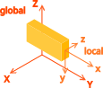

# Orientation

An `orientation` is required for 3D beam elements to indicate how the section is oriented.
The `orientation` object also handles transformation between global and local coordinate systems of beam/truss elements.

Similar configurations are also required in other FEM software, see, for example, Section 26.3.4 `Beam element cross-section orientation` of the Abaqus Analysis User's Manual.

The local $$x$$-axis is along the chord of the beam element.
The local $$z$$-axis is temporarily taken as the vector assigned by the user.
The local $$y$$-axis is defined to be the cross product of the local $$z$$-axis and the local $$x$$-axis.
After obtaining the local $$y$$-axis, the local $$z$$-axis is redefined to be the cross product of the local $$x$$-axis and the local $$y$$-axis.

Depending on the different literature and textbooks, different conventions may be used.
Thus, the term local $$z$$-axis may not be the same axis you may expect.
Please validate the orientation first before using it.



For 2D beam elements, the local $$z$$-axis is defined to be the global $$z$$-axis.

## Background

An orientation object is a coordinate transformation attached to a beam or truss element.
Given the user-supplied vector $$\mathbf n$$ and the element chord direction $$\mathbf e_x$$, the local triad is built as $$\mathbf e_y=\mathbf n\times\mathbf e_x$$ followed by $$\mathbf e_z=\mathbf e_x\times\mathbf e_y$$, which re-orthogonalises the supplied vector against the chord and yields a right-handed frame.
The three basis vectors form the rotation matrix $$\mathbf R=\begin{bmatrix}\mathbf e_x&\mathbf e_y&\mathbf e_z\end{bmatrix}^\mathrm T$$, so that first-order quantities transform as $$\mathbf a_l=\mathbf R\mathbf a_g$$ and $$\mathbf a_g=\mathbf R^\mathrm T\mathbf a_l$$, while stiffness matrices transform as $$\mathbf K_g=\mathbf R^\mathrm T\mathbf K_l\mathbf R$$.
A linear orientation (`B3DL`, `B3DOSL`, or the internal 2D `B2DL`) keeps $$\mathbf R$$ fixed at the initial configuration and is appropriate for small-displacement analysis.
A corotational orientation (`B3DC` or `B3DOSC`, and the internal `B2DC`) updates $$\mathbf R$$ from the current chord and additionally subtracts the chord rotation from the nodal rotations, so that the element only sees the small straining deformation discussed in the [Beam Element Overview](Beam.md).
For the two-dimensional case the local deformations are $$u=L-L_0$$ and $$\Theta_i=\theta_i+\beta_0-\beta$$, and the geometric stiffness contribution is $$\mathbf K_g^{(\mathrm{geo})}=\sum_i f_{l,i}\,\partial^2\Theta_i/\partial\mathbf v^2$$.
The corotational transformation follows Crisfield's work with the modifications of de Souza, and the mass matrix is deliberately left untransformed so that it remains constant.

!!! warning "implementation limitation"
    Leaving the mass matrix untransformed means the corotational formulation is not energy preserving under large rigid rotations, so it is mainly suited to earthquake-engineering applications.

## Syntax

```text title="Orientation"
orientation (1) (2) (3) (4) (5)
# (1) string, orientation type
# (2) int, unique orientation tag
# (3) double, x component of local z axis
# (4) double, y component of local z axis
# (5) double, z component of local z axis
```

## Remarks

1. For type `(2)`, the following options are available.
   1. `B3DL` (stands for linear 3D beam transformation) and `B3DC` (corotational formulation).
      The nodal size is 6 and the local quantity size is 6.
   2. `B3DOSL` (linear for beams of open sections such as `EB31OS`) and `B3DOSC` (corotational).
      The nodal size is 7 (including an extra warping DoF) and the local quantity size is 9.
2. The `B3DC`/`B3DOSC` formulation is based on Crisfield's work with modifications.
   See de Souza's [thesis](https://books.google.co.nz/books/about/Force_based_Finite_Element_for_Large_Dis.html?id=YZ5NAQAAMAAJ).
3. For brevity, the mass distribution does not follow the corotational formulation, implying that the mass matrix is always a constant matrix.
   This is often sufficient for applications in earthquake engineering.
   However, it is not recommended for other applications.
   An energy-preserving corotational formulation is required, see Crisfield's work.
4. During initialisation each element rejects an orientation whose nonlinear-geometry flag disagrees with its own switch, and it also checks the orientation type, `B3D` for [`B31`](B31.md) and `B3DOS` for [`B31OS`](B31OS.md) and [`EB31OS`](EB31OS.md).

Correct orientations are required for different element types.
For example, `B31`/`F31` require `B3DL` or `B3DC`.
`EB31OS` requires `B3DOSL` or `B3DOSC`.

One can use the following model to check how the orientation works.

The following model defines a number of beam elements with the `WT12X125` section that is placed at the centre of the web.

The elements are subject to axial forces, but since loads are applied at the centre of the web, the elements are also subject to bending.

Different orientations of local reference frame are defined.
The nodal forces are different for different orientations.

```text
node 1 0 0 0
node 2 1 0 0
node 3 1 0 0
node 4 1 0 0
node 5 1 0 0
orientation B3DL 1 0. 0. 1.
orientation B3DL 2 0. 1. 0.
material Elastic1D 1 1
section US3D WT12X125 1 1
element B31 1 1 2 1 1
element B31 2 1 3 1 2
element B31 3 4 1 1 1
element B31 4 5 1 1 2
fix2 1 E 1
displacement 1 0 1 1 2
displacement 2 0 1 1 3
displacement 3 0 1 1 4
displacement 4 0 1 1 5
step static 1
analyze
peek node 2 3 4 5
exit
```

## References

1. [ISBN 0-471-92956-5](https://search.worldcat.org/search?q=bn:0471929565)
2. Force-based Finite Element for Large Displacement Inelastic Analysis of Structures
