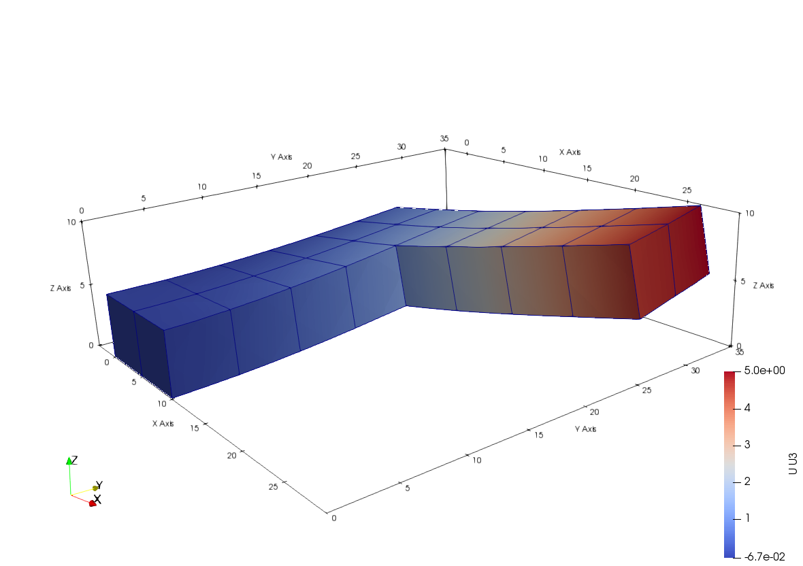

# C3D20

Second Order Cube/Brick

* Number of Nodes: 20
* Number of DoFs: 3 (All Translation)
* DoF Label: U1, U2, U3
* Supports Body Force
* Constant Consistent Mass Matrix With Same Order Integration

## Theory

`C3D20` is the twenty-node quadratic isoparametric hexahedron, also known as the Q2 brick.
It adds one midside node to each of the twelve edges of the Q1 cube.
The first eight nodes are the corners in the same order as [C3D8](C3D8.md), and nodes nine through twenty are the edge midpoints.

The corner shape functions are
$$
N_I=\frac18(1+\xi_I\xi)(1+\eta_I\eta)(1+\zeta_I\zeta)(\xi_I\xi+\eta_I\eta+\zeta_I\zeta-2),
$$
while each midside function is a product of one quadratic factor and two linear factors, for example $\frac14(1-\xi^2)(1+\eta_I\eta)(1+\zeta_I\zeta)$.

The isoparametric mapping $\boldsymbol x=\sum_{I=1}^{20}N_I\boldsymbol x_I$ and the displacement interpolation $\boldsymbol u=\sum_{I=1}^{20}N_I\boldsymbol u_I$ use the same basis.
The strain-displacement matrix and the element integrals have the same form as in [C3D8](C3D8.md), with the sum running over twenty nodes and over the selected integration points.
The quadratic interpolation represents curved edges and a varying strain field within the element, which reduces shear locking in bending relative to Q1.

The reduced scheme uses $2\times2\times2$ Gauss points and is the default.
The full scheme uses the fourteen-point Irons rule and is selected by switching the reduced-integration flag off.
The nonlinear-geometry switch activates the same total-Lagrangian formulation used by [C3D8](C3D8.md).

## Syntax

```text title="C3D20"
element C3D20 (1) (2...21) (22) [23] [24]
# (1) int, unique element tag
# (2...21) int, twenty corner nodes with conventional order
# (22) int, material tag
# [23] bool string, reduced integration scheme switch, default: true
# [24] bool string, nonlinear geometry switch, default: false
```

## Remarks

1. The nonlinearity is implemented by using total Lagrangian (TL) formulation, turn on the switch to use it.
2. The reduced integration uses 2nd order Gauss scheme.
3. The full integration uses 3rd order Irons scheme.

The reduced-integration switch is a boolean string and defaults to `true`, so the eight-point Gauss rule is used when it is omitted.
The nonlinear-geometry switch is a separate boolean string and defaults to `false`.
No hourglass stabilisation is implemented for `C3D20`.

!!! warning "implementation limitation"
    Reduced-integration quadratic bricks can still exhibit hourglass modes under some distortion patterns, and this element provides no stabilisation, so prefer the fourteen-point rule when spurious zero-energy deformation is suspected.

The full fourteen-point rule is more expensive and is mainly useful when a stiffer response or a richer sampling of the material state is desired.
Use a 3D material tag with this element, and prefer [C3D8](C3D8.md) for a coarse first-order mesh or the infinite element [CIN3D8](CIN3D8.md) for the far field of an unbounded domain.

## Sample



## References

1. [ISBN 978-0-486-41181-1](https://search.worldcat.org/search?q=bn:9780486411811)
2. [ISBN 978-1-85617-634-7](https://search.worldcat.org/search?q=bn:9781856176347)
