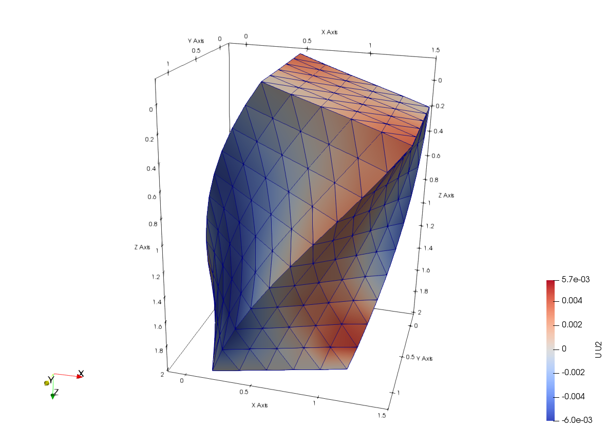

# C3D4

Linear Tetrahedral

* Number of Nodes: 4
* Number of DoFs: 3 (All Translation)
* DoF Label: U1, U2, U3
* Supports Body Force
* Integration Scheme: Single Point At Centre
* Constant Consistent Mass Matrix With Same Order Integration

## Theory

`C3D4` is the four-node linear tetrahedron, the simplest three-dimensional solid element.
It uses the barycentric shape functions $N_1=1-\xi-\eta-\zeta$, $N_2=\xi$, $N_3=\eta$ and $N_4=\zeta$ in a parent tetrahedron.

The implementation forms the augmented coordinate matrix $\boldsymbol X=[\boldsymbol 1,\boldsymbol x_1,\boldsymbol x_2,\boldsymbol x_3]$ and computes the volume as $V=\det\boldsymbol X/6$.
The physical shape-function gradients are the last three rows of $\boldsymbol X^{-1}$, which are constant over the element.
Consequently the strain-displacement matrix $\boldsymbol B$ is constant and the single integration point at the centroid integrates the element exactly.

The stiffness is $\boldsymbol K_e=V\boldsymbol B^{\mathrm T}\boldsymbol D\boldsymbol B$, while the mass and the body force use the centroid values $N_I=1/4$.
With the nonlinear-geometry switch enabled the element uses a total-Lagrangian formulation with $\boldsymbol F=\boldsymbol I+\sum_I\boldsymbol u_I\otimes\nabla N_I$ and the Green-Lagrange strain $\boldsymbol E=\frac12(\boldsymbol F^{\mathrm T}\boldsymbol F-\boldsymbol I)$ passed to the material, together with a geometric stiffness term.

Because the strain is constant, `C3D4` is overly stiff in bending and suffers volumetric locking for nearly incompressible materials.
It is best used to mesh complex geometries with a fine grid, while bending-dominated problems are better served by [C3D8](C3D8.md), [C3D8I](C3D8I.md) or [C3D20](C3D20.md).

## Syntax

```text title="C3D4"
element C3D4 (1) (2...5) (6) [7]
# (1) int, unique element tag
# (2...5) int, four corner nodes with conventional order
# (6) int, material tag
# [7] bool string, nonlinear geometry switch, default: false
```

## Remarks

1. The nonlinearity is implemented by using total Lagrangian (TL) formulation, turn on the switch to use it.

The single integration point is located at the element centroid, which explains the property listed above.
The element volume is computed from $\det\boldsymbol X/6$, so a badly ordered node list gives a negative volume and an invalid element.
No hourglass control is needed because the one-point rule is exact for the constant strain field.
The mass matrix and body-force vector use the centroid shape-function values $N_I=1/4$.

!!! warning "implementation limitation"
    The body-force vector is assembled from the centroid shape functions without an element-volume factor, so the applied nodal force is not scaled by the tetrahedron volume as it is in the brick elements.

For the phase-field fracture version with an additional damage DoF see [DC3D4](DC3D4.md).

## Sample



## References

1. [ISBN 978-0-486-41181-1](https://search.worldcat.org/search?q=bn:9780486411811)
2. [ISBN 978-1-85617-634-7](https://search.worldcat.org/search?q=bn:9781856176347)
