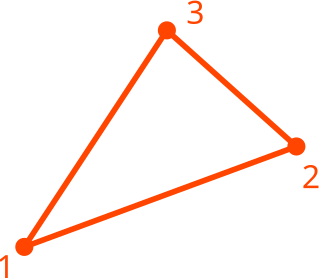

# Allman

Allman's Triangle With Drilling DoFs

* Number of Nodes: 3
* Number of DoFs: 3 (Translation, Translation, Rotation)
* DoF Label: U1, U2, UR3
* Integration Scheme: 3-Point Mid-edge



## Theory

A standard three-node membrane interpolates only translations and therefore cannot contribute stiffness to the out-of-plane rotation about the element normal, called the drilling DoF.

Flat shell elements combine a membrane with a plate that provides the two bending rotations, so the third rotation must be supplied by the membrane to avoid a zero-energy mode in a general three-dimensional assembly.

Allman's device is to start from a complete quadratic displacement field and to express the midside displacement of each edge in terms of the translations and rotations at the two adjacent vertices.

Let node $$i$$ have translation $$(u_i,v_i)$$ and drilling rotation $$\theta_i$$, and let the edge from $$i$$ to $$j$$ have length $$\ell_{ij}$$ and unit normal $$\mathbf n_{ij}=(-(y_j-y_i),\,x_j-x_i)/\ell_{ij}$$.

The midside displacement used in the implementation is

$$
\bar{\mathbf u}_{ij}=\dfrac12(\mathbf u_i+\mathbf u_j)+\dfrac18(\theta_j-\theta_i)\,\ell_{ij}\,\mathbf n_{ij}.
$$

The first term is the average of the vertex translations, and the second term is the Allman correction that couples the drilling rotation to the edge-normal displacement.

The complete quadratic basis $$\{1,x,y,xy,x^2,y^2\}$$ is fitted through the three corner points and the three mid-edge points, giving the displacement field $$\mathbf u=[u,v]^{\mathsf T}=\mathbf N\mathbf d$$ with $$\mathbf d=(u_1,v_1,\theta_1,u_2,v_2,\theta_2,u_3,v_3,\theta_3)^{\mathsf T}$$.

Differentiating this field gives the three in-plane strains

$$
\mathbf\varepsilon=\begin{bmatrix}u_{,x}\\ v_{,y}\\ u_{,y}+v_{,x}\end{bmatrix}=\mathbf B\mathbf d ,
$$

and the element stiffness is the usual $$\mathbf K=\int_A\mathbf B^{\mathsf T}\mathbf D\mathbf B\,t\,dA$$, where $$\mathbf D$$ is the two-dimensional material stiffness and $$t$$ the thickness.

The integration is performed at the three midside points with equal weight $$At/3$$, where $$A$$ is the triangle area; this is the origin of the `3-Point Mid-edge` label.

The same mid-edge idea underlies the quadrilateral drilling elements [GQ12](GQ12.md) and [GCMQ](GCMQ.md), while the plate-side discrete Kirchhoff interpolation used in shells is described on [DKT3](../../Plate/DKT3.md).

!!! info "deviation from theory"
    The drilling correction depends only on differences of nodal rotations, so a uniform rotation field produces no mid-edge offset and no membrane strain.
    The element therefore has no stiffness against a uniform drilling mode and is not a penalty-stabilized drilling element in the sense of Hughes and Brezzi.

## Syntax

```text title="Allman"
element Allman (1) (2...4) (5) [6]
# (1) int, unique element tag
# (2...4) int, node i, j, k
# (5) int, material tag
# [6] double, element thickness, default: 1.0
```

## Remarks

* Three middle points on edges are used as integration points.
* For a plane-strain material the thickness argument is overridden to 1.0 during initialization, so it only has an effect for plane-stress materials.

!!! warning "implementation limitation"
    The thickness argument is silently overwritten for plane strain.
    The element does not assemble a drilling stabilization term, so the UR3 DoF must be restrained where it is not constrained by adjacent elements.

!!! note "developer note"
    The three integration points are fixed at the edge midpoints.

* The midside correction depends on rotation differences only, so a uniform drilling rotation produces no membrane strain and no drilling stiffness from a single element.
* Restrain the UR3 DoF where necessary, since the Allman interpolation gives no stiffness to a uniform drilling rotation.
* The element supports a consistent mass matrix when the material supplies a nonzero density and records the material response at the three integration points.
* Use [GQ12](GQ12.md) instead when a four-node membrane with the same DoF layout is required.

## References

1. [10.1016/0045-7949(84)90197-4](https://doi.org/10.1016/0045-7949(84)90197-4)
2. [10.1016/0045-7825(89)90124-2](https://doi.org/10.1016/0045-7825(89)90124-2)
3. A robust quadrilateral membrane finite element with drilling degrees of freedom
