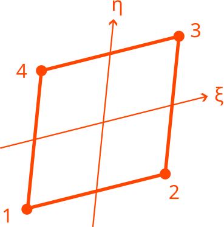

# GQ12

Quadrilateral With Drilling DoFs

* Number of Nodes: 4
* Number of DoFs: 3 (Translation, Translation, Rotation)
* DoF Label: U1, U2, UR3
* Supports Body Force
* Integration Scheme: 2nd Order Gauss
* Constant Consistent Mass Matrix With Same Order Integration



## Background

GQ12 is the four-node generalized conforming membrane with vertex drilling rotations introduced by Long and Xu.

The generalized conforming method replaces pointwise inter-element compatibility with an integral compatibility condition along each edge, which allows a low-order polynomial field to include the nodal rotation.

The in-plane displacement is written as a bilinear translation part plus a drilling part that depends on the four edge vectors $\Delta\mathbf x_i$ and on the differences of adjacent nodal rotations, the same physical idea as the mid-edge correction derived on [Allman](Allman.md).

The implementation builds the strain--displacement matrix as $\mathbf B=\mathbf B_u+\mathbf B_\theta$, where $\mathbf B_u$ comes from the bilinear shape functions and $\mathbf B_\theta$ from the drilling interpolation scaled by $1/16$.

The strain is $\mathbf\varepsilon=(u_{,x},\,v_{,y},\,u_{,y}+v_{,x})^{\mathsf T}$ and the standard stiffness $\int\mathbf B^{\mathsf T}\mathbf D\mathbf B\,t\,dA$ is evaluated with 2-by-2 Gauss points.

The drilling interpolation uses the actual edge lengths, so the drilling stiffness is geometry dependent, a limitation that the enhanced mixed element [GCMQ](GCMQ.md) can avoid through its objective-length option.

!!! info "deviation from theory"
    The drilling part is built from the actual edge vectors without a material-dependent penalty parameter of the Hughes--Brezzi type.
    The drilling stiffness therefore scales with element size, and a uniform drilling rotation still produces no membrane strain.

This element supplies the membrane part of the flat shell [S4](../../Shell/S4.md).

## References

1. [10.1016/0045-7949(94)90356-5](https://doi.org/10.1016/0045-7949(94)90356-5)
2. Generalized conforming quadrilateral membrane element with vertex rigid rotational freedom
3. [10.1016/0045-7825(89)90124-2](https://doi.org/10.1016/0045-7825(89)90124-2)

## Syntax

```text title="GQ12"
element GQ12 (1) (2...5) (6) [7]
# (1) int, unique element tag
# (2...5) int, node i, j, k, l
# (6) int, material tag
# [7] double, element thickness, default: 1.0
```

## Remarks

* The thickness argument is overridden to 1.0 for a plane-strain material, so it only matters for plane stress.

!!! warning "implementation limitation"
    There is no objective-length argument to reduce mesh-size dependence.
    The thickness is silently overwritten for plane strain.

!!! note "developer note"
    The 2-by-2 Gauss rule and the drilling interpolation are fixed in the code.

* A consistent mass matrix and a body-force vector are assembled when the material provides a nonzero density.
* A uniform drilling rotation produces no membrane strain, so the UR3 DoF still needs to be restrained or stabilized in an isolated membrane patch.
* For an improved coarse-mesh response consider [GCMQ](GCMQ.md), which adds enhanced strain modes through a modified Hu--Washizu formulation.
* In a shell analysis this element is combined with the [Mindlin](../../Plate/Mindlin.md) plate to form [S4](../../Shell/S4.md).
