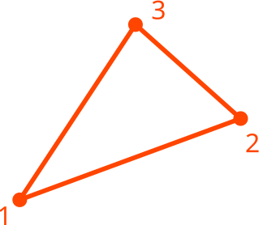

# DCP3

Constant Strain Triangle With Crack Phase

* Number of Nodes: 3
* Number of DoFs: 3 (Translation, Translation, Damage)
* DoF Label: U1, U2, DAMAGE
* Integration Scheme: Single Point Centre
* Zero Mass Entries On Damage DoFs



## Background

[`DCP3`](DCP3.md) implements a phase-field model of brittle fracture on the constant-strain triangle.
The total potential energy contains a degraded bulk term and a crack-surface term,
$$
\Psi=\int_\Omega g(d)\,\psi(\mathbf\varepsilon)\,\mathrm d\Omega+G_c\int_\Omega\left[\frac{d^2}{2l}+\frac{l}{2}|\nabla d|^2\right]\mathrm d\Omega.
$$
Here $d\in[0,1]$ is the damage field, $g(d)=(1-d)^2$ is the degradation function, $\psi=\tfrac12\mathbf\varepsilon^\mathrm T\mathbf\sigma$ is the strain energy density, $G_c$ is the fracture energy release rate and $l$ is the characteristic length.
The second integral is the regularised crack length, and the two terms give the damage stiffness blocks $G_c\,l^{-1}\mathbf N^\mathrm T\mathbf N$ and $G_c\,l\,\mathbf B^\mathrm T\mathbf B$.
Stationarity with respect to the displacement gives $\nabla\cdot[g(d)\mathbf\sigma]+\mathbf b=\mathbf 0$, and stationarity with respect to $d$ gives the Allen-Cahn-type equation $\frac{G_c}{l}d-G_c l\nabla^2d=2(1-d)\mathcal H$.
The history field $\mathcal H=\max_t\psi(t)$ enforces irreversibility of crack growth by keeping the maximum strain energy reached so far.

!!! info "deviation from theory"
    The implementation sets $\mathcal H$ from the total strain energy $\tfrac12\mathbf\varepsilon^\mathrm T\mathbf\sigma$.
    It does not perform the tensile and compressive spectral split used in many phase-field fracture models, so compression can also drive damage.

The displacement and damage fields use the same nodal interpolation, so each node carries `U1`, `U2` and `DAMAGE`.
In the staggered scheme the coupling blocks are omitted and the two fields are solved in sequence; the `DCP3M` variant keeps the coupling blocks and solves monolithically.
The element uses one centroid integration point, so the strain is constant over the triangle and $l$ defaults to $2\sqrt{A}$ when a negative value is supplied.

!!! warning "implementation limitation"
    A single integration point makes the history field constant over each triangle, so the crack band cannot vary inside an element.
    The resulting crack path is strongly tied to the mesh alignment and needs a sufficiently fine, well-oriented discretisation.

The quadrilateral counterpart with $2\times2$ Gauss integration is [`DCP4`](DCP4.md).

## References

There are a lot of papers on the phase-field model.
A staggered scheme with maximum strain energy is adopted as an illustration of implementation.

* [10.1016/j.commatsci.2016.04.009](https://doi.org/10.1016/j.commatsci.2016.04.009)
* [10.1016/j.cma.2010.04.016](https://doi.org/10.1016/j.cma.2010.04.016)

## Syntax

```text title="DCP3"
element DCP3 (1) (2...4) (5) (6) (7) [8]
# (1) int, unique element tag
# (2...4) int, node i, j, k
# (5) int, material tag
# (6) double, characteristic length
# (7) double, energy release rate
# [8] double, element thickness, default: 1.0
```

## Remarks

* The third DoF is the damage variable.
  Boundary conditions can be assigned.
* The characteristic length `(6)` can be set to a negative value to automatically determine it based on the element geometry.
* The energy release rate `(7)` is the material parameter $G_c$ and must be positive to give a meaningful crack-driving force.
* The damage DoF has zero mass entries, so it is intended for quasi-static analysis; dynamic crack problems need special treatment.
* The history variable is stored at the integration point and is updated only when the current strain energy exceeds the previous maximum.
* A mesh size comparable to $l$ is needed to resolve the diffuse crack profile.
* [`DCP3M`](DCP3.md) solves the coupled problem monolithically, whereas the default `DCP3` uses a staggered update without coupling blocks.

## Recording

This model supports the following additional history variables to be recorded.

| variable label | physical meaning |
|----------------|------------------|
| DAMAGE         | damage variable  |

## Variants

`DCP3M` uses the same command `element DCP3M (1) (2...4) (5) (6) (7) [8]` as `DCP3`, but solves displacement and damage monolithically by adding their coupling blocks to the stiffness matrix instead of using a staggered update.
