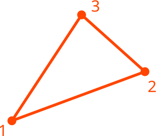

# CP3

Constant Strain Triangle

* Number of Nodes: 3
* Number of DoFs: 2 (Translation, Translation)
* DoF Label: U1, U2
* Integration Scheme: Single Point Centre
* Supports Body Force
* Constant Consistent Mass Matrix With Same Order Integration



## Background

[`CP3`](CP3.md) is the three-node constant-strain triangle, abbreviated CST.
The displacement is linear over the triangle, $\boldsymbol u=\sum_{a=1}^3N_a\boldsymbol u_a$, with area coordinates $N_a=A_a/A$.
The coordinate matrix $\boldsymbol X$ has columns $[1,x_a,y_a]^\mathrm T$, so the area is $A=\tfrac12\det\boldsymbol X$ and the constant gradients are $\partial N_a/\partial x$ and $\partial N_a/\partial y$, the last two rows of $\boldsymbol X^{-1}$.
The strain vector $\boldsymbol\varepsilon=\boldsymbol B\boldsymbol a$ is constant over the element, with
$$
\boldsymbol B=\begin{bmatrix}
N_{1,x}&0&N_{2,x}&0&N_{3,x}&0\\
0&N_{1,y}&0&N_{2,y}&0&N_{3,y}\\
N_{1,y}&N_{1,x}&N_{2,y}&N_{2,x}&N_{3,y}&N_{3,x}
\end{bmatrix}.
$$
Because $\boldsymbol B$ and $\boldsymbol D$ are constant, the single-centre-point rule is exact for homogeneous material and $\boldsymbol K^e=A\,t\,\boldsymbol B^\mathrm T\boldsymbol D\boldsymbol B$.
The same centroid rule is used for the consistent mass matrix and the body-force vector.
The quadratic triangle [`CP6`](CP6.md) removes the constant-strain restriction by adding edge midnodes and a three-point rule.
For axisymmetric problems the analogous constant-strain triangle is [`CAX3`](../Axisymmetric/CAX3.md).

## Syntax

```text title="CP3"
element CP3 (1) (2...4) (5) [6] [7]
# (1) int, unique element tag
# (2...4) int, node i, j, k
# (5) int, material tag
# [6] double, element thickness, default: 1.0
# [7] bool string, nonlinear geometry switch, default: false
```

## Remarks

* The `CP3` element resembles CPS3 and CPE3 elements in ABAQUS.
  It is a constant strain element.

!!! info "deviation from theory"
    Only `CP3` is accepted as an element token for both plane stress and plane strain; the names CPS3 and CPE3 are descriptive only and are not registered as commands.
    The material plane type decides whether thickness is applied.

!!! note "developer note"
    The ABAQUS-style names CPS3 and CPE3 are descriptive only; the element parser registers a single token `CP3` for both plane stress and plane strain.

* A single integration point at the center of the element is used for integration.
* The characteristic length used by material regularisation is $\sqrt{A}$, with $A$ the area of the triangle.
* The thickness argument is forced to unity when the material declares plane strain.
* The nonlinear geometry switch activates a Total Lagrangian update based on the Green-Lagrange strain.
* The constant strain field makes the element too stiff in bending, so [`CP6`](CP6.md) or [`CP8`](CP8.md) should be preferred when stress gradients matter.
* Elements with a drilling rotation are available as [`Allman`](../Drilling/Allman.md) and [`GQ12`](../Drilling/GQ12.md).

## References

1. [ISBN 978-1-85617-633-0](https://search.worldcat.org/search?q=bn:9781856176330)
2. [ISBN 978-0-486-41181-1](https://search.worldcat.org/search?q=bn:9780486411811)
