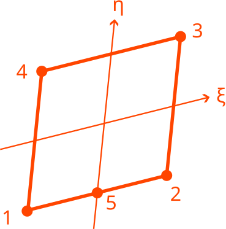

# CP5

Five-Point Quadrilateral

* Number of Nodes: 5
* Number of DoFs: 2 (Translation, Translation)
* DoF Label: U1, U2
* Integration Scheme: 2nd Order Irons
* Supports Body Force
* Constant Consistent Mass Matrix With Same Order Integration



## Background

[`CP5`](CP5.md) is a five-node quadrilateral obtained from the bilinear quad [`CP4`](CP4.md) by adding one midside node on the bottom edge.
The shape functions are $N_5=\tfrac14(1-\xi^2)(1-\eta)$ and $N_a=\tfrac14(1\pm\xi)(1\pm\eta)-\tfrac12N_5$ for the two corner nodes of that edge, while the other two corner functions remain bilinear.
The added function is a quadratic bubble that vanishes on three edges and is symmetric about $\xi=0$, so the interpolated displacement is quadratic along the bottom edge and linear elsewhere.
This makes [`CP5`](CP5.md) a transition element: it can share the midside node with a quadratic [`CP8`](CP8.md) on one edge and a plain [`CP4`](CP4.md) on the others.
The nodes are ordered counter-clockwise from $(\xi,\eta)=(-1,-1)$ and node 5 lies at $(0,-1)$.
A five-point Irons rule is used, with one point at the centre and four points at $(\pm1,0)$ and $(0,\pm1)$, which is exact to polynomial degree five.
The stiffness is assembled as $\boldsymbol K^e=\sum_q t\,J_qw_q\,\boldsymbol B_q^\mathrm T\boldsymbol D_q\boldsymbol B_q$, exactly as in [`CP4`](CP4.md).
Adding the further midside nodes gives [`CP6`](CP6.md) and [`CP7`](CP7.md).

## Syntax

```text title="CP5"
element CP5 (1) (2...6) (7) [8] [9]
# (1) int, unique element tag
# (2...6) int, node tags that define the element
# (7) int, material tag
# [8] double, element thickness, default: 1.0
# [9] bool string, nonlinear geometry switch, default: false
```

## Remarks

* The node order is the four corners counter-clockwise from the bottom left, followed by the midside node of the bottom edge.
* The characteristic length is computed from the first four nodes only, using the shoelace formula.

!!! info "deviation from theory"
    The midside node does not contribute to the characteristic length or to the area used for it.
    A highly curved bottom edge therefore gives the same length as the corresponding bilinear [`CP4`](CP4.md).

* The thickness argument is ignored when the material declares plane strain.
* The nonlinear geometry switch activates a Total Lagrangian update.
* Use this element to connect a quadratic mesh to a linear mesh without hanging nodes; [`CP7`](CP7.md) and [`CP8`](CP8.md) add further midside nodes.

## References

1. O. C. Zienkiewicz, R. L. Taylor and J. Z. Zhu, *The Finite Element Method: Its Basis and Fundamentals*, 7th ed., Butterworth-Heinemann (2013), Chapter 8.
