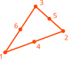

# CP6

Quadratic Triangle

* Number of Nodes: 6
* Number of DoFs: 2 (Translation, Translation)
* DoF Label: U1, U2
* Integration Scheme: 3-Point Mid-edge
* Supports Body Force
* Constant Consistent Mass Matrix With Same Order Integration



## Background

[`CP6`](CP6.md) is the six-node quadratic triangle.
Nodes 1 to 3 are the vertices and nodes 4 to 6 are the midpoints of edges 1-2, 2-3 and 3-1.
The interpolation uses the complete quadratic monomial vector $[1,x,y,xy,x^2,y^2]$, so the displacement is quadratic and the strain varies linearly over the triangle.
The implementation inverts the $6\times6$ matrix built from the six nodal coordinate vectors to obtain the shape functions and their derivatives directly in the global frame.
Three integration points are placed at the three midside nodes with weights $A\,t/3$ each, which integrates the quadratic strain energy exactly.
The stiffness is $\boldsymbol K^e=\sum_{q=1}^{3}\tfrac{1}{3}A\,t\,\boldsymbol B_q^\mathrm T\boldsymbol D_q\boldsymbol B_q$.

!!! info "deviation from theory"
    The same three-point rule is reused for the mass matrix.
    Since the product of two quadratic shape functions is quartic, that mass matrix is under-integrated and is only approximately the consistent mass.

Compared with the constant-strain triangle [`CP3`](CP3.md), the linear strain field captures bending with far fewer elements, at the cost of three material evaluations per element.

## Syntax

```text title="CP6"
element CP6 (1) (2...7) (8) [9] [10]
# (1) int, unique element tag
# (2...7) int, node tags that define the element
# (8) int, material tag
# [9] double, element thickness, default: 1.0
# [10] bool string, nonlinear geometry switch, default: false
```

## Remarks

* The first three nodes are the triangle vertices and the last three are the corresponding edge midpoints.
* The characteristic length used by regularisation models is $\sqrt{A}$, with $A$ the triangle area.
* The thickness argument is ignored when the material declares plane strain.
* The nonlinear geometry switch activates a Total Lagrangian update.
* Midside nodes must be placed at the actual edge midpoints to keep the quadratic mapping well behaved.
* For quadrilateral meshes the corresponding quadratic option is [`CP8`](CP8.md).

## References

1. [ISBN 978-1-85617-633-0](https://search.worldcat.org/search?q=bn:9781856176330)
