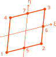

# CP7

Seven-Point Quadrilateral

* Number of Nodes: 7
* Number of DoFs: 2 (Translation, Translation)
* DoF Label: U1, U2
* Integration Scheme: 2nd Order Irons
* Supports Body Force
* Constant Consistent Mass Matrix With Same Order Integration



## Background

[`CP7`](CP7.md) is a seven-node quadrilateral obtained from [`CP5`](CP5.md) by adding midside nodes on the right and top edges.
The three bubble functions are $N_5=\tfrac14(1-\xi^2)(1-\eta)$, $N_6=\tfrac14(1+\xi)(1-\eta^2)$ and $N_7=\tfrac14(1-\xi^2)(1+\eta)$, with the corner-node functions reduced by one half of the bubble function on the corresponding edge.
The left edge remains linear, so the element is a transition between the quadratic [`CP8`](CP8.md) and the bilinear [`CP4`](CP4.md).
The nodes are ordered counter-clockwise from $(\xi,\eta)=(-1,-1)$, followed by the bottom, right and top midside nodes.
A five-point Irons rule is used, giving polynomial degree five accuracy for the stiffness integral.
The interpolation and quadrature are the same as in [`CP5`](CP5.md), with one additional midside mode.

## Syntax

```text title="CP7"
element CP7 (1) (2...8) (9) [10] [11]
# (1) int, unique element tag
# (2...8) int, node tags that define the element
# (9) int, material tag
# [10] double, element thickness, default: 1.0
# [11] bool string, nonlinear geometry switch, default: false
```

## Remarks

* The node order is the four corners counter-clockwise from the bottom left, then the bottom, right and top midside nodes.
* The characteristic length is computed from the first four nodes only, using the shoelace formula.

!!! info "deviation from theory"
    The three midside nodes are ignored when the characteristic length is evaluated.
    The value equals the shoelace area of the four corner nodes, so curvature of the edges does not affect it.

* The thickness argument is ignored when the material declares plane strain.
* The nonlinear geometry switch activates a Total Lagrangian update.
* Use this element as an intermediate step when refining from [`CP4`](CP4.md) to [`CP8`](CP8.md) without hanging nodes.

## References

1. [ISBN 978-1-85617-633-0](https://search.worldcat.org/search?q=bn:9781856176330)
