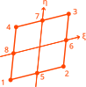

# CP8

Second Order Quadrilateral

* Number of Nodes: 8
* Number of DoFs: 2 (Translation, Translation)
* DoF Label: U1, U2
* Integration Scheme: 2nd Order Irons (Full) or 2nd Order Gauss (Reduced)
* Supports Body Force
* Constant Consistent Mass Matrix With Same Order Integration



## Background

[`CP8`](CP8.md) is the eight-node quadratic serendipity quadrilateral.
The four corner shape functions are the bilinear functions minus one half of the adjacent midside functions, and the four midside functions are
$$
N_5=\tfrac12(1-\xi^2)(1-\eta),\quad N_6=\tfrac12(1+\xi)(1-\eta^2),\quad N_7=\tfrac12(1-\xi^2)(1+\eta),\quad N_8=\tfrac12(1-\xi)(1-\eta^2).
$$
The nodes are ordered counter-clockwise from $$(\xi,\eta)=(-1,-1)$$, with midside nodes on the bottom, right, top and left edges.
The quadratic interpolation allows curved edges and a strain field that varies linearly within each element.
The strain is assembled as $$\mathbf\varepsilon=\mathbf B\mathbf a$$ with the same Voigt pattern as [`CP4`](CP4.md), and the stiffness is $$\mathbf K^e=\sum_q t\,J_qw_q\,\mathbf B_q^\mathrm T\mathbf D_q\mathbf B_q$$.
In the source the full scheme is the five-point Irons rule, which is exact to polynomial degree five and therefore comparable in accuracy to the $$3\times3$$ Gauss rule mentioned in the remarks.
Reduced integration uses $$2\times2$$ Gauss points.

## Syntax

```text title="CP8"
element CP8 (1) (2...9) (10) [11] [12] [13]
# (1) int, unique element tag
# (2...9) int, node 1 to node 8
# (10) int, material tag
# [11] double, element thickness, default: 1.0
# [12] bool string, reduced integration switch, default: false
# [13] bool string, nonlinear geometry switch, default: false
```

## Remarks

* The `CP8` element resembles CPS8, CPE8, CPS8R and CPE8R elements in ABAQUS.
* The full integration scheme uses 3-by-3 Gauss scheme and the reduced integration uses a 2-by-2 scheme.
* In the current source the full rule is the five-point Irons pattern, exact to degree five, while the reduced rule is $$2\times2$$ Gauss.

!!! note "developer note"
    The original remark above states that full integration uses a 3-by-3 Gauss scheme.
    The source instead constructs a five-point Irons rule, which has the same polynomial degree of precision but only five sampling points.

* The reduced-integration variant does not add an hourglass stiffness, so check for zero-energy modes in coarse meshes.

!!! warning "implementation limitation"
    Unlike [`CP4`](CP4.md), the reduced-integration option of `CP8` has no hourglass stabilisation and no hourglass multiplier argument.
    Coarse meshes with reduced integration can therefore develop zero-energy modes that are not controlled by the element itself.

* The characteristic length used by regularisation models is the square root of the area of the four corner nodes.
* The thickness argument is ignored when the material declares plane strain.
* The nonlinear geometry switch activates a Total Lagrangian update.

## Variants

The plane stress or plane strain behaviour is set by the material's plane type, not by the element token; a plane-strain material forces unit thickness.
`CPS8` is the plane-stress name for the same `CP8` implementation and accepts the identical `element CPS8 (1) (2...9) (10) [11] [12] [13]` arguments.
`CPE8` is the plane-strain counterpart; `element CPE8 (1) (2...9) (10) [11] [12]` omits the thickness argument and takes the optional reduced-integration and nonlinear-geometry switches.
`CPE8R` is the plane-strain variant with reduced integration forced; `element CPE8R (1) (2...9) (10) [11]` accepts only the nonlinear-geometry switch.

## References

1. [ISBN 978-1-85617-633-0](https://search.worldcat.org/search?q=bn:9781856176330)
2. [ISBN 978-0-486-41181-1](https://search.worldcat.org/search?q=bn:9780486411811)
