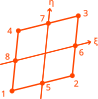

# PCPE8DC

Quadratic Quadrilateral With Pore Pressure (Drained)

* Number of Nodes: 8
* Number of DoFs: 4 (Solid Translation, Solid Translation, Fluid Translation, Fluid Translation)
* DoF Label: U1, U2, FU1, FU2
* Supports Body Force
* Constant Consistent Mass Matrix With Same Order Integration



## Background

This is the eight-node quadratic companion of [PCPE4DC](PCPE4DC.md) in the drained consolidation family.

It uses the same $$u$$--$$U$$ formulation, the same pressure coefficient $$q=K_sK_f/[nK_s+(\alpha-n)K_f]$$, the same four-block fluid stiffness and the same relative-velocity Darcy damping matrix, so refer to the [PCPE4DC](PCPE4DC.md) theory page for the derivation.

!!! info "deviation from theory"
    As in the bilinear variant, pore pressure is not a nodal unknown and drainage is represented by a velocity-proportional Darcy damping matrix.
    A static analysis therefore cannot dissipate pore pressure.

The differences are the quadratic eight-node interpolation and the five-point Irons integration rule instead of the four-point Gauss rule.

The characteristic length is taken from the area of the quadrilateral formed by the first four corner nodes.

!!! warning "implementation limitation"
    The quadratic element accepts only a plane-strain solid and an isotropic fluid with nonzero bulk moduli.
    The permeability is a single scalar, so anisotropy and tensor permeability cannot be represented.

!!! note "developer note"
    The quadratic element uses a fixed five-point Irons integration rule.
    The characteristic length is computed from the four corner nodes and ignores the four midside nodes.

## Syntax

```text title="PCPE8DC"
element PCPE8DC (1) (2...9) (10) (11) (12) (13) (14)
# (1) int, unique element tag
# (2...9) int, node i, j, k, l
# (10) int, solid material tag
# (11) int, fluid material tag
# (12) double, alpha
# (13) double, porosity n
# (14) double, permeability k
```

## Remarks

Only plane strain is supported.
Plane stress does not make sense in geotechnical engineering.

For the fluid phase, an isotropic fluid material can be provided, which mainly provides the bulk modulus of the fluid phase.
For example,

```
# material Fluid (tag) (bulk modulus) (density)
material Fluid 1 1000. 1E-2
```

The $$\alpha$$ parameter `(12)` is often close to unity for soils.
The porosity $$n$$ ranges from zero to unity.
The isotropic permeability is assumed.

Interactions with other elements (with different arrangements of DoFs) can only be fulfilled via constraints.

* The eight nodes are ordered with four corners first and four midside nodes afterwards, as indicated by the element encoding figure.
* The quadratic interpolation gives a better approximation of curved boundaries and stress gradients than [PCPE4DC](PCPE4DC.md).
* The pressure coefficient, damping and mass are assembled with five Irons points, and `PP` is recorded at those points.
* As for the bilinear variant, a transient or dynamic step is required for the permeability-driven damping to dissipate pore pressure.
* The undrained quadratic counterpart is [PCPE8UC](PCPE8UC.md).

## Recording

This model supports the following additional history variables to be recorded.

| variable label | physical meaning |
|----------------|------------------|
| PP             | pore pressure    |

## References

1. [10.1063/1.1712886](https://doi.org/10.1063/1.1712886)
2. [10.1680/geot.1980.30.4.385](https://doi.org/10.1680/geot.1980.30.4.385)
