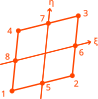

# PCPE8UC

Quadratic Quadrilateral With Pore Pressure (Undrained)

* Number of Nodes: 8
* Number of DoFs: 2 (Solid Translation, Solid Translation)
* DoF Label: U1, U2
* Supports Body Force
* Constant Consistent Mass Matrix With Same Order Integration



## Background

This is the eight-node quadratic companion of [PCPE4UC](PCPE4UC.md) in the undrained porous family.

It imposes the same undrained constraint $\mathbf u_f=\mathbf u_s$, giving the added stiffness $\mathbf K_u=\int q\alpha^2\mathbf B^{\mathsf T}\mathbf m\mathbf m^{\mathsf T}\mathbf B\,dV$ with $q=K_sK_f/[nK_s+(\alpha-n)K_f]$ and $\mathbf m=(1,1,0)^{\mathsf T}$, and it records $p=-\alpha q\,\nabla\cdot\mathbf u_s$.

!!! info "deviation from theory"
    The undrained response is obtained by tying the fluid displacement to the solid one, so pore pressure is recovered from volumetric strain rather than solved as a nodal field.
    No permeability or flow equation is present.

The derivation is given on [PCPE4DC](PCPE4DC.md) and the undrained reduction on [PCPE4UC](PCPE4UC.md).

The only differences are the quadratic eight-node shape functions and the five-point Irons integration rule used in place of four-point Gauss integration.

The characteristic length is computed from the first four corner nodes.

!!! warning "implementation limitation"
    Only plane strain and an isotropic fluid with nonzero bulk moduli are accepted.
    Partial drainage and transient pore pressure dissipation are outside the scope of this undrained element.

!!! note "developer note"
    The five-point Irons integration rule is fixed.

## Syntax

```text title="PCPE8UC"
element PCPE8UC (1) (2...9) (10) (11) (12) (13)
# (1) int, unique element tag
# (2...9) int, node i, j, k, l
# (10) int, solid material tag
# (11) int, fluid material tag
# (12) double, alpha
# (13) double, porosity n
```

## Remarks

Only plane strain is supported.
Plane stress does not make sense in geotechnical engineering.

For the fluid phase, an isotropic fluid material can be provided, which mainly provides the bulk modulus of the fluid phase.
For example,

```
# material Fluid (tag) (bulk modulus) (density)
material Fluid 1 1000. 1E-2
```

The $$\alpha$$ parameter `(12)` is often close to unity for soils.
The porosity $$n$$ ranges from zero to unity.
The isotropic permeability is assumed.

Interactions with other elements (with different arrangements of DoFs) can only be fulfilled via constraints.

* The eight nodes are ordered with four corners first and four midside nodes afterwards, as indicated by the element encoding figure.
* No permeability argument is taken, and no Darcy damping matrix is assembled, because relative fluid motion is suppressed.
* The mixture density $(1-n)\rho_s+n\rho_f$ is used for the consistent mass matrix.
* Use [PCPE8DC](PCPE8DC.md) if drainage and consolidation over time are required.

## Recording

This model supports the following additional history variables to be recorded.

| variable label | physical meaning |
|----------------|------------------|
| PP             | pore pressure    |

## References

1. [10.1063/1.1712886](https://doi.org/10.1063/1.1712886)
2. [10.1680/geot.1980.30.4.385](https://doi.org/10.1680/geot.1980.30.4.385)
