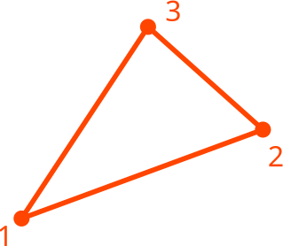

# DKT3

DKT Triangle Plate

* Number of Nodes: 3
* Number of DoFs: 3 (Translation, Rotation, Rotation)
* DoF Label: U3, UR1, UR2



## Theory

The discrete Kirchhoff triangle is a thin-plate element based on Kirchhoff--Love assumptions, namely that normals to the midsurface remain straight and normal to the deformed midsurface, so transverse shear strain vanishes.

Let $w$ be the transverse displacement and let $\beta_x=\partial w/\partial x$ and $\beta_y=\partial w/\partial y$ be the rotations of the normal.

In the sign convention of the implementation the nodal rotations satisfy $\beta_x=\theta_y$ and $\beta_y=-\theta_x$, which is why the first transformation matrix maps $\theta_y$ to $\beta_x$ with a positive sign and $\theta_x$ to $\beta_y$ with a negative sign.

!!! info "deviation from theory"
    The rotation signs follow the source transformation matrices and differ from texts that define the bending rotations with the opposite sign.

!!! note "developer note"
    The DoF labels in the manual are $U_3,UR_1,UR_2$, while the internal constructor passes generic 2D DoF tags that are later interpreted by the element.

The curvature vector is

$$
\mathbf\kappa=\begin{bmatrix}\beta_{x,x}\\ \beta_{y,y}\\ \beta_{x,y}+\beta_{y,x}\end{bmatrix},
$$

and the moment--curvature relation is $\mathbf M=\mathbf D_b\mathbf\kappa$, with the plane-stress bending stiffness

$$
\mathbf D_b=\dfrac{Et^3}{12(1-\nu^2)}
\begin{bmatrix}
1 & \nu & 0\\
\nu & 1 & 0\\
0 & 0 & (1-\nu)/2
\end{bmatrix}.
$$

The implementation obtains this matrix by numerical integration through the thickness rather than by forming $\mathbf D_b$ explicitly.

!!! info "deviation from theory"
    The bending stiffness is synthesized from the two-dimensional constitutive matrix, so the element relies on a plane-stress material to reproduce the standard $Et^3/[12(1-\nu^2)]$ coefficient.
    A plane-strain material would give a different bending stiffness.

A fibre at local coordinate $z$ carries the strain $\mathbf\varepsilon(z)=z\mathbf\kappa$, so the stiffness contribution of a layer is $z^2\mathbf B^{\mathsf T}\mathbf D\mathbf B\,dV$.

The discrete Kirchhoff condition is imposed only at the three edge midpoints instead of pointwise.

Along an edge of length $\ell$ with direction cosines $c=\Delta y/\ell$ and $s=-\Delta x/\ell$, the tangential rotation varies linearly between its nodal values $\beta_{s,i}=c\,\theta_{x,i}+s\,\theta_{y,i}$, while $w$ is taken as a cubic function of the edge coordinate.

Enforcing $\beta_s=-\partial w/\partial s$ at the midpoint gives

$$
\beta_s^{\,m}=\dfrac{3}{2}\dfrac{w_i-w_j}{\ell}+\dfrac14\left(\beta_{s,i}+\beta_{s,j}\right),
$$

which expresses the midside rotation in terms of the nodal transverse displacements and rotations.

!!! info "deviation from theory"
    The Kirchhoff condition is satisfied only at the three midside points rather than pointwise over the element.
    The element is therefore a discrete Kirchhoff approximation and does not enforce zero transverse shear strain at the corners.

The rotation values at the three corners and three midpoints are then used to fit the polynomial field in $\{1,x,y,xy,x^2,y^2\}$, and differentiation yields the curvature matrix $\mathbf B$.

The element stiffness is assembled from the three midside integration points and from the selected number of Gauss points through the thickness.

## Syntax

```text title="DKT3"
element DKT3 (1) (2...4) (5) (6) [7]
# (1) int, unique element tag
# (2...4) int, node i, j, k
# (5) int, material tag
# (6) double, thickness
# [7] int, number of integration points, default: 3
```

## Remarks

* The three DoFs are the transverse displacement $w$ and the two bending rotations, so this is a plate-only element and not a shell.
* For a flat triangular shell with six DoFs per node use [DKTS3](../Shell/DKTS3.md), which combines this plate interpolation with a drilling membrane.
* The thickness is a required argument and is used both for the fibre coordinate $z=\xi t/2$ and for the layer weight.
* The optional number of integration points is a Gauss rule through the thickness, defaulting to three.
* Use a plane-stress two-dimensional material such as [`Elastic2D`](../../Material/Material2D/Elastic2D.md) with its plane-type flag set to zero, since the bending stiffness is synthesized from the in-plane constitutive matrix.

!!! warning "implementation limitation"
    The thickness rule is the only configurable integration.
    The element has no transverse shear strain, so thick-plate behaviour cannot be represented.

!!! note "developer note"
    The in-plane integration is fixed at the three edge midpoints.

* The formulation has no transverse shear strain, so it does not suffer from shear locking in the thin-plate limit, but it is not intended for thick plates where shear deformation is important.
* For a shear-deformable quadrilateral plate use [Mindlin](Mindlin.md), and for the quadrilateral Kirchhoff plate use [DKT4](DKT4.md).
* The complete algebra of the rotation transformations is documented in the `DKT.tex` notes distributed with the source code.

## Example

```text
material Elastic2D 1 2.0E11 0.3
element DKT3 1 1 2 3 1 0.01 3
```

## References

1. [10.1002/nme.1620151205](https://doi.org/10.1002/nme.1620151205)
2. [ISBN 978-0-07-064779-4](https://search.worldcat.org/search?q=bn:9780070647794)
3. [ISBN 978-0-13-301458-7](https://search.worldcat.org/search?q=bn:9780133014587)
