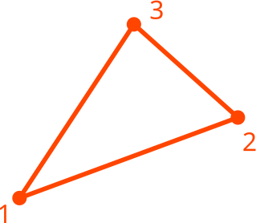
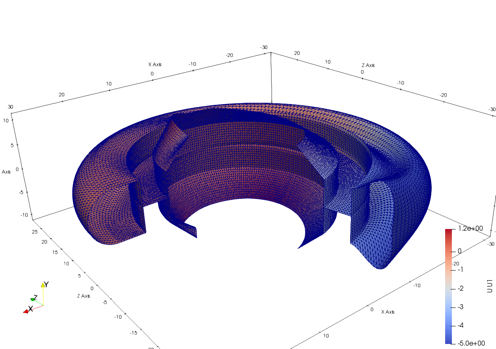

# DKTS3

DKT Triangle Shell

* Number of Nodes: 3
* Number of DoFs: 6 (Translation, Translation, Translation, Rotation, Rotation, Rotation)
* DoF Label: U1, U2, U3, UR1, UR2, UR3



## Background

DKTS3 is a flat triangular shell that superposes a three-node membrane with drilling rotations and the [DKT3](../Plate/DKT3.md) thin-plate model.

The assembly follows [ShellBase](ShellBase.md), with the membrane DoFs taken from $$(U_1,U_2,UR_3)$$ and the plate DoFs from $$(U_3,UR_1,UR_2)$$.

The membrane interpolation samples three mid-edge points and uses the Allman-type correction in which the mid-edge displacement depends on the difference of the drilling rotations at the adjacent corners, as derived on [Allman](../Membrane/Drilling/Allman.md).

!!! info "deviation from theory"
    The drilling stiffness is not supplied by a penalty term, so a uniform drilling rotation remains a zero-energy mode.

!!! note "developer note"
    The source `print()` routine describes the membrane as a CST formulation, but the interpolation contains the Allman drilling correction at the mid-edge points.

The plate interpolation applies the discrete Kirchhoff constraint at the same three mid-edge points, so a single set of sampling points serves both actions.

At a fibre of coordinate $$z$$ the strain is $$\mathbf\varepsilon(z)=\mathbf B_m\mathbf d_m+z\,\mathbf B_p\mathbf d_p$$, giving the membrane, bending and membrane--bending coupling blocks described on [ShellBase](ShellBase.md).

Gauss integration through the thickness uses the selected number of layers, with $$z=\xi t/2$$ by default for three points.

The local triad is built from the element geometry and the resistance and stiffness are rotated back to global coordinates by `ShellBase`.

## Syntax

```text title="DKTS3"
element DKTS3 (1) (2...4) (5) (6) [7] [8]
# (1) int, unique element tag
# (2...4) int, node i, j, k
# (5) int, material tag
# (6) double, thickness
# [7] int, number of integration points, default: 3
# [8] bool, nonlinear geometry switch, default: false
```

## Remarks

1. If the nonlinear geometry is switched on, the transformation between the global and local reference frames will depend on the current displacement.
   The nonlinear transformation is similar to the corotational transformation, and the local response is still linear.
   Thus, it follows "large displacement, small deformation" assumption.

* The optional integration-point count is a Gauss rule through the thickness and is capped at twenty in the constructor.

!!! warning "implementation limitation"
    Only the through-thickness count is adjustable.
    The element is restricted to flat geometry with the local frame taken from the first three nodes.

!!! note "developer note"
    The membrane and plate integrations are fixed at the three mid-edge points.

* The thickness is required and sets both the fibre coordinates and the layer weights.
* Use a plane-stress two-dimensional material such as [`Elastic2D`](../../Material/Material2D/Elastic2D.md) so that the bending stiffness has the correct thin-plate coefficient.
* The `print()` routine of the source calls the membrane part a CST formulation, but the interpolation uses mid-edge points with Allman-type drilling coupling.
* The uniform drilling mode can be without stiffness, as on the [Allman](../Membrane/Drilling/Allman.md) page, so restrain `UR3` where necessary.
* For a quadrilateral shell compare [S4](S4.md), which uses a shear-deformable plate, and [SGCMS](SGCMS.md), which uses a mixed drilling membrane with the [DKT4](../Plate/DKT4.md) plate.

## Sample

The model can be downloaded.
[DKTS3.zip](DKTS3.zip)



## References

1. [10.1002/nme.1620151205](https://doi.org/10.1002/nme.1620151205)
2. [10.1016/0045-7949(84)90197-4](https://doi.org/10.1016/0045-7949(84)90197-4)
3. [10.1016/0045-7825(89)90124-2](https://doi.org/10.1016/0045-7825(89)90124-2)
