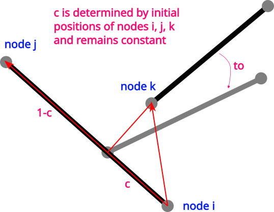

# TranslationConnector

Translation Connector Implemented via Penalty Method

## Syntax

### TranslationConnector2D

* Number of Nodes: 3
* Number of DoFs: 2 (Translation: UX, Translation: UY)

```text title="TranslationConnector"
element TranslationConnector2D (1) (2) (3) (4) (5)
# (1) int, unique element tag
# (2) int, node i
# (3) int, node j
# (4) int, node k
# (5) double, penalty factor
```

### TranslationConnector3D

* Number of Nodes: 3
* Number of DoFs: 3 (Translation: UX, Translation: UY, Translation: UZ)

```text
element TranslationConnector3D (1) (2) (3) (4) (5)
# (1) int, unique element tag
# (2) int, node i
# (3) int, node j
# (4) int, node k
# (5) double, penalty factor
```

## Theory

The schematic is shown as follows.



The initial position of node $$k$$ is not necessarily on the line defined by nodes $$i$$ and $$j$$.

The `TranslationConnector` will pull node $$k$$ to the (closest point of) line defined by nodes $$i$$ and $$j$$.

The ratio $$c$$ is computed according to the initial positions and remains constant during the analysis.

With the fixed ratio $c$, the target point on the line is $(1-c)\boldsymbol x_i+c\,\boldsymbol x_j$, and the penalty force on node $k$ is

$$
\boldsymbol R_k=\alpha\big[(1-c)\boldsymbol u_i+c\,\boldsymbol u_j-\boldsymbol u_k\big].
$$

The reactions on nodes $i$ and $j$ are $-(1-c)\boldsymbol R_k$ and $-c\,\boldsymbol R_k$, so the three nodal forces are self-equilibrated.
Writing $\boldsymbol B=[(1-c)\boldsymbol I,\ c\boldsymbol I,\ -\boldsymbol I]$, the initial tangent rows for nodes $i$, $j$ and $k$ are $-(1-c)\alpha\boldsymbol B$, $-c\alpha\boldsymbol B$ and $\alpha\boldsymbol B$, respectively.
The tangent is assembled once from the initial geometry and has rank equal to the number of translational DoFs.

!!! warning "implementation limitation"
    The ratio $c$ is frozen at initialization.
    A standard node-to-line constraint re-projects the node at every step, whereas this element keeps the initial parametric position even when the line rotates.

## Remarks

1. The penalty factor `[5]` is taken as an absolute value, so a negative input produces the same constraint stiffness.
2. The ratio $c$ is frozen at the initial configuration, making this a linear constraint that does not follow large rigid rotations of the host line.
3. Unlike [`Tie`](Tie.md), the constraint is geometric: node $k$ is attached to the closest point of the line through nodes $i$ and $j$, not to an arbitrary algebraic combination of DoFs.
4. Choose a penalty large relative to the connected stiffness but small enough to preserve conditioning, as discussed on the [`Tie`](Tie.md) page.
