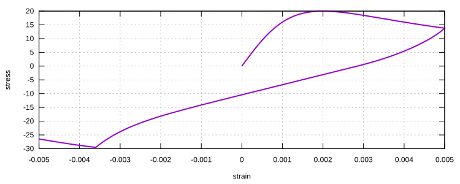
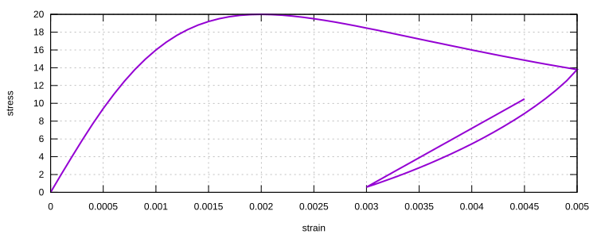
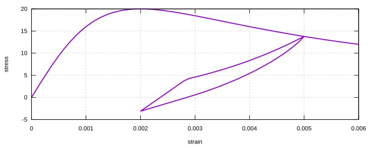
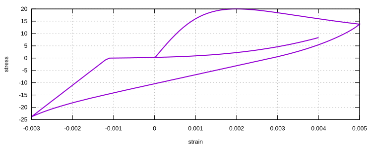
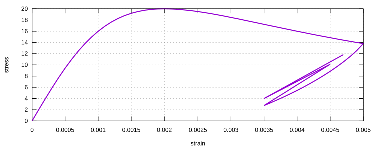
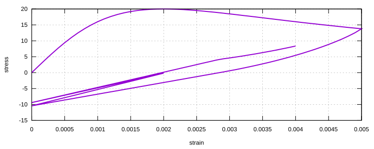

# ConcreteCM

Chang-Mander Concrete Model

## Syntax

```text title="ConcreteCM"
material ConcreteCM (1) (2) (3) (4) (5) (6) [7] [8] [9] [10]
# (1) int, unique material tag
# (2) double, elastic modulus
# (3) double, compression strength, should be negative but sign insensitive
# (4) double, tension strength, should be positive but sign insensitive
# (5) double, NC
# (6) double, NT
# [7] double, strain at compression strength, default: -2E-3
# [8] double, strain at tension strength, default: 1E-4
# [9] bool string, linear transition switch, default: false
# [10] double, density, default: 0.0
```

## Background

`ConcreteCM` is a rule-based uniaxial cyclic concrete model derived from the Chang--Mander formulation.
The monotonic response in both tension and compression follows the normalised Tsai (1988) equation

$$
y=\dfrac{m x}{1+\left(m-\dfrac{n}{n-1}\right)x+\dfrac{x^n}{n-1}},
$$

with $x=\varepsilon/\varepsilon_c$ or $\varepsilon/\varepsilon_t$ and $y=\sigma/f_c$ or $\sigma/f_t$.
Here $f_c$ and $\varepsilon_c$ are the compressive strength and its strain, $f_t$ and $\varepsilon_t$ are the tensile strength and its strain, $m$ is fixed by the initial stiffness and $n>1$ controls the slope of the descending branch.
The implementation sets $m_c=E\varepsilon_c/f_c$ and $m_t=E\varepsilon_t/f_t$, so the initial tangent modulus is exactly $E$ on both backbones.
Unloading generates a residual strain and a degraded residual stiffness, and the unload--reload branches are governed by separate rules for tension and compression.
A transition branch connects the two residual states to represent crack closing when the strain changes sign.
The original rule set can produce a transition stiffness larger than the initial modulus, so a linear transition option is provided for improved stability.

!!! warning "implementation limitation"
    The compression and tension envelopes are pure Tsai curves.
    The additional straight-line spalling tail of the original Chang--Mander formulation is not implemented.
    The nonlinear transition between tension and compression is replaced by a linear branch when the transition switch is enabled, which is more stable but changes the hysteresis shape.

## Remarks

1. The Chang-Mander concrete model uses Tsai's equation as backbone curves for both tension and compression.
2. Parameters `NC` and `NT` control the shapes of backbone curves.
   A detailed explanation is presented later.
3. In the original model, the transition between compression and tension could sometimes have larger stiffness than the initial stiffness.
   This is unlikely to be true in reality.
4. A linear behaviour for part of the hysteresis can be applied by turning on the linear transition switch.
   ***It shall be noted that a linear hysteresis rule is much more stable than the original version.***
5. The original CM model has some undefined behaviour which may cause stability issues.
   This is a simplified model.

6. The parser requires $|\varepsilon_c|>|f_c|/E$ and $|\varepsilon_t|>|f_t|/E$ so that the secant stiffness at each peak is below the initial stiffness and the corresponding $m$ is greater than one.

7. The parameters `NC` and `NT` are clamped to values greater than unity in the constructor.

8. A typical choice is $n_c$ between 2 and 6 and $n_t>n_c$, with larger values giving a steeper descending branch.

9. The strength and strain inputs are sign insensitive because their absolute values are taken and the signs are restored internally.

10. Compared with [`ConcreteTsai`](ConcreteTsai.md), which uses the simpler `SimpleHysteresis` rules, this model resolves small cycles and keeps separate tension and compression unloading histories.

## History Variable Layout

| location              | value                |
|-----------------------|----------------------|
| `initial_history(0)`  | unload_c_strain      |
| `initial_history(1)`  | unload_c_stress      |
| `initial_history(2)`  | reverse_c_strain     |
| `initial_history(3)`  | reverse_c_stress     |
| `initial_history(4)`  | residual_c_strain    |
| `initial_history(5)`  | residual_c_stiffness |
| `initial_history(6)`  | unload_t_strain      |
| `initial_history(7)`  | unload_t_stress      |
| `initial_history(8)`  | reverse_t_strain     |
| `initial_history(9)`  | reverse_t_stress     |
| `initial_history(10)` | residual_t_strain    |
| `initial_history(11)` | residual_t_stiffness |
| `initial_history(12)` | connect_c_stress     |
| `initial_history(13)` | connect_c_stiffness  |
| `initial_history(14)` | connect_t_stress     |
| `initial_history(15)` | connect_t_stiffness  |
| `initial_history(16)` | inter_strain         |
| `initial_history(17)` | inter_stress         |
| `initial_history(18)` | reload_c_stiffness   |
| `initial_history(19)` | reload_t_stiffness   |

## General Description of the Model

### Unload from backbone



### Reload from unload branch

#### Reload before residual



#### Reload between two residuals



#### Reload after the opposite residual



#### Small Cycle





## Determination of Parameters

The Tsai equation (Tsai, 1988) can be expressed as

$$
y=\dfrac{mx}{1+(m-\dfrac{n}{n-1})x+\dfrac{x^n}{n-1}}.
$$

where $$x=\varepsilon/\varepsilon_c$$ or $$x=\varepsilon/\varepsilon_t$$ is normalized strain and $$y=f/f_c$$ and $$y=f/f_t$$ are normalized stresses.
The stress decreases to zero if $$m(n-1)>n$$ and $$n>1$$.
The initial stiffness is related to $$m_t$$ and $$m_c$$ by

$$
E_0=mE_s=m_t\dfrac{f_t}{\varepsilon_t}=m_c\dfrac{f_c}{\varepsilon_c}.
$$

Once $$E_0$$ is given, $$m_c$$ and $$m_t$$ are determined automatically.

The parameter $$n$$ controls the slope of descending branch, normally $$n_t>n_c$$.
Some empirical expressions are available to determine both $$m$$ and $$n$$.
But most are unit dependent.
Users shall do manual conversion.
For example,

$$
m_c=1+\dfrac{17.9}{f_c}\quad{}f_c\text{ in MPa},
$$

$$
m_c=1+\dfrac{2600}{f_c}\quad{}f_c\text{ in psi},
$$

$$
n_c=\dfrac{f_c}{6.68}-1.85>1\quad{}f_c\text{ in MPa},
$$

$$
n_c=\dfrac{f_c}{970}-1.85>1\quad{}f_c\text{ in psi}.
$$

## References

1. Chang, G. A., and Mander, J. B. (1994), "Seismic Energy Based Fatigue Damage Analysis of Bridge Columns, Part I: Evaluation of Seismic Capacity," NCEER Report 94-0006, State University of New York at Buffalo.

2. Mander, J. B., Priestley, M. J. N., and Park, R. (1988), "Theoretical Stress-Strain Model for Confined Concrete," Journal of Structural Engineering, 114(8), 1804--1826, [doi:10.1061/(ASCE)0733-9445(1988)114:8(1804)](https://doi.org/10.1061/(ASCE)0733-9445(1988)114:8(1804)).

3. Tsai, W. T. (1988), "Uniaxial Compressional Stress-Strain Relation of Concrete," Journal of Structural Engineering, 114(9), 2133--2136, [doi:10.1061/(ASCE)0733-9445(1988)114:9(2133)](https://doi.org/10.1061/(ASCE)0733-9445(1988)114:9(2133)).
