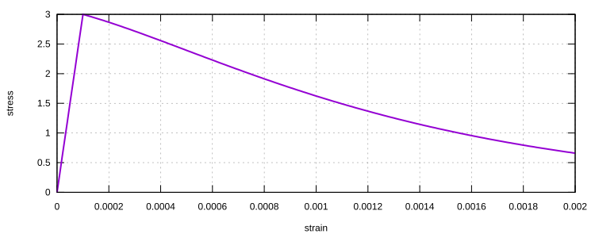
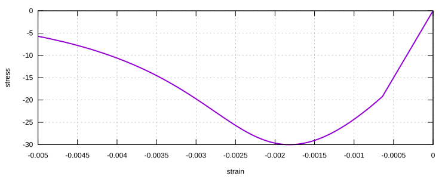

# ConcreteExp

Objective Concrete Model

The `ConcreteExp` model uses the exponential functions from the Barcelona model (Lubliner, 1989) as the backbones.
The main advantage is that the area under the backbone has an upper bound and can be explicitly integrated.
By associating this value with objective quantities, it is possible to obtain a uni-axial concrete model that supports objective response.

## Syntax

```text title="ConcreteExp"
material ConcreteExp (1) (2) (3) (4) (5) (6) (7) (8) [9] [10]
# (1) int, unique tag
# (2) double, elastic modulus
# (3) double, f_t
# (4) double, a_t
# (5) double, g_t
# (6) double, f_{c,m}
# (7) double, a_c
# (8) double, g_c
# [9] double, middle point, default: 0.2
# [10] double, density, default: 0.0
```

## History Variable Layout

Since it is derived from the [`SimpleHysteresis`](../Hysteresis/SimpleHysteresis.md) model, it shares the same history variable layout.

## Theory

For both tension and compression, the following equation is used for the backbone.

$$
\dfrac{\sigma}{f}=\left(1+a\right)\exp\left(-b\varepsilon_p\right)-a\exp\left(-2b\varepsilon_p\right)
$$

where $$a$$ and $$b$$ are two material properties that control the shape of the backbone.
For tension, $$a<1$$.
For compression, $$a>1$$.

The area under the backbone is

$$
g=\dfrac{a+2}{2b}f.
$$

So for a fixed $$g$$, $$b$$ can be computed as

$$
b=\dfrac{a+2}{2g}f.
$$

The model accepts $$g_t$$ and $$g_c$$ in order to obtain objective results.

The parameters $$f_t$$ and $$f_c$$ are elastic limits of tension and compression respectively.
**However, the maximum strength $$f_{c,m}$$ is taken as an input since for compression there is a hardening response.**

It could be derived that

$$
\dfrac{f_c}{f_{c,m}}=\dfrac{4a_c}{\left(1+a_c\right)^2}.
$$

The coefficients $b_t$ and $b_c$ are not entered directly.
The implementation derives them from the supplied energies as $b=(1+a/2)f/g$, where $f$ is the corresponding elastic limit.
Because strain appears inside the exponential through the elastic offset $\sigma/E$, the backbone is evaluated by a local Newton iteration at each trial strain.
The area $g$ has units of energy per unit area, so it must be associated with a length measure when a mesh-objective softening response is required.

!!! info "deviation from theory"
    The model does not read the element characteristic length, so the energy parameters must be scaled by the analyst to obtain mesh objectivity.

!!! note "developer note"
    The backbone is evaluated by a local Newton iteration because the strain appears through the elastic offset $\sigma/E$, rather than by direct evaluation of an explicit stress--strain formula.

If, as normally assumed, the elastic limit is $$80~\%$$ of the maximum strength, then

$$
\dfrac{f_c}{f_{c,m}}=\dfrac{4a_c}{\left(1+a_c\right)^2}=0.8,\qquad a_c\approx3.73.
$$

For other ratios, $$a_c$$ can be determined accordingly.

## Determination of Parameters

The parameter $$g_t$$ could be associated with the mode one specific fracture energy of the material.
For concrete, it typically ranges from $$40~\mathrm{N/m}$$ to $$120~\mathrm{N/m}$$ (according to ABAQUS).
Values of similar scale can be used.

The counterpart $$g_c$$ can be chosen as several hundred times larger than $$g_t$$.

The $$a_t$$ can be set to $$(0,~1)$$, typically, a value of $$0.7$$ is good for general use.
The $$a_c$$ is greater than $$1$$.
A larger $$a_c$$ has a narrower hardening region and thus degrades more rapidly.
For high strength concrete, $$a_c$$ can be large.
For low strength concrete, $$a_c$$ could be around $$2$$.

```
material ConcreteExp 1 3E4 3. .6 4E-3 30. 4. 1E-1 .2
```

The above command has the following tension response (strain and stress).



And the following compression response.



## Remarks

All strength, energy and shape inputs are converted to positive magnitudes in the constructor, so their signs do not matter.
The parameter `(6)` is the peak compressive strength $f_{c,m}$, while the elastic limit is derived internally as $f_c=4a_c f_{c,m}/(1+a_c)^2$.
The ratio $f_c/f_{c,m}=0.8$ gives $a_c\approx3.73$, and $a_c$ must exceed one to produce a compression branch that hardens before softening.
The tensile shape parameter $a_t$ should lie in $(0,1)$, with a value near 0.7 being a practical starting point.
The energies $g_t$ and $g_c$ have units of force per length, and this class does not read the element characteristic length, so the analyst must scale them with the element size when a mesh-objective response is required.
The middle point parameter `[9]` controls the size of the hysteresis loop in the inherited [`SimpleHysteresis`](../Hysteresis/SimpleHysteresis.md) rules and is clamped to $[0,1]$.
The density `[10]` defaults to zero.
The objective energy formulation follows the Barcelona damage model of Lubliner et al. (1989).

## References

1. [10.1016/0020-7683(89)90050-4](https://doi.org/10.1016/0020-7683(89)90050-4)
