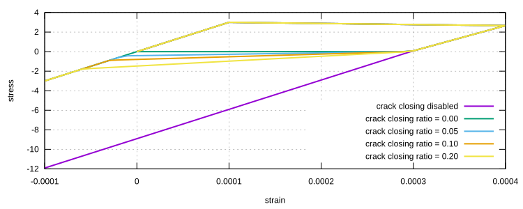
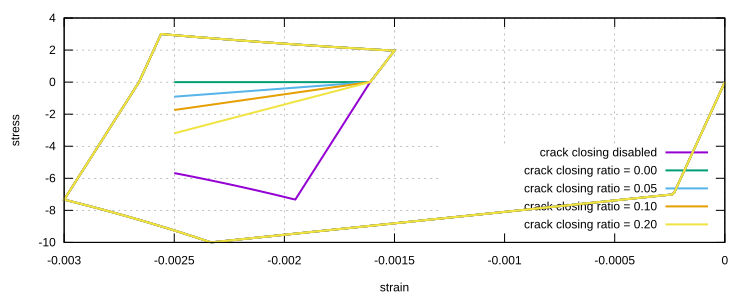
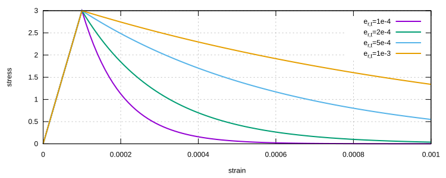
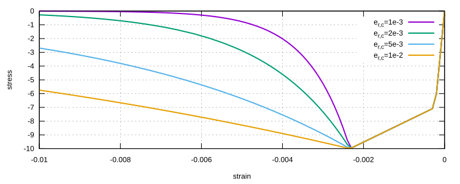
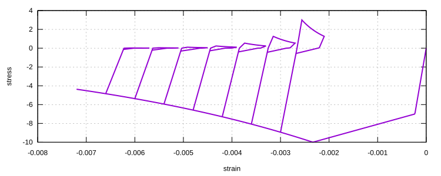

# ConcreteK4

A Uniaxial Plastic-Damage Concrete Model

## References

1. [10.1061/(ASCE)ST.1943-541X.0002592](https://doi.org/10.1061/(ASCE)ST.1943-541X.0002592)
2. [Constitutive Modelling Cookbook](https://github.com/TLCFEM/constitutive-modelling-cookbook/releases/download/latest/COOKBOOK.pdf)
3. [ISBN 978-0-521-32853-1](https://search.worldcat.org/search?q=bn:9780521328531)

## Syntax

```text title="ConcreteK4"
material ConcreteK4 (1) (2) (3) (4) (5) (6) (7) (8) (9) (10) (11) [12]
# (1) int, unique material tag
# (2) double, elastic modulus (+), typical: 30000 (in MPa)
# (3) double, crack closing stiffness ratio (+), typical: ~0.1
# (4) double, tensile hardening ratio (+), typical: [0,1]
# (5) double, compressive hardening ratio (+), typical: [0,1]
# (6) double, tensile strength (+), typical: 3 (in MPa)
# (7) double, crush (compressive) strength (+), typical: 40 (in MPa)
# (8) double, crush (compressive) strain (+), typical: 0.002
# (9) double, yield (compressive) strength ratio (<1), typical: ~0.7
# (10) double, reference tensile zeta
# (11) double, reference compressive zeta
# [12] double, density, default: 0.0
```

!!! warning "maximum element size"
    Based on physical material limits, finite element dimensions for typical concrete cannot exceed half a meter (plain) to one meter (reinforced) if **strict** energy scaling is considered.
    The numbers are only indicative.

## Theory

There is no official name proposed by the authors.
The name K4 comes from the fact that the four authors' last names all start with the letter K.

The model implements the proposed hardening laws and crack closing mechanism.
But the damage evolution is different from the original formulation.
Specifically, the original linear damage evolution is replaced by an exponential law that would alleviate potential numerical issues, as the numerical world does not like exact zeros.

### Additive Split

$$
\sigma=\left(1-d\right)\bar{\sigma}.
$$

### Yield Function

$$
F=\left\{
\begin{array}{ll}
F_t,&\bar{\sigma}>0,\\
F_c,&\text{otherwise},
\end{array}
\right.
$$

with

$$
F_t=\bar{\sigma}-\bar{\sigma}_{y,t},\qquad
F_c=-\bar{\sigma}-\bar{\sigma}_{y,c}.
$$

### Flow Rule

$$
\dot{\varepsilon^p}=\gamma~\text{sign}{\bar{\sigma}}.
$$

### Hardening Laws

$$
\bar{\sigma}_{y,t}=f_t+h_tk_t,\qquad
\bar{\sigma}_{y,c}=\left\{
\begin{array}{ll}
f_y+h_ck_c,&k_c\leqslant{}k_0,\\
f_y+h_ck_0+h_d\left(k_c-k_0\right),&\text{otherwise}.
\end{array}
\right.
$$

The tensile strength $$f_t$$ is controlled by `(6)`.
The hardening modulus $$h_t$$ is computed as `(4)` times elastic modulus.

The crush strength $$f_c$$ `(7)` can be expressed as $$f_c=f_y+h_ck_0$$ where $$f_y$$ is `(9)` times $$f_c$$.
$$k_0$$ is the strain when crush strength is reached; this is controlled by `(8)`.
The hardening modulus $$h_c$$ is automatically computed.
The hardening modulus $$h_d$$ is computed as `(5)` times elastic modulus.

### Damage

$$
d_t=1-\exp\left(-\dfrac{k_t}{e_{r,t}}\right),\qquad
d_c=1-\exp\left(-\dfrac{k_c}{e_{r,c}}\right).
$$

The reference strain $$e_{r,t}$$ and $$e_{r,c}$$ are used to control the damage evolution.
They can be expressed as

$$
e_{r,t}=\dfrac{f_t}{\zeta_tE},\qquad
e_{r,c}=\dfrac{f_c}{\zeta_cE},
$$

in which $$\zeta_t$$ and $$\zeta_c$$ are `(10)` and `(11)` respectively.

### Crack Closing and Objective Damage

When the stress changes from tension to compression, previously opened cracks must close before the compressive stiffness is fully recovered.
The implementation activates a dedicated branch when the trial stress is compressive, the strain increment is compressive and the stored tensile plastic strain exceeds the closing strain accumulated so far.
The crack-closing increment is capped by the available tensile plastic strain, which prevents the crack from closing beyond its original opening.
Damage is evaluated on the effective stress and multiplies both the stress and the consistent tangent by $1-d$.
When objective damage is enabled, each zeta parameter is replaced by a length-dependent scale,

$$
\zeta_{\mathrm{eff}}=\dfrac{2a}{\sqrt{1+\dfrac{4}{l_c}\left[\left(\dfrac{a}{\zeta}\right)^2+\dfrac{a}{\zeta}\right]}-1},
$$

where $l_c$ is the element characteristic length and $a$ is the corresponding hardening modulus.
The characteristic length defaults to unity in the material base class and is normally supplied by the element, so mesh objectivity requires an element that sets it.

!!! warning "implementation limitation"
    The damage evolution is exponential instead of the linear law of the original K4 formulation, so the tangent never vanishes exactly.
    The crack-closing increment is capped by the previously accumulated tensile plastic strain.
    Objective damage is opt-in and uses the element characteristic length, which defaults to unity when the element does not set it.

## Remarks

The parameter `(2)` is the elastic modulus and `(3)` is the crack-closing stiffness ratio, which is clamped to $[10^{-4},1]$ and multiplied by $E$ internally.
The ratios `(4)` and `(5)` multiply the elastic modulus to give the tensile hardening modulus $h_t$ and the post-peak compressive modulus $h_d$.
The strength inputs `(6)` and `(7)` and the crush strain `(8)` are converted to absolute values.
The compressive hardening modulus before the peak is computed internally as $h_c=(f_c-f_y)/k_0$, where $f_y$ is `(9)` times $f_c$.
The parameters `(10)` and `(11)` are dimensionless zeta values that are multiplied by $E$ internally, so a larger zeta gives a smaller reference strain and faster damage growth.
After the density `[12]` the parser accepts three optional boolean flags that enable damage, enable crack closing and enable objective damage, with defaults true, true and false respectively.
The implementation replaces the original linear damage evolution by an exponential law so that the tangent never becomes exactly zero, which improves numerical stability.
The local return map uses a maximum of 20 iterations.
Unlike the rule-based [`ConcreteCM`](ConcreteCM.md) and [`ConcreteTsai`](ConcreteTsai.md), this is a damage-plasticity model with an explicit yield surface and an evolving damage variable.

## Examples

### Effect of Crack Closing Stiffness Ratio

The crack closing stiffness ratio `(3)` controls the slope of the segment where crack opening is gradually closed.





### Effect of Tensile Reference Strain

Basic model:

```text
material ConcreteK4 1 3E4 .05 .01 .01 3. 10. 2E-3 .7 1. 1.
```



### Effect of Compressive Reference Strain

Basic model:

```text
material ConcreteK4 1 3E4 .05 .01 .01 3. 10. 2E-3 .7 1. 1.
```



### A Cyclic Example

```text
material ConcreteK4 1 3E4 .05 .01 .01 3. 10. 2E-3 .7 5. 5.

materialTest1D 1 -1E-5 300 90 150 90 150 90 150 90 150 90 150 90 150 90 150
```


