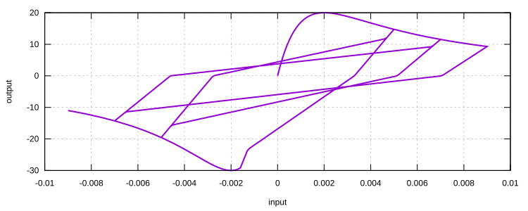
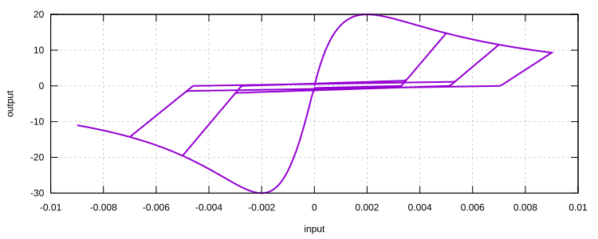

# ConcreteTsai

Uniaxial Concrete Model Using Tsai's Equation

The `ConcreteTsai` model is a simple concrete model using Tsai's equation.

## References

1. [10.1061/(ASCE)0733-9445(1988)114:9(2133)](https://doi.org/10.1061/(ASCE)0733-9445(1988)114:9(2133))

The backbone is governed by a normalized function which is controlled by two parameters $$m$$ and $$n$$.

<iframe src="https://www.desmos.com/calculator/l5lebk1toq?embed" width="800" height="400" style="border: 1px solid #ccc" frameborder=0></iframe>

2. Tsai, W. T. (1988), "Uniaxial Compressional Stress-Strain Relation of Concrete," Journal of Structural Engineering, 114(9), 2133--2136, [doi:10.1061/(ASCE)0733-9445(1988)114:9(2133)](https://doi.org/10.1061/(ASCE)0733-9445(1988)114:9(2133)).

## Syntax

```text title="ConcreteTsai"
material ConcreteTsai (1) (2) (3) (4) (5) (6) (7) (8) (9) [10]
# (1) int, unique material tag
# (2) double, elastic modulus, E
# (3) double, compression strength, should be negative but sign insensitive, f_c
# (4) double, tension strength, should be positive but sign insensitive, f_t
# (5) double, NC
# (6) double, NT
# (7) double, middle point, typical: 0.2
# (8) double, strain at compression strength, \varepsilon_c, typical: -2E-3
# (9) double, strain at tension strength, \varepsilon_t, typical: 1E-4
# [10] double, density, default: 0.0
```

## Theory

The backbone is the normalised Tsai (1988) function

$$
y=\dfrac{m x}{1+\left(m-\dfrac{n}{n-1}\right)x+\dfrac{x^n}{n-1}},
$$

where $x=\varepsilon/\varepsilon_c$ in compression and $x=\varepsilon/\varepsilon_t$ in tension, while $y=\sigma/f_c$ and $y=\sigma/f_t$ respectively.
The parameter $m$ controls the initial slope and is computed internally from the initial modulus and the peak coordinates as $m=E\varepsilon_{\mathrm{peak}}/f_{\mathrm{peak}}$.
The parameter $n>1$ controls the curvature of the descending branch, with smaller values giving more gradual softening.
For $n=1$ the implementation uses the limiting logarithmic form of the denominator.
A descending branch requires $m(n-1)>n$, so the peak strain and the shape parameter must be chosen consistently.
Unloading and reloading are handled by the [`SimpleHysteresis`](../Hysteresis/SimpleHysteresis.md) base class, which stores the previous tensile and compressive reversal points and the corresponding residual strains.
The residual strain on unloading from a reversal point $(\varepsilon_r,\sigma_r)$ follows a secant construction with the empirical constants 0.57 in compression and 0.67 in tension.
The middle point parameter selects the intermediate kink of the unloading branch and therefore the energy dissipated in a small cycle.

!!! info "deviation from theory"
    The shape parameter $m$ is not an input but is computed from the elastic modulus and the peak strain, which forces the initial tangent to equal $E$.
    The residual strains use fixed empirical constants 0.57 and 0.67 rather than calibrated unloading parameters.
    The inherited hysteresis rules have no separate small-cycle model.

## History Variable Layout

Since it is derived from the [`SimpleHysteresis`](../Hysteresis/SimpleHysteresis.md) model, it shares the same history variable layout.

## Remarks

1. The middle point parameter represents the size of the hysteresis loop.
   Valid values range from 0 to 1 (ends not recommended).
2. There is no additional consideration for small loops, which is available in [`ConcreteCM`](ConcreteCM.md).

3. The strength and peak-strain inputs are converted to absolute values, so the sign convention is handled internally.

4. The shape parameters `NC` and `NT` are clamped to values greater than unity.

5. The initial stiffness equals the input modulus $E$ only when the peak strains satisfy the inequalities given above, otherwise the parser rejects the material.

6. For nonlinear transitions and explicit small-cycle rules use [`ConcreteCM`](ConcreteCM.md), and for an energy-based or tabulated backbone use [`ConcreteExp`](ConcreteExp.md) or [`ConcreteTable`](ConcreteTable.md).

The parameter $$m$$ is defined in the reference.
But it is not explicitly exposed in order to eliminate inconsistent elastic modulus in compression and tension.
It is, instead, computed internally based on the given strains at compression and tension strength.

Note the magnitude of the strain at compression/tension strength has to be greater than the 'elastic strain' computed by the corresponding strength divided by the elastic modulus.

$$
|\varepsilon_c|>\dfrac{|f_c|}{E},\\
|\varepsilon_t|>\dfrac{|f_t|}{E}.
$$

This ensures the corresponding parameter $$m$$ is always greater than 1, which is required by the model.

## Usage

```
material ConcreteTsai 1 3E4 30 20 2 2 .8 2E-3 2E-3
materialTest1D 1 1E-4 50 100 120 140 160 180
exit
```



```
material ConcreteTsai 1 3E4 30 20 2 2 .1 2E-3 2E-3
materialTest1D 1 1E-4 50 100 120 140 160 180
exit
```


