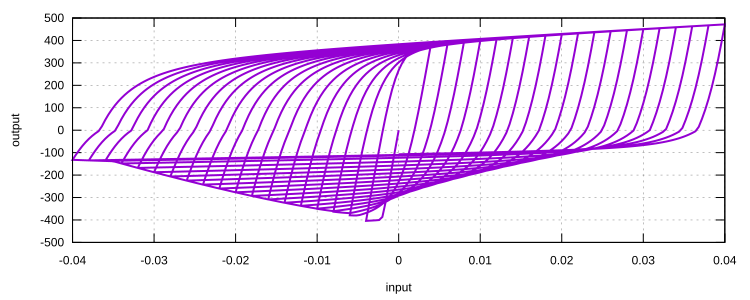

# Dhakal

Dhakal Degradation

The `Dhakal` wrapper reduces the compression envelope of a reinforcing bar to account for post-yield buckling between ties.
It is a strain-driven degradation wrapper in the sense of [`Degradation`](Degradation.md), but it degrades only the compression side.
The intact response is supplied by a host steel model such as [`MPF`](../Hysteresis/MPF.md).

!!! warning "implementation limitation"
    The published Dhakal and Maekawa model is a fully path-dependent cyclic law with a tension yield plateau, a nonlinear compression envelope and Giuffrè--Menegotto--Pinto reversal loops.
    This wrapper implements only a monotonic compression degradation envelope as a multiplier on a host material.
    It has no yield plateau of its own, no load-reversal memory, no reduced post-buckling reloading stiffness and no effect on tension.

## References

1. [10.1061/(ASCE)0733-9445(2002)128:9(1139)](https://doi.org/10.1061/(ASCE)0733-9445(2002)128:9(1139))
2. [10.1016/S0141-0296(02)00080-9](https://doi.org/10.1016/S0141-0296(02)00080-9)

## Syntax

```text title="Dhakal"
material Dhakal (1) (2) (3) (4)
# (1) int, unique material tag
# (2) int, host material tag
# (3) double, yield strain
# (4) double, geometry parameter
```

## Theory

The model is proposed for modelling buckling of reinforcement bars in concrete members.

The geometry parameter `[4]` is defined as

$$
\sqrt{\dfrac{f_y}{100~\text{MPa}}}\dfrac{L}{D}.
$$

Since this parameter is calibrated according to the dimensional constant $$100~\text{MPa}$$, the whole analysis must then use the same unit system.

This is a common issue in lots of phenomenological models, which lack a clear implication of those ad-hoc parameters.

Denote the yield strain magnitude by $$\varepsilon_y=|(3)|$$ and the geometry parameter by $$r_b=|(4)|$$.
The implementation sets the intermediate strain magnitude and the intermediate degradation factor to

$$
\varepsilon_i=\varepsilon_y\max(55-2.3\,r_b,\,7),\qquad
D_i=\min\{1,\,\max(1.1-0.016\,r_b,\,0.2)\}.
$$

Both quantities are evaluated as magnitudes, so the sign of the input yield strain is immaterial.
The final strain magnitude at which degradation saturates is

$$
\varepsilon_f=\varepsilon_i+50\,(D_i-0.2)\,\varepsilon_y.
$$

Writing $$e=|\varepsilon|$$ for the compressive strain magnitude, the compression degradation factor is

$$
D(e)=\begin{cases}
1, & e\le\varepsilon_y,\\[1mm]
1-\dfrac{1-D_i}{\varepsilon_i-\varepsilon_y}\big(e-\varepsilon_y\big), & \varepsilon_y<e\le\varepsilon_i,\\[2mm]
D_i-\dfrac{0.02}{\varepsilon_y}\big(e-\varepsilon_i\big), & \varepsilon_i<e\le\varepsilon_f,\\[2mm]
0.2, & e>\varepsilon_f.
\end{cases}
$$

The factor is continuous at both $$\varepsilon_i$$ and $$\varepsilon_f$$.
In tension the wrapper returns $$D=1$$ with zero derivative, so tensile stress is never reduced.
On a new compressive extreme the tangent stiffness is $$K=D\bar K+\bar\sigma\,\mathrm{d}D/\mathrm{d}\varepsilon$$, and elsewhere it is $$K=D\bar K$$, as derived in [`Degradation`](Degradation.md).

## Example

```text
material MPF 1 2E5 400 .01
material Dhakal 2 1 5E-3 50
materialTest1D 2 -4E-4 10 20 25 30 35 40 45 50 55 60 65 70 75 80 85 90 95 100 105 110 115 120 125 130 135 140 145 150 155 160 165 170 175 180 185 190 195 200 100
```



## Remarks

The argument `(3)` is a strain, not a yield stress, and it is converted to a magnitude internally.
The argument `(4)` is the dimensionless buckling parameter $$r_b=\sqrt{f_y/100~\text{MPa}}\,(L/D)$$, where $$L$$ is the unsupported length and $$D$$ the bar diameter.
Because the constant 100 MPa is embedded in the calibration, the yield strength used to compute `(4)` must be expressed in MPa and the host stress units should be consistent.

!!! warning "implementation limitation"
    The geometry parameter is not dimensionless in an arbitrary unit system because the calibration embeds a 100 MPa divisor.
    Scaling all stresses by a constant changes $$r_b$$ and therefore changes $$\varepsilon_i$$, $$D_i$$ and $$\varepsilon_f$$.
    The same unit system must be used consistently across the host material and the wrapper.

Degradation is applied only in compression, so the tension envelope of the host material is left unchanged.
The model is intended for reinforcing bars whose buckling is restrained by surrounding concrete, so $$L/D$$ should reflect the tie spacing rather than the total bar length.
The three-segment envelope is monotonic in the strain magnitude and independent of load reversals, so it does not reproduce cyclic pinching or path dependence.
Use [`CustomStrainDegradation`](CustomStrainDegradation.md) or [`CustomStressDegradation`](CustomStressDegradation.md) for a fully custom evolution law.
