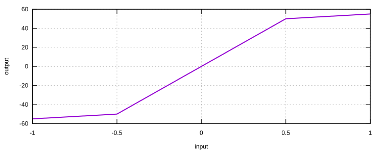

# BilinearElastic1D

Uniaxial Bilinear Elastic Material

The `BilinearElastic1D` model defines a symmetric, piecewise linear backbone with an initial elastic branch and a post-yield branch.
It is a special case of [`MultilinearElastic1D`](MultilinearElastic1D.md) with two segments and the sharp-corner limit of [`NLE1D01`](NLE1D01.md).

## Theory

Let $$E$$ be the elastic modulus, $$\sigma_y$$ the yield stress and $$b=H/E$$ the hardening ratio, where $$H$$ is the post-yield slope.
The yield strain is $$\varepsilon_y=\sigma_y/E$$.
The backbone is odd and given by

$$
\sigma(\varepsilon)=\begin{cases}
E\varepsilon, & |\varepsilon|\le\varepsilon_y,\\[1mm]
\operatorname{sign}(\varepsilon)\big[\sigma_y+H\big(|\varepsilon|-\varepsilon_y\big)\big], & |\varepsilon|>\varepsilon_y,
\end{cases}
$$

with tangent stiffness

$$
E_T=\begin{cases}
E, & |\varepsilon|\le\varepsilon_y,\\
H, & |\varepsilon|>\varepsilon_y.
\end{cases}
$$

The response is path independent, so unloading follows the initial elastic slope back through the origin and no residual strain is retained.
The secant stiffness $$E_S=\sigma/\varepsilon$$ decreases continuously from $$E$$ towards $$H$$ as the strain grows.

!!! warning "implementation limitation"
    Despite the yield terminology, this is a nonlinear elastic backbone and not an elastoplastic model.
    No yield surface, plastic strain or history variable is stored, and a stress reversal simply retraces the backbone.
    It cannot reproduce residual strains, hysteresis or the Bauschinger effect.

## Syntax

```text title="BilinearElastic1D"
material BilinearElastic1D (1) (2) (3) [4] [5]
# (1) int, unique material tag
# (2) double, elastic modulus
# (3) double, yield stress
# [4] double, hardening modulus, default: 0.0
# [5] double, density, default: 0.0
```

## Usage

```
material BilinearElastic1D 1 100 50 0.1
```



## Remarks

The argument `(3)` is the yield stress magnitude and `(4)` is the hardening ratio $$b=H/E$$, not an absolute hardening modulus.

!!! info "deviation from theory"
    The syntax block labels `(4)` as a hardening modulus, but `new_bilinearelastic1d` passes it to the constructor as a ratio.
    The post-yield slope actually used is $|E|\,b$, so the input is dimensionless.

The constructor converts the elastic modulus and the yield stress to absolute values and forms the hardening modulus as $$|E|\,b$$.
A hardening ratio of zero gives an elastic--perfectly-plastic backbone, while values approaching one recover nearly linear elastic behaviour.
The tangent stiffness is discontinuous at $$|\varepsilon|=\varepsilon_y$$, which may cause convergence difficulties when the solution repeatedly crosses the yield point.
[`NLE1D01`](NLE1D01.md) uses the same class with a positive transition radius to replace the sharp corner by a smooth Menegotto--Pinto transition.
Use [`MultilinearElastic1D`](MultilinearElastic1D.md) when more than two segments are needed.
