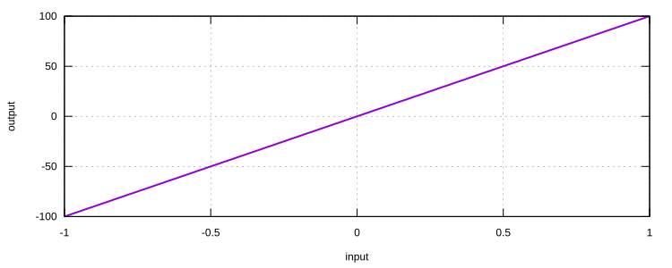

# Elastic1D

Uniaxial Elastic Material

The `Elastic1D` model is the canonical linear elastic material for a single axial stress component.
It maps the axial strain to the axial stress through a constant modulus, so that the secant and the tangent stiffness coincide.

## Theory

A one-dimensional material model relates the axial strain $$\varepsilon$$ to the axial stress $$\sigma$$ at a material point.
For linear elasticity this relation is given by Hooke's law,

$$
\sigma=E\varepsilon,\qquad E_S=\frac{\sigma}{\varepsilon}=E,\qquad E_T=\frac{\mathrm{d}\sigma}{\mathrm{d}\varepsilon}=E.
$$

Here $$E$$ denotes the elastic modulus, whose unit is that of stress, $$E_S$$ is the secant stiffness and $$E_T$$ is the tangent stiffness.
The secant stiffness is the slope of the straight line joining the origin to the current point of the stress--strain curve.
The tangent stiffness is the slope of the curve at that point and is the quantity used to linearise the equilibrium equations in a Newton--Raphson iteration.
For a general nonlinear elastic law $$\sigma=f(\varepsilon)$$ the two stiffnesses differ and are related by

$$
E_S(\varepsilon)=\frac{f(\varepsilon)}{\varepsilon},\qquad E_T(\varepsilon)=\frac{\mathrm{d}f}{\mathrm{d}\varepsilon}=E_S+\varepsilon\frac{\mathrm{d}E_S}{\mathrm{d}\varepsilon}.
$$

Every model in this family defines such a single-valued function $$f$$.
Consequently the stress depends only on the current total strain and not on the path taken to reach it.
Loading, unloading and reloading retrace the same curve and no energy is dissipated.
The stored energy is $$U(\varepsilon)=\int_0^\varepsilon f(\eta)\,\mathrm{d}\eta$$, which reduces to $$U=E\varepsilon^2/2$$ for the linear model.
The base [`Material1D`](../Material1D.md) class stores no history variables for this model and marks the tangent stiffness as symmetric.

## Syntax

```text title="Elastic1D"
material Elastic1D (1) (2) [3]
# (1) int, unique material tag
# (2) double, elastic modulus
# [3] double, density, default: 0.0
```

## Usage

```
material Elastic1D 1 100 0.
materialTest1D 1 1E-2 100 200
exit
```



## Remarks

The elastic modulus `(2)` is stored as given, without conversion to an absolute value, so a positive input is required for a physically meaningful stiffness.

!!! warning "implementation limitation"
    Unlike [`BilinearElastic1D`](BilinearElastic1D.md), the constructor does not apply `fabs` to the modulus.
    A negative input therefore produces a negative stiffness and an unstable response.

The density `(3)` defaults to zero and is used only to assemble mass or damping related terms in dynamic or eigenvalue analyses.
The implementation installs a constant stiffness, so a linear structure converges in a single Newton--Raphson iteration.
The model can be assigned directly to the truss elements [`T2D2`](../../../Element/Truss/T2D2.md) and [`T3D2`](../../../Element/Truss/T3D2.md), or to a [`TrussSection`](../../../Section/Section1D/TrussSection.md) used by section-based elements.
For tension--compression asymmetry use [`AsymmElastic1D`](AsymmElastic1D.md).
For piecewise linear backbones use [`BilinearElastic1D`](BilinearElastic1D.md) or [`MultilinearElastic1D`](MultilinearElastic1D.md).
For smooth nonlinear backbones use [`PolyElastic1D`](PolyElastic1D.md), [`Sinh1D`](Sinh1D.md), [`Tanh1D`](Tanh1D.md) or [`CustomElastic1D`](CustomElastic1D.md).
To combine a backbone with stiffness loss, wrap it with one of the models in [`Degradation`](../Degradation/Degradation.md).

## References

1. Crisfield, M. A. (1991). *Non-linear Finite Element Analysis of Solids and Structures, Volume 1: Essentials*. Wiley.
2. Zienkiewicz, O. C. and Taylor, R. L. (2000). *The Finite Element Method, Volume 1: The Basis*, 5th edition. Butterworth-Heinemann.
