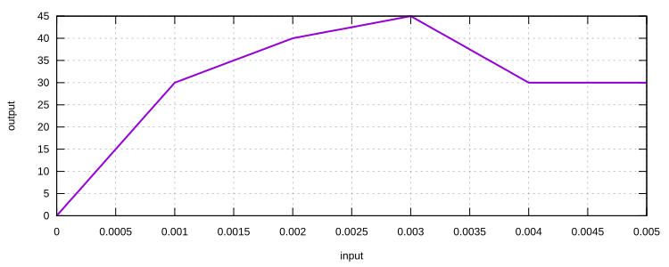

# MultilinearElastic1D

Uniaxial Multilinear Elastic Material

## Theory

A simple uniaxial multilinear elastic material model.
The [`BilinearElastic1D`](BilinearElastic1D.md) model is a special case of this model.

The backbone is a set of data points $$(\varepsilon_i,\sigma_i)$$ with $$i=1,\dots,n$$, sorted by increasing strain magnitude.
The slope of each segment is precomputed as

$$
K_1=\frac{\sigma_1}{\varepsilon_1},\qquad K_i=\frac{\sigma_i-\sigma_{i-1}}{\varepsilon_i-\varepsilon_{i-1}},\quad i\ge 2.
$$

For a strain magnitude $$|\varepsilon|$$ the model locates the first point whose strain exceeds it and interpolates linearly with that segment's slope.
Below the first point the response is a straight line through the origin with slope $$K_1$$.
Beyond the last point the stress is held constant at $$\sigma_n$$ and the tangent stiffness is zero.
The stress is finally mirrored by the sign of the strain, so the backbone is odd and symmetric in tension and compression.

## Syntax

```text title="MultilinearElastic1D"
material MultilinearElastic1D (1) (2 3...) [4]
# (1) int, unique material tag
# (2) double, strain of the data point
# (3) double, stress of the data point
# [4] double, density, default: 0.0
```

## Usage

The first point does not need to be the origin.
Starting from the first non-zero point is fine.
Multiple data points can be defined.
A constant response is assumed after the last point.

```
material MultilinearElastic1D 1 1E-3 35 2E-3 40 3E-3 45 4E-3 30
```



## Remarks

The first data point need not be at the origin.
Below it the response is a straight line through the origin with slope $$\sigma_1/\varepsilon_1$$.
Data points must be supplied with strictly increasing strain magnitudes, otherwise the segment slopes are undefined.

!!! warning "implementation limitation"
    Data points are not sorted or validated by the model, so supply them with strictly increasing strain magnitudes.
    Unordered input silently produces the wrong backbone.
    A repeated strain value gives a division by zero when the slope is formed.

!!! note "developer note"
    The constructor computes each slope directly from the order in which the points are given.
    It performs no sorting or validation of the data points.

The strain and stress values are used as given, so their units define the units of the resulting modulus.
The optional density is inferred from the parity of the argument count rather than from a fixed position.

!!! warning "implementation limitation"
    The final number is treated as the density only when the total count of numeric arguments is odd.
    An even count always means zero density, so omitting or adding a single number silently changes how the remaining values are paired.

!!! note "developer note"
    The density is identified by argument-count parity in `new_multilinearelastic1d`.

A negative slope between two points is allowed and produces a softening segment, but it can lead to convergence problems in a Newton--Raphson analysis.
The constant plateau beyond the last point has zero tangent stiffness and should be used with care in quasi-static analyses.
See [`BilinearElastic1D`](BilinearElastic1D.md) for the two-segment case and [`NLE1D01`](NLE1D01.md) for a smooth alternative.
