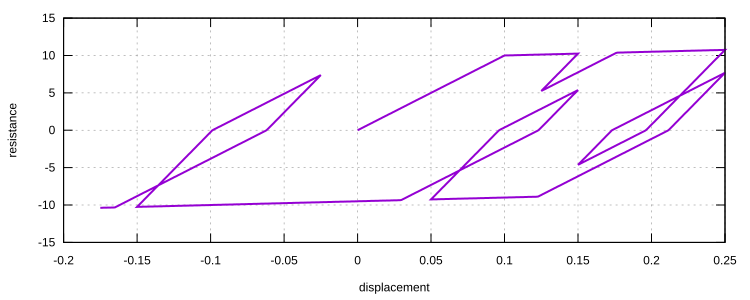
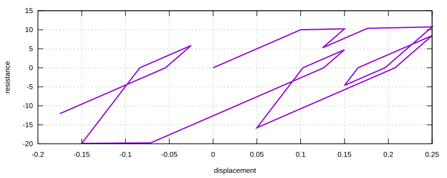
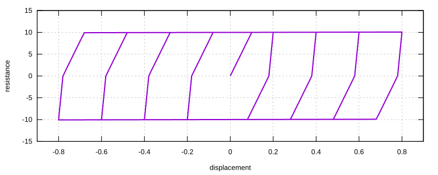

# AFC

Asymmetrical Friction Connection

## Theory

The `AFC` model is a bilinear hardening model with an unloading stiffness that differs from the initial stiffness.
The term AFC comes from "asymmetric friction connection" which is a type of energy dissipater.
But this model can be used in other applications.

The monotonic backbone of each sign is bilinear, with a yield stress $$\sigma_y^{+}$$ in tension and $$\sigma_y^{-}$$ in compression and a post-yield slope given by the corresponding hardening modulus $$E_h$$.
The initial slope is the elastic modulus $$E$$, and the yield strain is $$\varepsilon_y=\sigma_y/E$$.
Unloading does not follow the initial slope but a distinct unloading modulus $$E_u$$, which is the feature that produces the asymmetric friction-connection loop.
At a load reversal the implementation computes the strain $$\varepsilon_r=\varepsilon-\sigma/E_u$$ at which the stress would fall to zero.
It then computes the intersection of the unloading line with the opposite backbone analytically, and the response between the reversal point and this intersection is a straight line when the degradation parameter is zero.
The sign of the strain increment together with the sign of the current stress selects one of four branches, so the response is path dependent through the stored reversal strain, start point and intersection point.
The [AFCN](AFCN.md) variant replaces this straight transition by a power-law transition and adds stiffness degradation.

!!! info "deviation from theory"
    The hardening and unloading arguments are absolute moduli and not the dimensionless hardening ratios used by the bilinear hysteresis models.
    The branch endpoints are computed algebraically from the bilinear backbones, so no contact or friction interface law is integrated.

## Syntax

```text title="AFC"
material AFCS (1) (2) (3) (4) (5) [6]
material AFC02 (1) (2) (3) (4) (5) [6]
# (1) int, unique tag
# (2) double, elastic modulus
# (3) double, yield stress
# (4) double, hardening modulus
# (5) double, unloading modulus
# [6] double, density, default: 0.0

material AFC (1) (2) (3) (4) (5) (6) (7) (8) [9]
material AFC01 (1) (2) (3) (4) (5) (6) (7) (8) [9]
# (1) int, unique tag
# (2) double, elastic modulus
# (3) double, tension yield stress
# (4) double, tension hardening modulus
# (5) double, tension unloading modulus
# (6) double, compression yield stress
# (7) double, compression hardening modulus
# (8) double, compression unloading modulus
# [9] double, density, default: 0.0
```

## History Variable Layout

| location             | value          |
|----------------------|----------------|
| `initial_history(0)` | load_sign      |
| `initial_history(1)` | max_strain     |
| `initial_history(2)` | reverse_strain |
| `initial_history(3)` | start_strain   |
| `initial_history(4)` | start_stress   |
| `initial_history(5)` | end_strain     |
| `initial_history(6)` | end_stress     |

## Remarks

1. `AFC02` is a wrapper of `AFC01`.
   It provides a symmetric behavior while `AFC01` provides an asymmetric behavior.
2. `AFC` and `AFC01` select the asymmetric form with eight required parameters, while `AFC02` and `AFCS` select the symmetric form with five required parameters.
3. The elastic modulus, the yield stresses, the hardening moduli and the unloading moduli are converted to absolute values by the constructor.
4. The hardening and unloading arguments are slopes, that is, moduli, rather than dimensionless ratios as in the [BilinearOO](BilinearOO.md) family.
5. A typical choice places the unloading modulus between the post-yield hardening modulus and the elastic modulus, so that the loop is narrower than a bilinear kinematic loop.
6. The state consists of seven history variables, including the load sign, the largest strain and the start and intersection points of the current branch.
7. Use the [AFCN](AFCN.md) variant when a smooth nonlinear transition and stiffness degradation are required.

## Examples

```
material AFC02 1 100 10 5 200
materialTest1D 1 1E-3 150 25 125 100 100 200 100 300 125 150
exit
```



```
material AFC01 1 100 10 5 200 20 2 300
materialTest1D 1 1E-3 150 25 125 100 100 200 100 300 125 150
exit
```



```
material AFC02 1 100 10 .1 500
materialTest1D 1 1E-2 20 40 60 80 100 120 140 160 80
exit
```


