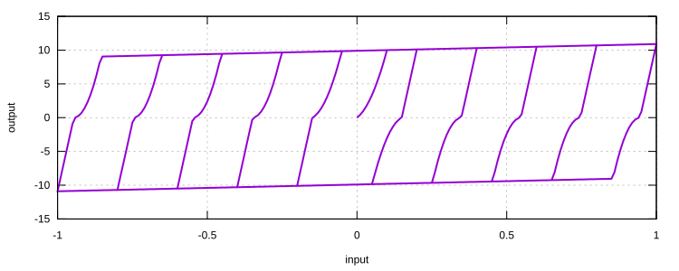

# AFCN

Nonlinear Version of AFC

## Theory

The difference between the [`AFC`](AFC.md) model and this AFCN model is the initial loading part.
This AFCN model accounts for an additional slip-lock effect.

The model keeps the bilinear backbones and the separate unloading moduli of [AFC](AFC.md), but activates the degradation parameter $$d$$ given as argument [9].
When $$d=0$$ the transition between the reversal point and the crossing point is linear, so `AFCN` with zero degradation is identical to the asymmetric [AFC](AFC.md) form.
For $$d>0$$ the implementation defines the factor $$f=0.9\exp\left(-d\,\max|\varepsilon|/\varepsilon_y\right)$$, where $$\varepsilon_y$$ is the relevant yield strain.
The start slope is scaled to $$fE$$ and the end slope is scaled to $$E_u-f(E_u-E)$$, where $$E_u$$ is the corresponding unloading modulus.
The response between the two points is a power-law transition,

$$
\sigma=\sigma_s+\Delta\varepsilon\left(E_s+\left(E_{\mathrm{sec}}-E_s\right)\left|\dfrac{\Delta\varepsilon}{\Delta\varepsilon_e}\right|^{R}\right),\qquad
R=\dfrac{E_e-E_{\mathrm{sec}}}{E_{\mathrm{sec}}-E_s},
$$

where $$E_{\mathrm{sec}}$$ is the secant slope between the start point and the crossing point and the tangent grows from $$E_s$$ to $$E_e$$.
The factor $$f$$ decreases as the largest strain grows, so the loop softens with cycling, which is the slip-lock-like behaviour referred to above.

!!! info "deviation from theory"
    The degradation factor is the empirical expression $$0.9\exp\left(-d\,\max|\varepsilon|/\varepsilon_y\right)$$, which caps the scaled start slope at $$0.9E$$ once degradation is activated.
    The power-law blend between the two branch endpoints is an interpolation chosen in suanPan rather than a relation derived from a friction mechanism.

## Syntax

```text title="AFCN"
material AFCN (1) (2) (3) (4) (5) (6) (7) (8) [9] [10]
# (1) int, unique tag
# (2) double, elastic modulus
# (3) double, tension yield stress
# (4) double, tension hardening modulus
# (5) double, tension unloading modulus
# (6) double, compression yield stress
# (7) double, compression hardening modulus
# (8) double, compression unloading modulus
# [9] double, non-negative degradation parameter, default: 0.0
# [10] double, density, default: 0.0
```

## History Variable Layout

| location             | value          |
|----------------------|----------------|
| `initial_history(0)` | load_sign      |
| `initial_history(1)` | max_strain     |
| `initial_history(2)` | reverse_strain |
| `initial_history(3)` | start_strain   |
| `initial_history(4)` | start_stress   |
| `initial_history(5)` | end_strain     |
| `initial_history(6)` | end_stress     |

## Remarks

- `AFCN` and `AFC03` are interchangeable names registered to the same parser factory, so both accept exactly the same arguments.
- Both names read the tag, the elastic modulus, the tension yield stress, the tension hardening modulus, the tension unloading modulus, the compression yield stress, the compression hardening modulus, the compression unloading modulus, the optional degradation parameter with default 0.0, and the optional density with default 0.0, in that order.
- The tension triple and the compression triple use the same order of yield stress, hardening modulus and unloading modulus.
- For comparison, `AFC` and `AFC01` use the same eight required parameters but no degradation argument, while `AFC02` and `AFCS` require only one symmetric triple of five parameters.
- The degradation parameter, the moduli and the stresses are all converted to absolute values, so their signs are ignored.
- A zero degradation parameter reduces the model to the linear-transition [AFC](AFC.md) response, and increasing it accelerates stiffness loss with the accumulated maximum strain.
- Use the symmetric [AFC](AFC.md) forms when tension and compression behavior are identical.

## Usage

```
material AFCN 1 100 10 1 200 10 1 200
materialTest1D 1 1E-2 20 40 60 80 100 120 140 160 80
exit
```


