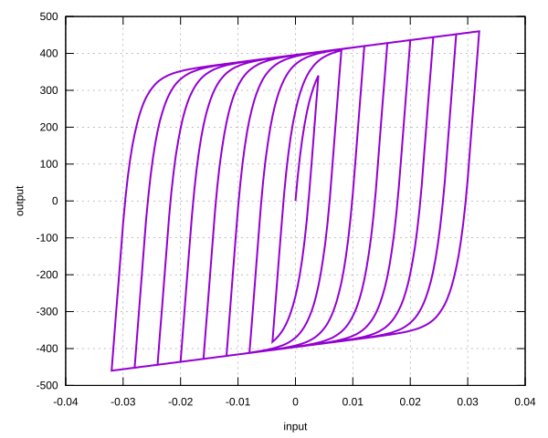
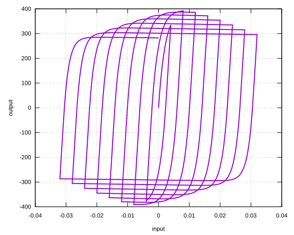
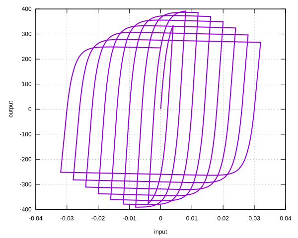
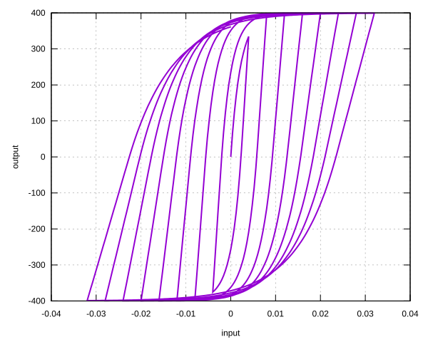
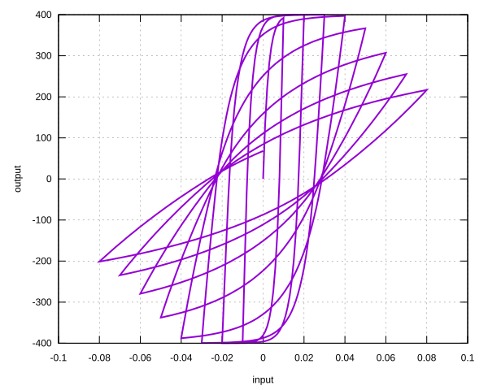

# BWBN

Bouc-Wen-Baber-Noori Model

The `BWBN` model is an extension of the `BoucWen` model with stiffness degradation, strength degradation and pinching effect.

## Syntax

```text title="BWBN"
material BWBN (1) [2...18]
# (1) int, unique material tag
# [2] double, elastic modulus, default: 2E5
# [3] double, yield stress, default: 4E2
# [4] double, hardening ratio, default: 1E-2
# [5] double, \beta (>0), default: 0.5
# [6] double, exponent n (>0, normally >=1), default: 1.0
# [7] double, initial \nu (>0), default: 1.0
# [8] double, slope of \nu (>0), default: 0.0
# [9] double, initial \eta (>0), default: 1.0
# [10] double, slope of \eta (>0), default: 0.0
# [11] double, initial \phi (>0), default: 1.0
# [12] double, slope of \phi (>0), default: 0.0
# [13] double, \zeta (1>\zeta>0), default: 0.0
# [14] double, slope of A (>0), default: 0.0
# [15] double, p (>0), default: 0.0
# [16] double, q (>0), default: 0.0
# [17] double, \lambda (>0), default: 1.0
# [18] double, density, default: 0.0
```

## History Variable Layout

| location             | value |
|----------------------|-------|
| `initial_history(0)` | `z`   |

## Theory

The [Wikipedia](https://en.wikipedia.org/wiki/Bouc–Wen_model_of_hysteresis) page contains sufficient information about the formulation of the `BWBN` model.
Some normalizations are carried out compared to the original model.

The evolution of internal displacement $$z(t)$$ is governed by the differential equation,

$$
\eta\Delta{}z=h\dfrac{\Delta{}u}{u_y}\left(A-\nu\left(\gamma+\text{sign}\left(z\cdot\Delta{}u\right)\beta\right)
\Big|z\Big|^n\right).
$$

Then,

$$
F=aF_y\dfrac{u}{u_y}+\left(1-a\right)F_yz.
$$

The model is the Bouc-Wen-Baber-Noori extension of [BoucWen](BoucWen.md), in which three energy-dependent degradation functions and a pinching function modify the evolution of $$z$$.
Here $$E$$ is the elastic modulus, $$F_y$$ the yield force, $$u_y=F_y/E$$ and $$a$$ the ratio of the post-yield to the initial stiffness.
The variable $$\nu\ge0$$ governs strength degradation, $$\eta>0$$ governs stiffness degradation and $$A$$, initially unity, governs the loss of hysteretic force amplitude.
The factor $$h\in[0,1]$$ produces pinching by reducing the evolution rate of $$z$$ near deformation reversals, and the exponent $$n$$ controls the sharpness of the loop.
The implementation again fixes $$\gamma=1-\beta$$, so the basic loop shape is set by $$\beta$$ and $$n$$.
The parameters $$\zeta$$ and $$p$$ control the magnitude and the energy-driven growth of the pinching, $$\phi_0$$ and $$\delta_\phi$$ set the pinching width, and $$q$$ and $$\lambda$$ shift and scale its centre.
All degradation functions evolve with the normalised dissipated energy, so setting every degradation slope to zero recovers the ordinary [BoucWen](BoucWen.md) response.

!!! info "deviation from theory"
    The general BWBN formulation treats the initial amplitude $$A_0$$ as an independent parameter.
    suanPan pins $$A_0=1$$ and lets $$A$$ decay as $$1-\delta_Ae$$, and it also enforces $$\gamma=1-\beta$$ as in [BoucWen](BoucWen.md).

For state determination, $$z$$ is solved iteratively by using the Newton method.
The evolutions of internal functions rely on the dissipated energy $$e$$, which is defined to be a **normalized** quantity.

$$
e=\left(1-a\right)\int{}z~\mathrm{d}u.
$$

The trapezoidal rule is used so that

$$
\Delta{}e=\left(1-a\right)\dfrac{2z+\Delta{}z}{2}\Delta{}u.
$$

The evolutions are

$$
\begin{align*} \nu&=\nu_0+\delta_\nu{}e,\\[3mm]
\eta&=\eta_0+\delta_\eta{}e,\\[3mm]
A&=1-\delta_Ae,\\[3mm]
h&=1-\zeta_1\exp\left(-\left(\dfrac{z\cdot\text{sign}\left(\Delta{}u\right)-qz_u}{\zeta_2}\right)^2\right),\\[3mm]
\zeta_1&=\zeta\left(1-\exp\left(-pe\right)\right),\\[3mm]
\zeta_2&=\left(\phi_0+\delta_\phi{}e\right)\left(\lambda+\zeta_1\right),\\[3mm]
z_u&=\sqrt[n]{\dfrac{1}{\nu}}=\nu^{-1/n}. \end{align*}
$$

The energy increment is evaluated with the trapezoidal rule, and the coupled nonlinear equations for $$z$$ and $$e$$ are solved by Newton iteration with at most 20 iterations.
The tangent stiffness returned to the global solver is the consistent algorithmic stiffness obtained by differentiating the converged equations.

!!! info "deviation from theory"
    The dissipated energy is normalised by the yield deformation, so $$e=(1-a)\int z\,\mathrm d\varepsilon$$ is dimensionless rather than a physical energy.
    The strength, stiffness and amplitude degradation laws are driven by this normalised scalar instead of by physical hysteretic energy.

!!! warning "implementation limitation"
    The coupled solve has no bracketed fallback and terminates with an error if the Newton iteration does not converge within 20 iterations.

## Parameters

Strength degradation is controlled by $$\nu$$.
To disable it, set $$\delta_\nu=0$$.

Stiffness degradation is controlled by $$\eta$$.
To disable it, set $$\delta_\eta=0$$.

Pinching is controlled by $$h$$.
To disable it, set $$\zeta=0$$ or $$p=0$$.

## Remarks

- The parser accepts the tag followed by up to 16 optional parameters and an optional density, with omitted values taking the defaults listed in the syntax block.
- The first five parameters are the same as in [BoucWen](BoucWen.md), namely $$E$$, $$F_y$$, $$a$$, $$\beta$$ and $$n$$.
- Strength degradation is switched off with $$\delta_\nu=0$$, stiffness degradation with $$\delta_\eta=0$$, amplitude degradation with $$\delta_A=0$$, and pinching with either $$\zeta=0$$ or $$p=0$$.
- The initial values $$\nu_0$$, $$\eta_0$$ and $$\phi_0$$ should be positive, and physical solutions require the derived quantities $$A>0$$, $$\eta>0$$ and $$\nu>0$$ throughout the loading history.
- The pinching parameters normally satisfy $$0\le\zeta<1$$, $$p>0$$, $$q\ge0$$ and $$\lambda>0$$, because a non-positive width parameter makes the Gaussian pinching function singular.
- The internal state consists of two history variables, namely $$z$$ and the accumulated normalised energy $$e$$, both initialised to zero.
- Use the model with one-dimensional truss or beam elements and calibrate the degradation parameters with `materialTest1D` before structural analysis.

## Examples

### Vanilla Model

The default behavior is similar to a bilinear hardening material.

```
material BWBN 1
materialtest1d 1 4E-4 10 20 30 40 50 60 70 80 90 100 110 120 130 140 150 160 80
```



### Strength degradation

A positive $$\delta_\nu$$ enables strength degradation.

```
material BWBN 1 2E5 4E2 0 .5 1. 1. 1E0 1. 0. 1. 0. 0. 0. 0. 0. 1. 0.
materialtest1d 1 4E-4 10 20 30 40 50 60 70 80 90 100 110 120 130 140 150 160 80
```



A positive $$\delta_A$$ has a similar effect.

```
material BWBN 1 2E5 4E2 0 .5 1. 1. 0. 1. 0. 1. 0. 0. 1E0 0. 0. 1. 0.
materialtest1d 1 4E-4 10 20 30 40 50 60 70 80 90 100 110 120 130 140 150 160 80
```



### Stiffness degradation

A positive $$\delta_\eta$$ enables stiffness degradation.

```
material BWBN 1 2E5 4E2 0 .5 1 1 0 1 1E1 1 0 1 0 1 1 0 0
materialtest1d 1 4E-4 10 20 30 40 50 60 70 80 90 100 110 120 130 140 150 160 80
```



### Pinching Effect

The pinching effect is governed by $$\phi_0$$, $$\delta_\phi$$, $$\zeta$$, $$p$$, $$q$$ and $$\lambda$$.

```
material BWBN 1 2E5 4E2 0 .5 1. 1. 0. 1. 0. 1. 1E1 1. 0. 1E1 1E0 1. 0.
materialtest1d 1 1E-3 10 20 30 40 50 60 70 80 90 100 110 120 130 140 150 160 80
```



## References

- Bouc, R. (1967), "Forced vibration of mechanical systems with hysteresis", Proceedings of the Fourth Conference on Nonlinear Oscillations, Prague, p. 315.
- Wen, Y.-K. (1976), "Method for random vibration of hysteretic systems", Journal of the Engineering Mechanics Division, ASCE, 102(2), 249-263, doi:10.1061/JMCEA3.0002106.
- Baber, T. T. and Wen, Y.-K. (1981), "Random vibration of hysteretic, degrading systems", Journal of the Engineering Mechanics Division, ASCE, 107(6), 1069-1087.
- Baber, T. T. and Noori, M. N. (1985), "Random vibration of degrading, pinching systems", Journal of Engineering Mechanics, ASCE, 111(8), 1010-1016, doi:10.1061/(ASCE)0733-9399(1985)111:8(1010).
