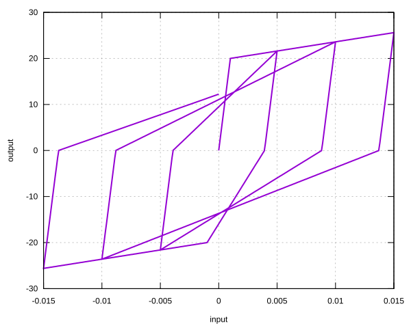
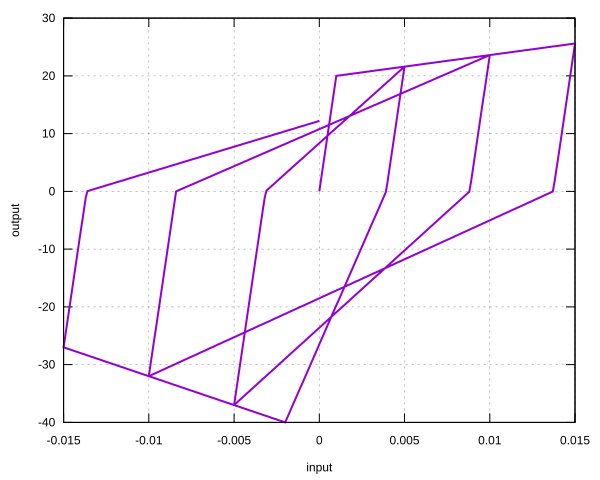

# BilinearPO

Bilinear Peak Oriented Model

## Theory

The [SimpleHysteresis](SimpleHysteresis.md) framework supplies the branch logic, and this model supplies a bilinear backbone on each side.
For the tension side the backbone is

$$
\sigma=E\varepsilon\quad(\varepsilon\le\varepsilon_y^+),\qquad
\sigma=\sigma_y^++E_h^+(\varepsilon-\varepsilon_y^+)\quad(\varepsilon>\varepsilon_y^+),
$$

where $$\varepsilon_y^+=\sigma_y^+/E$$ and $$E_h^+$$ is the hardening modulus.
The compression backbone is the mirror expression with negative strain and negative yield stress.
The input hardening argument is a ratio, so the code sets $$E_h=rE$$.
A peak-oriented rule unloads with the initial elastic modulus, so the residual strain at zero stress is the elastic intercept $$\varepsilon_r=\varepsilon-\sigma/E$$.
The residual functions of the peak-oriented base implement this rule, so the inner branches pass through these elastic-intercept points rather than through the origin.
The resulting loops are fuller than those of the origin-oriented model, as can be seen by comparing the example with [BilinearOO](BilinearOO.md).
The stress is clamped to zero when evaluation of the wrong-sign backbone would give a stress of the wrong sign, and the tangent is then set to a near-zero value.

!!! info "deviation from theory"
    The stress is forced to zero whenever a backbone would give a stress of the wrong sign, and the tangent is then set to $$10^{-10}$$.
    This clipping prevents a backbone from crossing the strain axis and is not part of an ideal bilinear plasticity formulation.

## Syntax

For symmetric response between compression and tension,

```text title="BilinearPO"
material BilinearPO (1) (2) (3) (4) [5]
# (1) int, unique material tag
# (2) double, elastic modulus
# (3) double, yield strain
# (4) double, hardening ratio
# [5] double, density, default: 0.0
```

For asymmetric response,

```
material BilinearPO (1) (2) (3) (4) (5) (6) [7]
# (1) int, unique material tag
# (2) double, elastic modulus
# (3) double, tension yield strain
# (4) double, tension hardening ratio
# (5) double, compression yield strain
# (6) double, compression hardening ratio
# [7] double, density, default: 0.0
```

## History Variable Layout

Since it is derived from the [`SimpleHysteresis`](../Hysteresis/SimpleHysteresis.md) model, it shares the same history variable layout.

## Remarks

- The input yield quantities are strains, not stresses, and both the elastic modulus and the yield strains are converted to absolute values.
- The hardening arguments are ratios with respect to $$E$$, so the example value 0.02 corresponds to a post-yield modulus of $$0.02E$$.
- In the asymmetric form the compression yield strain is stored as a negative value and its hardening ratio may also be negative, which produces a softening post-yield compression branch.
- The initial reverse points are the first yield points of the backbones, so unloading before yielding follows the initial elastic modulus.
- The model is rate independent and has no separate degradation parameters, and the state uses the eight history variables of [SimpleHysteresis](SimpleHysteresis.md).
- Use it with one-dimensional truss or beam elements, and prefer [MultilinearPO](MultilinearPO.md) when the backbone is known as a table of points.

## Example

### Symmetric Response

```
material BilinearPO 1 2E4 1E-3 .02
materialTest1D 1 1E-4 50 100 150 200 250 300 150
```



### Asymmetric Response

```
material BilinearPO 1 2E4 1E-3 .02 2E-3 -.05
materialTest1D 1 1E-4 50 100 150 200 250 300 150
```



## References

- [10.1002/eqe.495](https://doi.org/10.1002/eqe.495)
