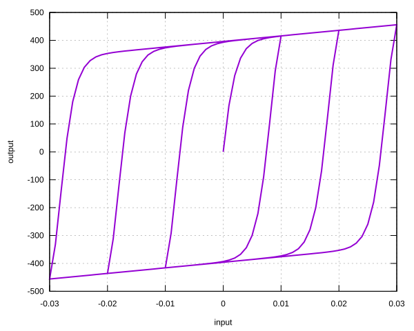
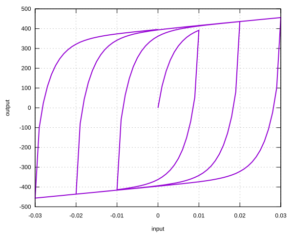

# BoucWen

Bouc-Wen Model

The `BoucWen` model is a phenomenological model.
Compared to the original formulation, the following modifications are applied.

1. $$A=1$$.
2. $$\gamma+\beta=1$$.

## Theory

The evolution of internal displacement $$z(t)$$ is governed by the differential equation,

$$
\Delta{}z=\dfrac{\Delta{}u}{u_y}\left(1-\left(\gamma+\text{sign}\left(z\cdot\Delta{}u\right)\beta\right)
\Big|z\Big|^n\right).
$$

Then,

$$
F=aF_y\dfrac{u}{u_y}+\left(1-a\right)F_yz.
$$

For state determination, $$z$$ is solved by using the Newton method.

The general Bouc-Wen model of a rate-independent hysteretic restoring force reads

$$
F=aF_y\dfrac{u}{u_y}+\left(1-a\right)F_yz,\qquad
\dot z=\dfrac{\dot u}{u_y}\left(A-\left(\gamma+\beta\,\mathrm{sign}\left(z\dot u\right)\right)\Big|z\Big|^n\right).
$$

Here $$E$$ is the elastic modulus, $$F_y$$ is the yield force, $$u_y=F_y/E$$ is the yield displacement, and $$a\in[0,1]$$ is the ratio of the post-yield stiffness to the initial stiffness.
The dimensionless internal variable $$z$$ carries the history of the hysteresis, and $$n$$ controls the sharpness of the transition from elastic to post-yield behavior.
The parameter $$A$$ sets the amplitude of the loop, while $$\beta$$ and $$\gamma$$ split the evolution law into a linear and a nonlinear part.
For the symmetric choice $$\beta=\gamma=0.5$$ and $$A=1$$, the stable branches satisfy $$|z|\le1$$, so a model with $$a=0$$ is bounded by $$\pm F_y$$.
The implementation fixes $$A=1$$ and $$\gamma=1-\beta$$, so only $$\beta$$ and $$n$$ remain as shape parameters in addition to $$E$$, $$F_y$$ and $$a$$.

!!! info "deviation from theory"
    The textbook Bouc-Wen model treats $$A$$, $$\beta$$ and $$\gamma$$ as three independent shape parameters.
    suanPan fixes $$A=1$$ and $$\gamma=1-\beta$$, so the loop amplitude and the split between the two evolution terms cannot be calibrated independently.

The tangent returned to the solver is the consistent algorithmic stiffness, that is, the derivative of the updated force with respect to the strain.
The evolution equation is integrated with the trapezoidal rule when $$|\Delta u/u_y|<0.25$$ and with the backward Euler rule otherwise.
The resulting nonlinear equation for the trial value of $$z$$ is solved by Newton iteration with at most 20 iterations, with a Ridders bracketed search used as fallback if convergence stalls.

!!! info "deviation from theory"
    The smooth differential equation is integrated approximately, and the chosen rule depends on the load-step size through $$|\Delta u/u_y|<0.25$$.
    The backward Euler branch evaluates the nonlinear term at the trial value of $$z$$, so the computed loop has a small step-size dependence.

!!! warning "implementation limitation"
    The local solve is capped at 20 iterations before the Ridders fallback is attempted.
    The update returns a failure flag if both the Newton iteration and the fallback fail to converge.

## Syntax

```text title="BoucWen"
material BoucWen (1) (2) (3) (4) (5) (6)
# (1) int, unique material tag
# (2) double, elastic modulus
# (3) double, yield stress
# (4) double, hardening ratio
# (5) double, beta, a positive parameter
# (6) double, n, a positive exponent
```

## Caveat

Since it is a phenomenological model, the non-observable internal "displacement" $$z$$ has no physical meaning.
For small loops, it violates plasticity postulates.

It is recommended to use a value greater than unity for $$n$$.

## Remarks

- The input arguments are $$E$$, $$F_y$$, $$a$$, $$\beta$$ and $$n$$, in that order, followed by an optional density.
- The implementation precomputes $$aE$$, $$(1-a)F_y$$ and $$u_y=F_y/E$$, so $$a$$ should lie in $$[0,1]$$ for a meaningful decomposition of the force.
- The internal state consists of one history variable $$z$$, which is initialised to zero.
- The choice $$\beta=0.5$$ gives the widest symmetric loop under the enforced constraint $$\gamma=1-\beta$$, while values of $$\beta$$ away from 0.5 change the loop shape and may require smaller load steps.
- Values of $$n$$ greater than unity sharpen the yield transition and improve the conditioning of the local Newton solve.
- The model is phenomenological and rate independent, so it does not represent a physical slip surface or a unique yield criterion.
- Use it with one-dimensional truss or beam elements and calibrate it with `materialTest1D` before structural analysis.
- For stiffness degradation, strength degradation and pinching, use the [BWBN](BWBN.md) extension.

## Example

```
material BoucWen 1 2E5 400 .01 1E-1 2
materialTest1D 1 1E-3 10 20 30 40 50 60 30
```



```
material BoucWen 1 2E5 400 .01 2. .6
materialTest1D 1 1E-3 10 20 30 40 50 60 30
```



## References

- Bouc, R. (1967), "Forced vibration of mechanical systems with hysteresis", Proceedings of the Fourth Conference on Nonlinear Oscillations, Prague, p. 315.
- Wen, Y.-K. (1976), "Method for random vibration of hysteretic systems", Journal of the Engineering Mechanics Division, ASCE, 102(2), 249-263, doi:10.1061/JMCEA3.0002106.
- Baber, T. T. and Wen, Y.-K. (1981), "Random vibration of hysteretic, degrading systems", Journal of the Engineering Mechanics Division, ASCE, 107(6), 1069-1087.
