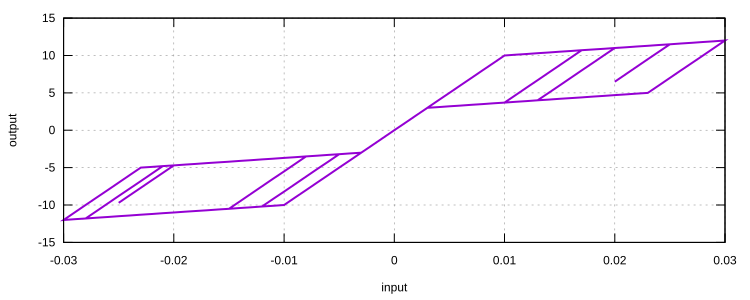
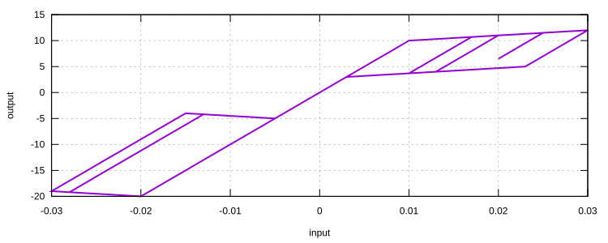

# Flag

Symmetric/Asymmetric Flag

Some self-centering and rocking systems show flag-shaped hysteresis behavior.
The `Flag01` model defines a symmetric flag-shaped hysteresis rule.
The `Flag02` model is an extension of the `Flag01` model and defines an asymmetric flag-shaped hysteresis rule.

More flexible flag-shaped hysteresis behavior can be achieved by combining a multilinear elastic model with, for example, a bilinear hardening model.

## Theory

The flag-shaped rule reproduces the narrow loop of post-tensioned, rocking or self-centering systems.
On first loading the stress follows $$\sigma=E\varepsilon$$ up to the yield strain $$\varepsilon_y=\sigma_y/E$$, after which the post-yield slope is $$E_h=\eta E$$.
At a reversal the response unloads with the initial modulus $$E$$ until the stress reaches the residual value $$\sigma_r$$, which may be positive, zero or negative.
The branch between this residual stress and the opposite yield point uses the reduced slope $$E_h$$, producing the two slender flaps of the flag.
A positive residual stress gives a wide flag and significant energy dissipation, while a negative residual stress increases the self-centering tendency and reduces the residual deformation.
The symmetric `Flag01` form sets the compression yield and residual stresses to the negatives of the tension values and uses the same hardening ratio in both directions.
The four history variables record the tension and compression reversal strains and the strains where the low-stress branches begin.

!!! info "deviation from theory"
    The symmetric `Flag01` form fixes the compression yield and residual stresses to the negatives of the tension values and reuses the same hardening ratio.
    Different tension and compression hardening ratios require the asymmetric `Flag02` form.

## Syntax

```text title="Flag"
material Flag01 (1) (2) (3) (4) [5] [6]
# (1) int, unique material tag
# (2) double, elastic modulus
# (3) double, yield stress, positive
# (4) double, residual stress, can be either positive or negative
# [5] double, hardening ratio, default: 0.0
# [6] double, density, default: 0.0

material Flag02 (1) (2) (3) (4) (5) (6) (7) (8) [9]
# (1) int, unique material tag
# (2) double, elastic modulus
# (3) double, tension yield stress, positive
# (4) double, tension residual stress, can be either positive or negative
# (5) double, tension hardening ratio
# (6) double, compression yield stress, negative
# (7) double, compression residual stress, can be either positive or negative
# (8) double, compression hardening ratio
# [9] double, density, default: 0.0
```

## History Variable Layout

| location             | value                          |
|----------------------|--------------------------------|
| `initial_history(0)` | tension_reverse_strain         |
| `initial_history(1)` | tension_reverse_low_strain     |
| `initial_history(2)` | compression_reverse_strain     |
| `initial_history(3)` | compression_reverse_low_strain |

## Remarks

1. `Flag01` is a wrapper of `Flag02`.
2. If `Flag01` is used, the compression yield stress and residual stress would be `-(3)` and `-(4)` so that the response would be symmetric.
3. The yield stresses are converted to absolute values, but the residual stresses keep their sign so that the self-centering can be tuned.
4. The hardening arguments are ratios that multiply the elastic modulus.
5. When `Flag02` is used, the compression yield stress should be entered as a negative value as shown in the example.
6. Use the model with one-dimensional truss or beam elements for self-centering braces, rocking piers or flag-shaped connections.

## Usage

```
material Flag01 1 1000 10 3 .1
materialTest1D 1 1E-3 20 2 7 5 10 20 10 50 10 5 20 10 12 25 40
exit
```



```
material Flag02 1 1000 10 3 .1 -20 -5 -.1
materialTest1D 1 1E-3 20 2 7 5 10 20 10 50 10 5 20 10 12 25 40
exit
```


