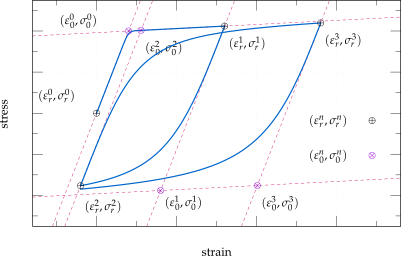
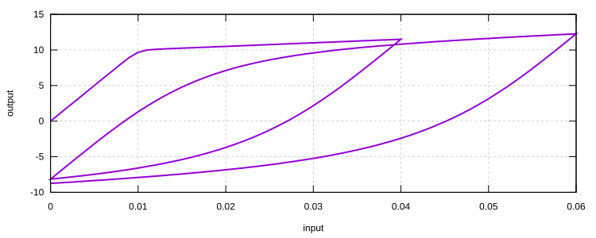

# MPF

Menegotto-Pinto-Filippou Steel Model

## Syntax

```text title="MPF"
material MPF (1) (2) (3) [4] [5] [6] [7] [8] [9] [10] [11] [12]
# (1) int, unique material tag
# (2) double, elastic modulus
# (3) double, initial yield stress
# [4] double, hardening ratio, default: 0.05
# [5] double, R0, default: 20.0
# [6] double, A1, default: 18.5
# [7] double, A2, default: 0.15
# [8] double, A3, default: 0.01
# [9] double, A4, default: 7.0
# [10] bool string, isotropic hardening switch, default: false
# [11] bool string, constant radius switch, default: false
# [12] double, density, default: 0.0
```

## History Variable Layout

| location                | value                        |
|-------------------------|------------------------------|
| `initialize_history(0)` | reverse_stress               |
| `initialize_history(1)` | reverse_strain               |
| `initialize_history(2)` | intermediate_stress          |
| `initialize_history(3)` | intermediate_strain          |
| `initialize_history(4)` | previous_intermediate_strain |
| `initialize_history(5)` | max_strain                   |
| `initialize_history(6)` | load_sign                    |

## Theory

The strain-stress relationship can be expressed as

$$
\sigma_n=b\varepsilon_n+\dfrac{\varepsilon_n-b\varepsilon_n}{\sqrt[R]{1+\varepsilon_n^R}},
$$

with the normalized stress $$\sigma_n$$ and strain $$\varepsilon_n$$, and parameter $$R$$ that controls curvature, defined as

$$
\sigma_n=\dfrac{\sigma-\sigma_r}{\sigma_0-\sigma_r},\quad\varepsilon_n=\dfrac{\varepsilon-\varepsilon_r}{\varepsilon_0-\varepsilon_r},\quad{}R=R_0-\dfrac{a_1\xi}{a_2+\xi},\quad\xi^n=\dfrac{\left|\varepsilon_r^{n}-\varepsilon_0^{n-1}\right|}{\varepsilon_{y,0}},\qquad(n>1).
$$

The other parameters are: $$b$$ controls hardening, $$\sigma_y=\sigma_0^0$$ and $$\varepsilon_y=\varepsilon_0^0$$ are the initial yielding stress and strain so that $$E=\sigma_y/\varepsilon_y$$ defines Young's modulus, and three dimensionless parameters with recommended values $$R_0=20$$, $$a_1=18.5$$ and $$a_2=0.15$$.
The parameter $$\xi$$ controls the Bauschinger effect.
It can be set to zero so that $$R=R_0$$ remains unchanged for the whole loading history.
As a result, the corresponding response resembles the one of a bilinear hardening material.
The parameters $$a_3$$ and $$a_4$$ control isotropic hardening, thus are only used when isotropic hardening is activated.



The governing equation defines a smooth transition curve that asymptotically approaches a limit (linear hardening bound) controlled by the height (reference stress magnitude) and the corresponding hardening ratio.

In the implementation the transition is written in normalised form relative to the last reversal point $$(\varepsilon_r,\sigma_r)$$ and the asymptote point $$(\varepsilon_i,\sigma_i)$$.
With $$b$$ the hardening ratio, the trial stress is

$$
\sigma=\sigma_r+\left(b+(1-b)\left(1+\varepsilon_n^{R}\right)^{-1/R}\right)\varepsilon_n\left(\sigma_i-\sigma_r\right),\qquad
\varepsilon_n=\dfrac{\varepsilon-\varepsilon_r}{\varepsilon_i-\varepsilon_r}.
$$

The radius decreases with the excursion measure $$\xi=|\varepsilon_r-\varepsilon_{i,\mathrm{prev}}|/\varepsilon_{y,0}$$ according to $$R=R_0-A_1\xi/(A_2+\xi)$$, which produces the Bauschinger effect.
When isotropic hardening is enabled, the asymptote stress is shifted by $$\max\left(0,A_3\sigma_y(|\varepsilon|_{\max}/\varepsilon_y-A_4)\right)$$, which is Filippou's extension of the original Menegotto-Pinto rule.
The Bauschinger effect can be removed with the constant-radius switch and the isotropic hardening can be removed with the corresponding switch.

!!! info "deviation from theory"
    The normalised strain is floored at `datum::eps` before the transition curve is evaluated.
    This avoids the singularity at the reversal point but replaces the exact curve by a constant value for negative normalised strain.
    The isotropic hardening modification shifts the asymptote stress and does not change the initial yield stress or the elastic branch.

## Remarks

1. The isotropic hardening switch can be turned on to use Filippou's modification.
2. If constant radius switch is on, $$R=R_0=20.0$$ is unchanged.
3. The defaults are $$b=0.05$$, $$R_0=20$$, $$A_1=18.5$$, $$A_2=0.15$$, $$A_3=0.01$$ and $$A_4=7$$, with both switches false.
4. A larger $$R_0$$ gives a sharper knee at a reversal, while a smaller $$R_0$$ gives a rounder transition.
5. The isotropic-hardening switch activates $$A_3$$ and $$A_4$$, whereas the constant-radius switch freezes $$R=R_0$$ and removes the Bauschinger effect.
6. Seven history variables store the reversal point, the asymptote point, the previous asymptote strain, the maximum strain and the load sign.
7. Use the model with one-dimensional truss or beam elements for reinforcing steel, and compare with [SlipLock](SlipLock.md) for a nonlinear elastic stiffening response.

## Example

```
material MPF 1 1000 10
materialTest1D 1 0.001 40 40 60 60
```



## References

- Menegotto, M. and Pinto, P. E. (1973), "Method of analysis for cyclically loaded RC plane frames including changes in geometry and non-elastic behavior of elements under combined normal force and bending", IABSE Symposium, Lisbon.
- Filippou, F. C., Popov, E. P. and Bertero, V. V. (1983), "Effects of bond deterioration on hysteretic behavior of reinforced concrete joints", Report EERC 83-19, University of California, Berkeley.
