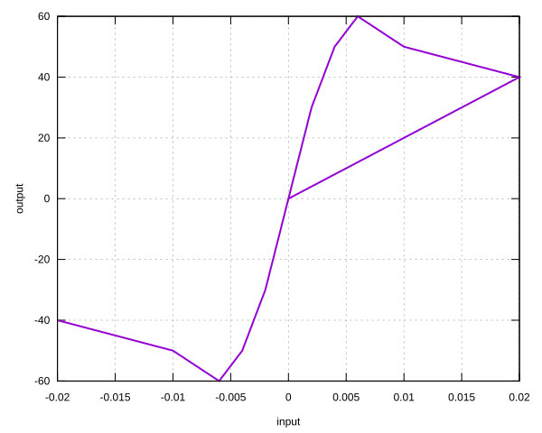

# MultilinearOO

Multilinear Origin Oriented Hysteresis Model

## Theory

The model uses the [SimpleHysteresis](SimpleHysteresis.md) state machine with a piecewise-linear backbone read from two two-column files.
Each row gives a point $$(\varepsilon_i,\sigma_i)$$, and the backbone stress is obtained by linear interpolation with the slope of the active segment as the tangent.
Before the first point the response is a straight line through the origin with slope $$\sigma_1/\varepsilon_1$$.
Beyond the last point the stress is held at the last tabulated value and the tangent drops to a near-zero value.
The origin-oriented rule sets the residual strain to zero after unloading, so the inner branches pass through the origin in the same way as in [BilinearOO](BilinearOO.md).
The parser converts the tension table to positive values and the compression table to negative values, so the files may contain signed or unsigned data.

!!! info "deviation from theory"
    The parser applies the absolute value to the entire tension table and its negative to the entire compression table.
    Any negative tension stress or positive compression stress in the input is silently overwritten.

!!! warning "implementation limitation"
    The backbone is not extrapolated past its last point, where the stress is frozen and the tangent drops to $$10^{-11}$$ in tension and zero in compression.
    Results at strains beyond the table are therefore not a physical constitutive response.

## Syntax

```text title="MultilinearOO"
material MultilinearOO (1) (2) (3) [4]
# (1) int, unique material tag
# (2) string, file name of tension backbone
# (3) string, file name of compression backbone
# [4] double, density, default: 0.0
```

## History Variable Layout

Since it is derived from the [`SimpleHysteresis`](../Hysteresis/SimpleHysteresis.md) model, it shares the same history variable layout.

## Remarks

1. The backbone file must have exactly two columns, storing turning points of the backbone.
2. The origin does not need to be included.
3. Tension backbone shall be positive.
4. Compression backbone shall be negative, positive table will be converted to negative.
5. If strain exceeds the last point, the last stress will be returned.
6. The parser removes the first row when its stress is zero, so an explicit origin point is optional.
7. Strain values in each file must increase in magnitude, because interpolation uses the first column as the abscissa.
8. Beyond the last point the stress stays at the last tabulated value and the tangent drops to effectively zero, so extrapolation is not physical.
9. For an analytic two-segment backbone use [BilinearOO](BilinearOO.md) instead, and for peak-oriented loops use [MultilinearPO](MultilinearPO.md).

## Examples

Backbone is stored in file `Backbone`.

```
.002 30
.004 50
.006 60
.01 50
.02 40
```

```
material MultilinearOO 1 Backbone Backbone
materialTest1D 1 1E-4 200 400
```


