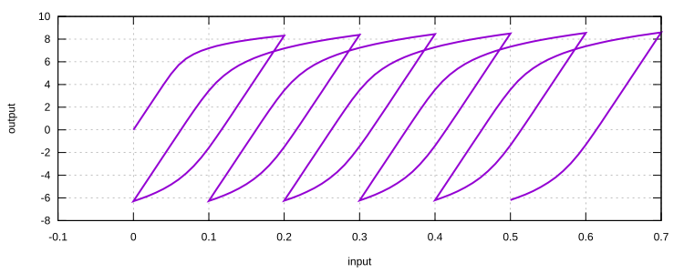
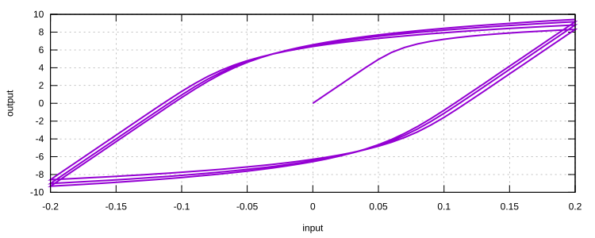
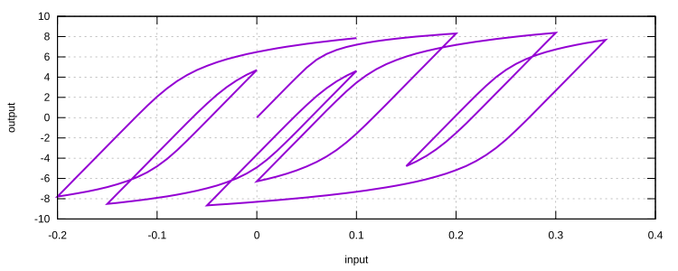

# RambergOsgood

Ramberg-Osgood Steel Model

## Syntax

```text title="RambergOsgood"
material RambergOsgood (1) (2) (3) [4] [5] [6]
# (1) int, unique material tag
# (2) double, elastic modulus
# (3) double, initial yield stress
# [4] double, offset alpha, default: 1.0
# [5] double, n, default: 4.0
# [6] double, density, default: 0.0
```

## History Variable Layout

| location                | value                   |
|-------------------------|-------------------------|
| `initialize_history(0)` | load_sign               |
| `initialize_history(1)` | reverse_strain          |
| `initialize_history(2)` | reverse_stress          |
| `initialize_history(3)` | previous_reverse_strain |
| `initialize_history(4)` | previous_reverse_stress |

## Remarks

1. Local iterations are required to obtain the stress value.
2. The defaults are $$\alpha=1$$ and $$n=4$$, and the elastic modulus, yield stress, offset and exponent are converted to absolute values.
3. The exponent $$n$$ must exceed unity for the plastic strain to vanish at zero stress, and larger values give a sharper knee and a flatter post-yield curve.
4. The offset $$\alpha$$ equals the ratio of plastic to elastic strain at the yield stress, so it sets the permanent strain accumulated on first yielding.
5. Five history variables store the load sign and the current and previous reversal points.
6. Because the stress comes from a local nonlinear solve, use small enough strain increments near reversals to help convergence.
7. For other smooth steel models see [MPF](MPF.md) and [SteelBRB](SteelBRB.md).

## Theory

The Ramberg-Osgood relationship is defined as

$$
\varepsilon=\dfrac{\sigma}{E}+\alpha\dfrac{\sigma}{E}(\dfrac{\sigma}{\sigma_0})^{n-1}
$$

where $$\alpha$$ is the offset and $$n$$ is the material constant that controls hardening.
Noting that $$\varepsilon=\varepsilon_e+\varepsilon_p=\dfrac{\sigma}{E}+\varepsilon_p$$, hence

$$
\dfrac{\sigma}{E}+\varepsilon_p=\dfrac{\sigma}{E}+\alpha\dfrac{\sigma}{E}(\dfrac{\sigma}{\sigma_0})^{n-1}
$$

so

$$
\varepsilon_p=\alpha\dfrac{\sigma}{E}(\dfrac{\sigma}{\sigma_0})^{n-1}.
$$

At the yield stress, viz., $$\sigma=\sigma_0$$, then

$$
\varepsilon_p=\alpha\varepsilon_e.
$$

So the offset $$\alpha$$ indicates the magnitude of plastic strain at yield stress.

The cyclic response uses the difference between current reverse stress and previous reverse stress as "yield stress".

In the cyclic implementation the stress increment is measured from the current reversal point $$(\varepsilon_r,\sigma_r)$$, and the normalising yield stress is the larger of the difference between the current and previous reversal stresses and the initial yield stress.
This gives a Masing-type rule in which each reversal starts a new Ramberg-Osgood branch.
The implicit equation

$$
\Delta\sigma\left(1+\alpha\left(\dfrac{\Delta\sigma}{\bar\sigma_y}\right)^{n-1}\right)=E\Delta\varepsilon
$$

is solved locally by Newton iteration with a tolerance of $$10^{-13}$$.
The consistent tangent returned to the global solver is $$E/\left(1+n\alpha\left(\Delta\sigma/\bar\sigma_y\right)^{n-1}\right)$$.

!!! info "deviation from theory"
    The classical Ramberg-Osgood equation describes a monotonic curve, whereas suanPan extends it to cyclic loading with a Masing rule based on the latest reversal point.
    When the previous reversal stress is small, the normalising yield stress is replaced by the larger of the reversal-stress difference and the initial yield stress.

!!! warning "implementation limitation"
    The local Newton iteration uses a hard-coded tolerance of $$10^{-13}$$ and a maximum of 20 iterations.
    The update returns a failure flag if convergence is not reached within that limit.

## Examples

```
material RambergOsgood 1 100.0 8.0 1 10.0
materialTest1D 1 1E-2 20 20 30 20 30 20 30 20 30 20 30 20
exit
```



```
material RambergOsgood 1 100.0 8.0 1 10.0
materialTest1D 1 1E-2 20 40 40 40 40 40 40
exit
```



```
material RambergOsgood 1 100.0 8.0 1 10.0
materialTest1D 1 1E-2 20 20 30 15 20 40 15 25 15 20 30
exit
```



## References

- Ramberg, W. and Osgood, W. R. (1943), "Description of stress-strain curves by three parameters", National Advisory Committee for Aeronautics, Technical Note No. 902.
