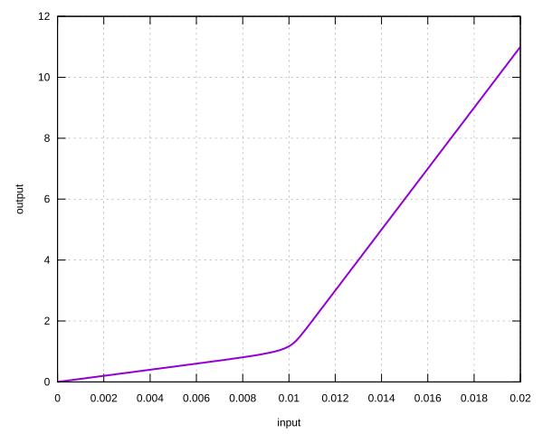

# SlipLock

Slip-Lock Material

This model describes a slip-lock material model.
It is a nonlinear elastic model; the initial stiffness is small, and with increasing strain/displacement, the stiffness becomes larger.
The upper bound can be customized.

## Theory

The model is a nonlinear elastic law of Menegotto-Pinto type, so it stores no plastic strain and retraces the same curve on unloading.
Let $$E$$ be the elastic modulus, $$\sigma_y=E\varepsilon_y$$ the reference stress built from the input yield strain, $$H$$ the hardening argument and $$R$$ the radius.
With $$h=1/H$$ the inverse hardening ratio, the source solves

$$
\varepsilon=\dfrac{\sigma}{E}\left(h+(1-h)\left(1+\Big|\dfrac{\sigma}{\sigma_y}\Big|^{R}\right)^{-1/R}\right)
$$

for the stress by Newton iteration.
The tangent modulus is

$$
E_t=E\,\dfrac{1+\left|\sigma/\sigma_y\right|^{R}}{h\left(1+\left|\sigma/\sigma_y\right|^{R}\right)+(1-h)\left(1+\left|\sigma/\sigma_y\right|^{R}\right)^{-1/R}}.
$$

The tangent grows from $$E$$ at zero stress toward the upper bound $$EH$$ as the stress becomes large, which produces the characteristic slip followed by lock-up.
Because the response is elastic, a complete loading-unloading cycle encloses no area and dissipates no energy.
The trial stress is reset to zero if a Newton update crosses the stress axis.

!!! info "deviation from theory"
    The input hardening argument is inverted, so $$h=1/H$$ and the asymptotic stiffness is $$EH$$ rather than $$hE$$.
    Unlike the [MPF](MPF.md) steel model, this Menegotto-Pinto-type law has no reversal branches and no plastic strain, so it dissipates no energy.

## Syntax

```text title="SlipLock"
material SlipLock (1) (2) (3) [4] [5] [6]
# (1) int, unique material tag
# (2) double, elastic modulus
# (3) double, initial yield strain
# [4] double, hardening ratio, default: 100.0
# [5] double, radius, default: 20.0
# [6] double, density, default: 0
```

## Example

```
material SlipLock 1 100 1E-2 10 10
materialTest1D 1 1E-4 200
```



## Remarks

- The parser defaults are $$H=100$$ and $$R=20$$, so the asymptotic stiffness is 100 times the initial modulus unless a smaller hardening argument is given.
- The hardening argument is a stiffness amplification factor rather than the small post-yield ratio used in [BilinearOO](BilinearOO.md), because the source stores its reciprocal.
- The yield strain is converted to a positive value and combined with $$E$$ to form the reference stress $$\sigma_y$$.
- Local Newton iteration with at most 20 iterations is used, with a stress sign check after each update.
- Use this model where an initially soft response followed by progressive stiffening is wanted, and use [MPF](MPF.md) when a dissipative steel hysteresis is required.

## References

- Method of analysis for cyclically loaded RC plane frames including changes in geometry
