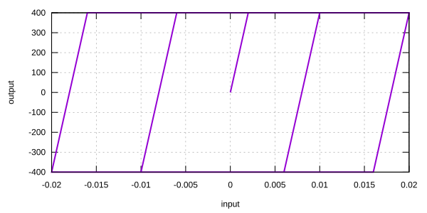
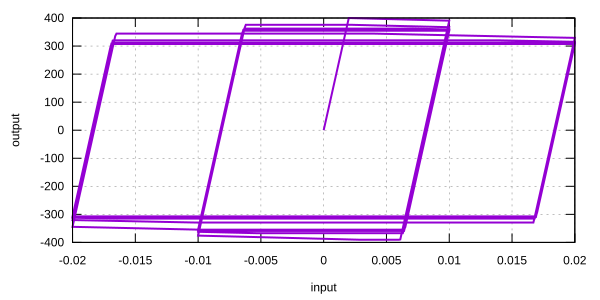

# AFCO1D

This is an extension of the [`ArmstrongFrederick1D`](ArmstrongFrederick1D.md) model.

The name represents the following.

- `AF` --- Armstrong-Frederick type kinematic hardening rule
- `CO` --- Chaboche-Ohno type isotropic hardening reduction rule

## References

1. [1840.20/26854](http://www.lib.ncsu.edu/resolver/1840.20/26854)
2. [10.1016/0013-7944(85)90095-5](https://doi.org/10.1016/0013-7944(85)90095-5)
3. [10.1115/1.3162603](https://doi.org/10.1115/1.3162603)
4. [10.1299/mer.14-00425](https://doi.org/10.1299/mer.14-00425)

## Theory

Compared to [`ArmstrongFrederick1D`](ArmstrongFrederick1D.md), this `AFCO1D` model further adopts the concept of a non-hardening plastic strain region.
It is described by the following surface.

$$
h=|\varepsilon^p-\theta|-r
$$

Here, $$\theta$$ points to the centre of the non-hardening plastic strain region.
It may be called the back plastic strain.
The field $$r$$ describes the size of this surface.
It is further used to introduce a reduction term in the isotropic hardening.

$$
\sigma^y=\sigma^i+Kq+\sigma^s\left(1-e^{-m^sq}\right)-\sigma^r\left(1-e^{-m^rr}\right).
$$

!!! info "deviation from theory"
    In the Chaboche--Ohno non-hardening region concept, plastic strain excursions inside the memory surface suppress further isotropic hardening.
    Here the memory radius instead drives a reduction term that is subtracted from the isotropic radius as it grows.
    The result is cyclic softening tied to the size of the memory region rather than a freeze of isotropic hardening inside it.
    The kinematic back stresses continue to follow the ordinary Armstrong--Frederick rule of [`ArmstrongFrederick1D`](ArmstrongFrederick1D.md).

The memory surface is updated only when the current plastic strain lies outside it.
Defining the overshoot $$\Delta h=|\varepsilon^p-\theta_n|-r_n$$, the update is

$$
r=r_n+c\,\Delta h,\qquad \theta=\theta_n+\operatorname{sign}\left(\varepsilon^p-\theta_n\right)\left(1-c\right)\Delta h,\qquad \Delta h>0.
$$

When $$\Delta h\leqslant0$$ both $$r$$ and $$\theta$$ retain their previous values.

!!! info "deviation from theory"
    Large steps across a strongly growing memory surface should be checked by step refinement.

!!! note "developer note"
    At every Newton iteration the update above is recomputed from the step-committed radius and centre rather than from the values obtained at the previous iteration.
    The memory surface is therefore advanced by a first-order frozen-surface update instead of being integrated together with the plastic multiplier.

The constant $$c\in[0,1]$$ splits the overshoot into growth of the radius and translation of the centre.
Because the reduction term $$-\sigma^r(1-e^{-m^rr})$$ grows with $$r$$, expansion of the memory surface reduces the isotropic radius and produces the cyclic softening seen in the second example below.
The plastic multiplier is still obtained by the implicit Newton iteration described for [`ArmstrongFrederick1D`](ArmstrongFrederick1D.md), with the additional derivative of the reduction term included in the Jacobian.

Further details can be found in the corresponding section in [Constitutive Modelling Cookbook](https://github.com/TLCFEM/constitutive-modelling-cookbook/releases/download/latest/COOKBOOK.pdf).

## Syntax

```text title="AFCO1D"
material AFCO1D (1) (2) (3) (4) (5) (6) (7) (8) (9) [(10) (11)...] [12]
# (1) int, unique material tag
# (2) double, elastic modulus
# (3) double, yield stress, \sigma^i
# (4) double, linear isotropic hardening modulus, K
# (5) double, saturation stress, \sigma^s
# (6) double, m^s, saturation rate
# (7) double, c, between 0 and 1
# (8) double, reduction, \sigma^r
# (9) double, m^r, reduction rate
# (10) double, a, kinematic hardening
# (11) double, b, kinematic hardening
# [12] double, density, default: 0.0
```

## Remarks

`AFCO1D` and [`ArmstrongFrederick1D`](ArmstrongFrederick1D.md) share the same C++ class and differ only in whether the strain-memory branch is active.
The first five numerical inputs are optional and default to $$E=2\times10^5$$, $$\sigma^i=400$$, $$K=0$$, $$\sigma^s=500$$ and $$m^s=10$$.
The next three inputs `(7)`--`(9)` are also optional and default to $$c=0.2$$, $$\sigma^r=500$$ and $$m^r=10$$.
The value of `c` is used directly as a partition factor and should lie between zero and one; values outside this range destroy the geometric meaning of the memory surface.
Setting `reduction` to zero disables the cyclic softening while leaving the memory surface to evolve.
The memory radius and centre are stored in the last two history entries, after the back stresses, the accumulated plastic strain and the signed plastic strain.
For the common case of a fixed saturation bound, choose $$b_i>0$$ so that each Armstrong--Frederick component saturates rather than growing without limit.

## Examples

With a perfectly plastic response, the [`ArmstrongFrederick1D`](ArmstrongFrederick1D.md) presents a non-degrading envelope.

```text
material ArmstrongFrederick1D 1 2E5 4E2 0 0 0
materialTest1D 1 1E-4 100 200 200 200 200 200 200 200 200 200 200 200 200 200 200 300 400 400 400 400 400 400 400 400 400 400 400 400 400 400 400 400 400 400 400
exit
```

The cyclic response is the following.



By introducing the reduction, one can obtain the following.

```text
material AFCO1D 1 2E5 4E2 0 0 0 .2 20. 300.
materialTest1D 1 1E-4 100 200 200 200 200 200 200 200 200 200 200 200 200 200 200 300 400 400 400 400 400 400 400 400 400 400 400 400 400 400 400 400 400 400 400
exit
```


