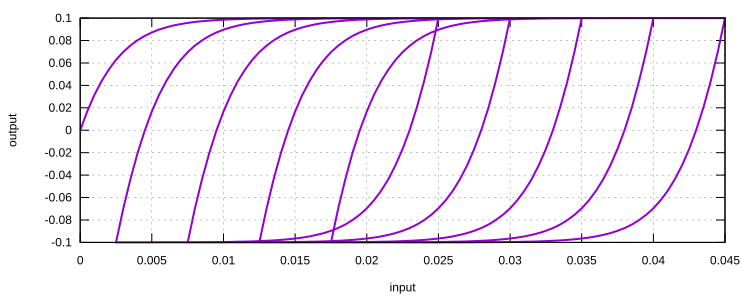
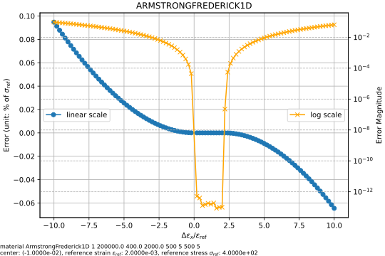

# ArmstrongFrederick1D

1D Armstrong-Frederick Steel Model

This model is a uniaxial version of the [`ArmstrongFrederick`](../../Material3D/vonMises/ArmstrongFrederick.md) steel model.
Readers can also refer to the corresponding section in [Constitutive Modelling Cookbook](https://github.com/TLCFEM/constitutive-modelling-cookbook/releases/download/latest/COOKBOOK.pdf) for details on the theory.

## Theory

A von Mises type yield function is used.
The associated plasticity is assumed.
Both isotropic and kinematic hardening rules are employed.

### Isotropic Hardening

An exponential function is added to the linear hardening law.

$$
\sigma^y=\sigma^i+Kq+\sigma^s(1-e^{-m^sq}),
$$

where $$\sigma^i$$ is the initial elastic limit (yielding stress), $$\sigma^s$$ is the saturation stress, $$K$$ is the linear hardening modulus, $$m^s$$ is a constant that controls the speed of hardening, $$\mathrm{d}q=|\mathrm{d}\varepsilon^p|$$ is the rate of accumulated plastic strain $$q$$.

### Kinematic Hardening

The Armstrong-Frederick type rule is used.
Multiple back stresses are defined,

$$
\beta=\sum\beta_i
$$

in which

$$
\mathrm{d}\beta_i=a_i~\mathrm{d}\varepsilon^p-b_i\beta~\mathrm{d}q,
$$

where $$a_i$$ and $$b_i$$ are material constants.
For $$b_i=0$$ the dynamic recovery vanishes and the $$i$$-th component reduces to linear (Prager) kinematic hardening.
Each component saturates at $$a_i/b_i$$ under monotonic proportional plastic flow, so the total back stress saturates at $$\sum_i a_i/b_i$$.

!!! info "deviation from theory"
    The equation above writes the recovery in terms of the total back stress $\beta$.
    The source instead applies the recovery to each component separately as $b_i\beta_i$, which is the usual Chaboche superposition rule.
    The accumulated plastic strain is $q=|\varepsilon^p|$ in one dimension, so the signed plastic strain and the accumulated plastic strain are distinct history variables.

### Numerical Integration

The plastic multiplier $$\gamma$$ is found by a fully implicit Newton iteration on the consistency residual.
With the elastic predictor $$\sigma^\text{tr}=\sigma_n+E\Delta\varepsilon$$, the trial shifted stress $$\xi=\sigma^\text{tr}-\sum_i\beta_i^n$$ and the sign $$n=\operatorname{sign}\xi$$, each back stress is updated by backward Euler,

$$
\beta_i(\gamma)=\dfrac{\beta_i^n+n\,a_i\gamma}{1+b_i\gamma}.
$$

!!! info "deviation from theory"
    The exact solution of the Armstrong--Frederick equation over a plastic strain increment $\gamma$ is exponential, namely $\beta_i=a_i/b_i+(\beta_i^n-a_i/b_i)e^{-b_i\gamma}$.
    The implementation uses the backward-Euler rational approximation instead.
    For large increments with large $b_i\gamma$ the two differ, so step-size refinement is needed when $b_i$ is large.

The residual solved at each iteration is

$$
F(\gamma)=\left|\sigma^\text{tr}-\sum_i\dfrac{\beta_i^n}{1+b_i\gamma}\right|-\left(E+\sum_i\dfrac{a_i}{1+b_i\gamma}\right)\gamma-k(p_n+\gamma).
$$

For $$n=+1$$ the derivative with respect to $$\gamma$$ is

$$
J=-E-\dfrac{\mathrm{d}k}{\mathrm{d}p}+\sum_i\dfrac{b_i\beta_i(\gamma)-a_i}{\left(1+b_i\gamma\right)^2}.
$$

At convergence the stress is corrected as $$\sigma=\sigma^\text{tr}-En\gamma$$ and the consistent tangent is $$E^{ep}=E+E^2/J$$, with $$J<0$$.
The iteration stops when the correction falls below the tolerance or the residual is sufficiently small, with a limit of 20 iterations.

## Syntax

The following applies to `v3.6` and later.
Check the older syntax in the older version of the documentation.

```text title="ArmstrongFrederick1D"
material ArmstrongFrederick1D (1) (2) (3) (4) (5) (6) [(7) (8)...] [9]
# (1) int, unique material tag
# (2) double, elastic modulus
# (3) double, yield stress, \sigma^i
# (4) double, linear hardening modulus, K
# (5) double, saturation stress, \sigma^s
# (6) double, m^s, saturation rate
# (7) double, a_i, kinematic hardening
# (8) double, b_i, kinematic hardening
# [9] double, density, default: 0.0
```

## Remarks

The first five inputs are optional in the parser and default to $$E=2\times10^5$$, $$\sigma^i=400$$, $$K=0$$, $$\sigma^s=500$$ and $$m^s=10$$.
The kinematic pairs `(7)` and `(8)` are read as many times as provided, with `a_i` first and `b_i` second.
If a trailing odd number is present it is taken as the density, otherwise the density is zero.
The constants $$a_i$$ have units of stress and $$b_i$$ have units of inverse plastic strain.
The dynamic recovery in the backward-Euler update is evaluated component-wise as $$b_i\beta_i$$, which is the standard Chaboche superposition of independent back stresses.
The history layout consists of the $$n$$ back stresses followed by the accumulated plastic strain $$q$$, the signed plastic strain $$\varepsilon^p$$, the memory radius $$r$$ and the memory centre $$\theta$$.
For `ArmstrongFrederick1D` the last three variables stay zero because the strain-memory branch is disabled.
For [`AFCO1D`](AFCO1D.md) the same class is instantiated with the memory branch enabled.
The initial stiffness is $$E$$, and the consistent tangent is used during iteration so quadratic convergence of the global Newton solver is retained.
A vanishing strain increment leaves the history unchanged.

## Example

### Kinematic Hardening Only With No Elastic Range

```
material ArmstrongFrederick1D 1 2E2 0. 0. 0. 0. 50 500.
```

The maximum stress can be computed as

$$
\sigma_{\text{max}}=\sigma^i+\sum\dfrac{a_i}{b_i}=\dfrac{50}{500}=0.1.
$$



## Accuracy

```py
from plugins import ErrorLine
# note: the dependency `ErrorLine` can be found in the following link
# https://github.com/TLCFEM/suanPan-manual/blob/dev/plugins/scripts/ErrorLine.py

young_modulus = 2e5
yield_stress = 4e2
hardening_ratio = 0.01

with ErrorLine(
    f"material ArmstrongFrederick1D 1 {young_modulus} {yield_stress} {hardening_ratio * young_modulus} 500 5 500 5",
    ref_strain=yield_stress / young_modulus,
    ref_stress=yield_stress,
) as error_map:
    error_map.contour("af1d", center=-5, size=10, type={"abs"})
```



## References

1. P. J. Armstrong and C. O. Frederick, A mathematical representation of the multiaxial Bauschinger effect, CEGB Report RD/B/N731, 1966.
2. J. L. Chaboche, Constitutive equations for cyclic plasticity and cyclic viscoplasticity, *International Journal of Plasticity* 5 (1989) 247--301, [doi:10.1016/0749-6419(89)90015-6](https://doi.org/10.1016/0749-6419(89)90015-6).
