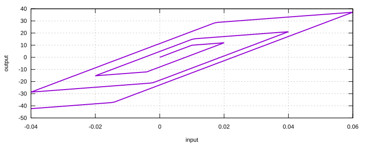
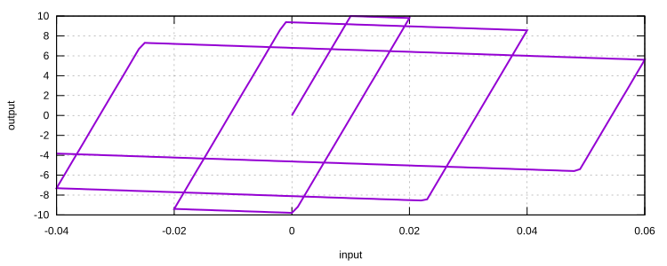
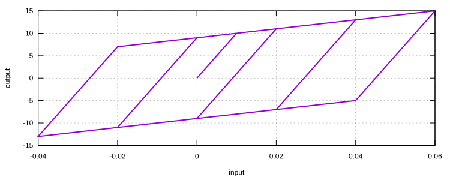
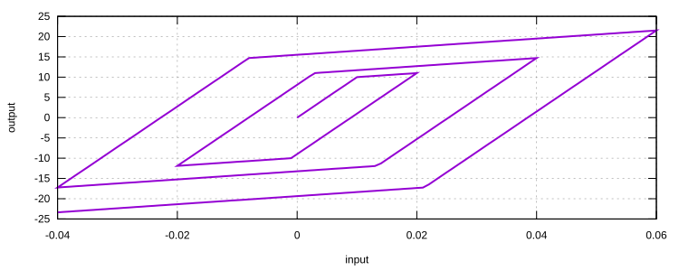
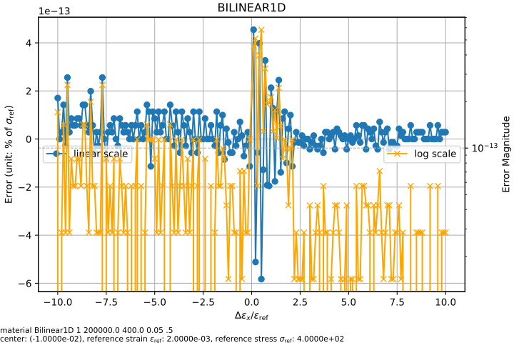

# Bilinear1D

Uniaxial Bilinear Material Using J2 Plasticity

The `Bilinear1D` material implements a simple plasticity model that employs both linear isotropic and kinematic hardening rules.
Further details can be found in Section 1.4.4 of [Computational Inelasticity](https://doi.org/10.1007/b98904).
Alternatively, refer to the corresponding section in [Constitutive Modelling Cookbook](https://github.com/TLCFEM/constitutive-modelling-cookbook/releases/download/latest/COOKBOOK.pdf) for implementation details.

It is suitable for simple hysteresis modelling.
For more complex behaviour, one shall use other models.

## Background

The yield radius depends linearly on the accumulated plastic strain $$p$$, while the back stress $$\alpha$$ moves with the signed plastic strain.

$$
F=\left|\sigma-\alpha\right|-\left(\sigma_{y0}+H_\text{iso}p\right).
$$

The input hardening ratio $$H$$ is the ratio of the post-yield tangent to the elastic modulus.
The isotropic and kinematic moduli are obtained by converting this ratio,

$$
H_\text{iso}=\beta\,E\,\dfrac{H}{1-H},\qquad H_\text{kin}=(1-\beta)\,E\,\dfrac{H}{1-H}.
$$

!!! warning "implementation limitation"
    The parser clamps the mixing factor `beta` to the interval $$[0,1]$$ before the moduli are computed.
    The conversion is singular at $$H=1$$, and the code does not guard against that value.
    Both $$E$$ and the yield stress are replaced by their absolute values, so a negative input cannot encode a sign convention.

Thus the sum $$H_\text{iso}+H_\text{kin}=EH/(1-H)$$ gives a total post-yield stiffness of exactly $$EH$$.
For a purely isotropic case ($$\beta=1$$) the back stress stays zero and the yield surface expands.
For a purely kinematic case ($$\beta=0$$) the yield radius is constant and the surface translates.

The return mapping is performed in closed form for the linear hardening law.
With the elastic predictor $$\sigma^\text{tr}=\sigma_n+E\Delta\varepsilon$$ and the trial shifted stress $$\xi=\sigma^\text{tr}-\alpha_n$$, plastic flow occurs only if $$|\xi|>\max(0,\sigma_{y0}+H_\text{iso}p_n)$$.

$$
\Delta p=\dfrac{|\xi|-\max(0,\sigma_{y0}+H_\text{iso}p_n)}{E+H_\text{kin}+H_\text{iso}}\quad\text{if }\sigma_{y0}+H_\text{iso}p_n>0,
$$

$$
\Delta p=\dfrac{|\xi|}{E+H_\text{kin}}\quad\text{if }\sigma_{y0}+H_\text{iso}p_n\leqslant0.
$$

The isotropic modulus is omitted from the denominator once the untruncated radius has reached zero through softening.

!!! info "deviation from theory"
    The standard linear-hardening return mapping always uses the total plastic modulus in the denominator.
    Here the isotropic contribution is dropped as soon as the untruncated radius becomes non-positive.
    The yield radius itself is clamped to zero, so a strongly softening branch becomes perfectly plastic instead of developing a negative radius.

The stress and the internal variables are updated consistently,

$$
\sigma=\sigma^\text{tr}-E\Delta p\,\operatorname{sign}\xi,\qquad \alpha=\alpha_n+H_\text{kin}\Delta p\,\operatorname{sign}\xi,\qquad p=p_n+\Delta p.
$$

The consistent tangent is $$E^{ep}=E(H_\text{iso}+H_\text{kin})/(E+H_\text{iso}+H_\text{kin})=EH$$ during plastic loading, and $$E^{ep}=E$$ during elastic unloading.

## Syntax

```text title="Bilinear1D"
material Bilinear1D (1) (2) (3) [4] [5] [6]
# (1) int, unique material tag
# (2) double, elastic modulus
# (3) double, initial yield stress
# [4] double, hardening ratio, default: 0.0
# [5] double, beta, default: 1.0
# [6] double, density, default: 0.0
```

## History Variable Layout

| location                | value                     |
|-------------------------|---------------------------|
| `initialize_history(0)` | back_stress               |
| `initialize_history(1)` | equivalent_plastic_strain |

## Remarks

1. The parameter `beta` is employed for the mixed hardening rule: zero $$0.0$$ for kinematic hardening and unity $$1.0$$ for isotropic hardening; anything in the range indicates a mixed hardening response.
2. Negative hardening ratio (softening) is supported.
   However, the yield surface will always be non-negative.
3. The parser clamps `beta` to the interval $$[0,1]$$, so a value outside this range is silently mapped to the nearest bound.
4. Both the elastic modulus and the yield stress are converted to absolute values, so a negative input is not a sign convention for compression.
5. The hardening ratio must be strictly less than unity because the moduli are divided by $$1-H$$; a value equal to unity makes the conversion singular.
6. Softening is realised by a negative hardening ratio and the yield radius is clamped at zero, so the material becomes perfectly plastic once the radius vanishes.
7. Since the hardening is linear, the local return mapping needs no iteration and the consistent tangent is exact for this algorithm.
8. [`BilinearMises1D`](BilinearMises1D.md) gives the same isotropic-only response but uses the [`Mises1D`](Mises1D.md) return-mapping framework instead of a dedicated implementation.
9. Use [`ArmstrongFrederick1D`](ArmstrongFrederick1D.md) when the Bauschinger effect must saturate rather than grow linearly.

## Usage

### Isotropic Hardening

```
material Bilinear1D 1 1000.0 10.0 0.2 1.0
materialTest1D 1 0.001 20 40 60 80 100 100
exit
```



### Isotropic Softening

```
material Bilinear1D 1 1000.0 10.0 -0.02 1.0
materialTest1D 1 0.001 20 40 60 80 100 100
exit
```



### Kinematic Hardening

```
material Bilinear1D 1 1000.0 10.0 0.1 0.0
materialTest1D 1 0.001 20 40 60 80 100 100
exit
```



### Combined Hardening

```
material Bilinear1D 1 1000.0 10.0 0.1 0.5
materialTest1D 1 0.001 20 40 60 80 100 100
exit
```



## Accuracy

There is no local iteration required.
The result is accurate.

```py
from plugins import ErrorLine
# note: the dependency `ErrorLine` can be found in the following link
# https://github.com/TLCFEM/suanPan-manual/blob/dev/plugins/scripts/ErrorLine.py

young_modulus = 2e5
yield_stress = 4e2
hardening_ratio = 0.05

with ErrorLine(
    f"material Bilinear1D 1 {young_modulus} {yield_stress} {hardening_ratio} .5",
    ref_strain=yield_stress / young_modulus,
    ref_stress=yield_stress,
) as error_map:
    error_map.contour("bilinear1d", center=-5, size=10, type={"abs"})
```



## References

1. [ISBN 978-0-387-97520-7](https://search.worldcat.org/search?q=bn:9780387975207)
