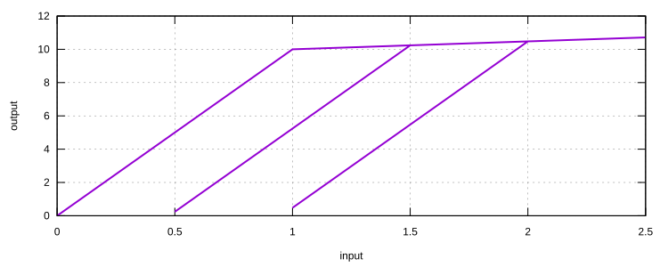
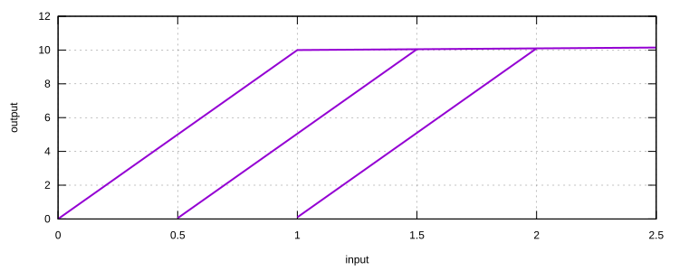

# CustomMises1D

J2 Plasticity Model With Custom Hardening

## Theory

This model is an implementation of the [`Mises1D`](Mises1D.md) abstract model.

The isotropic function supplies the yield radius $$k(p)$$ and the kinematic function supplies the magnitude $$h(p)$$ of the back stress, with $$p$$ the accumulated plastic strain.
The base class calls both the value and the derivative of each function through the expression interface,

$$
k(p)=f_k(p),\quad \dfrac{\mathrm{d}k}{\mathrm{d}p}=f_k'(p),\qquad h(p)=f_h(p),\quad \dfrac{\mathrm{d}h}{\mathrm{d}p}=f_h'(p).
$$

These four quantities enter the return mapping and the consistent tangent exactly as described in [`Mises1D`](Mises1D.md).

!!! warning "implementation limitation"
    Both expressions must have exactly one input and one output, and the kinematic expression must evaluate to zero at zero plastic strain.
    The expression class must implement `gradient()`, since the base class calls it instead of approximating the derivative itself.
    The kinematic function is still a prescribed function of the accumulated plastic strain, not an independently evolving back stress.

## Syntax

```text title="CustomMises1D"
material CustomMises1D (1) (2) (3) (4) [5]
# (1) int, unique material tag
# (2) double, elastic modulus
# (3) int, isotropic hardening expression tag
# (4) int, kinematic hardening expression tag
# [5] double, density, default: 0.0
```

## Usage

Both the isotropic and kinematic hardening functions are provided by [Expression](../../../../Collection/Define/expression.md) objects.

Both hardening functions shall be defined in terms of the equivalent plastic strain.

The isotropic hardening function evaluates to the yield stress for trivial equivalent plastic strain.

***The expressions shall be able to compute derivatives.***

## Example

### Isotropic Hardening

For example, one can define a purely isotropic hardening model as follows:

```
expression SimpleScalar 1 x 10+.5x
expression SimpleScalar 2 x 0

material CustomMises1D 1 10 1 2

materialTest1D 1 1E-2 150 150 200 200 250
```

In the above example, the isotropic hardening function is defined as:

$$
y=10+0.5x,
$$

in which $$x$$ maps to the equivalent plastic strain and $$y$$ maps to the shifted stress.

The kinematic hardening function is defined as:

$$
y=0.
$$

For an elastic modulus of $$E=10$$, the isotropic hardening ratio satisfies:

$$
0.5=E\dfrac{H}{1-H},
$$

solving which yields $$H=0.04762$$.

The last point is $$11.190476190476174$$, then

$$
\dfrac{10.714285714285706-10}{2.5-1}=0.04762E.
$$



### Kinematic Hardening

```text
expression SimpleScalar 1 x 10
expression SimpleScalar 2 x .1x

material CustomMises1D 1 10 1 2
materialTest1D 1 1E-2 150 100 150 100 150
```

In the above example, purely kinematic hardening is defined.

The hardening ratio is $$0.1/(E+0.1)=0.0099$$.

The last point is $$10.074626865671641$$, then

$$
\dfrac{10.148514851485146-10}{2.5-1}=0.0099.
$$



With custom functions, it is possible to define arbitrary hardening rules.

## Remarks

Both expressions must be univariate, with one input and one output.
The kinematic expression must evaluate to zero at zero plastic strain, otherwise initialisation fails with an error message.
The isotropic expression evaluated at zero plastic strain defines the initial yield stress.
The expression objects must implement `gradient()`, since the base class calls it rather than a finite-difference approximation.
Expressions are looked up by tag during `initialize`, so they must be defined before the material is first used.
The returned history layout is the same as that of [`Mises1D`](Mises1D.md), namely accumulated plastic strain followed by back stress.
Smooth functions are strongly preferred because kinks make the Newton corrector of the base class converge slowly or fail.
For tabulated or piecewise-linear hardening without expression derivatives use [`MultilinearMises1D`](Multilinear1D.md) instead.

## References

1. J. C. Simo and T. J. R. Hughes, *Computational Inelasticity*, Springer, New York, 1998, Section 1.4.4, [doi:10.1007/b98904](https://doi.org/10.1007/b98904).
