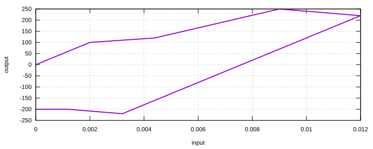

# Multilinear1D

Uniaxial Multilinear Material Using J2 Plasticity

## Background

The isotropic backbone $$k(p)$$ is a piecewise-linear interpolant of the control points $$(\varepsilon_i^p,\sigma_i)$$ supplied on the command line.
On the interval between two adjacent points,

$$
k(p)=\sigma_i+\dfrac{\sigma_{i+1}-\sigma_i}{\varepsilon_{i+1}^p-\varepsilon_i^p}\left(p-\varepsilon_i^p\right),\qquad \varepsilon_i^p\leqslant p\leqslant\varepsilon_{i+1}^p.
$$

The slope is precomputed for every segment at construction time, and the slope of the final segment is forced to zero.
Thus beyond the last control point the yield radius remains at the last tabulated stress, giving a perfectly plastic response.
The kinematic function is identically zero, so the model is the isotropic special case of [`Mises1D`](Mises1D.md).
The derivative $$\mathrm{d}k/\mathrm{d}p$$ is the slope of the active segment, which makes the local Newton corrector of the base class exact on each segment.

!!! warning "implementation limitation"
    The constructor throws an exception unless the first plastic strain is exactly zero and exactly two columns are supplied.
    The slope of the final segment is overwritten with zero, regardless of the last two tabulated points.
    The plastic modulus beyond the last point is therefore zero and the algorithmic tangent vanishes there.

## Syntax

```text title="Multilinear1D"
material MultilinearMises1D (1) (2) (3) ((4) (5)...)
# (1) int, unique material tag
# (2) double, elastic modulus
# (3) double, density
# (4) double, plastic strain of control point
# (5) double, stress of control point
```

## Remarks

1. No kinematic hardening is defined in this model.
2. The stress will be constant after the last point defined.
   This means the yield surface does not change its size after the last point.
   So the stiffness will be singular.
   This may cause instability issues in analysis.
3. The first plastic strain ***must*** be zero.
4. The registered material token is `MultilinearMises1D`, not `Multilinear1D`; the latter is only the file and page name.
5. The density `(3)` is compulsory in the parser, even though it is not used by a quasi-static analysis.
6. Control points must be given in strictly increasing plastic strain order, since the segment search stops at the first point whose strain exceeds $$p$$.
7. The stress of the first control point is the initial yield stress; its value is also the radius of the initial yield surface.
8. The zero slope assigned to the last segment means the consistent tangent drops to zero outside the tabulated range, which is the source of the singularity noted above.
9. Smooth hardening data can be supplied to [`CustomMises1D`](CustomMises1D.md) if a differentiable expression is available.

!!! warning "implementation limitation"
    Using `Multilinear1D` as a material token does not select this model.
    The parser forwards unknown tokens to the external-module hook, so the command fails at material creation.

## Usage

```
material MultilinearMises1D 1 50000 1. 0. 100 2E-3 120 4E-3 250 1E-2 200
materialTest1D 1 1E-4 120 120
exit
```

The above command defines the backbone using the following data.

| plastic strain | stress |
|----------------|--------|
| 0E0            | 100    |
| 2E-3           | 120    |
| 4E-3           | 250    |
| 1E-2           | 200    |
|                | 200    |

### Examples



## References

1. J. C. Simo and T. J. R. Hughes, *Computational Inelasticity*, Springer, New York, 1998, Section 1.4.4, [doi:10.1007/b98904](https://doi.org/10.1007/b98904).
